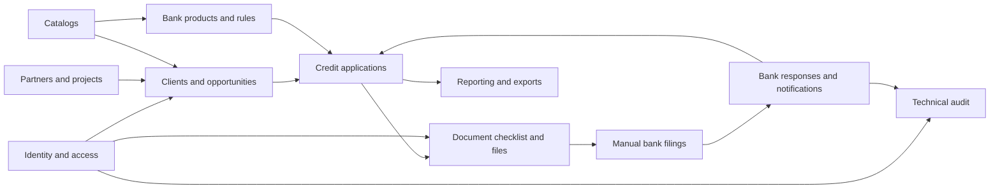

# Real Estate Credit Backoffice — Backend

[](https://github.com/CarlosDev88/real-estate-credit-backoffice/actions/workflows/backend.yml)

Backend for an MVP that manages Colombian real-estate credit applications. It supports the internal operations backoffice and a buyer self-service portal: clients, opportunities, credit applications, documents, manual bank filings, and application tracking.

The API is implemented as a modular monolith with Django REST Framework and PostgreSQL. Functional, data, and API specifications are available in the root [`docs`](../docs/) directory.

## Technology Stack

- Python 3.11, Django 5.2, and Django REST Framework.
- PostgreSQL 16.
- Docker Compose for the local development environment.
- OpenAPI 3.1 and Swagger UI through `drf-spectacular`.
- Redis for shared cache and rate limiting (always on); Celery prepared for asynchronous work (opt-in).
- Pytest, Ruff, and MyPy for testing and code quality.

## Data Flow and Database Domains

The database contains 55 domain, configuration, security, and platform tables. The diagram below presents the main flow; each box represents a connected business area, not a single table.



## Backend Modules

| Module | Purpose | Main relationships |
| --- | --- | --- |
| `identity` | Internal users, roles, permissions, internal sessions, invitations, buyer magic links, and consent records. | Authorizes all other modules; buyer access is tied to clients and applications. |
| `catalogs` | Configurable business catalogs and reusable workflow transitions. | Provides options such as cities, purposes, reasons, and priorities to other modules. |
| `partners` | Construction partners, memberships, and real-estate projects. | Projects can be linked to CRM opportunities and application properties. |
| `crm` | Clients, addresses, opportunities, assignments, tasks, and business activity. | An opportunity belongs to a client and can become one or more credit applications. |
| `banking` | Banks, bank products, allowed purposes, and operational bank rules. | Applications select a product; document requirements use the bank-product context. |
| `applications` | Credit applications, participants, finances, income, property, financing preferences, assignments, and status history. | Central business record connecting CRM, banking, documents, and filings. |
| `documents` | Document types and requirements, checklist slots, private file versions, reviews, and ZIP package jobs. | Builds the application checklist and provides the evidence used in bank filings. |
| `filings` | Manual bank filings, immutable document snapshots, bank responses, and correction observations. | Uses application and document data; produces outcomes that notify buyers. |
| `notifications` | In-app notifications, delivery attempts, idempotency records, and outbox events. | Communicates application and filing events reliably. |
| `reporting` | Dashboards, operational reports, and export jobs. | Reads authorized data from CRM, applications, filings, and documents. |
| `audit` | Immutable technical audit events and request correlation. | Records sensitive actions performed across all modules. |

The complete table ownership, dependencies, and build order are documented in [the complete ERD](../docs/DER_COMPLETO_MVP_CREDITO.md#15-distribución-de-tablas-por-módulo-y-orden-de-construcción).

## Quick Start

### Prerequisites

- Docker Desktop running.
- Git.

You do not need to create or activate a local Python virtual environment. Python and project dependencies run inside the `backend` container.

### Environment Configuration

`.env` contains local-development values and must never be committed. Recreate it from the example file when needed:

```powershell
Copy-Item .env.example .env
```

### Start the Environment

From this directory (`backend`):

```powershell
docker compose up --build
```

To run services in the background:

```powershell
docker compose up -d --build
```

Default services:

| Service | Local address | Purpose |
| --- | --- | --- |
| Django backend | http://localhost:8000 | API and documentation. |
| PostgreSQL | `localhost:5433` | Local development database. |
| Redis | internal only | Shared cache used by authentication rate limits. |

Useful endpoints:

- [Health](http://localhost:8000/health): confirms that the HTTP process is running.
- [Ready](http://localhost:8000/ready): confirms that Django can connect to PostgreSQL.
- [OpenAPI schema](http://localhost:8000/openapi.json): API contract.
- [Swagger UI](http://localhost:8000/docs): interactive local API documentation.

## Common Commands

Run all commands from the `backend` directory.

```powershell
# Inspect service status and logs
docker compose ps
docker compose logs -f backend

# Stop services without deleting data
docker compose down

# Create and apply database migrations
docker compose exec -T backend python manage.py makemigrations
docker compose exec -T backend python manage.py migrate

# Validate Django configuration and migrations
docker compose exec -T backend python manage.py check
docker compose exec -T backend python manage.py showmigrations

# Run quality checks and tests
docker compose exec -T backend ruff check .
docker compose exec -T backend ruff format .
docker compose exec -T backend mypy config apps
docker compose exec -T backend pytest
```

Tests use `config.settings.test` (forced through `--ds` in `pytest.ini`): in-memory cache, a fast password hasher, and an isolated test database.

To start the Celery worker when asynchronous features are being built:

```powershell
docker compose --profile async up -d
```

## Internal Authentication

Internal users (admin, advisors, brokers, and partner users) authenticate with email and password. The API never returns tokens in the body; it sets cookies:

| Cookie | Content | Lifetime |
| --- | --- | --- |
| `__Host-app_access` | Signed JWT (HS256) with `iss`, `aud`, `exp`, `nbf`, `jti`, and the session id (`sid`). | 15 minutes |
| `__Host-app_refresh` | Opaque, single-use, rotating refresh token. Only its SHA-256 hash is stored in `auth_sessions`. | 8 hours from login (rotation does not extend it) |
| `app_csrf` | CSRF token, readable by the frontend. | Rotated on every login |

In local development (`AUTH_COOKIE_SECURE=false`, plain HTTP) the cookie names drop the `__Host-` prefix, because browsers reject it without `Secure`.

| Method | Route | Notes |
| --- | --- | --- |
| `POST` | `/api/v1/auth/login` | 5 attempts per email + IP every 15 minutes. |
| `POST` | `/api/v1/auth/refresh` | Rotates the refresh token. Reusing a rotated token revokes the whole session chain. |
| `POST` | `/api/v1/auth/logout` | `204`; revokes the current session. Idempotent. |
| `GET` | `/api/v1/auth/me` | Profile, role, permissions, and scope. Source of truth for the frontend. |
| `POST` | `/api/v1/auth/password-reset-requests` | Always `202`, whether or not the email exists. 3 per email + IP per hour. |
| `POST` | `/api/v1/auth/password-resets/confirm` | Single-use token valid for 30 minutes; revokes every session. |
| `POST` | `/api/v1/auth/change-password` | Requires the current password; revokes the other sessions. |

Frontend integration rules:

- Send requests with `credentials: "include"`.
- On every `POST`, `PUT`, `PATCH`, or `DELETE`, send the `X-CSRFToken` header with the value of the `app_csrf` cookie.
- On a `401 SESSION_EXPIRED`, call `/auth/refresh` once and retry. Serialize refresh calls (one at a time across tabs): two concurrent refreshes with the same token look like token theft and close the session.
- Revoking a session or deactivating a user cuts access immediately: every request checks that the JWT session is still active.

## Users and Roles

| Method | Route | Permission |
| --- | --- | --- |
| `GET`, `POST` | `/api/v1/users` | `users.read`, `users.create`. Filters: `role`, `status` (`PENDING`, `ACTIVE`, `INACTIVE`), `search`. |
| `GET`, `PATCH` | `/api/v1/users/{id}` | `users.read`, `users.update` (name and phone; the email cannot change). |
| `POST` | `/api/v1/users/{id}/activate` (optional reason), `/deactivate` (reason required) | `users.manage_status` |
| `PUT` | `/api/v1/users/{id}/roles` | `roles.assign`. `{role_codes, partner_id}` replaces every role. |
| `GET` | `/api/v1/roles` | `roles.read`. Roles with their permissions. |

- `POST /users` takes `{email, first_name, last_name, phone, role_codes, partner_id, send_invitation}`. The user is `PENDING` (no password) until they accept the invitation, which is sent right away unless `send_invitation` is `false`.
- `CONSTRUCTION_PARTNER` cannot be combined with other roles and requires a partner: creating the user or assigning that role with `partner_id` creates the membership; removing the role ends it.
- Deactivating a user revokes their sessions and pending invitations immediately.
- Admins cannot deactivate themselves or remove their own `ADMIN` role.
- Buyers are not internal users and are never created here.

## Internal Invitations

Internal users join through a single-use invitation sent by email; they set their own password.

| Method | Route | Permission |
| --- | --- | --- |
| `GET` | `/api/v1/invitations` | `invitations.read`. Filters: `email`, `role`, `status` (`PENDING`, `ACCEPTED`, `REVOKED`, `EXPIRED`), `partner_id`. |
| `POST` | `/api/v1/invitations` | `invitations.create`. `{email, role, partner_id}`; `partner_id` is required only for `CONSTRUCTION_PARTNER`. |
| `POST` | `/api/v1/invitations/{id}/resend` | `invitations.create`. Revokes the old token and sends a new invitation. |
| `DELETE` | `/api/v1/invitations/{id}` | `invitations.revoke` |
| `POST` | `/api/v1/invitations/accept` | Public, 10 attempts per IP every 15 minutes. `{token, password, password_confirmation, first_name, last_name}`. |
| `POST` | `/api/v1/partners/{id}/members` with `email` | `partner_members.create`. Invites a new partner user; the membership is created on acceptance. |

- The invitation lasts 72 hours (`AUTH_INVITATION_HOURS`) and only its SHA-256 hash is stored.
- Accepting creates the user, or links an existing user that never had a password (names are then optional), assigns the role, and creates the partner membership when applicable.
- An email that already belongs to an account with a password cannot be invited or accepted, so an invitation can never take over an existing account. Only one pending invitation per email is allowed.
- Accepting does not log the user in; the frontend then calls `POST /auth/login`.

## Catalogs and Workflow

The frontend never hard-codes business lists: it reads them from the API.

| Method | Route | Permission |
| --- | --- | --- |
| `GET` | `/api/v1/metadata/bootstrap` | Any internal user. Small catalogs, permissions, features, and `metadata_version`. Supports `If-None-Match` (`304`). |
| `GET` | `/api/v1/metadata/catalogs/{code}` | Any internal user. Active, currently valid items; filter with `parent_code` or `parent_id`. Supports `If-None-Match`. |
| `GET`, `POST` | `/api/v1/catalogs` | `catalogs.read`, `catalogs.create` |
| `GET`, `PATCH` | `/api/v1/catalogs/{id}` | `catalogs.read`, `catalogs.update` |
| `GET`, `POST` | `/api/v1/catalogs/{id}/items` | `catalogs.read`, `catalogs.create` |
| `PUT` | `/api/v1/catalogs/{id}/items/order` | `catalogs.update` |
| `GET`, `PATCH` | `/api/v1/catalog-items/{id}` | `catalogs.read`, `catalogs.update` |
| `POST` | `/api/v1/catalog-items/{id}/activate`, `/deactivate` | `catalogs.update` |
| `GET`, `POST` | `/api/v1/workflow-transitions` | `workflow.read`, `workflow.create` |
| `GET`, `PATCH` | `/api/v1/workflow-transitions/{id}` | `workflow.read`, `workflow.update` (inactive only) |
| `POST` | `/api/v1/workflow-transitions/{id}/activate`, `/deactivate` | `workflow.publish` |

Rules:

- Codes are stable: they cannot be renamed or deleted. Items are deactivated instead, so historical records keep their label.
- Every change to a catalog or its items increases `catalogs.version`; the metadata endpoints use it for caching.
- Catalogs with `is_manageable = false` (structural status labels and bank response types) are read-only through the API.
- Structural statuses for each flow are backend constants (`apps/catalogs/workflow.py`). A transition can only connect statuses of its own flow and can only use a guard implemented by the backend. Transitions are created inactive.
- Other modules reference catalog items with `CatalogItemCodeField(catalog_code="...")`, which rejects codes from another catalog and inactive or expired items.

Seed data (`catalogs/0002`) only contains values defined in the specifications plus Colombian standards: DANE departments and their capitals, and identity document types. The full DIVIPOLA municipality list must be imported separately. Every other catalog is created by the module that uses it.

## Partners and Projects

| Method | Route | Permission |
| --- | --- | --- |
| `GET`, `POST` | `/api/v1/partners` | `partners.read`, `partners.create` |
| `GET`, `PATCH` | `/api/v1/partners/{id}` | `partners.read`, `partners.update` |
| `POST` | `/api/v1/partners/{id}/activate`, `/deactivate` (reason required) | `partners.manage_status` |
| `GET`, `POST` | `/api/v1/partners/{id}/members` | `partner_members.read`, `partner_members.create` |
| `GET`, `PATCH`, `DELETE` | `/api/v1/partner-memberships/{id}` | `partner_members.read`, `.update`, `.remove` |
| `GET`, `POST` | `/api/v1/projects` | `projects.read`, `projects.create` |
| `GET`, `PATCH` | `/api/v1/projects/{id}` | `projects.read`, `projects.update` |
| `POST` | `/api/v1/projects/{id}/submit` | `projects.submit` |
| `POST` | `/api/v1/projects/{id}/activate`, `/reject` (reason required) | `projects.approve` |
| `POST` | `/api/v1/projects/{id}/archive` (reason required) | `projects.archive` |

Access scope, computed on the server for every request:

| Role | Partners | Memberships | Projects |
| --- | --- | --- | --- |
| `ADMIN` | All | All | All |
| `ADVISOR` | All (read) | — | All; approves and corrects |
| `CONSTRUCTION_PARTNER` | Own partner only | Own membership only | Own partner; edits only in `DRAFT` |
| `INDEPENDENT_BROKER` | — | — | `ACTIVE` projects of active partners (read) |

- A partner user's partner comes from their active membership; a `partner_id` sent by the client is ignored. Out-of-scope resources return `404`.
- A user has at most one active membership. Ending a membership keeps it as history.
- The partner `tax_id` is a NIT with a validated check digit, stored as `900123456-8`.
- Project status changes use the `PROJECT` workflow transitions seeded in `partners/0002`: `DRAFT → PENDING_REVIEW → ACTIVE → ARCHIVED`, `PENDING_REVIEW → DRAFT` (reject), and `DRAFT → ACTIVE` for advisors. The project detail returns `available_actions` for the current user.
- Status changes emit `project_status_changed` and `partner_status_changed` signals with the reason, ready for the activity and audit modules.
- `GET /projects/{id}/summary` will be added with the CRM and applications modules, when there is data to count.

## Credit Applications

The credit application is the central record of the process (API §16 to §18). All endpoints use the `/api/v1` prefix.

| Method | Path | Access |
| --- | --- | --- |
| `GET`, `POST` | `/applications` | `applications.read`, `applications.create`. Filters: `status`, `bank_id`, `product_id`, `purpose`, `advisor_id`, `project_id`, `origin`, `search`, and `ordering`. |
| `GET`, `PATCH` | `/applications/{id}` | `applications.read`, `applications.update`. `?include=participants,financing`. `PATCH` changes only `purpose_code` and `bank_product_id`. |
| `GET` | `/applications/{id}/summary` | `applications.read_summary`. No financial or property data. |
| `POST` | `/applications/{id}/assignments` | `applications.assign` |
| `POST` | `/applications/{id}/status-transitions` | `applications.transition`. `{target_status, reason_code, comment, expected_version}`. |
| `POST` | `/applications/{id}/withdrawals` | `applications.withdraw`. `{reason_code, comment, expected_version}`. |
| `GET` | `/applications/{id}/status-history` | `applications.read_history` |
| `GET` | `/applications/{id}/available-actions` | `applications.read` |
| `GET` | `/applications/{id}/completeness` | `applications.read` |
| `GET`, `POST` | `/applications/{id}/participants` | `applications.read`, `applications.update` |
| `GET`, `PATCH`, `DELETE` | `/application-participants/{id}` | `applications.read`, `applications.update` |
| `GET`, `PUT` | `/application-participants/{id}/financial-profile` | `applications.read`, `applications.update` |
| `GET`, `POST` | `/financial-profiles/{id}/income-sources` | `applications.read`, `applications.update` |
| `PATCH`, `DELETE` | `/income-sources/{id}` | `applications.update` |
| `GET`, `PUT` | `/applications/{id}/property`, `/applications/{id}/financing` | `applications.read`, `applications.update` |
| `GET` | `/applications/{id}/eligible-bank-products` | `applications.read` |
| `POST` | `/applications/{id}/bank-rule-evaluations` | `applications.update` |
| `GET` | `/applications/{id}/bank-rule-evaluations/latest` | `applications.read` |
| `GET` | `/clients/{id}/applications` | `applications.read` |

- Scope: `ADMIN` sees every application and `ADVISOR` the ones assigned to them. `INDEPENDENT_BROKER` only gets the summary of applications from opportunities they originated, and `403` on every sub-resource with application data. `CONSTRUCTION_PARTNER` has no access. Out-of-scope resources return `404`.
- Creating an application converts its opportunity to `CONVERTED` in the same transaction; at most one non-terminal application exists per opportunity.
- Optimistic concurrency: every response carries `ETag: "<version>"`. Every `PUT`/`PATCH` requires `If-Match` (`428` without it, `409 STALE_VERSION` when stale). Status transitions and withdrawals send `expected_version` in the body instead.
- Application data can only change before `FILED` (`409 APPLICATION_NOT_EDITABLE`).
- Bank rules: the evaluation applies the product's published rules plus its amount and term ranges as system blocking rules, and fails closed on missing data. Choosing a product stores an evaluation automatically.
- `READY_TO_FILE` requires a product, a current eligible evaluation (re-evaluated automatically when stale), and approved documents. The document part fails closed until the document file module exists, so the transition returns `422 APPLICATION_NOT_READY` with every reason in `details`.
- Seeded `APPLICATION` transitions cover the pre-filing flow, closing to `CANCELLED`, `OWN_FUNDS`, and `EXTERNAL_CREDIT_APPROVED` (with a required reason), and `WITHDRAWN` from every non-terminal status. Transitions from `FILED` onwards arrive with the filings module.
- Domain events (`application_created`, `application_updated`, `application_assigned`, `application_status_changed`, `participant_added`, `participant_removed`) are sent after commit, ready for the activity, notification, and audit modules.

Every response includes `X-Request-ID` (an incoming value is kept when it is safe). Errors share one format:

```json
{"code": "INVALID_CREDENTIALS", "message": "...", "details": [], "request_id": "..."}
```

## Initial Structure

```text
backend/
├── apps/                 # Django applications organized by domain
│   ├── identity/         # Internal users, roles, permissions, sessions, and auth API
│   ├── catalogs/         # Catalogs, workflow transitions, and frontend metadata
│   └── partners/         # Construction partners, memberships, and projects
├── config/               # Settings, URLs, error format, request id, health, and OpenAPI
├── tests/                # Pytest suite
├── Dockerfile
├── docker-compose.yml
├── requirements.txt
└── pyproject.toml        # Ruff and MyPy configuration
```

## Key Conventions

- Functional endpoints use the `/api/v1` prefix.
- Every endpoint requires an authenticated session unless it explicitly declares `AllowAny`.
- Permission checks use `apps.identity.permissions.HasPermissionCode` with a per-method `required_permissions` map; undeclared methods are denied.
- Lists use the paginated format `{items, page, page_size, total, next, previous}`; `ordering` and filters only accept allow-listed fields.
- Write serializers reject undeclared fields (`config.serializers.StrictSerializer`).
- Models use UUID primary keys.
- COP amounts are stored as integers, never as `float` values.
- Buyers do not have a permanent user account or password; they use magic links and temporary sessions.
- Business catalogs, bank products, and document requirements are backend-managed data, not frontend hard-coded lists.
- Never commit secrets, tokens, or `.env` files.

## Current Status

Build steps 1 to 8 are complete:

1. `identity` core: internal users, roles and permissions, sessions with rotating refresh tokens, password reset, and `/api/v1/auth/*`.
2. `catalogs`: catalogs and items, workflow transitions, and the metadata endpoints.
3. `partners`: construction partners, memberships, and projects with their approval flow.
4. `identity` invitations and user administration: internal invitations, partner member invitations, `/users`, and `/roles`.
5. `crm`: clients, addresses, and opportunities.
6. `banking`: banks, products, and versioned policy rules with a declarative engine.
7. `documents`: document types and requirements.
8. `applications`: credit applications, participants, financial profiles, income sources, property, financing, bank rule evaluations, status transitions, withdrawals, history, available actions, and completeness.

Remaining modules follow the documented build order, starting with buyer access (step 9).
