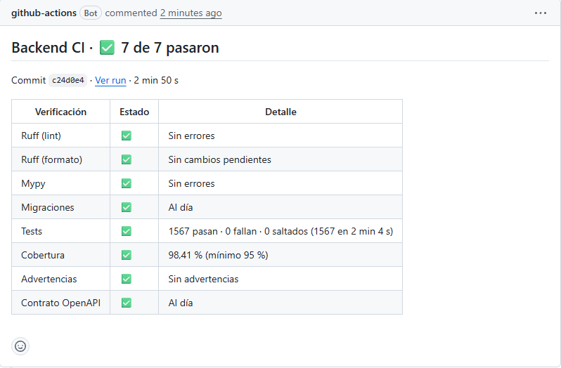

# Real Estate Credit Backoffice

[](https://github.com/CarlosDev88/real-estate-credit-backoffice/actions/workflows/backend.yml)

MVP that manages Colombian real-estate credit applications. It has two faces: an internal operations backoffice and a buyer self-service portal, covering clients, opportunities, credit applications, documents, manual bank filings, and application tracking.

This repository is a monorepo: the Django API, the frontend, the API contract between them, the design system, and the functional documentation live together.

## Repository Structure

```text
/
├── backend/            # Django REST API (modular monolith, PostgreSQL)
├── frontend/           # Next.js app: backoffice and buyer portal
├── contracts/
│   └── openapi.json    # API contract generated by the backend; the frontend generates its types from it
├── design/             # Umbral design system: tokens and approved mockups
├── docs/               # Functional requirements, data model, and API specification
├── specs/              # Implementation tasks with their design decisions
└── .github/workflows/  # CI: backend.yml and frontend.yml, each with a PR report comment
```

## Quick Start

Requirements: Docker Desktop running and Git. No local Python or Node environment is needed to run the project.

```powershell
cd backend
Copy-Item .env.example .env
docker compose up -d --build
```

This starts three containers:

| Container | Address | What it is |
| --- | --- | --- |
| `frontend` | http://localhost:3000 | Next.js app (production build). Open the backoffice here. |
| `backend` | http://localhost:8000 | Django API ([health](http://localhost:8000/health), [Swagger UI](http://localhost:8000/docs)). |
| `postgres` | `localhost:5433` | Database. |

The frontend forwards `/api/v1/*` to the backend, so the browser only talks to `http://localhost:3000` (same origin: no CORS, and the session cookies stay on the frontend origin). To log in, create an internal user first; see [Test User](backend/README.md#test-user).

Two ways to work:

- **Demo:** `docker compose up -d --build` and open http://localhost:3000.
- **Frontend development:** `docker compose up -d postgres backend`, then `pnpm dev` in `frontend/` (the `frontend` container would take port 3000). See [Demo and Frontend Development](backend/README.md#demo-and-frontend-development).

Configuration, services, commands, and module details are in [`backend/README.md`](backend/README.md).

This is the **simple local mode**: the `postgres`, `backend`, and `frontend` containers. Documents are stored on disk, the shared cache lives in PostgreSQL, and antivirus scans and filing packages run in the same process. Migrations are applied on every start. The project has no deployment; everything runs locally.

The real asynchronous architecture (Redis, SeaweedFS, a Celery worker, and ClamAV) is opt-in, with `docker compose --profile full up -d` and the "Full" block of `.env`. See [Local Modes](backend/README.md#local-modes) for both modes and what changes between them.

## API Contract

[`contracts/openapi.json`](contracts/openapi.json) is generated from the backend, and CI fails if it is out of date. Any pull request that changes the API must include the regenerated contract; see [OpenAPI Contract](backend/README.md#openapi-contract) for the command.

## CI

Every pull request runs the backend checks in [`backend.yml`](.github/workflows/backend.yml). The `Lint, types and tests` job is the required check: it fails if any check fails, and pytest warnings never block it. A single comment on the pull request, updated on every push, shows the status of each check and the details of what failed:



[CI Report](backend/README.md#ci-report) explains what each status means and how to preview the report locally.

The frontend has its own workflow, [`frontend.yml`](.github/workflows/frontend.yml), whose required check is `Frontend: lint, types and tests` (ESLint, Prettier, TypeScript, tests with coverage, the generated API types, and the build). It posts its own comment with the same format. It runs on every pull request, and finishes green without checking anything when the pull request does not touch `frontend/`, `contracts/openapi.json`, or `design/generated/`.

## Documentation

- [`backend/README.md`](backend/README.md): backend setup, services, commands, and conventions.
- [`design/README.md`](design/README.md): Umbral design system, tokens, and mockups.
- [`docs/`](docs/): requirements, data model, ERD, PostgreSQL schema, and REST API.
- [`specs/`](specs/): implementation tasks. Older specs keep the paths that were valid when they were written (before the monorepo, backend files lived at the root).
