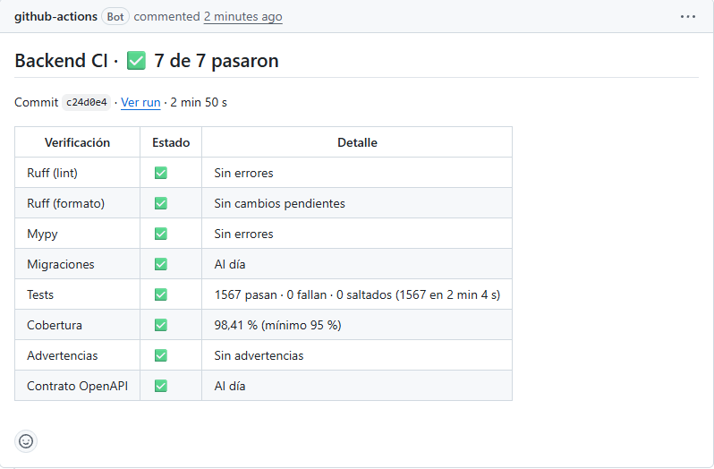

# Real Estate Credit Backoffice

[](https://github.com/CarlosDev88/real-estate-credit-backoffice/actions/workflows/backend.yml)
[](https://github.com/CarlosDev88/real-estate-credit-backoffice/actions/workflows/frontend.yml)

MVP that manages Colombian real-estate credit applications. It has two faces: an internal operations backoffice and a buyer self-service portal, covering clients, opportunities, credit applications, documents, manual bank filings, bank responses, notifications, reports, and commissions.

This repository is a monorepo: the Django API, the frontend, the API contract between them, the design system, and the functional documentation live together.

**Full project guide (in Spanish):** [`docs/guia/00-indice.md`](docs/guia/00-indice.md) — product, business rules, architecture, system design, data model, the 16 modules, flows, frontend, quality, how it was built, and 15 architecture decision records.

## Project Status

> Last updated: November 18, 2026. The project runs locally and in CI; there is no deployment.

### Backend: all 16 modules merged

Django 5.2 + DRF modular monolith on PostgreSQL 16, built in the dependency order of the data model.

| # | Module | What it does | Status |
| ---: | --- | --- | --- |
| 1 | `identity` (core) | Internal users, roles, permissions, JWT sessions in HTTP-only cookies, password reset | ✅ Merged |
| 2 | `catalogs` | Administrable catalogs and workflow transitions per role | ✅ Merged |
| 3 | `partners` | Construction partners, memberships, and projects | ✅ Merged |
| 4 | `identity` (invitations) | Internal invitations, including partner memberships | ✅ Merged |
| 5 | `crm` | Clients, addresses, opportunities, and advisor assignment | ✅ Merged |
| 6 | `banking` | Banks, products, purposes, and bank policy rules | ✅ Merged |
| 7 | `documents` (setup) | Document types and requirements per product and purpose | ✅ Merged |
| 8 | `applications` | Credit applications, participants, financial profile, property, financing, status history | ✅ Merged |
| 9 | `identity` (buyer access) | Expiring single-use magic links, buyer sessions, and consents | ✅ Merged |
| 10 | `documents` (dossier) | Document checklist, uploads with file validation and antivirus, review, signed downloads, filing package | ✅ Merged |
| 11 | `filings` | Manual bank filings, bank responses, returns with per-document observations, evidence | ✅ Merged |
| 12 | `tasks` / `workday` / `activity` | Advisor "My day", manual tasks, activity timeline, and internal notes | ✅ Merged |
| 13 | `notifications` / `idempotency` | Buyer notifications by portal and email with retries; `Idempotency-Key` on critical operations | ✅ Merged |
| 14 | `audit` | Immutable technical audit log (PostgreSQL trigger), admin search, and retention | ✅ Merged |
| 15 | `reporting` | Dashboard, cohort funnel, workload, bank results, applications report, CSV and async exports | ✅ Merged |
| 16 | `commissions` | Commission plans, automatic settlement on disbursement, advisor/broker split, payouts | ✅ Merged |

### Frontend: 18 of the 22 views merged

Next.js 16, Ant Design 6, Tailwind 4, TanStack Query, React Hook Form + Zod, and types generated from the API contract, on the Umbral design system.

| Area | Views | Status |
| --- | --- | --- |
| Base | Login, app shell, role-based navigation, light and dark themes | ✅ Merged |
| Backoffice | Applications list, application workspace (data, documents and review, history), manual filing and bank responses | ✅ Merged |
| Operations | Dashboard, My day (attention tray and tasks), reports with CSV and async exports | ✅ Merged |
| Clients | Clients list, create and edit, client detail with opportunities, create an application from an opportunity | ✅ Merged |
| Buyer portal | Magic-link access, consents, home, personal and financial data, property and financing, documents with mobile upload, notifications | ✅ Merged |
| Design system | Umbral in Storybook: foundations, component library, patterns, usage guide, accessibility checks in CI | ✅ Merged |
| Administration | Users and invitations, partners and projects, banks, products and rules, documents, catalogs and workflow | 🚧 In progress |
| Finance and broker | Commissions, my commissions, broker workspace, opportunity actions, dossier editing | 🚧 In progress |

### Quality

- Every pull request runs two required CI jobs (backend and frontend), each with a report comment on the PR.
- Backend: Ruff, mypy, migrations check, pytest with a 95% coverage minimum, and the OpenAPI contract check.
- Frontend: ESLint, Prettier, TypeScript, Vitest with coverage, generated API types, the build, Storybook, and an accessibility check of every story; Playwright end-to-end tests with axe run locally.
- Four security checks in the backend CI: `pip-audit` (dependencies), `gitleaks` (secrets across the whole history), `bandit` (static analysis), and that the generated access-matrix document matches its test.
- **Security audit (November 2026):** automated scans, dynamic testing against a local copy of the API, a role access matrix that requests every API operation as each of 9 actors (2,124 cases, no access gaps), and a manual review, with about 2,500 security tests in `backend/tests/security/`. Phase A: 20 findings (0 critical, 0 high); phase B: 19 fixed and 1 accepted, plus 1 informational finding from the re-test, also fixed. Report (Spanish): [`docs/SEGURIDAD.md`](docs/SEGURIDAD.md).
- Next: a frontend performance audit (Lighthouse and Web Vitals) and backend load and stress tests, both with their results published.

## Repository Structure

```text
/
├── backend/            # Django REST API (modular monolith, PostgreSQL)
├── frontend/           # Next.js app: backoffice and buyer portal
├── contracts/
│   └── openapi.json    # API contract generated by the backend; the frontend generates its types from it
├── design/             # Umbral design system: tokens and approved mockups
├── docs/               # Project guide (Spanish), ADRs, requirements, data model, and API specification
├── specs/              # Implementation tasks with their design decisions
└── .github/workflows/  # CI: backend.yml and frontend.yml, each with a PR report comment
```

## Quick Start

Requirements: Docker Desktop running and Git. No local Python or Node environment is needed to run the project.

```powershell
cd backend
Copy-Item .env.example .env
docker compose up -d --build
```

This starts three containers:

| Container | Address | What it is |
| --- | --- | --- |
| `frontend` | http://localhost:3000 | Next.js app (production build). Open the backoffice here. |
| `backend` | http://localhost:8000 | Django API ([health](http://localhost:8000/health), [Swagger UI](http://localhost:8000/docs)). |
| `postgres` | `localhost:5433` | Database. |

The frontend forwards `/api/v1/*` to the backend, so the browser only talks to `http://localhost:3000` (same origin: no CORS, and the session cookies stay on the frontend origin).

To try it with sample data, load the demo (local only, requires `DEBUG=True`):

```powershell
docker compose exec backend python manage.py seed_demo_data
```

It creates one demo user per role (`@demo.local`, password `DemoUmbral2026!`) and six months of varied data in every status, and prints the users table and a one-time buyer portal link. It can run again: it only adds what is missing. See [Demo Data](backend/README.md#demo-data); to create your own internal user, see [Test User](backend/README.md#test-user).

Two ways to work:

- **Demo:** `docker compose up -d --build` and open http://localhost:3000.
- **Frontend development:** `docker compose up -d postgres backend`, then `pnpm dev` in `frontend/` (the `frontend` container would take port 3000). See [Demo and Frontend Development](backend/README.md#demo-and-frontend-development).

Configuration, services, commands, and module details are in [`backend/README.md`](backend/README.md).

This is the **simple local mode**: the `postgres`, `backend`, and `frontend` containers. Documents are stored on disk, the shared cache lives in PostgreSQL, and antivirus scans, filing packages, and report exports run in the same process. Migrations are applied on every start.

The real asynchronous architecture (Redis, SeaweedFS, a Celery worker, and ClamAV) is opt-in, with `docker compose --profile full up -d` and the "Full" block of `.env`. See [Local Modes](backend/README.md#local-modes) for both modes and what changes between them.

## API Contract

[`contracts/openapi.json`](contracts/openapi.json) is generated from the backend, and CI fails if it is out of date. Any pull request that changes the API must include the regenerated contract; see [OpenAPI Contract](backend/README.md#openapi-contract) for the command. The frontend regenerates its types from it (`frontend/src/lib/api/schema.d.ts`), and its CI fails if they are out of date too.

## CI

Every pull request runs the backend checks in [`backend.yml`](.github/workflows/backend.yml). The `Lint, types and tests` job is the required check: it fails if any check fails, and pytest warnings never block it. A single comment on the pull request, updated on every push, shows the status of each check and the details of what failed:



[CI Report](backend/README.md#ci-report) explains what each status means and how to preview the report locally.

The frontend has its own workflow, [`frontend.yml`](.github/workflows/frontend.yml), whose required check is `Frontend: lint, types and tests` (ESLint, Prettier, TypeScript, tests with coverage, the generated API types, the build, Storybook, and the Storybook accessibility check). It posts its own comment with the same format.

## Documentation

- [Guía completa del proyecto, en español](docs/guia/00-indice.md): product, business, architecture, system design, data model, modules, flows, frontend, quality, and how it was built.
- [`docs/adr/`](docs/adr/README.md): 15 architecture decision records (context, options, decision, consequences).
- [`docs/SEGURIDAD.md`](docs/SEGURIDAD.md): security audit report — scope, method, threat model, controls, access matrix, and every finding with its status (Spanish).
- [`docs/seguridad/`](docs/seguridad/): detailed results of each audit phase; [`backend/security/README.md`](backend/security/README.md): how to repeat the audit locally.
- [`backend/README.md`](backend/README.md): backend setup, services, commands, and conventions.
- [`frontend/README.md`](frontend/README.md): frontend setup, commands, folders, Storybook, and conventions.
- [`design/README.md`](design/README.md): Umbral design system, tokens, and mockups.
- [`docs/`](docs/): requirements, data model, ERD, PostgreSQL schema, and REST API specification.
- [`specs/`](specs/): implementation tasks with their decisions. Older specs keep the paths that were valid when they were written (before the monorepo, backend files lived at the root).
