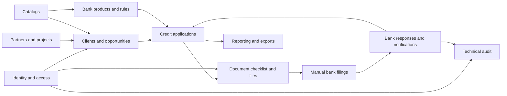

# Real Estate Credit Backoffice — Backend

[](https://github.com/CarlosDev88/real-estate-credit-backoffice/actions/workflows/backend.yml)

Backend for an MVP that manages Colombian real-estate credit applications. It supports the internal operations backoffice and a buyer self-service portal: clients, opportunities, credit applications, documents, manual bank filings, and application tracking.

The API is implemented as a modular monolith with Django REST Framework and PostgreSQL. Functional, data, and API specifications are available in [`docs/`](../docs/), and the implementation specs with every design decision in [`specs/`](../specs/).

## Technology Stack

- Python 3.11, Django 5.2, and Django REST Framework.
- PostgreSQL 16.
- Docker Compose for the local development environment.
- OpenAPI 3.1 and Swagger UI through `drf-spectacular`.
- Two local modes (see [Local Modes](#local-modes)): **simple** by default, with only PostgreSQL and the backend, and **full** (`full` profile), with the real asynchronous architecture.
- Redis for shared cache and rate limiting, and as the Celery broker (full mode; in simple mode the cache lives in PostgreSQL).
- Celery worker and ClamAV for document scanning and filing packages (full mode; in simple mode tasks run in the same process).
- Private document storage: a local folder in simple mode, SeaweedFS (S3-compatible) in full mode, S3 in production.
- Pytest, Ruff, and MyPy for testing and code quality.

## Data Flow and Database Domains

The database contains 55 domain, configuration, security, and platform tables. The diagram below presents the main flow; each box represents a connected business area, not a single table.



## Backend Modules

| Module | Purpose | Main relationships |
| --- | --- | --- |
| `identity` | Internal users, roles, permissions, internal sessions, invitations, buyer magic links, and consent records. | Authorizes all other modules; buyer access is tied to clients and applications. |
| `catalogs` | Configurable business catalogs and reusable workflow transitions. | Provides options such as cities, purposes, reasons, and priorities to other modules. |
| `partners` | Construction partners, memberships, and real-estate projects. | Projects can be linked to CRM opportunities and application properties. |
| `crm` | Clients, addresses, opportunities, assignments, tasks, and business activity. | An opportunity belongs to a client and can become one or more credit applications. |
| `banking` | Banks, bank products, allowed purposes, and operational bank rules. | Applications select a product; document requirements use the bank-product context. |
| `applications` | Credit applications, participants, finances, income, property, financing preferences, assignments, and status history. | Central business record connecting CRM, banking, documents, and filings. |
| `documents` | Document types and requirements, checklist slots, private file versions, reviews, and ZIP package jobs. | Builds the application checklist and provides the evidence used in bank filings. |
| `filings` | Manual bank filings, immutable document snapshots, bank responses, and correction observations. | Uses application and document data; produces outcomes that notify buyers. |
| `notifications` | In-app notifications, delivery attempts, idempotency records, and outbox events. | Communicates application and filing events reliably. |
| `reporting` | Dashboards, operational reports, and export jobs. | Reads authorized data from CRM, applications, filings, and documents. |
| `audit` | Immutable technical audit events and request correlation. | Records sensitive actions performed across all modules. |

The complete table ownership, dependencies, and build order are documented in [the complete ERD](../docs/DER_COMPLETO_MVP_CREDITO.md#15-distribución-de-tablas-por-módulo-y-orden-de-construcción).

## Quick Start

### Prerequisites

- Docker Desktop running.
- Git.

You do not need to create or activate a local Python virtual environment. Python and project dependencies run inside the `backend` container.

### Environment Configuration

`.env` contains local-development values and must never be committed. Recreate it from the example file when needed:

```powershell
Copy-Item .env.example .env
```

### Start the Environment

From this directory (`backend`):

```powershell
docker compose up --build
```

To run services in the background:

```powershell
docker compose up -d --build
```

Default services (simple mode):

| Service | Local address | Purpose |
| --- | --- | --- |
| Django backend | http://localhost:8000 | API and documentation. Applies migrations, creates the cache table, and recalculates the stored completeness of the application list on every start. |
| PostgreSQL | `localhost:5433` | Local development database, also the shared cache used by rate limits. |

Uploaded documents and filing packages are stored in the `mvp_credit_documents_data` volume. Redis, SeaweedFS, the Celery worker, and ClamAV belong to the `full` profile.

### Local Modes

`.env` decides how the backend is configured, and the compose profile decides which containers run. Switching modes always takes both steps.

| | Simple (default) | Full (`full` profile) |
| --- | --- | --- |
| Containers | `postgres`, `backend` | Also `redis`, `seaweedfs`, `storage-init`, `worker`, and `clamav`. |
| Documents | Disk, in the `mvp_credit_documents_data` volume (`DOCUMENT_STORAGE_BACKEND=filesystem`). | SeaweedFS, through the S3 API (`s3`). |
| Downloads | Signed backend URL: `/api/v1/storage/objects/{token}`. | Presigned S3 URL (`http://localhost:8333`). |
| Cache (rate limits) | PostgreSQL table (`CACHE_BACKEND=database`). | Redis (`redis`). |
| Tasks (scans, packages) | Same process, after the commit (`CELERY_TASK_ALWAYS_EAGER=true`). | Celery worker. |
| Antivirus | Fake scanner (`DOCUMENT_SCANNER=fake`). | ClamAV (`clamd`). |

**Simple mode** is the `.env.example` default:

```powershell
docker compose up -d --build
docker compose logs backend
```

The log shows the mode the backend started with: `Servicios locales: almacenamiento=filesystem · caché=database · tareas=inmediatas · antivirus=fake`.

**Full mode:**

1. In `.env`, comment out the "Local simple" block and uncomment the "Full" block.
2. Start with the profile, and check that storage and antivirus answer:

```powershell
docker compose --profile full up -d --build
# ClamAV downloads its signatures on first start; wait until it is "healthy" (several minutes)
docker compose --profile full ps clamav
docker compose exec -T backend python manage.py check_document_services
```

To go back to simple mode, restore the simple block in `.env`, then:

```powershell
docker compose --profile full stop worker clamav redis seaweedfs
docker compose up -d
```

- **When the log does not match the profile,** `.env` and the profile disagree. With the profile but the simple `.env`, the extra containers run and the backend ignores them. With the full `.env` but no profile, uploads and downloads answer `503`.
- **Files do not move between modes.** Each mode keeps its own documents. A download of a file uploaded in the other mode answers `503 DOWNLOAD_UNAVAILABLE` until you switch back. The `mvp_credit_seaweedfs_data` and `mvp_credit_redis_data` volumes are kept for full mode.
- **Inline tasks are meant for the fake scanner.** With `CELERY_TASK_ALWAYS_EAGER=true`, an upload waits for its scan and a package request waits for its ZIP. Retries run back to back, without the usual wait. With `DOCUMENT_SCANNER=clamd` and clamd down, an upload can take several minutes (up to 9 attempts of up to 30 s each). The final state is the same as with the worker: the scan stays `PENDING`, and the package ends `FAILED`. A failed task never breaks the request: it is logged with the file or package id.
- **Nothing connects to Redis in simple mode.** With `CELERY_TASK_ALWAYS_EAGER=true`, Celery uses an in-memory broker and keeps no results. Without it, an empty `REDIS_URL` stops the backend from starting.
- **SeaweedFS needs its keys.** In full mode, `DOCUMENT_STORAGE_ACCESS_KEY_ID` and `DOCUMENT_STORAGE_SECRET_ACCESS_KEY` must be set in `.env`. SeaweedFS refuses to start without them (see [Storage and Antivirus](#storage-and-antivirus)).

Useful endpoints:

- [Health](http://localhost:8000/health): confirms that the HTTP process is running.
- [Ready](http://localhost:8000/ready): confirms that Django can connect to PostgreSQL.
- [OpenAPI schema](http://localhost:8000/openapi.json): API contract.
- [Swagger UI](http://localhost:8000/docs): interactive local API documentation.

## Common Commands

Run all commands from the `backend` directory.

```powershell
# Inspect service status and logs
docker compose ps
docker compose logs -f backend

# Stop services without deleting data
docker compose down

# Create and apply database migrations
docker compose exec -T backend python manage.py makemigrations
docker compose exec -T backend python manage.py migrate

# Validate Django configuration and migrations
docker compose exec -T backend python manage.py check
docker compose exec -T backend python manage.py showmigrations

# Run quality checks and tests
docker compose exec -T backend ruff check .
docker compose exec -T backend ruff format .
docker compose exec -T backend mypy config apps
docker compose exec -T backend pytest
```

Tests use `config.settings.test` (forced through `--ds` in `pytest.ini`): in-memory cache, a fast password hasher, and an isolated test database.

Tests never use SeaweedFS, ClamAV, or Redis: `config.settings.test` uses an in-memory storage, a fake antivirus, and runs Celery tasks in-process (`CELERY_TASK_ALWAYS_EAGER`).

## OpenAPI Contract

The API contract lives in [`contracts/openapi.json`](../contracts/openapi.json) at the repository root, and the frontend generates its types from it. Regenerate it whenever a change touches the API, and commit it in the same pull request:

```powershell
docker compose exec backend python manage.py spectacular --settings config.settings.test --format openapi-json --file /contracts/openapi.json --validate --fail-on-warn
```

- The `backend` service mounts `../contracts` at `/contracts`.
- `--settings config.settings.test` is required: the cookie names in `securitySchemes` depend on the settings (`__Host-` prefix when cookies are `Secure`), and CI generates the contract with the test settings.
- CI regenerates the contract after the tests and fails if it differs from the committed file (`OpenAPI contract is up to date` step).
- In Git Bash, prefix the command with `MSYS_NO_PATHCONV=1`; otherwise Git Bash rewrites `/contracts` as a Windows path.

## CI Report

The `Lint, types and tests` job in [`backend.yml`](../.github/workflows/backend.yml) is the required check for `master`. It runs Ruff (lint and format), Mypy, the migrations check, the tests, coverage (minimum 95 %, set by `CI_COVERAGE_MIN`), and the OpenAPI contract check. Every check runs even when an earlier one fails, so the report shows all the problems at once. The final `CI gate` step fails the job if any check failed or the dependencies could not be installed. Pytest warnings never fail it.

Each check writes its output to `backend/.ci-report/` (ignored by Git), and [`scripts/ci_report.py`](scripts/ci_report.py) turns those outputs into a Markdown report. The script uses only the standard library and never fails the job. The report is published in four places:

- **Pull request comment:** a single comment per pull request, marked `<!-- ci-report:backend -->` and updated on every push. It is posted only for pull requests from branches of this repository.
- **Run summary:** the summary page of the run in Actions shows the same report.
- **Artifact:** `ci-report-backend` keeps `.ci-report/` for 7 days: JUnit, `coverage.xml`, the tool outputs, and the regenerated contract.
- **Annotations:** Ruff and Mypy errors are annotated on their lines in the pull request's "Files changed" tab.

Each row of the report has one of these statuses:

| Status | Meaning |
| --- | --- |
| ✅ | Passed. |
| ⚠️ | Passed with warnings. Only pytest warnings use this status, and they never block. |
| ❌ | Failed. The details are in a collapsible block of up to 50 lines, followed by a link to the full log if there is more. |
| ⏭️ | Did not run, for example because dependency installation failed. |

- **Coverage after failed tests:** coverage runs even when tests fail, as long as there is coverage data. The row then says `con tests fallidos`. The details list the five least-covered modules, excluding migrations.
- **OpenAPI contract:** schema warnings fail the contract check (`--fail-on-warn`). An outdated contract lists the routes and schemas that changed.
- **Pytest warnings:** the `pytest_warning_recorded` hook in `tests/conftest.py` collects them only when `CI_REPORT_DIR` is set, and writes them once at the end of the session.
- **Language:** the report text is in Spanish.

To preview the tests, coverage, and warnings rows locally (checks that are not run show ⏭️):

```powershell
docker compose exec -T -e CI_REPORT_DIR=.ci-report backend sh -c '
  mkdir -p .ci-report
  if pytest -q --cov=apps --cov=scripts --cov-report=xml:.ci-report/coverage.xml --junit-xml=.ci-report/pytest.xml; then t=success; else t=failure; fi
  if python -m coverage report --format=total --precision=2 --fail-under=95; then c=success; else c=failure; fi
  OUTCOME_TESTS=$t OUTCOME_COVERAGE=$c python scripts/ci_report.py
'
```

The report is written to `.ci-report/report.md`.

## Document Dossier

Each application gets a document checklist built from the published document requirements (API §19): one **slot** per expected file, for the application itself (property and legalization documents) or for each participant according to role and employment profile. The checklist is recalculated in the same transaction whenever the product, purpose, property condition, participants, or employment profile change; slots that stop applying are retired, never deleted, and keep their versions.

| Method | Path | Access |
| --- | --- | --- |
| `GET` | `/applications/{id}/document-slots` | `documents.read`. Filters: `status`, `participant_id`, `document_type_code`, `required`, `include_retired`. |
| `POST` | `/applications/{id}/document-slots/refresh` | `documents.manage_requirements`, before `FILED`. |
| `GET` | `/document-slots/{id}`, `/document-slots/{id}/versions` | `documents.read` |
| `PATCH` | `/document-slots/{id}/review` | `documents.review`; waivers and reopenings also need `documents.waive`. |
| `GET` | `/document-files/{id}`, `/document-files/{id}/scan-status` | `documents.read` |
| `GET` | `/document-files/{id}/download` | `documents.download` |
| `POST` | `/applications/{id}/document-package-jobs` | `filings.prepare` |
| `GET` | `/document-package-jobs/{id}`, `/document-package-jobs/{id}/download` | `filings.prepare` |
| `GET` | `/buyer/applications/{id}/document-slots`, `/buyer/document-slots/{id}`, `/buyer/document-slots/{id}/versions` | Buyer session |
| `POST` | `/buyer/document-slots/{id}/uploads` | Buyer session, consents accepted |
| `GET` | `/buyer/document-files/{id}/download` | Buyer session |

Admins see every dossier and advisors the applications assigned to them (`404` outside their scope). Brokers and partners get `403` everywhere. Document operations never change the application version nor require `If-Match`; instead, a **dossier fingerprint** (a hash of the current slots and versions) is stored with every package and will be checked at filing time.

### Storage and Antivirus

Uploaded documents and generated packages live in private storage, with the `documents/` and `packages/` prefixes. Object keys never contain the original file name, and files are only downloaded through short-lived signed URLs.

- **Local, simple mode:** a folder in the `mvp_credit_documents_data` volume (`DOCUMENT_STORAGE_ROOT`, `/data/documents`). Keys cannot leave that folder (no `..`, absolute paths, or links pointing outside). Downloads go through `GET /api/v1/storage/objects/{token}`, which plays the role of a presigned S3 URL:
  - The URL is relative, so it works through the frontend rewrites and directly on `:8000`. It needs no session: the signature (`django.core.signing`, with its own salt and the expiry inside) is the credential, and it lasts `DOCUMENT_DOWNLOAD_URL_SECONDS`.
  - Expired or altered links answer `403 DOWNLOAD_LINK_INVALID`, and missing objects answer `404`. Outside `filesystem` mode the endpoint always answers `404`, and it is not part of the OpenAPI contract.
  - Files are always sent as attachments (never `inline`), with the signed `Content-Type`, `Cache-Control: no-store`, and `X-Content-Type-Options: nosniff`. The token is replaced by `***` in every log, including runserver's.
- **Local, full mode:** SeaweedFS (`chrislusf/seaweedfs:3.85`, `weed server -s3`) in `docker-compose.yml`. MinIO was discarded because its community edition no longer publishes container images.
- **Production:** real S3. Switching is only a matter of environment variables: point `DOCUMENT_STORAGE_ENDPOINT_URL` and `DOCUMENT_STORAGE_PUBLIC_ENDPOINT_URL` to empty values (AWS endpoint), set the bucket, region and credentials (or leave the keys empty to use an IAM role), `DOCUMENT_STORAGE_ADDRESSING_STYLE=auto`, and `DOCUMENT_STORAGE_SSE=AES256`.
- **Encryption:** server-side encryption (SSE-S3) only applies on real S3. Neither SeaweedFS nor the local folder encrypts, so `DOCUMENT_STORAGE_SSE` stays empty locally and `file_objects.encryption_key_version` is `null`.
- **Presigned S3 URLs (full mode)** are signed for the host the browser sees (`DOCUMENT_STORAGE_PUBLIC_ENDPOINT_URL`, `http://localhost:8333` locally), while the backend talks to `http://seaweedfs:8333` inside the Docker network.

| Variable | Local value | Purpose |
| --- | --- | --- |
| `DOCUMENT_STORAGE_BACKEND` | `filesystem` (simple) / `s3` (full) | `s3`, `filesystem`, or `memory` (`filesystem` and `memory` only with `DEBUG` or in tests). |
| `DOCUMENT_STORAGE_ROOT` | `/data/documents` | `filesystem` folder, an absolute path (the `mvp_credit_documents_data` volume). |
| `DOCUMENT_STORAGE_BUCKET` | `mvp-credit-documents` | Private bucket. |
| `DOCUMENT_STORAGE_REGION` | `us-east-1` | Region used to sign requests. |
| `DOCUMENT_STORAGE_ENDPOINT_URL` | `http://seaweedfs:8333` | Endpoint the backend and worker use. Empty on AWS. |
| `DOCUMENT_STORAGE_PUBLIC_ENDPOINT_URL` | `http://localhost:8333` | Host in presigned URLs. Empty: same as above. |
| `DOCUMENT_STORAGE_ACCESS_KEY_ID` / `DOCUMENT_STORAGE_SECRET_ACCESS_KEY` | local-only values | Also the single SeaweedFS identity; anonymous access is denied. |
| `DOCUMENT_STORAGE_ADDRESSING_STYLE` | `path` | `auto` on AWS. |
| `DOCUMENT_STORAGE_SSE` | empty | `AES256` on AWS. |
| `DOCUMENT_SCANNER` | `fake` (simple) / `clamd` (full) | `clamd`, or `fake` (only with `DEBUG` or in tests). |
| `CLAMD_HOST` / `CLAMD_PORT` / `CLAMD_TIMEOUT_SECONDS` | `clamav` / `3310` / `30` | clamd over TCP (`INSTREAM`). |

| `CACHE_BACKEND` | `database` (simple) / `redis` (full) | Shared cache for rate limits. `database` uses the table created by `createcachetable`. |
| `REDIS_URL` / `REDIS_CACHE_URL` | empty (simple) / `redis://redis:6379/0` and `/1` (full) | Celery broker and Redis cache. |
| `CELERY_TASK_ALWAYS_EAGER` | `true` (simple) / `false` (full) | Run tasks in the same process, after the commit. |

The application refuses to start with `filesystem` or `memory` storage, or the `fake` scanner, unless `DEBUG` is on or it runs the test settings.

### Full Profile: Worker and Antivirus

Redis, SeaweedFS, the Celery worker, and ClamAV belong to the `full` profile (see [Local Modes](#local-modes)). In full mode, uploads are scanned asynchronously: until ClamAV answers, files stay `PENDING` and can be neither approved nor downloaded. They never become `CLEAN` without a real scan. Filing packages are also built by the worker.

| Service | Profile | Purpose |
| --- | --- | --- |
| `redis` | `full` | Shared cache for rate limits, and the Celery broker. |
| `seaweedfs` | `full` | S3-compatible private storage (`http://localhost:8333`). |
| `storage-init` | `full` | Creates the private bucket, then exits. The backend waits for it. |
| `worker` | `full` | Celery worker: antivirus scans (`scan_file_object`) and filing packages (`build_document_package`). |
| `clamav` | `full` | ClamAV daemon (`clamav/clamav:1.4.3`); signatures persist in the `mvp_credit_clamav_data` volume. |

```powershell
# Start everything, with the "Full" block of .env
docker compose --profile full up -d --build

# ClamAV downloads its signatures on first start; wait until it is "healthy" (several minutes)
docker compose --profile full ps clamav

# Check that the storage bucket and clamd answer
docker compose exec -T backend python manage.py check_document_services

# Worker logs
docker compose --profile full logs -f worker
```

`python manage.py init_document_storage` creates the bucket if it is missing; `storage-init` runs it on every start. On real S3 the bucket is provisioned by the infrastructure instead.

### Buyer Uploads and Scanning

Only the buyer uploads documents, from the portal (`POST /api/v1/buyer/document-slots/{slot_id}/uploads`, `multipart/form-data`). Each upload is a new version of the slot; previous versions are kept.

- The real type is detected from the file signature (PDF, JPEG, PNG), must be allowed by the document type and match the extension. Executable or double extensions are rejected (`422 UNSUPPORTED_FILE_TYPE`), as are files over the type's size limit (`422 FILE_TOO_LARGE`). A request body over 10.5 MB is cut before being read (`413 PAYLOAD_TOO_LARGE`).
- Quotas: versions per slot and bytes per application (`409 DOCUMENT_QUOTA_EXCEEDED`). Rate limit: 60 uploads per hour per buyer session.
- After the database commit, the `scan_file_object` task scans the file: `CLEAN` leaves the version `IN_REVIEW` for the advisor; `INFECTED` (or an object that no longer matches its SHA-256) rejects it, and the buyer sees a fixed message. If storage or clamd fail, the task retries with growing delays (about 1 h 15 min in total) and the file stays `PENDING`.
- Files still `PENDING` (retries exhausted or broker down at upload time) are queued again with `python manage.py requeue_pending_scans` (only files older than 15 minutes by default; `--older-than-minutes` changes it). Run it periodically, for example from cron.

| Variable | Default | Purpose |
| --- | --- | --- |
| `DOCUMENT_UPLOAD_MAX_VERSIONS_PER_SLOT` | `20` | Uploaded versions allowed per document slot. |
| `DOCUMENT_UPLOAD_QUOTA_BYTES` | `209715200` (200 MB) | Total bytes of all uploaded versions per application. |

### Review and Downloads

Advisors (and admins) review each slot with `PATCH /api/v1/document-slots/{slot_id}/review`. No `If-Match`: documents never change the application version. Every decision adds an immutable row to `document_reviews`; correcting a decision is deciding again.

- `APPROVED` / `REJECTED` act on `document_file_id`, which must be the slot's current version (`409 DOCUMENT_NOT_CURRENT`). Approving needs a `CLEAN` scan (`409 FILE_NOT_CLEAN`) and, when the slot has a validity period, a `document_date` (the buyer's or a corrected one); an expired document is not approved (`422 DOCUMENT_EXPIRED`). Rejecting needs `reason_code` and `buyer_comment`.
- `WAIVED` (needs `documents.waive`) waives the slot with a `document_waiver_reason`. In an alternative group it also waives the holder's other slots of the group, except the approved ones; if any slot that would be waived is not waivable, nothing is waived.
- `REOPENED` (needs `documents.waive` and an `internal_comment`) undoes the last waiver of the slot and of the slots waived with it; each returns to the status of its current version (`PENDING` without one).
- Only before `FILED` (`409 APPLICATION_NOT_EDITABLE`). `internal_comment` never reaches the buyer.

Downloads return a short-lived pre-signed URL: `GET /api/v1/document-files/{file_id}/download` (internal, `documents.download`) and `GET /api/v1/buyer/document-files/{file_id}/download` (buyer). Only `CLEAN` files (`409 FILE_NOT_CLEAN`); 60 downloads per hour per user or buyer session. The URL is never logged.

| Variable | Default | Purpose |
| --- | --- | --- |
| `DOCUMENT_DOWNLOAD_URL_SECONDS` | `300` | Lifetime of the pre-signed download URL. |

### Readiness and Completeness

The `READY_TO_FILE` guard and `GET /api/v1/applications/{id}/completeness` share one rule, so they never disagree:

- every current required slot must be `APPROVED` and not expired (`expires_at` after today) or `WAIVED`. An alternative group of the same holder counts as one and is fulfilled by a complete set of one document type;
- a checklist without required documents is not fulfilled (`DOCUMENTS_NOT_CONFIGURED`);
- the guard evaluates the slots locked, in the same transaction, and answers `422 APPLICATION_NOT_READY` with `DOCUMENT_PENDING`, `DOCUMENT_EXPIRED`, or `DOCUMENTS_NOT_CONFIGURED` in `details`, next to the bank-rule reasons;
- completeness returns `data_percentage`, `documents_percentage`, and their average as `percentage`, plus `ready_to_file`, `ready_to_file_problems` (same format as the `422` details), and the required slots. It is read-only: a stale bank evaluation is computed in memory, never stored;
- an application already in `READY_TO_FILE` that stops complying keeps its status; completeness shows why, and filing will stop it.

The buyer portal shows the same progress (`progress` in `GET /api/v1/buyer/applications/{id}`) without the bank evaluation.

### Filing Packages

`POST /api/v1/applications/{id}/document-package-jobs` (`filings.prepare`) asks the worker for a ZIP to deliver to the bank:

- It only requires the documents (same document reasons as the guard, `422 APPLICATION_NOT_READY`); it never evaluates bank rules. Any non-terminal status is accepted (`409 APPLICATION_CLOSED` otherwise).
- **The content is fixed at request time**: the job stores the versions, their SHA-256, and the dossier fingerprint, and the worker packs exactly that list. A live job (`PENDING`, `RUNNING`, or unexpired `COMPLETED`) with the same fingerprint is returned with `200` instead of creating another one (`201`).
- The ZIP holds the current version of every approved, unexpired slot in folders `00_SOLICITUD` and `<nn>_<ROLE>_<First_Last>` (`01_TITULAR_Laura_Gomez`, `02_COSOLICITANTE_Andres_Moreno`, `03_DEUDOR_SOLIDARIO_...`), with ASCII-safe names of up to 60 characters (`Desprendible_o_comprobante_de_nomina_2_de_3.pdf`), plus a `manifest.json` for the bank. That manifest has no internal ids, original file names, waiver reasons, or comments; waived slots are listed without a file.
- The worker verifies every SHA-256 (`FAILED` with `CHECKSUM_MISMATCH` on a mismatch, no retry), retries storage failures with growing delays (`FAILED` with `STORAGE_UNAVAILABLE` when exhausted), and claims the job with a conditional update, so two workers never build it twice. A failed package is not retried: request a new one.
- The ZIP is stored as `CLEAN` without going through ClamAV: it is built from `CLEAN` versions whose checksums are verified while packing.
- `GET /api/v1/document-package-jobs/{id}/download` returns a short-lived pre-signed URL like version downloads (same 60 per hour limit), or `409 PACKAGE_NOT_READY` / `409 PACKAGE_EXPIRED`.
- Packages expire after `DOCUMENT_PACKAGE_TTL_DAYS`. They read as `EXPIRED` as soon as the date passes; `python manage.py expire_document_packages` persists it and deletes the ZIP. `python manage.py requeue_document_packages` queues again the jobs still `PENDING` or stuck `RUNNING` for more than 15 minutes (`--older-than-minutes`). Schedule both, for example from cron.

| Variable | Default | Purpose |
| --- | --- | --- |
| `DOCUMENT_PACKAGE_TTL_DAYS` | `7` | Days a completed package can be downloaded. |

## Internal Authentication

Internal users (admin, advisors, brokers, and partner users) authenticate with email and password. The API never returns tokens in the body; it sets cookies:

| Cookie | Content | Lifetime |
| --- | --- | --- |
| `__Host-app_access` | Signed JWT (HS256) with `iss`, `aud`, `exp`, `nbf`, `jti`, and the session id (`sid`). | 15 minutes |
| `__Host-app_refresh` | Opaque, single-use, rotating refresh token. Only its SHA-256 hash is stored in `auth_sessions`. | 8 hours from login (rotation does not extend it) |
| `app_csrf` | CSRF token, readable by the frontend. | Rotated on every login |

In local development (`AUTH_COOKIE_SECURE=false`, plain HTTP) the cookie names drop the `__Host-` prefix, because browsers reject it without `Secure`.

| Method | Route | Notes |
| --- | --- | --- |
| `POST` | `/api/v1/auth/login` | 5 attempts per email + IP every 15 minutes. |
| `POST` | `/api/v1/auth/refresh` | Rotates the refresh token. Reusing a rotated token revokes the whole session chain. |
| `POST` | `/api/v1/auth/logout` | `204`; revokes the current session. Idempotent. |
| `GET` | `/api/v1/auth/me` | Profile, role, permissions, and scope. Source of truth for the frontend. |
| `POST` | `/api/v1/auth/password-reset-requests` | Always `202`, whether or not the email exists. 3 per email + IP per hour. |
| `POST` | `/api/v1/auth/password-resets/confirm` | Single-use token valid for 30 minutes; revokes every session. |
| `POST` | `/api/v1/auth/change-password` | Requires the current password; revokes the other sessions. |

Frontend integration rules:

- Send requests with `credentials: "include"`.
- On every `POST`, `PUT`, `PATCH`, or `DELETE`, send the `X-CSRFToken` header with the value of the `app_csrf` cookie.
- On a `401 SESSION_EXPIRED`, call `/auth/refresh` once and retry. Serialize refresh calls (one at a time across tabs): two concurrent refreshes with the same token look like token theft and close the session.
- Revoking a session or deactivating a user cuts access immediately: every request checks that the JWT session is still active.

## Users and Roles

| Method | Route | Permission |
| --- | --- | --- |
| `GET`, `POST` | `/api/v1/users` | `users.read`, `users.create`. Filters: `role`, `status` (`PENDING`, `ACTIVE`, `INACTIVE`), `search`. |
| `GET`, `PATCH` | `/api/v1/users/{id}` | `users.read`, `users.update` (name and phone; the email cannot change). |
| `POST` | `/api/v1/users/{id}/activate` (optional reason), `/deactivate` (reason required) | `users.manage_status` |
| `PUT` | `/api/v1/users/{id}/roles` | `roles.assign`. `{role_codes, partner_id}` replaces every role. |
| `GET` | `/api/v1/roles` | `roles.read`. Roles with their permissions. |

- `POST /users` takes `{email, first_name, last_name, phone, role_codes, partner_id, send_invitation}`. The user is `PENDING` (no password) until they accept the invitation, which is sent right away unless `send_invitation` is `false`.
- `CONSTRUCTION_PARTNER` cannot be combined with other roles and requires a partner: creating the user or assigning that role with `partner_id` creates the membership; removing the role ends it.
- Deactivating a user revokes their sessions and pending invitations immediately.
- Admins cannot deactivate themselves or remove their own `ADMIN` role.
- Buyers are not internal users and are never created here.

## Internal Invitations

Internal users join through a single-use invitation sent by email; they set their own password.

| Method | Route | Permission |
| --- | --- | --- |
| `GET` | `/api/v1/invitations` | `invitations.read`. Filters: `email`, `role`, `status` (`PENDING`, `ACCEPTED`, `REVOKED`, `EXPIRED`), `partner_id`. |
| `POST` | `/api/v1/invitations` | `invitations.create`. `{email, role, partner_id}`; `partner_id` is required only for `CONSTRUCTION_PARTNER`. |
| `POST` | `/api/v1/invitations/{id}/resend` | `invitations.create`. Revokes the old token and sends a new invitation. |
| `DELETE` | `/api/v1/invitations/{id}` | `invitations.revoke` |
| `POST` | `/api/v1/invitations/accept` | Public, 10 attempts per IP every 15 minutes. `{token, password, password_confirmation, first_name, last_name}`. |
| `POST` | `/api/v1/partners/{id}/members` with `email` | `partner_members.create`. Invites a new partner user; the membership is created on acceptance. |

- The invitation lasts 72 hours (`AUTH_INVITATION_HOURS`) and only its SHA-256 hash is stored.
- Accepting creates the user, or links an existing user that never had a password (names are then optional), assigns the role, and creates the partner membership when applicable.
- An email that already belongs to an account with a password cannot be invited or accepted, so an invitation can never take over an existing account. Only one pending invitation per email is allowed.
- Accepting does not log the user in; the frontend then calls `POST /auth/login`.

## Catalogs and Workflow

The frontend never hard-codes business lists: it reads them from the API.

| Method | Route | Permission |
| --- | --- | --- |
| `GET` | `/api/v1/metadata/bootstrap` | Any internal user. Small catalogs, permissions, features, and `metadata_version`. Supports `If-None-Match` (`304`). |
| `GET` | `/api/v1/metadata/catalogs/{code}` | Any internal user. Active, currently valid items; filter with `parent_code` or `parent_id`. Supports `If-None-Match`. |
| `GET`, `POST` | `/api/v1/catalogs` | `catalogs.read`, `catalogs.create` |
| `GET`, `PATCH` | `/api/v1/catalogs/{id}` | `catalogs.read`, `catalogs.update` |
| `GET`, `POST` | `/api/v1/catalogs/{id}/items` | `catalogs.read`, `catalogs.create` |
| `PUT` | `/api/v1/catalogs/{id}/items/order` | `catalogs.update` |
| `GET`, `PATCH` | `/api/v1/catalog-items/{id}` | `catalogs.read`, `catalogs.update` |
| `POST` | `/api/v1/catalog-items/{id}/activate`, `/deactivate` | `catalogs.update` |
| `GET`, `POST` | `/api/v1/workflow-transitions` | `workflow.read`, `workflow.create` |
| `GET`, `PATCH` | `/api/v1/workflow-transitions/{id}` | `workflow.read`, `workflow.update` (inactive only) |
| `POST` | `/api/v1/workflow-transitions/{id}/activate`, `/deactivate` | `workflow.publish` |

Rules:

- Codes are stable: they cannot be renamed or deleted. Items are deactivated instead, so historical records keep their label.
- Every change to a catalog or its items increases `catalogs.version`; the metadata endpoints use it for caching.
- Catalogs with `is_manageable = false` (structural status labels and bank response types) are read-only through the API.
- Structural statuses for each flow are backend constants (`apps/catalogs/workflow.py`). A transition can only connect statuses of its own flow and can only use a guard implemented by the backend. Transitions are created inactive.
- Other modules reference catalog items with `CatalogItemCodeField(catalog_code="...")`, which rejects codes from another catalog and inactive or expired items.

Seed data (`catalogs/0002`) only contains values defined in the specifications plus Colombian standards: DANE departments and their capitals, and identity document types. The full DIVIPOLA municipality list must be imported separately. Every other catalog is created by the module that uses it.

## Partners and Projects

| Method | Route | Permission |
| --- | --- | --- |
| `GET`, `POST` | `/api/v1/partners` | `partners.read`, `partners.create` |
| `GET`, `PATCH` | `/api/v1/partners/{id}` | `partners.read`, `partners.update` |
| `POST` | `/api/v1/partners/{id}/activate`, `/deactivate` (reason required) | `partners.manage_status` |
| `GET`, `POST` | `/api/v1/partners/{id}/members` | `partner_members.read`, `partner_members.create` |
| `GET`, `PATCH`, `DELETE` | `/api/v1/partner-memberships/{id}` | `partner_members.read`, `.update`, `.remove` |
| `GET`, `POST` | `/api/v1/projects` | `projects.read`, `projects.create` |
| `GET`, `PATCH` | `/api/v1/projects/{id}` | `projects.read`, `projects.update` |
| `POST` | `/api/v1/projects/{id}/submit` | `projects.submit` |
| `POST` | `/api/v1/projects/{id}/activate`, `/reject` (reason required) | `projects.approve` |
| `POST` | `/api/v1/projects/{id}/archive` (reason required) | `projects.archive` |

Access scope, computed on the server for every request:

| Role | Partners | Memberships | Projects |
| --- | --- | --- | --- |
| `ADMIN` | All | All | All |
| `ADVISOR` | All (read) | — | All; approves and corrects |
| `CONSTRUCTION_PARTNER` | Own partner only | Own membership only | Own partner; edits only in `DRAFT` |
| `INDEPENDENT_BROKER` | — | — | `ACTIVE` projects of active partners (read) |

- A partner user's partner comes from their active membership; a `partner_id` sent by the client is ignored. Out-of-scope resources return `404`.
- A user has at most one active membership. Ending a membership keeps it as history.
- The partner `tax_id` is a NIT with a validated check digit, stored as `900123456-8`.
- Project status changes use the `PROJECT` workflow transitions seeded in `partners/0002`: `DRAFT → PENDING_REVIEW → ACTIVE → ARCHIVED`, `PENDING_REVIEW → DRAFT` (reject), and `DRAFT → ACTIVE` for advisors. The project detail returns `available_actions` for the current user.
- Status changes emit `project_status_changed` and `partner_status_changed` signals with the reason, ready for the activity and audit modules.
- `GET /projects/{id}/summary` will be added with the CRM and applications modules, when there is data to count.

## Credit Applications

The credit application is the central record of the process (API §16 to §18). All endpoints use the `/api/v1` prefix.

| Method | Path | Access |
| --- | --- | --- |
| `GET`, `POST` | `/applications` | `applications.read`, `applications.create`. Filters: `status`, `bank_id`, `product_id`, `purpose`, `product_type`, `advisor_id`, `project_id`, `origin`, `search`, and `ordering` (also `requested_amount`, `bank_name`, and `applicant_name`, with empty values last). Catalog codes (`purpose`, `origin`, `product_type`) that do not exist answer `400`. Rows also carry `status_label`, the product type, `requested_amount_cop`, `participants_summary`, `completeness_pct`, `ready_to_file_blocked`, `last_buyer_activity_at`, and `buyer_inactive`. `quick_filter` selects a tab (see below). |
| `GET` | `/applications/quick-filters` | `applications.read`. Tabs with their counts within the actor's scope, with the same filters and search as the list (`status` and `quick_filter` are ignored). One counting query. |
| `GET`, `PATCH` | `/applications/{id}` | `applications.read`, `applications.update`. `?include=participants,financing`. `PATCH` changes only `purpose_code` and `bank_product_id`. |
| `GET` | `/applications/{id}/summary` | `applications.read_summary`. No financial or property data. |
| `POST` | `/applications/{id}/assignments` | `applications.assign` |
| `POST` | `/applications/{id}/status-transitions` | `applications.transition`. `{target_status, reason_code, comment, expected_version}`. |
| `POST` | `/applications/{id}/withdrawals` | `applications.withdraw`. `{reason_code, comment, expected_version}`. |
| `GET` | `/applications/{id}/status-history` | `applications.read_history` |
| `GET` | `/applications/{id}/available-actions` | `applications.read` |
| `GET` | `/applications/{id}/completeness` | `applications.read` |
| `GET`, `POST` | `/applications/{id}/participants` | `applications.read`, `applications.update` |
| `GET`, `PATCH`, `DELETE` | `/application-participants/{id}` | `applications.read`, `applications.update` |
| `GET`, `PUT` | `/application-participants/{id}/financial-profile` | `applications.read`, `applications.update` |
| `GET`, `POST` | `/financial-profiles/{id}/income-sources` | `applications.read`, `applications.update` |
| `PATCH`, `DELETE` | `/income-sources/{id}` | `applications.update` |
| `GET`, `PUT` | `/applications/{id}/property`, `/applications/{id}/financing` | `applications.read`, `applications.update` |
| `GET` | `/applications/{id}/eligible-bank-products` | `applications.read` |
| `POST` | `/applications/{id}/bank-rule-evaluations` | `applications.update` |
| `GET` | `/applications/{id}/bank-rule-evaluations/latest` | `applications.read` |
| `GET` | `/clients/{id}/applications` | `applications.read` |

- Scope: `ADMIN` sees every application and `ADVISOR` the ones assigned to them. `INDEPENDENT_BROKER` only gets the summary of applications from opportunities they originated, and `403` on every sub-resource with application data. `CONSTRUCTION_PARTNER` has no access. Out-of-scope resources return `404`.
- Creating an application converts its opportunity to `CONVERTED` in the same transaction; at most one non-terminal application exists per opportunity.
- Optimistic concurrency: every response carries `ETag: "<version>"`. Every `PUT`/`PATCH` requires `If-Match` (`428` without it, `409 STALE_VERSION` when stale). Status transitions and withdrawals send `expected_version` in the body instead.
- Application data can only change before `FILED` (`409 APPLICATION_NOT_EDITABLE`).
- Quick filter tabs are a fixed configuration in `apps/applications/quick_filters.py`, and every status belongs to exactly one tab: `all`, `draft`, `waiting`, `review`, `ready`, `bank`, and `closed` (see API §16.1).
- Buyer inactivity: in the `waiting` tab, `buyer_inactive` is `true` when the buyer's last portal activity (or the stage start, if they never came in) is older than `BUYER_INACTIVITY_DAYS` (3, a setting without an environment variable). Step 12 ("Mi día") may reuse or replace this rule.
- Stored completeness for the list: `completeness_pct` and `ready_to_file_ok` hold the result of the same rule as `/completeness`, so the list needs no per-row queries. They are recalculated after commit on every data edit and status change, every bank evaluation, the application's creation, and every dossier change (upload, scan result, review, waiver, reopening, and slot refresh). The refresh never changes `version` or `updated_at`, and an error is logged with the application id without breaking the request. What changes only with time (documents that expire, new rules or requirements) is recalculated by `python manage.py refresh_application_completeness`: open applications and those never calculated (`--all` for every one). It always exits with code 0, runs on every backend start, and in a real environment would run daily.
- Bank rules: the evaluation applies the product's published rules plus its amount and term ranges as system blocking rules, and fails closed on missing data. Choosing a product stores an evaluation automatically.
- `READY_TO_FILE` requires a product, a current eligible evaluation (re-evaluated automatically when stale), and the required documents approved or waived (see [Readiness and Completeness](#readiness-and-completeness)). Otherwise the transition returns `422 APPLICATION_NOT_READY` with every reason in `details`.
- Seeded `APPLICATION` transitions cover the pre-filing flow, closing to `CANCELLED`, `OWN_FUNDS`, and `EXTERNAL_CREDIT_APPROVED` (with a required reason), and `WITHDRAWN` from every non-terminal status. Transitions from `FILED` onwards arrive with the filings module.
- Domain events (`application_created`, `application_updated`, `application_assigned`, `application_status_changed`, `participant_added`, `participant_removed`) are sent after commit, ready for the activity, notification, and audit modules.

Every response includes `X-Request-ID` (an incoming value is kept when it is safe). Errors share one format:

```json
{"code": "INVALID_CREDENTIALS", "message": "...", "details": [], "request_id": "..."}
```

## Buyer Access

Buyers have no account or password (API §8). An advisor, admin, or the originating broker issues a single-use magic link for the application's primary participant; consuming it opens a temporary buyer session.

| Method | Route | Access |
| --- | --- | --- |
| `GET`, `POST` | `/applications/{id}/buyer-access-links` | `buyer_access.read`, `buyer_access.create` (`ADMIN`, `ADVISOR`, `INDEPENDENT_BROKER` within scope). 3 per issuer + application per hour. |
| `DELETE` | `/buyer-access-links/{id}` | `buyer_access.revoke`. A broker only revokes links it issued. |
| `GET` | `/applications/{id}/consents` | `consents.read` (`ADMIN`, `ADVISOR`). Consent evidence. |
| `POST` | `/buyer-access/consume` | Public, 5 attempts per IP per hour. `{token}`; sets the buyer cookie and rotates CSRF. |
| `GET` | `/buyer/session`, `/buyer/processes`, `/buyer/applications/{id}` | Buyer session. |
| `POST` | `/buyer/session/logout` | Public with CSRF; always `204`. |
| `GET`, `POST` | `/buyer/applications/{id}/consents` | Buyer session. `{consent_definition_id, action}`. |
| `GET`, `PATCH` | `/buyer/applications/{id}/profile` | Buyer session. Contact data and addresses of the primary participant. |
| `GET` | `/buyer/applications/{id}/participants` | Buyer session. |
| `GET`, `PUT` | `/buyer/participants/{id}/financial-profile` | Buyer session. |
| `POST` | `/buyer/participants/{id}/financial-profile/confirmation` | Buyer session. Sets `data_confirmed_at`. |
| `GET`, `POST` | `/buyer/financial-profiles/{id}/income-sources` | Buyer session. |
| `PATCH`, `DELETE` | `/buyer/income-sources/{id}` | Buyer session. |
| `GET`, `PUT` | `/buyer/applications/{id}/property`, `/buyer/applications/{id}/financing` | Buyer session. |
| `GET` | `/buyer/applications/{id}/eligible-bank-products` | Buyer session. `eligible` only, no rule detail. |
| `POST` | `/buyer/applications/{id}/withdrawals` | Buyer session. `{reason_code, comment, expected_version}`. |

- Tokens: 256-bit random, only their SHA-256 hash is stored, and they never appear in lists or logs. The link URL is returned only in the `201` (and sent by email with the `EMAIL` channel).
- Link lifetime: 1 to 168 hours, 72 by default (`BUYER_ACCESS_LINK_DEFAULT_HOURS`, `BUYER_ACCESS_LINK_MAX_HOURS`). Issuing a link revokes the pending ones; consuming a link closes the buyer's other sessions on that application. The link page is `BUYER_ACCESS_URL`.
- Consume errors (`401`): `MAGIC_LINK_INVALID`, `MAGIC_LINK_EXPIRED`, `MAGIC_LINK_CONSUMED`, `MAGIC_LINK_REVOKED`.
- Buyer session: cookie `__Host-buyer_session`, 24 absolute hours (`BUYER_SESSION_HOURS`), no refresh. It only opens `/buyer/*`, and internal cookies never open `/buyer/*`. A revoked or expired session, or a client that is no longer the active primary participant, returns `401 SESSION_EXPIRED`. Writes require `X-CSRFToken`.
- Every `/buyer/*` route only accepts resources of the session's application (`404` otherwise). Responses carry `ETag` and `Cache-Control: no-store`; `PUT`/`PATCH` require `If-Match`.
- Consents: `DATA_PROCESSING` is always required, and `CO_APPLICANT_AUTHORIZATION` when the application has active co-applicants or solidary debtors. While one is pending, buyer writes return `403 CONSENT_REQUIRED`. New versions are published by migration; the seeded texts are provisional and pending legal review.
- Buyers edit their contact data, the financial profiles and income of every active participant, the property, and the financing before `FILED` (`409 APPLICATION_NOT_EDITABLE` after). Once the application is closed, the portal is read-only (`409 APPLICATION_CLOSED`). Any real change to a profile or its income clears `data_confirmed_at`.
- A buyer withdrawal is recorded in the status history with `actor_buyer_session` instead of a user.

## Initial Structure

```text
backend/
├── apps/                 # Django applications organized by domain
│   ├── identity/         # Internal users, roles, permissions, sessions, and auth API
│   ├── catalogs/         # Catalogs, workflow transitions, and frontend metadata
│   └── partners/         # Construction partners, memberships, and projects
├── config/               # Settings, URLs, error format, request id, health, and OpenAPI
├── scripts/              # Support scripts (CI report)
├── tests/                # Pytest suite
├── Dockerfile
├── docker-compose.yml
├── requirements.txt
└── pyproject.toml        # Ruff and MyPy configuration
```

## Key Conventions

- Functional endpoints use the `/api/v1` prefix.
- Every endpoint requires an authenticated session unless it explicitly declares `AllowAny`.
- Permission checks use `apps.identity.permissions.HasPermissionCode` with a per-method `required_permissions` map; undeclared methods are denied.
- Lists use the paginated format `{items, page, page_size, total, next, previous}`; `ordering` and filters only accept allow-listed fields.
- Write serializers reject undeclared fields (`config.serializers.StrictSerializer`).
- Models use UUID primary keys.
- COP amounts are stored as integers, never as `float` values.
- Buyers do not have a permanent user account or password; they use magic links and temporary sessions.
- Business catalogs, bank products, and document requirements are backend-managed data, not frontend hard-coded lists.
- Never commit secrets, tokens, or `.env` files.

## Current Status

Build steps 1 to 10 are complete:

1. `identity` core: internal users, roles and permissions, sessions with rotating refresh tokens, password reset, and `/api/v1/auth/*`.
2. `catalogs`: catalogs and items, workflow transitions, and the metadata endpoints.
3. `partners`: construction partners, memberships, and projects with their approval flow.
4. `identity` invitations and user administration: internal invitations, partner member invitations, `/users`, and `/roles`.
5. `crm`: clients, addresses, and opportunities.
6. `banking`: banks, products, and versioned policy rules with a declarative engine.
7. `documents`: document types and requirements.
8. `applications`: credit applications, participants, financial profiles, income sources, property, financing, bank rule evaluations, status transitions, withdrawals, history, available actions, and completeness.
9. `identity` buyer access: magic links, buyer sessions, consents, and the buyer portal endpoints.
10. `documents` dossier: checklist slots, buyer uploads with asynchronous antivirus scanning, review, waivers, downloads, the `READY_TO_FILE` document guard, completeness, and asynchronous filing packages.

Remaining modules follow the documented build order, starting with manual bank filings (step 11).
