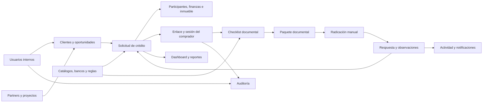
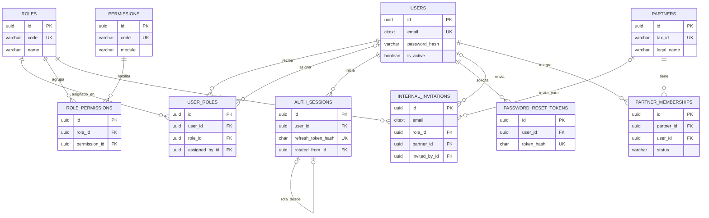
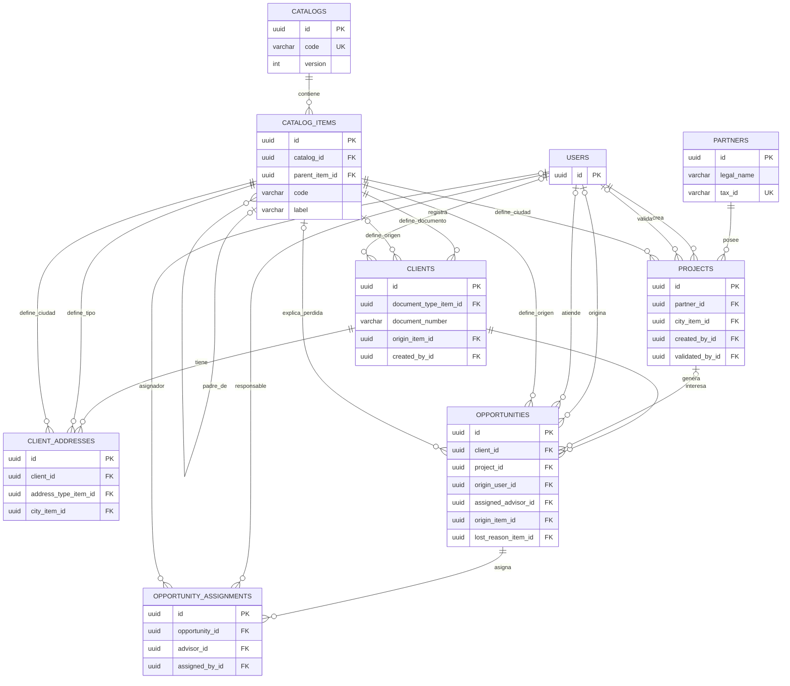
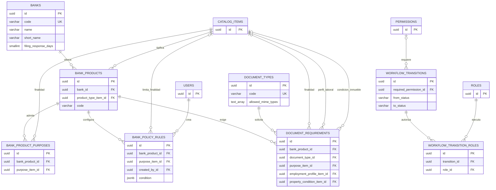
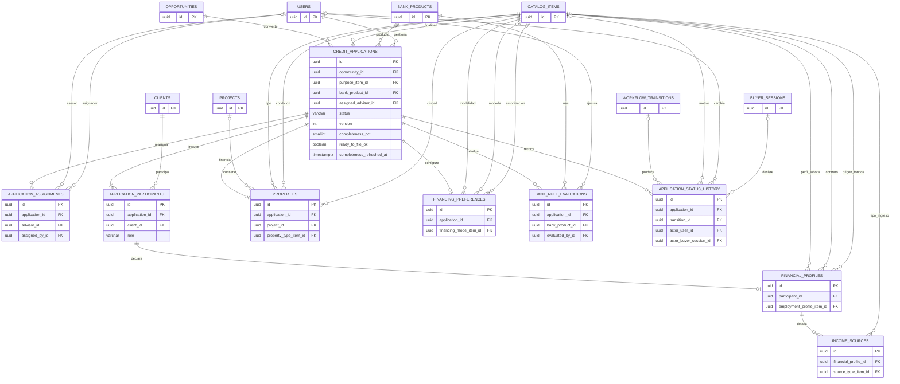
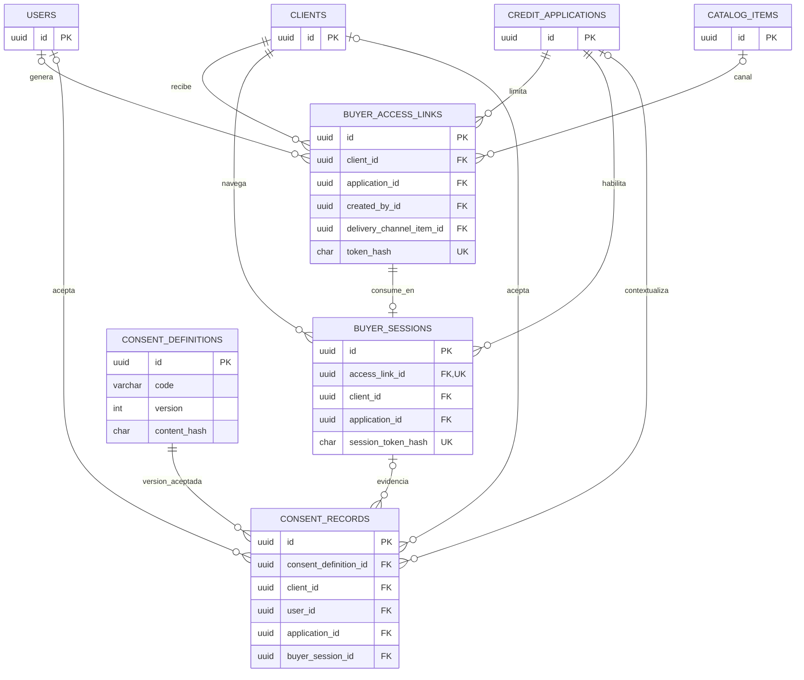
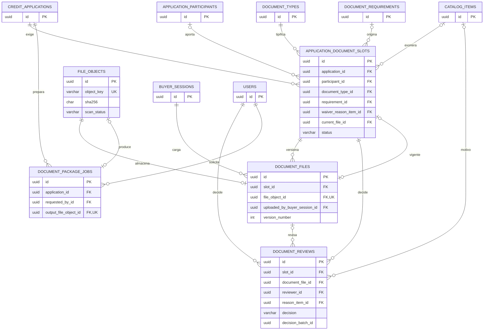
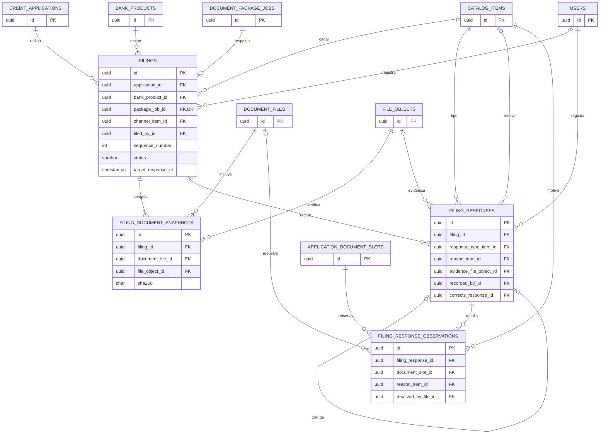
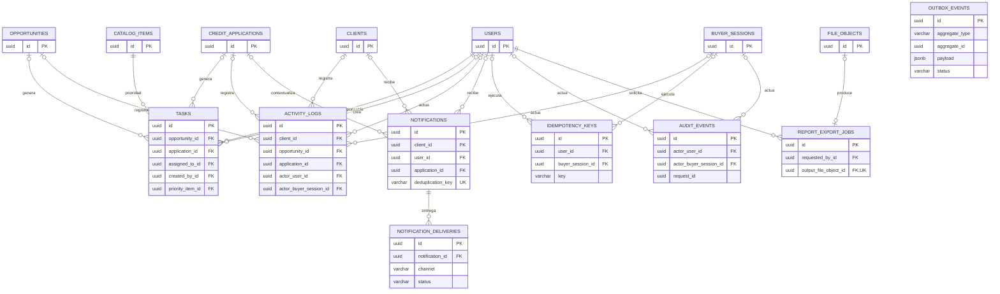

# Diagrama entidad-relación completo

## MVP de gestión de crédito de vivienda

Este documento representa visualmente las 58 tablas definidas en [`ESQUEMA_POSTGRESQL_MVP_CREDITO.sql`](./ESQUEMA_POSTGRESQL_MVP_CREDITO.sql). Se divide por módulos para que las relaciones sean legibles. Cuando una tabla aparece en más de un diagrama, sigue siendo la misma tabla de PostgreSQL; se repite únicamente como referencia visual.

## 1. Cómo leer las relaciones

| Símbolo Mermaid | Significado | Ejemplo |
| --- | --- | --- |
| `||--o{` | Uno a cero o muchos | Un usuario puede tener muchas sesiones. |
| `||--|{` | Uno a uno o muchos, mínimo uno | Una solicitud debe tener participantes. |
| `||--o|` | Uno a cero o uno | Un enlace puede producir una sesión. |
| `||--||` | Uno a uno obligatorio | Una solicitud tiene una configuración financiera. |

La tabla que contiene el campo terminado en `_id` es la tabla hija. Por ejemplo, `auth_sessions.user_id` significa que muchas sesiones pueden apuntar a un mismo usuario.

## 2. Mapa maestro del recorrido de los datos

## 3. Identidad, roles e invitaciones internas

Lectura sencilla:

- `user_roles` convierte usuarios y roles en una relación muchos-a-muchos.
- `role_permissions` convierte roles y permisos en otra relación muchos-a-muchos.
- Una sesión o token siempre pertenece a un usuario, pero un usuario puede acumular varios registros históricos.
- La invitación interna permite que un asesor, broker o miembro de constructora cree su propia contraseña.

## 4. Partners, proyectos, clientes y oportunidades

Lectura sencilla:

- Un cliente existe una sola vez y puede generar varias oportunidades.
- Una oportunidad puede señalar un proyecto o existir sin proyecto.
- `assigned_advisor_id` guarda el asesor actual; `opportunity_assignments` conserva todos los asesores anteriores.
- `catalog_items` ofrece valores compartidos como ciudad, tipo de documento, origen y motivo de pérdida.

## 5. Bancos, productos, reglas y flujos

`bank_product_purposes` es la tabla intermedia N:M entre productos y finalidades. `workflow_transition_roles` hace lo mismo entre transiciones y roles.

## 6. Solicitud, participantes, finanzas e inmueble

El estado y asesor actuales viven en `credit_applications` para consultar rápido. Sus historiales viven en `application_status_history` y `application_assignments`.

## 7. Acceso del comprador y consentimientos

El comprador no se conecta con `users`: está representado por `clients`. El único vínculo del usuario interno con el enlace es `created_by_id`, que identifica quién lo generó.

## 8. Expediente documental

Hay cuatro conceptos distintos:

1. `document_requirements`: plantilla general.
2. `application_document_slots`: documento concreto esperado en una solicitud.
3. `document_files`: cada versión cargada.
4. `document_reviews`: decisiones sobre un slot: aprobar o rechazar una versión, exonerar y reabrir (desvío del paso 10, ver MODELO §8.4).

`file_objects` solo describe dónde está el archivo físico y su estado antivirus.

## 9. Radicación manual y respuestas

`filing_document_snapshots` es la tabla intermedia N:M entre radicaciones y versiones documentales. Conserva la evidencia exacta de lo enviado. Una observación señala únicamente el slot que el comprador puede corregir después de radicar.

Catálogos de la radicación: `filing_channel` (canal de entrega), `filing_response_type` (incluye `DISBURSED`), `filing_return_reason` y `filing_rejection_reason` (motivo de la respuesta), y `document_rejection_reason` (motivo de cada observación). `banks.filing_response_days` calcula `filings.target_response_at`. Las transiciones `FILE` y `BANK_*` son de sistema (`workflow_transitions.system_only`).

## 10. Tareas, actividad, notificaciones y plataforma

`outbox_events` no usa una FK física porque puede representar eventos de muchas tablas. Guarda `aggregate_type` y `aggregate_id`; su propósito es asegurar que correos, escaneos y trabajos no se pierdan después de guardar el cambio principal.

## 11. Las relaciones N:M del modelo

| Relación conceptual | Tabla intermedia | Restricción que evita duplicados |
| --- | --- | --- |
| Usuarios N:M roles | `user_roles` | (`user_id`, `role_id`) |
| Roles N:M permisos | `role_permissions` | (`role_id`, `permission_id`) |
| Transiciones N:M roles | `workflow_transition_roles` | (`transition_id`, `role_id`) |
| Productos N:M finalidades | `bank_product_purposes` | (`bank_product_id`, `purpose_item_id`) |
| Solicitudes N:M clientes | `application_participants` | (`application_id`, `client_id`) |
| Radicaciones N:M versiones documentales | `filing_document_snapshots` | (`filing_id`, `document_file_id`) |

En el DER físico estas relaciones se dibujan como dos relaciones 1:N hacia la tabla intermedia.

## 12. Relaciones 1:1 o 1:0..1 importantes

| Tabla padre | Tabla hija | Cómo se garantiza |
| --- | --- | --- |
| Participante | Perfil financiero | `financial_profiles.participant_id UNIQUE` |
| Solicitud | Inmueble | `properties.application_id UNIQUE` |
| Solicitud | Preferencia financiera | `financing_preferences.application_id UNIQUE` |
| Enlace mágico | Sesión del comprador | `buyer_sessions.access_link_id UNIQUE` |
| Objeto físico | Versión documental | `document_files.file_object_id UNIQUE` |
| Trabajo de paquete | Radicación | `filings.package_job_id UNIQUE` |
| Objeto físico | Paquete/exportación | FK de salida `UNIQUE` |

## 13. Flujo completo en una frase por etapa

1. Un usuario interno recibe roles y permisos.
2. Un broker o partner registra un cliente y una oportunidad.
3. Un asesor convierte la oportunidad en solicitud.
4. La solicitud reúne participantes, finanzas, inmueble y financiación.
5. Banco, producto y reglas generan los documentos exigidos.
6. Un enlace mágico crea una sesión temporal para el comprador.
7. El comprador carga versiones y el asesor las revisa.
8. Las versiones aprobadas forman un paquete.
9. El asesor registra una radicación manual y congela lo enviado.
10. Cada respuesta bancaria se agrega sin sobrescribir la anterior.
11. Las observaciones habilitan solo los documentos que deben corregirse.
12. Estado, actividad, tareas, notificaciones y auditoría conservan todo el recorrido.

## 14. Fuente física

El diagrama explica las relaciones; el archivo SQL define los detalles ejecutables: tipos, nulabilidad, `ON DELETE`, restricciones únicas, `CHECK` e índices.

- [Esquema PostgreSQL](./ESQUEMA_POSTGRESQL_MVP_CREDITO.sql)
- [Diccionario completo de tablas](./MODELO_DATOS_DER_MVP_CREDITO.md)

## 15. Distribución de tablas por módulo y orden de construcción

Cada tabla tiene un único módulo propietario. Otros módulos pueden consultarla o
referenciarla mediante claves foráneas, pero no deben modificar directamente sus
reglas de negocio. El orden siguiente reduce dependencias y separa las tablas que
solo pueden existir cuando ya están creados sus recursos padre.

| Orden | Módulo | Tablas propietarias | Depende principalmente de |
| ---: | --- | --- | --- |
| 1 | `identity` (núcleo) | `users`, `roles`, `permissions`, `user_roles`, `role_permissions`, `auth_sessions`, `password_reset_tokens` | Ningún módulo de negocio. |
| 2 | `catalogs` | `catalogs`, `catalog_items`, `workflow_transitions`, `workflow_transition_roles` | `identity` para permisos y roles de las transiciones. |
| 3 | `partners` | `partners`, `partner_memberships`, `projects` | `identity` para miembros/creadores y `catalogs` para ciudad. |
| 4 | `identity` (invitaciones) | `internal_invitations` | `partners`, porque una invitación puede reservar una membresía de constructora. |
| 5 | `crm` (núcleo) | `clients`, `client_addresses`, `opportunities`, `opportunity_assignments` | `identity`, `catalogs` y `partners` cuando la oportunidad tenga proyecto. |
| 6 | `banking` | `banks`, `bank_products`, `bank_product_purposes`, `bank_policy_rules` | `catalogs` para tipificaciones e `identity` para el creador de reglas. |
| 7 | `documents` (configuración) | `document_types`, `document_requirements` | `banking` y `catalogs`. |
| 8 | `applications` | `credit_applications`, `application_assignments`, `application_participants`, `financial_profiles`, `income_sources`, `properties`, `financing_preferences`, `bank_rule_evaluations`, `application_status_history` | `crm`, `identity`, `catalogs`, `banking` y `partners` para el proyecto opcional del inmueble. |
| 9 | `identity` (acceso comprador) | `consent_definitions`, `buyer_access_links`, `buyer_sessions`, `consent_records` | `crm`, `applications`, `catalogs` e `identity` núcleo. |
| 10 | `documents` (expediente) | `file_objects`, `application_document_slots`, `document_files`, `document_reviews`, `document_package_jobs` | `applications`, acceso comprador, configuración documental, catálogos e identidad. |
| 11 | `filings` | `filings`, `filing_document_snapshots`, `filing_responses`, `filing_response_observations` | `applications`, `banking`, `documents`, `catalogs` e `identity`. |
| 12 | `crm` (operación) | `tasks`, `activity_logs` | `crm` núcleo, `applications`, acceso comprador, catálogos e identidad. |
| 13 | `notifications` | `notifications`, `notification_deliveries`, `idempotency_keys`, `outbox_events` | `identity`, `crm`, `applications` y acceso comprador. |
| 14 | `audit` | `audit_events` | `identity` y acceso comprador. |
| 15 | `reporting` | `report_export_jobs` | `identity` y `documents.file_objects`; consulta, sin ser dueño, los datos de CRM, solicitudes y radicaciones. |
| 16 | `commissions` | `commission_plans`, `commission_settlements`, `commission_shares` | `banking` para el producto, `applications` y `crm` para asesor y origen, `filings` para el desembolso y `notifications` para el evento `APPLICATION_DISBURSED`. |

### Resumen por módulo

| Módulo | Cantidad | Tablas |
| --- | ---: | --- |
| `identity` | 12 | `users`, `roles`, `permissions`, `user_roles`, `role_permissions`, `auth_sessions`, `password_reset_tokens`, `internal_invitations`, `consent_definitions`, `buyer_access_links`, `buyer_sessions`, `consent_records` |
| `partners` | 3 | `partners`, `partner_memberships`, `projects` |
| `catalogs` | 4 | `catalogs`, `catalog_items`, `workflow_transitions`, `workflow_transition_roles` |
| `crm` | 6 | `clients`, `client_addresses`, `opportunities`, `opportunity_assignments`, `tasks`, `activity_logs` |
| `banking` | 4 | `banks`, `bank_products`, `bank_product_purposes`, `bank_policy_rules` |
| `applications` | 9 | `credit_applications`, `application_assignments`, `application_participants`, `financial_profiles`, `income_sources`, `properties`, `financing_preferences`, `bank_rule_evaluations`, `application_status_history` |
| `documents` | 7 | `document_types`, `document_requirements`, `file_objects`, `application_document_slots`, `document_files`, `document_reviews`, `document_package_jobs` |
| `filings` | 4 | `filings`, `filing_document_snapshots`, `filing_responses`, `filing_response_observations` |
| `notifications` | 4 | `notifications`, `notification_deliveries`, `idempotency_keys`, `outbox_events` |
| `reporting` | 1 | `report_export_jobs` |
| `audit` | 1 | `audit_events` |
| `commissions` | 3 | `commission_plans`, `commission_settlements`, `commission_shares` |
| **Total** | **58** | Todas las tablas persistentes de negocio y plataforma del MVP. |
