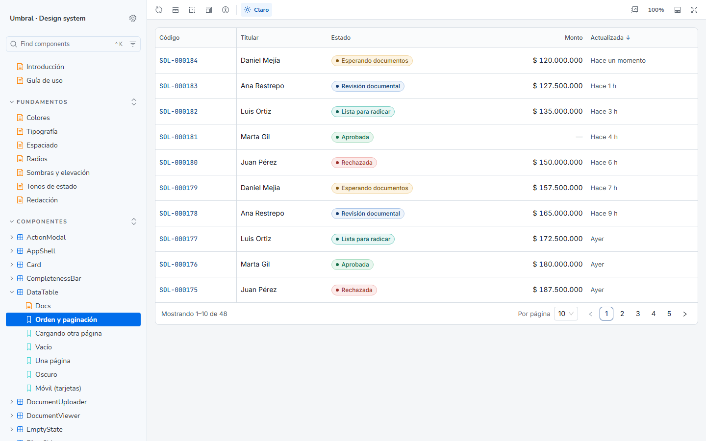
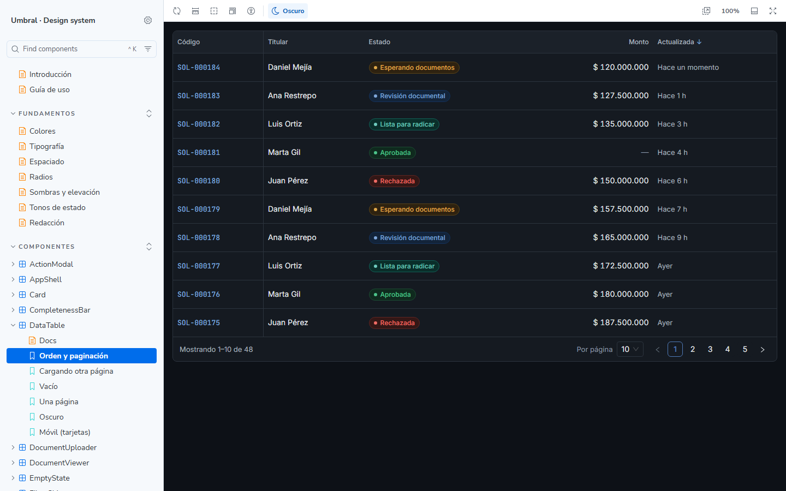

# Umbral · Design system

**Umbral** es el design system del backoffice y del portal del comprador: los tokens (color, tipografía, espaciado, radios, sombras y tonos de estado), la librería de componentes de `frontend/src/components/ui/` y los patrones con los que se arman las vistas. El nombre es el de trabajo del producto: el umbral es la puerta de la casa nueva.

Todo vive en Storybook, que es la documentación de referencia. Este documento resume qué hay, de dónde sale y cómo se trabaja con él.

## Cómo abrirlo

| Dónde | Cómo |
| --- | --- |
| **En línea** | <https://carlosdev88.github.io/real-estate-credit-backoffice/>, publicado por [`storybook-pages.yml`](../.github/workflows/storybook-pages.yml) en cada push a `master` que toca el frontend, el diseño o el contrato. |
| **En local** | `pnpm storybook` en `frontend/` y abre <http://localhost:6006>. |
| **Estático** | `pnpm build-storybook` en `frontend/` deja la misma versión que se publica en `frontend/storybook-static/`. |

La misma publicación trae la **referencia de la API** en <https://carlosdev88.github.io/real-estate-credit-backoffice/api/>: una página estática generada con Redoc desde [`contracts/openapi.json`](../contracts/openapi.json), con buscador, ejemplos, errores y permisos de cada operación. Es solo lectura: no hay servidor detrás ni botón de "probar".

Lo publicado usa solo datos de ejemplo: ningún story llama a la API, y los archivos del visor (`frontend/.storybook/public/`) son documentos de muestra.

## Qué hay

| Sección | Qué trae |
| --- | --- |
| **Introducción** y **Guía de uso** | Qué es Umbral, cómo usar Storybook (tema, tamaños de pantalla, accesibilidad), cuándo usar cada componente, qué no hacer y cómo crear o pedir un componente. |
| **Fundamentos** | Colores, tipografía, espaciado, radios, sombras y elevación, tonos de estado y redacción. Las páginas leen los archivos generados de `design/generated/`: no copian valores. |
| **Componentes** | La librería de `components/ui`: `AppShell`, `PageHeader`, `Card`, `DataTable`, `FilterChips`, `StatusBadge`, `Money`, `RelativeTime`, `CompletenessBar`, `Stepper`, `ScrollTabs`, `ActionModal`, `SidePanel`, `FormField`, `DocumentUploader`, `DocumentViewer`, los estados (vacío, cargando y error), los toasts y los íconos. Cada uno con su tabla de props y sus stories: básico, vacío, cargando, error, texto largo, oscuro y móvil, según aplique. |
| **Patrones** | Formulario con validación, lista con filtros en la URL, tabla con orden y paginación, panel lateral de revisión, modal de confirmación, carga de archivo, estados de la vista y encabezado de página. |

En la barra de Storybook, **Tema** cambia entre claro y oscuro (aplica `data-theme` y el tema de Ant Design juntos, igual que el botón de la app) y el botón de viewport tiene móvil (390 px), portátil (1280 px) y escritorio (1440 px).

## De dónde salen los tokens

La fuente única es [`design/tokens/tokens.json`](../design/tokens/tokens.json): paletas, tokens semánticos de los dos temas, tipografía, espaciado, radios, tonos de estado y los pares de contraste que se verifican. `node design/scripts/build-tokens.mjs` genera lo que usan la app y Storybook:

| Archivo generado | Lo usa |
| --- | --- |
| `design/generated/tokens.css` | Variables `--um-*`, tema claro por defecto y oscuro con `[data-theme="dark"]`. |
| `design/generated/tailwind-theme.css` | Tema de Tailwind 4 (clases como `bg-bg-surface` o `text-text-secondary`). |
| `design/generated/antd-theme.ts` | `lightTheme` y `darkTheme` del `ConfigProvider` de Ant Design. |
| `design/generated/status-tones.ts` | El tono de cada código de estado (`toneFor(kind, code)`). |
| `design/generated/contrast-report.md` | El resultado de la verificación de contraste. Si un par no cumple, el build de los tokens falla. |

Los generados no se editan a mano. El detalle de los tokens, los mockups aprobados y las reglas visuales completas están en [`design/README.md`](../design/README.md).

## Reglas

- **Colores:** solo tokens semánticos (`bg-bg-surface`, `text-text-secondary`, `border-border-default`), nunca paletas (`blue-600`) ni colores escritos. La prueba `frontend/src/test/no-hardcoded-colors.test.ts` falla con cualquier color en hexadecimal, `rgb()` o `hsl()` fuera de su lista permitida.
- **Tonos:** seis (`neutral`, `info`, `accent`, `success`, `warning` y `danger`) cubren todos los estados. El tono es presentación: el texto del estado siempre llega de la API (`label`) y un código desconocido cae en `neutral`. El estado nunca depende solo del color: el badge lleva el texto.
- **Redacción:** textos en español, sin mayúsculas espaciadas; etiquetas en minúscula inicial; enlaces dentro de un texto subrayados; montos en COP con `Money`, nunca formateados a mano. Una sola acción principal por vista, y si está bloqueada, con la razón visible. Lo destructivo no se destaca.
- **Listas de negocio:** estados, motivos, catálogos y transiciones vienen de la API. El frontend no los escribe.
- **Accesibilidad en CI:** el job `Frontend: lint, types and tests` de [`frontend.yml`](../.github/workflows/frontend.yml) compila Storybook y corre cada story en Chromium con axe (`pnpm test:storybook`); falla con violaciones serias o críticas. Además: contraste verificado en los dos temas, foco visible, diálogos que atrapan y devuelven el foco, todo control con nombre y errores de campo enlazados con `aria-describedby`.
- **Portal del comprador:** móvil primero, controles de 40 px y una sola columna.

## Cómo agregar un componente

1. **¿Va en la librería?** Si se repite en dos o más features o es una pieza del sistema. Si solo lo usa una feature, se queda en `features/<feature>/components/` hasta que haya un segundo uso.
2. **Código:** `frontend/src/components/ui/<nombre>.tsx` en kebab-case, sobre Ant Design y los tokens. Props en inglés con su comentario JSDoc (es lo que muestra Storybook) y textos visibles en español; variantes con nombre (`variant`, `size`, `layout`) en lugar de banderas sueltas.
3. **Story:** `<nombre>.stories.tsx` al lado, con `title: "Componentes/<Nombre>"`, su descripción, `argTypes` descritos y los estados que apliquen, incluidos `globals: DARK` y `globals: MOBILE` (de `src/stories/globals.ts`). Solo fixtures: nada de llamadas a la API ni datos personales reales.
4. **Pruebas:** comportamiento y accesibilidad en `components/ui/*.test.tsx`, por rol y nombre.
5. **Verificaciones:** `pnpm lint`, `pnpm format:check`, `pnpm typecheck`, `pnpm test --coverage`, `pnpm build-storybook` y `pnpm test:storybook`.

La "Guía de uso" de Storybook tiene la versión completa, con cómo pedir un componente desde una feature y los candidatos ya identificados.
