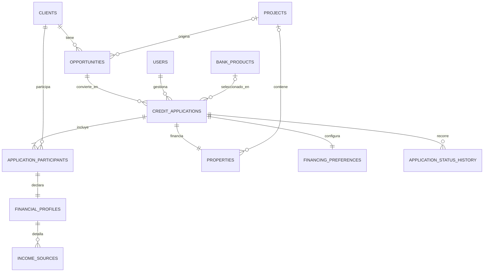
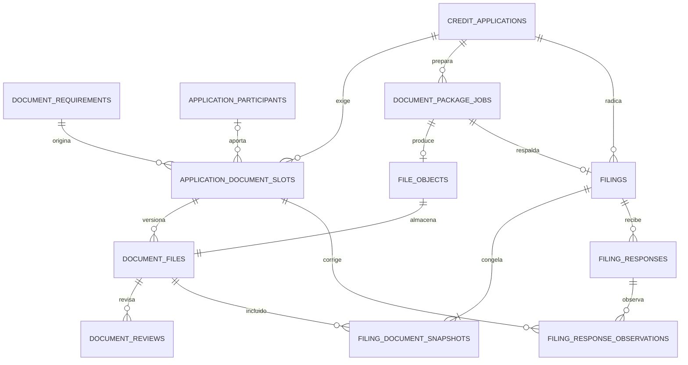
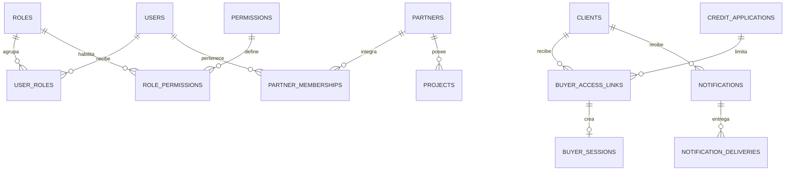

# Modelo de datos y diccionario para el DER

## MVP de gestión de crédito de vivienda

| Campo | Definición |
| --- | --- |
| Motor | PostgreSQL 16 o superior |
| Acceso | Django ORM; SQL manual solo para consultas medidas y justificadas |
| Identificadores | UUID generados en la base de datos |
| Moneda | COP almacenado en pesos enteros (`BIGINT`) |
| Zona horaria | Fechas operativas en `TIMESTAMPTZ` y UTC |
| Modelo propuesto | 58 tablas persistentes de negocio y plataforma |
| Alcance | Vivienda nueva, vivienda usada y remodelación; radicación bancaria manual |

## 1. Objetivo

Este documento permite dibujar el diagrama entidad-relación y luego convertirlo en modelos de Django. Para cada tabla define sus campos, tipos PostgreSQL, relaciones, cardinalidad y una explicación sencilla de por qué existe esa relación.

El comprador no tiene usuario ni contraseña. Es una persona en `clients` que entra temporalmente mediante `buyer_access_links` y `buyer_sessions`. `users` se reserva para administrador, asesor, broker independiente y miembro de constructora.

## 2. Decisiones de modelado

### 2.1 Normalización

El modelo busca tercera forma normal (3FN):

- una tabla representa una sola idea principal;
- los datos repetibles se guardan en filas, no en columnas como `ingreso_1`, `ingreso_2`;
- las relaciones muchos-a-muchos tienen tabla intermedia;
- los archivos físicos, revisiones, respuestas y notificaciones conservan su propio historial;
- bancos, productos, documentos y tipificaciones se administran como datos del backend;
- `JSONB` se limita a reglas declarativas, metadatos controlados y evidencias técnicas que no necesitan relaciones propias.

Hay dos duplicaciones intencionales para acelerar las pantallas más usadas:

1. `opportunities.assigned_advisor_id` y `credit_applications.assigned_advisor_id` guardan el responsable actual, mientras sus tablas de asignaciones conservan el historial.
2. `credit_applications.status` guarda el estado actual, mientras `application_status_history` conserva todos los cambios.

Esto evita calcular el último registro en cada fila de “Mi día”, sin sacrificar trazabilidad. Ambas copias deben actualizarse dentro de la misma transacción.

### 2.2 Convenciones comunes

Salvo indicación distinta, las tablas mutables incluyen:

Aunque estos campos se repiten, aparecen escritos individualmente dentro de cada tabla para que el documento pueda trasladarse directamente al DER sin interpretar abreviaciones.

| Campo | Tipo | Regla |
| --- | --- | --- |
| `id` | `UUID` | PK, `DEFAULT gen_random_uuid()`. |
| `created_at` | `TIMESTAMPTZ` | Obligatorio, fecha de creación. |
| `updated_at` | `TIMESTAMPTZ` | Obligatorio, fecha de última modificación. |

Las tablas históricas e inmutables incluyen `id` y `created_at`, pero no necesitan `updated_at`. Las FK usan `UUID`. En este documento `FK` significa clave foránea y `UQ` restricción única.

Convenciones de tipos:

- correo: `CITEXT`, con extensión `citext`, para unicidad sin distinguir mayúsculas;
- teléfono: `VARCHAR(20)` en formato E.164;
- códigos estables: `VARCHAR(50)`;
- textos humanos breves: `VARCHAR(255)`;
- dinero COP: `BIGINT`, nunca `FLOAT`;
- porcentajes y razones: `NUMERIC(8,4)`;
- hashes SHA-256: `CHAR(64)` hexadecimal;
- IP: `INET`;
- estados estructurales: `VARCHAR(40)` con `CHECK` y constantes del backend;
- catálogos de negocio: FK hacia `catalog_items`.

### 2.3 Acciones de borrado de las FK

- `RESTRICT`: impide borrar un registro que conserva historia de negocio.
- `CASCADE`: solo en tablas puente o hijos que no tienen sentido sin su padre.
- `SET NULL`: conserva el historial cuando el dato relacionado deja de estar activo.
- No se usa borrado físico desde la aplicación para solicitudes, documentos, radicaciones, respuestas, consentimientos o auditoría.

## 3. Inventario de tablas

| Grupo | Cantidad | Tablas |
| --- | ---: | --- |
| Identidad y seguridad | 12 | `users` a `consent_records` |
| Organizaciones y CRM | 8 | `partners` a `tasks` |
| Solicitud de crédito | 8 | `credit_applications` a `application_status_history` |
| Configuración | 11 | `banks` a `document_requirements` |
| Expediente documental | 5 | `file_objects` a `document_package_jobs` |
| Radicación | 4 | `filings` a `filing_response_observations` |
| Comunicación y plataforma | 7 | `activity_logs` a `report_export_jobs` |
| Comisiones | 3 | `commission_plans` a `commission_shares` |
| **Total** | **58** | No incluye tablas técnicas propias de Django. |

## 4. Identidad y seguridad

### 4.1 `users`

Usuarios internos que pueden iniciar sesión.

| Campo | Tipo | Nulo | Regla/uso |
| --- | --- | --- | --- |
| `id` | `UUID` | No | PK, `DEFAULT gen_random_uuid()`. |
| `created_at` | `TIMESTAMPTZ` | No | Fecha y hora de creación. |
| `updated_at` | `TIMESTAMPTZ` | No | Fecha y hora de última modificación. |
| `email` | `CITEXT` | No | UQ; login normalizado. |
| `password_hash` | `VARCHAR(255)` | No | Hash Argon2id; nunca contraseña reversible. |
| `first_name` | `VARCHAR(100)` | No | Nombres. |
| `last_name` | `VARCHAR(100)` | No | Apellidos. |
| `phone` | `VARCHAR(20)` | Sí | Contacto. |
| `is_active` | `BOOLEAN` | No | `DEFAULT TRUE`. |
| `last_login_at` | `TIMESTAMPTZ` | Sí | Último acceso correcto. |
| `deleted_at` | `TIMESTAMPTZ` | Sí | Desactivación lógica excepcional. |

Relaciones:

| Con tabla | Cardinalidad | Por qué existe |
| --- | --- | --- |
| `roles` mediante `user_roles` | N:M | Una persona puede cumplir más de una función interna sin duplicar su cuenta. |
| `partners` mediante `partner_memberships` | N:M, máximo una activa en MVP | Permite saber a qué constructora pertenece un usuario. |
| `auth_sessions` | 1:N | Un usuario puede iniciar sesión en varios dispositivos y revocar cada acceso por separado. |

Índices: UQ `email`; parcial `is_active WHERE deleted_at IS NULL`.

### 4.2 `roles`

Funciones internas como `ADMIN`, `ADVISOR`, `INDEPENDENT_BROKER` y `CONSTRUCTION_PARTNER`.

| Campo | Tipo | Nulo | Regla/uso |
| --- | --- | --- | --- |
| `id` | `UUID` | No | PK, `DEFAULT gen_random_uuid()`. |
| `created_at` | `TIMESTAMPTZ` | No | Fecha y hora de creación. |
| `updated_at` | `TIMESTAMPTZ` | No | Fecha y hora de última modificación. |
| `code` | `VARCHAR(50)` | No | UQ, código estable. |
| `name` | `VARCHAR(100)` | No | Nombre visible. |
| `description` | `TEXT` | Sí | Explicación. |
| `is_active` | `BOOLEAN` | No | Habilitación. |

Relaciones: N:M con `users` por `user_roles` porque un rol se asigna a muchas personas; N:M con `permissions` por `role_permissions` porque cada función necesita varias capacidades.

### 4.3 `permissions`

Acciones atómicas como `documents.review` o `filings.create`.

| Campo | Tipo | Nulo | Regla/uso |
| --- | --- | --- | --- |
| `id` | `UUID` | No | PK, `DEFAULT gen_random_uuid()`. |
| `created_at` | `TIMESTAMPTZ` | No | Fecha y hora de creación. |
| `updated_at` | `TIMESTAMPTZ` | No | Fecha y hora de última modificación. |
| `code` | `VARCHAR(100)` | No | UQ. |
| `module` | `VARCHAR(50)` | No | Agrupación visual. |
| `name` | `VARCHAR(120)` | No | Nombre. |
| `description` | `TEXT` | Sí | Alcance funcional. |

Relación N:M con `roles` mediante `role_permissions`: una acción puede pertenecer a varios roles sin repetir su definición.

### 4.4 `user_roles`

Tabla puente de asignación de roles.

| Campo | Tipo | Nulo | Regla/uso |
| --- | --- | --- | --- |
| `id` | `UUID` | No | PK, `DEFAULT gen_random_uuid()`. |
| `created_at` | `TIMESTAMPTZ` | No | Fecha y hora de creación del registro histórico. |
| `user_id` | `UUID` | No | FK `users`, `CASCADE`. |
| `role_id` | `UUID` | No | FK `roles`, `RESTRICT`. |
| `assigned_by_id` | `UUID` | Sí | FK `users`, `SET NULL`. |

UQ (`user_id`, `role_id`). Relación: muchos usuarios pueden compartir un rol y cada usuario puede tener varios; esta tabla evita guardar una lista difícil de consultar dentro de `users`.

### 4.5 `role_permissions`

Tabla puente entre roles y permisos.

| Campo | Tipo | Nulo | Regla/uso |
| --- | --- | --- | --- |
| `id` | `UUID` | No | PK, `DEFAULT gen_random_uuid()`. |
| `created_at` | `TIMESTAMPTZ` | No | Fecha y hora de creación del registro histórico. |
| `role_id` | `UUID` | No | FK `roles`, `CASCADE`. |
| `permission_id` | `UUID` | No | FK `permissions`, `CASCADE`. |

UQ (`role_id`, `permission_id`). Explicación: permite cambiar lo que puede hacer un rol sin modificar cada usuario individualmente.

### 4.6 `auth_sessions`

Sesiones internas con refresh token rotativo.

| Campo | Tipo | Nulo | Regla/uso |
| --- | --- | --- | --- |
| `id` | `UUID` | No | PK, `DEFAULT gen_random_uuid()`. |
| `created_at` | `TIMESTAMPTZ` | No | Fecha y hora de creación del registro histórico. |
| `user_id` | `UUID` | No | FK `users`, `CASCADE`. |
| `refresh_token_hash` | `CHAR(64)` | No | UQ; nunca guarda token plano. |
| `expires_at` | `TIMESTAMPTZ` | No | Caducidad. |
| `revoked_at` | `TIMESTAMPTZ` | Sí | Revocación. |
| `rotated_from_id` | `UUID` | Sí | FK autorreferente, `SET NULL`. |
| `ip_address` | `INET` | Sí | Seguridad. |
| `user_agent_summary` | `VARCHAR(255)` | Sí | Dispositivo resumido. |

Relaciones: N:1 con `users` porque cada sesión pertenece a una cuenta; 0..1:1 consigo misma para reconstruir la rotación y detectar reutilización de tokens.

Índices: UQ hash; (`user_id`, `revoked_at`, `expires_at`).

### 4.7 `internal_invitations`

Invitaciones para crear o vincular usuarios internos.

| Campo | Tipo | Nulo | Regla/uso |
| --- | --- | --- | --- |
| `id` | `UUID` | No | PK, `DEFAULT gen_random_uuid()`. |
| `created_at` | `TIMESTAMPTZ` | No | Fecha y hora de creación. |
| `updated_at` | `TIMESTAMPTZ` | No | Fecha y hora de última modificación. |
| `email` | `CITEXT` | No | Destinatario. |
| `token_hash` | `CHAR(64)` | No | UQ. |
| `role_id` | `UUID` | No | FK `roles`, `RESTRICT`. |
| `partner_id` | `UUID` | Sí | FK `partners`, `RESTRICT`. |
| `invited_by_id` | `UUID` | Sí | FK `users`, `SET NULL`. |
| `expires_at` | `TIMESTAMPTZ` | No | Vencimiento. |
| `consumed_at` | `TIMESTAMPTZ` | Sí | Uso único. |
| `revoked_at` | `TIMESTAMPTZ` | Sí | Anulación. |

Relaciones: N:1 con `roles` para saber qué función recibe; N:1 opcional con `partners` para ubicar al nuevo miembro; N:1 con `users` para saber quién lo invitó. La invitación existe antes que la cuenta, por eso se guarda aparte.

### 4.8 `password_reset_tokens`

Tokens temporales de recuperación de usuarios internos.

| Campo | Tipo | Nulo | Regla/uso |
| --- | --- | --- | --- |
| `id` | `UUID` | No | PK, `DEFAULT gen_random_uuid()`. |
| `created_at` | `TIMESTAMPTZ` | No | Fecha y hora de creación del registro histórico. |
| `user_id` | `UUID` | No | FK `users`, `CASCADE`. |
| `token_hash` | `CHAR(64)` | No | UQ. |
| `expires_at` | `TIMESTAMPTZ` | No | Vencimiento. |
| `consumed_at` | `TIMESTAMPTZ` | Sí | Uso. |
| `requested_ip` | `INET` | Sí | Auditoría de seguridad. |

Relación N:1 con `users`: una persona puede solicitar más de un enlace, pero cada token cambia la contraseña de una sola cuenta.

### 4.9 `buyer_access_links`

Enlaces mágicos de un solo uso para el comprador.

| Campo | Tipo | Nulo | Regla/uso |
| --- | --- | --- | --- |
| `id` | `UUID` | No | PK, `DEFAULT gen_random_uuid()`. |
| `created_at` | `TIMESTAMPTZ` | No | Fecha y hora de creación del registro histórico. |
| `client_id` | `UUID` | No | FK `clients`, `RESTRICT`. |
| `application_id` | `UUID` | No | FK `credit_applications`, `RESTRICT`. |
| `token_hash` | `CHAR(64)` | No | UQ. |
| `created_by_id` | `UUID` | Sí | FK `users`, `SET NULL`. |
| `delivery_channel_item_id` | `UUID` | Sí | FK `catalog_items`, `RESTRICT`. |
| `expires_at` | `TIMESTAMPTZ` | No | Caducidad. |
| `consumed_at` | `TIMESTAMPTZ` | Sí | Uso único. |
| `revoked_at` | `TIMESTAMPTZ` | Sí | Revocación. |

Relaciones: N:1 con `clients` y `credit_applications` porque el enlace identifica a una persona y la limita a un expediente; N:1 con `users` para saber quién lo generó. Esto evita crear contraseña al comprador y evita que el enlace abra otras solicitudes.

Índices: UQ hash; (`application_id`, `expires_at`) con condición `consumed_at IS NULL AND revoked_at IS NULL`.

### 4.10 `buyer_sessions`

Sesión temporal creada después de consumir un enlace mágico.

| Campo | Tipo | Nulo | Regla/uso |
| --- | --- | --- | --- |
| `id` | `UUID` | No | PK, `DEFAULT gen_random_uuid()`. |
| `created_at` | `TIMESTAMPTZ` | No | Fecha y hora de creación del registro histórico. |
| `access_link_id` | `UUID` | No | FK `buyer_access_links`, `RESTRICT`. |
| `client_id` | `UUID` | No | FK `clients`, `RESTRICT`. |
| `application_id` | `UUID` | No | FK `credit_applications`, `RESTRICT`. |
| `session_token_hash` | `CHAR(64)` | No | UQ. |
| `expires_at` | `TIMESTAMPTZ` | No | Caducidad. |
| `revoked_at` | `TIMESTAMPTZ` | Sí | Cierre o revocación. |
| `last_seen_at` | `TIMESTAMPTZ` | Sí | Actividad. |
| `ip_address` | `INET` | Sí | Seguridad. |
| `user_agent_summary` | `VARCHAR(255)` | Sí | Dispositivo. |

Relaciones: 1:1 efectivo con el enlace consumido y N:1 con cliente/solicitud. Se repiten cliente y solicitud de forma controlada para validar el alcance rápidamente en cada petición y para conservar la sesión aunque se roten enlaces.

### 4.11 `consent_definitions`

Versiones publicadas de textos de consentimiento.

| Campo | Tipo | Nulo | Regla/uso |
| --- | --- | --- | --- |
| `id` | `UUID` | No | PK, `DEFAULT gen_random_uuid()`. |
| `created_at` | `TIMESTAMPTZ` | No | Fecha y hora de creación. |
| `updated_at` | `TIMESTAMPTZ` | No | Fecha y hora de última modificación. |
| `code` | `VARCHAR(50)` | No | Código del consentimiento. |
| `version` | `INTEGER` | No | Versión publicada. |
| `title` | `VARCHAR(180)` | No | Título. |
| `body` | `TEXT` | No | Texto aceptado. |
| `content_hash` | `CHAR(64)` | No | Prueba de integridad. |
| `effective_from` | `TIMESTAMPTZ` | No | Inicio de vigencia. |
| `retired_at` | `TIMESTAMPTZ` | Sí | Fin de uso futuro. |

UQ (`code`, `version`). Relación 1:N con `consent_records`: una versión puede ser aceptada por muchas personas; mantener el texto separado evita copiarlo en cada aceptación y permite demostrar qué versión se mostró.

### 4.12 `consent_records`

Evidencia de aceptación o retiro de un consentimiento.

| Campo | Tipo | Nulo | Regla/uso |
| --- | --- | --- | --- |
| `id` | `UUID` | No | PK, `DEFAULT gen_random_uuid()`. |
| `created_at` | `TIMESTAMPTZ` | No | Fecha y hora de creación del registro histórico. |
| `consent_definition_id` | `UUID` | No | FK `consent_definitions`, `RESTRICT`. |
| `client_id` | `UUID` | Sí | FK `clients`, `RESTRICT`. |
| `user_id` | `UUID` | Sí | FK `users`, `RESTRICT`. |
| `application_id` | `UUID` | Sí | FK `credit_applications`, `RESTRICT`. |
| `action` | `VARCHAR(20)` | No | `ACCEPTED` o `WITHDRAWN`. |
| `ip_address` | `INET` | Sí | Evidencia. |
| `user_agent_summary` | `VARCHAR(255)` | Sí | Evidencia. |
| `buyer_session_id` | `UUID` | Sí | FK `buyer_sessions`, `SET NULL`. |

`CHECK`: exactamente uno de `client_id` o `user_id` debe existir. Relaciones: N:1 con definición para probar qué texto aceptó; N:1 opcional con solicitud para ligar el consentimiento al trámite; N:1 con sesión para demostrar desde qué acceso se realizó.

## 5. Organizaciones y CRM

### 5.1 `partners`

Constructoras que originan proyectos y solicitudes; no son tenants independientes.

| Campo | Tipo | Nulo | Regla/uso |
| --- | --- | --- | --- |
| `id` | `UUID` | No | PK, `DEFAULT gen_random_uuid()`. |
| `created_at` | `TIMESTAMPTZ` | No | Fecha y hora de creación. |
| `updated_at` | `TIMESTAMPTZ` | No | Fecha y hora de última modificación. |
| `legal_name` | `VARCHAR(180)` | No | Razón social. |
| `trade_name` | `VARCHAR(180)` | Sí | Nombre comercial. |
| `tax_id` | `VARCHAR(30)` | No | UQ, NIT normalizado. |
| `status` | `VARCHAR(20)` | No | `ACTIVE`/`INACTIVE`. |
| `contact_name` | `VARCHAR(150)` | Sí | Contacto. |
| `contact_email` | `CITEXT` | Sí | Correo. |
| `contact_phone` | `VARCHAR(20)` | Sí | Teléfono. |
| `deleted_at` | `TIMESTAMPTZ` | Sí | Archivo lógico. |

Relaciones: 1:N con `partner_memberships` para sus miembros y 1:N con `projects` para sus proyectos. Así se puede mostrar la operación de una constructora sin mezclarla con otra.

### 5.2 `partner_memberships`

Vinculación entre usuario interno y constructora.

| Campo | Tipo | Nulo | Regla/uso |
| --- | --- | --- | --- |
| `id` | `UUID` | No | PK, `DEFAULT gen_random_uuid()`. |
| `created_at` | `TIMESTAMPTZ` | No | Fecha y hora de creación. |
| `updated_at` | `TIMESTAMPTZ` | No | Fecha y hora de última modificación. |
| `partner_id` | `UUID` | No | FK `partners`, `RESTRICT`. |
| `user_id` | `UUID` | No | FK `users`, `RESTRICT`. |
| `job_title` | `VARCHAR(120)` | Sí | Cargo. |
| `status` | `VARCHAR(20)` | No | `ACTIVE`/`INACTIVE`. |
| `started_at` | `DATE` | No | Inicio. |
| `ended_at` | `DATE` | Sí | Fin. |

UQ parcial `user_id WHERE status='ACTIVE'` para el MVP. Relación N:1 con ambas tablas: muchos miembros pertenecen a una constructora y se conserva el historial si alguien deja de pertenecer.

### 5.3 `projects`

Proyectos de vivienda creados por una constructora.

| Campo | Tipo | Nulo | Regla/uso |
| --- | --- | --- | --- |
| `id` | `UUID` | No | PK, `DEFAULT gen_random_uuid()`. |
| `created_at` | `TIMESTAMPTZ` | No | Fecha y hora de creación. |
| `updated_at` | `TIMESTAMPTZ` | No | Fecha y hora de última modificación. |
| `partner_id` | `UUID` | No | FK `partners`, `RESTRICT`. |
| `name` | `VARCHAR(180)` | No | Nombre. |
| `code` | `VARCHAR(50)` | Sí | Código del partner. |
| `status` | `VARCHAR(20)` | No | `DRAFT`, `PENDING_REVIEW`, `ACTIVE`, `ARCHIVED`. |
| `city_item_id` | `UUID` | No | FK `catalog_items`, `RESTRICT`. |
| `address` | `VARCHAR(255)` | No | Ubicación. |
| `description` | `TEXT` | Sí | Resumen. |
| `estimated_delivery_date` | `DATE` | Sí | Entrega estimada. |
| `created_by_id` | `UUID` | No | FK `users`, `RESTRICT`. |
| `validated_by_id` | `UUID` | Sí | FK `users`, `SET NULL`. |
| `validated_at` | `TIMESTAMPTZ` | Sí | Fecha de aprobación. |
| `deleted_at` | `TIMESTAMPTZ` | Sí | Archivo lógico. |

UQ sugerida (`partner_id`, `name`) donde no esté archivado. Relaciones: N:1 con partner porque cada proyecto tiene dueño; N:1 con creadores/validadores para responsabilizar acciones; 1:N con oportunidades y propiedades porque varias familias/unidades pueden interesarse en el mismo proyecto.

### 5.4 `clients`

Personas compradoras y posibles participantes de una solicitud.

| Campo | Tipo | Nulo | Regla/uso |
| --- | --- | --- | --- |
| `id` | `UUID` | No | PK, `DEFAULT gen_random_uuid()`. |
| `created_at` | `TIMESTAMPTZ` | No | Fecha y hora de creación. |
| `updated_at` | `TIMESTAMPTZ` | No | Fecha y hora de última modificación. |
| `document_type_item_id` | `UUID` | No | FK `catalog_items`, `RESTRICT`. |
| `document_number` | `VARCHAR(30)` | No | Número normalizado. |
| `first_names` | `VARCHAR(120)` | No | Nombres. |
| `last_names` | `VARCHAR(120)` | No | Apellidos. |
| `birth_date` | `DATE` | Sí | Fecha de nacimiento. |
| `email` | `CITEXT` | Sí | Contacto; no es login. |
| `phone` | `VARCHAR(20)` | Sí | Contacto. |
| `origin_item_id` | `UUID` | Sí | FK `catalog_items`, `RESTRICT`. |
| `created_by_id` | `UUID` | Sí | FK `users`, `SET NULL`. |
| `deleted_at` | `TIMESTAMPTZ` | Sí | Archivo/anonimización futura. |

UQ (`document_type_item_id`, `document_number`). Relaciones: 1:N con oportunidades porque una persona puede explorar varias opciones; N:M con solicitudes mediante `application_participants` porque puede ser titular en una y codeudor en otra; 1:N con direcciones y accesos mágicos.

### 5.5 `client_addresses`

Direcciones reutilizables de una persona.

| Campo | Tipo | Nulo | Regla/uso |
| --- | --- | --- | --- |
| `id` | `UUID` | No | PK, `DEFAULT gen_random_uuid()`. |
| `created_at` | `TIMESTAMPTZ` | No | Fecha y hora de creación. |
| `updated_at` | `TIMESTAMPTZ` | No | Fecha y hora de última modificación. |
| `client_id` | `UUID` | No | FK `clients`, `CASCADE`. |
| `address_type_item_id` | `UUID` | No | FK `catalog_items`, `RESTRICT`. |
| `city_item_id` | `UUID` | No | FK `catalog_items`, `RESTRICT`. |
| `line1` | `VARCHAR(255)` | No | Dirección. |
| `line2` | `VARCHAR(120)` | Sí | Complemento. |
| `postal_code` | `VARCHAR(12)` | Sí | Código postal. |
| `is_primary` | `BOOLEAN` | No | Dirección principal. |

Relación N:1 con `clients`: una persona puede haber vivido en más de una dirección. Separarla evita crear columnas repetidas y permite actualizar el contacto sin alterar el inmueble financiado.

### 5.6 `opportunities`

Interés comercial previo a una solicitud formal.

| Campo | Tipo | Nulo | Regla/uso |
| --- | --- | --- | --- |
| `id` | `UUID` | No | PK, `DEFAULT gen_random_uuid()`. |
| `created_at` | `TIMESTAMPTZ` | No | Fecha y hora de creación. |
| `updated_at` | `TIMESTAMPTZ` | No | Fecha y hora de última modificación. |
| `client_id` | `UUID` | No | FK `clients`, `RESTRICT`. |
| `project_id` | `UUID` | Sí | FK `projects`, `RESTRICT`. |
| `origin_user_id` | `UUID` | Sí | FK `users`, `SET NULL`; broker/partner originador. |
| `assigned_advisor_id` | `UUID` | Sí | FK `users`, `SET NULL`; responsable actual. |
| `origin_item_id` | `UUID` | No | FK `catalog_items`, `RESTRICT`. |
| `status` | `VARCHAR(30)` | No | Estado comercial. |
| `converted_at` | `TIMESTAMPTZ` | Sí | Conversión. |
| `lost_reason_item_id` | `UUID` | Sí | FK `catalog_items`, `RESTRICT`. |

Relaciones: N:1 con cliente porque cada oportunidad pertenece a una persona; N:1 opcional con proyecto porque no toda compra se origina en constructora; 1:N con solicitudes para permitir un nuevo intento sin borrar el anterior; 1:N con asignaciones para conservar quién la atendió en cada periodo.

Índices: (`assigned_advisor_id`, `status`, `updated_at DESC`), (`origin_user_id`, `status`), (`project_id`, `status`).

### 5.7 `opportunity_assignments`

Historial de responsables de una oportunidad.

| Campo | Tipo | Nulo | Regla/uso |
| --- | --- | --- | --- |
| `id` | `UUID` | No | PK, `DEFAULT gen_random_uuid()`. |
| `created_at` | `TIMESTAMPTZ` | No | Fecha y hora de creación del registro histórico. |
| `opportunity_id` | `UUID` | No | FK `opportunities`, `RESTRICT`. |
| `advisor_id` | `UUID` | No | FK `users`, `RESTRICT`. |
| `assigned_by_id` | `UUID` | Sí | FK `users`, `SET NULL`. |
| `ended_at` | `TIMESTAMPTZ` | Sí | Fin. |
| `reason` | `VARCHAR(255)` | Sí | Motivo. |

Relación N:1 con oportunidad y asesor. Explicación: muestra quién fue responsable en cada momento, mientras la oportunidad guarda directamente al responsable actual para consultar rápido.

### 5.8 `tasks`

Pendientes manuales o automáticos de la operación.

| Campo | Tipo | Nulo | Regla/uso |
| --- | --- | --- | --- |
| `id` | `UUID` | No | PK, `DEFAULT gen_random_uuid()`. |
| `created_at` | `TIMESTAMPTZ` | No | Fecha y hora de creación. |
| `updated_at` | `TIMESTAMPTZ` | No | Fecha y hora de última modificación. |
| `opportunity_id` | `UUID` | Sí | FK `opportunities`, `RESTRICT`. |
| `application_id` | `UUID` | Sí | FK `credit_applications`, `RESTRICT`. |
| `assigned_to_id` | `UUID` | No | FK `users`, `RESTRICT`. |
| `created_by_id` | `UUID` | Sí | FK `users`, `SET NULL`. |
| `title` | `VARCHAR(180)` | No | Acción. |
| `description` | `TEXT` | Sí | Detalle. |
| `priority_item_id` | `UUID` | No | FK `catalog_items`, `RESTRICT`. |
| `status` | `VARCHAR(20)` | No | `PENDING`, `COMPLETED`, `CANCELLED`. |
| `source` | `VARCHAR(20)` | No | `MANUAL` o `AUTOMATIC`. |
| `due_at` | `TIMESTAMPTZ` | Sí | Vencimiento. |
| `completed_at` | `TIMESTAMPTZ` | Sí | Finalización. |

`CHECK`: al menos una de oportunidad o solicitud debe existir. Explicación: una tarea se liga al caso que la originó y a la persona que debe resolverla; así “Mi día” puede mostrar pendientes sin convertir la tarea en el estado oficial del crédito.

Índice parcial: (`assigned_to_id`, `due_at`) `WHERE status='PENDING'`.

## 6. Solicitud de crédito

### 6.1 `credit_applications`

Expediente central del proceso de crédito.

| Campo | Tipo | Nulo | Regla/uso |
| --- | --- | --- | --- |
| `id` | `UUID` | No | PK, `DEFAULT gen_random_uuid()`. |
| `created_at` | `TIMESTAMPTZ` | No | Fecha y hora de creación. |
| `updated_at` | `TIMESTAMPTZ` | No | Fecha y hora de última modificación. |
| `code` | `VARCHAR(30)` | No | UQ, código legible `SOL-*`. |
| `opportunity_id` | `UUID` | No | FK `opportunities`, `RESTRICT`. |
| `purpose_item_id` | `UUID` | No | FK `catalog_items`, `RESTRICT`. |
| `bank_product_id` | `UUID` | Sí | FK `bank_products`, `RESTRICT`. |
| `assigned_advisor_id` | `UUID` | No | FK `users`, `RESTRICT`; responsable actual. |
| `status` | `VARCHAR(40)` | No | Estado estructural actual. |
| `version` | `INTEGER` | No | `DEFAULT 1`; concurrencia optimista. |
| `current_stage_started_at` | `TIMESTAMPTZ` | No | Cálculo de días en etapa. |
| `ready_to_file_at` | `TIMESTAMPTZ` | Sí | Momento de completitud. |
| `withdrawn_at` | `TIMESTAMPTZ` | Sí | Desistimiento. |
| `withdrawal_reason_item_id` | `UUID` | Sí | FK `catalog_items`, `RESTRICT`. |
| `closed_at` | `TIMESTAMPTZ` | Sí | Cierre final. |

Relaciones: N:1 con oportunidad porque puede haber más de un intento en una relación comercial; N:1 opcional con producto porque la selección puede ocurrir después; N:1 con asesor para poblar “Mi día”; 1:N con participantes, documentos, radicaciones, estados, tareas y actividad porque todos forman parte del mismo expediente.

Índices principales:

- UQ `code`;
- (`assigned_advisor_id`, `status`, `updated_at DESC`) para “Mi día”;
- (`bank_product_id`, `status`, `created_at`) para reportes;
- (`purpose_item_id`, `status`);
- (`opportunity_id`, `created_at DESC`).

### 6.2 `application_assignments`

Historial de asesores responsables de la solicitud.

| Campo | Tipo | Nulo | Regla/uso |
| --- | --- | --- | --- |
| `id` | `UUID` | No | PK, `DEFAULT gen_random_uuid()`. |
| `created_at` | `TIMESTAMPTZ` | No | Fecha y hora de creación del registro histórico. |
| `application_id` | `UUID` | No | FK `credit_applications`, `RESTRICT`. |
| `advisor_id` | `UUID` | No | FK `users`, `RESTRICT`. |
| `assigned_by_id` | `UUID` | Sí | FK `users`, `SET NULL`. |
| `ended_at` | `TIMESTAMPTZ` | Sí | Fin. |
| `reason` | `VARCHAR(255)` | Sí | Motivo. |

Relación N:1 con solicitud y asesor. Permite explicar quién gestionó el crédito en cada periodo, mientras la FK directa de la solicitud evita buscar la última asignación en cada consulta.

### 6.3 `application_participants`

Personas que participan en el crédito como titular, co-solicitante o deudor solidario.

| Campo | Tipo | Nulo | Regla/uso |
| --- | --- | --- | --- |
| `id` | `UUID` | No | PK, `DEFAULT gen_random_uuid()`. |
| `created_at` | `TIMESTAMPTZ` | No | Fecha y hora de creación. |
| `updated_at` | `TIMESTAMPTZ` | No | Fecha y hora de última modificación. |
| `application_id` | `UUID` | No | FK `credit_applications`, `RESTRICT`. |
| `client_id` | `UUID` | No | FK `clients`, `RESTRICT`. |
| `role` | `VARCHAR(30)` | No | `PRIMARY`, `CO_APPLICANT`, `SOLIDARY_DEBTOR`. |
| `contributes_income` | `BOOLEAN` | No | Si suma ingresos. |
| `income_share_cop` | `BIGINT` | Sí | Aporte declarado. |
| `is_active` | `BOOLEAN` | No | Participación vigente. |

UQ (`application_id`, `client_id`); UQ parcial `application_id WHERE role='PRIMARY' AND is_active`. Relación N:M entre solicitudes y clientes: una solicitud reúne varias personas y una persona puede aparecer en distintos trámites. La tabla guarda el papel que cumple en cada caso.

### 6.4 `financial_profiles`

Resumen financiero de cada participante dentro de una solicitud.

| Campo | Tipo | Nulo | Regla/uso |
| --- | --- | --- | --- |
| `id` | `UUID` | No | PK, `DEFAULT gen_random_uuid()`. |
| `created_at` | `TIMESTAMPTZ` | No | Fecha y hora de creación. |
| `updated_at` | `TIMESTAMPTZ` | No | Fecha y hora de última modificación. |
| `participant_id` | `UUID` | No | FK `application_participants`, `CASCADE`; UQ. |
| `employment_profile_item_id` | `UUID` | No | FK `catalog_items`, `RESTRICT`. |
| `contract_type_item_id` | `UUID` | Sí | FK `catalog_items`, `RESTRICT`. |
| `employer_name` | `VARCHAR(180)` | Sí | Empleador/actividad. |
| `job_title` | `VARCHAR(120)` | Sí | Cargo. |
| `employment_start_date` | `DATE` | Sí | Antigüedad. |
| `monthly_income_cop` | `BIGINT` | No | Ingreso consolidado. |
| `monthly_expenses_cop` | `BIGINT` | No | Gastos. |
| `assets_cop` | `BIGINT` | No | Activos. |
| `liabilities_cop` | `BIGINT` | No | Pasivos. |
| `funds_origin_item_id` | `UUID` | Sí | FK `catalog_items`, `RESTRICT`. |
| `data_confirmed_at` | `TIMESTAMPTZ` | Sí | Confirmación del comprador. |

Relación 1:1 con participante porque cada persona tiene un resumen financiero propio en ese expediente; 1:N con fuentes de ingreso porque el total puede venir de varios lugares. No se guarda directamente en `clients`, ya que puede cambiar entre solicitudes.

Índices: UQ `participant_id`; `employment_profile_item_id` para evaluación de requisitos.

### 6.5 `income_sources`

Detalle de empleos, pensiones, arriendos u otros ingresos.

| Campo | Tipo | Nulo | Regla/uso |
| --- | --- | --- | --- |
| `id` | `UUID` | No | PK, `DEFAULT gen_random_uuid()`. |
| `created_at` | `TIMESTAMPTZ` | No | Fecha y hora de creación. |
| `updated_at` | `TIMESTAMPTZ` | No | Fecha y hora de última modificación. |
| `financial_profile_id` | `UUID` | No | FK `financial_profiles`, `CASCADE`. |
| `source_type_item_id` | `UUID` | No | FK `catalog_items`, `RESTRICT`. |
| `payer_name` | `VARCHAR(180)` | Sí | Pagador. |
| `monthly_amount_cop` | `BIGINT` | No | Valor mensual. |
| `start_date` | `DATE` | Sí | Inicio. |
| `is_primary` | `BOOLEAN` | No | Fuente principal. |
| `notes` | `TEXT` | Sí | Aclaración. |

Relación N:1 con perfil financiero: una persona puede combinar salario, actividad independiente y otros ingresos sin añadir columnas nuevas cada vez.

### 6.6 `properties`

Inmueble que se compra o remodela.

| Campo | Tipo | Nulo | Regla/uso |
| --- | --- | --- | --- |
| `id` | `UUID` | No | PK, `DEFAULT gen_random_uuid()`. |
| `created_at` | `TIMESTAMPTZ` | No | Fecha y hora de creación. |
| `updated_at` | `TIMESTAMPTZ` | No | Fecha y hora de última modificación. |
| `application_id` | `UUID` | No | FK `credit_applications`, `CASCADE`; UQ. |
| `project_id` | `UUID` | Sí | FK `projects`, `RESTRICT`. |
| `property_type_item_id` | `UUID` | No | FK `catalog_items`, `RESTRICT`. |
| `condition_item_id` | `UUID` | No | FK `catalog_items`, `RESTRICT`. |
| `city_item_id` | `UUID` | No | FK `catalog_items`, `RESTRICT`. |
| `address` | `VARCHAR(255)` | Sí | Requerida para usada/remodelación. |
| `unit_reference` | `VARCHAR(100)` | Sí | Torre/apartamento. |
| `estimated_value_cop` | `BIGINT` | No | Valor estimado. |
| `is_owned_by_applicant` | `BOOLEAN` | Sí | Relevante para remodelación. |
| `ownership_notes` | `TEXT` | Sí | Relación con el inmueble. |

Relación 1:1 con solicitud porque el MVP financia un inmueble por expediente; N:1 opcional con proyecto porque una vivienda nueva puede pertenecer a una constructora, mientras usada y remodelación existen sin proyecto.

Índices: UQ `application_id`; (`project_id`, `created_at`) y `city_item_id`.

### 6.7 `financing_preferences`

Cómo espera financiarse el comprador.

| Campo | Tipo | Nulo | Regla/uso |
| --- | --- | --- | --- |
| `id` | `UUID` | No | PK, `DEFAULT gen_random_uuid()`. |
| `created_at` | `TIMESTAMPTZ` | No | Fecha y hora de creación. |
| `updated_at` | `TIMESTAMPTZ` | No | Fecha y hora de última modificación. |
| `application_id` | `UUID` | No | FK `credit_applications`, `CASCADE`; UQ. |
| `financing_mode_item_id` | `UUID` | No | FK `catalog_items`, `RESTRICT`. |
| `requested_amount_cop` | `BIGINT` | No | Monto. |
| `term_months` | `SMALLINT` | Sí | Plazo. |
| `currency_mode_item_id` | `UUID` | Sí | FK `catalog_items`, `RESTRICT`; COP/UVR. |
| `amortization_mode_item_id` | `UUID` | Sí | FK `catalog_items`, `RESTRICT`. |
| `own_resources_cop` | `BIGINT` | No | Recursos propios. |
| `uses_severance_funds` | `BOOLEAN` | No | Usa cesantías. |
| `severance_funds_cop` | `BIGINT` | No | Valor estimado. |
| `external_approved_amount_cop` | `BIGINT` | Sí | Crédito externo aprobado. |

Relación 1:1 con solicitud: separa los datos de financiación del estado operativo y permite evolucionar sus reglas sin hacer crecer la tabla central.

### 6.8 `application_status_history`

Historial inmutable de cambios de estado.

| Campo | Tipo | Nulo | Regla/uso |
| --- | --- | --- | --- |
| `id` | `UUID` | No | PK, `DEFAULT gen_random_uuid()`. |
| `created_at` | `TIMESTAMPTZ` | No | Fecha y hora de creación del registro histórico. |
| `application_id` | `UUID` | No | FK `credit_applications`, `RESTRICT`. |
| `from_status` | `VARCHAR(40)` | Sí | Estado anterior. |
| `to_status` | `VARCHAR(40)` | No | Estado nuevo. |
| `transition_id` | `UUID` | Sí | FK `workflow_transitions`, `RESTRICT`. |
| `reason_item_id` | `UUID` | Sí | FK `catalog_items`, `RESTRICT`. |
| `comment` | `TEXT` | Sí | Explicación. |
| `actor_user_id` | `UUID` | Sí | FK `users`, `SET NULL`. |
| `actor_buyer_session_id` | `UUID` | Sí | FK `buyer_sessions`, `SET NULL`. |
| `application_version` | `INTEGER` | No | Versión resultante. |

Relación N:1 con solicitud: una solicitud solo tiene un estado actual, pero necesita recordar todo su recorrido. La relación opcional con transición indica qué acción autorizada produjo el cambio.

Índice: (`application_id`, `created_at DESC`).

## 7. Configuración y catálogos

### 7.1 `banks`

Entidades financieras disponibles para selección manual.

| Campo | Tipo | Nulo | Regla/uso |
| --- | --- | --- | --- |
| `id` | `UUID` | No | PK, `DEFAULT gen_random_uuid()`. |
| `created_at` | `TIMESTAMPTZ` | No | Fecha y hora de creación. |
| `updated_at` | `TIMESTAMPTZ` | No | Fecha y hora de última modificación. |
| `code` | `VARCHAR(50)` | No | UQ, código interno. |
| `name` | `VARCHAR(180)` | No | Nombre visible. |
| `tax_id` | `VARCHAR(30)` | Sí | Identificación. |
| `status` | `VARCHAR(20)` | No | `ACTIVE`/`INACTIVE`. |
| `operational_notes` | `TEXT` | Sí | Indicaciones internas. |

Relación 1:N con `bank_products`: un banco puede ofrecer distintos productos. Separarlos evita repetir los datos del banco en cada solicitud.

### 7.2 `bank_products`

Productos habilitados, inicialmente uno por banco.

| Campo | Tipo | Nulo | Regla/uso |
| --- | --- | --- | --- |
| `id` | `UUID` | No | PK, `DEFAULT gen_random_uuid()`. |
| `created_at` | `TIMESTAMPTZ` | No | Fecha y hora de creación. |
| `updated_at` | `TIMESTAMPTZ` | No | Fecha y hora de última modificación. |
| `bank_id` | `UUID` | No | FK `banks`, `RESTRICT`. |
| `code` | `VARCHAR(50)` | No | Código dentro del banco. |
| `name` | `VARCHAR(180)` | No | Nombre. |
| `product_type_item_id` | `UUID` | No | FK `catalog_items`, `RESTRICT`. |
| `status` | `VARCHAR(20)` | No | Estado. |
| `min_amount_cop` | `BIGINT` | Sí | Rango operativo. |
| `max_amount_cop` | `BIGINT` | Sí | Rango operativo. |
| `min_term_months` | `SMALLINT` | Sí | Plazo. |
| `max_term_months` | `SMALLINT` | Sí | Plazo. |
| `valid_from` | `DATE` | No | Vigencia. |
| `valid_to` | `DATE` | Sí | Fin. |

UQ (`bank_id`, `code`). Relaciones: N:1 con banco; N:M con finalidades mediante `bank_product_purposes`; 1:N con reglas y requisitos. De este modo agregar un producto no obliga a cambiar código ni frontend.

### 7.3 `bank_product_purposes`

Finalidades admitidas por producto.

| Campo | Tipo | Nulo | Regla/uso |
| --- | --- | --- | --- |
| `id` | `UUID` | No | PK, `DEFAULT gen_random_uuid()`. |
| `created_at` | `TIMESTAMPTZ` | No | Fecha y hora de creación del registro histórico. |
| `bank_product_id` | `UUID` | No | FK `bank_products`, `CASCADE`. |
| `purpose_item_id` | `UUID` | No | FK `catalog_items`, `RESTRICT`. |
| `is_active` | `BOOLEAN` | No | Disponibilidad. |

UQ (`bank_product_id`, `purpose_item_id`). Es una relación N:M porque un producto admite varias finalidades y una finalidad puede ser atendida por varios productos.

### 7.4 `bank_policy_rules`

Reglas operativas versionadas; no deciden la aprobación bancaria.

| Campo | Tipo | Nulo | Regla/uso |
| --- | --- | --- | --- |
| `id` | `UUID` | No | PK, `DEFAULT gen_random_uuid()`. |
| `created_at` | `TIMESTAMPTZ` | No | Fecha y hora de creación. |
| `updated_at` | `TIMESTAMPTZ` | No | Fecha y hora de última modificación. |
| `bank_product_id` | `UUID` | No | FK `bank_products`, `RESTRICT`. |
| `purpose_item_id` | `UUID` | Sí | FK `catalog_items`, `RESTRICT`. |
| `code` | `VARCHAR(80)` | No | Código lógico. |
| `version` | `INTEGER` | No | Versión. |
| `severity` | `VARCHAR(20)` | No | `WARNING` o `BLOCKING`. |
| `condition` | `JSONB` | No | Expresión declarativa validada. |
| `message` | `TEXT` | No | Mensaje operativo. |
| `status` | `VARCHAR(20)` | No | `DRAFT`, `ACTIVE`, `INACTIVE`. |
| `valid_from` | `TIMESTAMPTZ` | No | Vigencia. |
| `valid_to` | `TIMESTAMPTZ` | Sí | Fin. |
| `created_by_id` | `UUID` | No | FK `users`, `RESTRICT`. |

UQ (`bank_product_id`, `code`, `version`). Relación N:1 con producto y finalidad. Se conserva cada versión para saber con qué reglas se preparó un expediente antiguo; el JSON solo admite operadores conocidos, no código ejecutable.

Índice parcial: (`bank_product_id`, `purpose_item_id`, `valid_from`) `WHERE status='ACTIVE'`.

### 7.5 `bank_rule_evaluations`

Resultado histórico de aplicar reglas a una solicitud.

| Campo | Tipo | Nulo | Regla/uso |
| --- | --- | --- | --- |
| `id` | `UUID` | No | PK, `DEFAULT gen_random_uuid()`. |
| `created_at` | `TIMESTAMPTZ` | No | Fecha y hora de creación del registro histórico. |
| `application_id` | `UUID` | No | FK `credit_applications`, `RESTRICT`. |
| `bank_product_id` | `UUID` | No | FK `bank_products`, `RESTRICT`. |
| `application_version` | `INTEGER` | No | Datos evaluados. |
| `is_eligible` | `BOOLEAN` | No | Sin bloqueos operativos. |
| `blocking_count` | `SMALLINT` | No | Conteo. |
| `warning_count` | `SMALLINT` | No | Conteo. |
| `result_snapshot` | `JSONB` | No | Regla/versión y resultado de cada una. |
| `evaluated_by_id` | `UUID` | Sí | FK `users`, `SET NULL`. |

Relación N:1 con solicitud y producto: una solicitud puede evaluarse varias veces a medida que cambian sus datos. Guardar el resultado evita reinterpretar el pasado con reglas nuevas.

Índice: (`application_id`, `created_at DESC`).

### 7.6 `catalogs`

Define familias de tipificaciones administrables.

| Campo | Tipo | Nulo | Regla/uso |
| --- | --- | --- | --- |
| `id` | `UUID` | No | PK, `DEFAULT gen_random_uuid()`. |
| `created_at` | `TIMESTAMPTZ` | No | Fecha y hora de creación. |
| `updated_at` | `TIMESTAMPTZ` | No | Fecha y hora de última modificación. |
| `code` | `VARCHAR(50)` | No | UQ. |
| `name` | `VARCHAR(120)` | No | Nombre. |
| `description` | `TEXT` | Sí | Uso. |
| `is_manageable` | `BOOLEAN` | No | Editable por administración. |
| `is_public` | `BOOLEAN` | No | Visible al comprador. |
| `version` | `INTEGER` | No | Caché/metadatos. |

Relación 1:N con `catalog_items`: un catálogo agrupa opciones del mismo tipo, como ciudades, finalidades o motivos. Esto permite que el frontend pregunte al backend en lugar de llevar listas propias.

### 7.7 `catalog_items`

Cada valor de una tipificación.

| Campo | Tipo | Nulo | Regla/uso |
| --- | --- | --- | --- |
| `id` | `UUID` | No | PK, `DEFAULT gen_random_uuid()`. |
| `created_at` | `TIMESTAMPTZ` | No | Fecha y hora de creación. |
| `updated_at` | `TIMESTAMPTZ` | No | Fecha y hora de última modificación. |
| `catalog_id` | `UUID` | No | FK `catalogs`, `RESTRICT`. |
| `code` | `VARCHAR(50)` | No | Código estable dentro del catálogo. |
| `label` | `VARCHAR(180)` | No | Etiqueta visible. |
| `description` | `TEXT` | Sí | Ayuda. |
| `parent_item_id` | `UUID` | Sí | FK autorreferente, `RESTRICT`. |
| `sort_order` | `INTEGER` | No | Orden. |
| `is_active` | `BOOLEAN` | No | Disponibilidad futura. |
| `valid_from` | `DATE` | Sí | Vigencia. |
| `valid_to` | `DATE` | Sí | Vigencia. |
| `metadata` | `JSONB` | No | `DEFAULT '{}'`; presentación controlada. |

UQ (`catalog_id`, `code`). Relación N:1 con catálogo; autorrelación opcional para jerarquías como departamento → municipio. Muchos registros de negocio apuntan a esta tabla para mantener códigos y etiquetas consistentes.

Índices: (`catalog_id`, `is_active`, `sort_order`); `parent_item_id`.

### 7.8 `workflow_transitions`

Acciones permitidas entre estados.

| Campo | Tipo | Nulo | Regla/uso |
| --- | --- | --- | --- |
| `id` | `UUID` | No | PK, `DEFAULT gen_random_uuid()`. |
| `created_at` | `TIMESTAMPTZ` | No | Fecha y hora de creación. |
| `updated_at` | `TIMESTAMPTZ` | No | Fecha y hora de última modificación. |
| `flow_type` | `VARCHAR(30)` | No | `OPPORTUNITY`, `APPLICATION`, `PROJECT`. |
| `code` | `VARCHAR(80)` | No | UQ dentro del flujo. |
| `from_status` | `VARCHAR(40)` | No | Origen. |
| `to_status` | `VARCHAR(40)` | No | Destino. |
| `label` | `VARCHAR(120)` | No | Acción visible. |
| `required_permission_id` | `UUID` | Sí | FK `permissions`, `RESTRICT`. |
| `guard_code` | `VARCHAR(80)` | Sí | Regla de dominio implementada. |
| `is_active` | `BOOLEAN` | No | Disponibilidad. |

UQ (`flow_type`, `code`). Relación N:M con roles mediante `workflow_transition_roles`; relación opcional con permiso. Sirve para indicar qué pasos puede mostrar la interfaz, aunque el backend sigue validando las reglas esenciales.

### 7.9 `workflow_transition_roles`

Roles autorizados para una transición.

| Campo | Tipo | Nulo | Regla/uso |
| --- | --- | --- | --- |
| `id` | `UUID` | No | PK, `DEFAULT gen_random_uuid()`. |
| `created_at` | `TIMESTAMPTZ` | No | Fecha y hora de creación del registro histórico. |
| `transition_id` | `UUID` | No | FK `workflow_transitions`, `CASCADE`. |
| `role_id` | `UUID` | No | FK `roles`, `CASCADE`. |

UQ (`transition_id`, `role_id`). Explicación: una transición puede estar disponible para varios roles sin guardar una lista dentro de una columna.

### 7.10 `document_types`

Tipos de soporte que puede solicitar el sistema.

| Campo | Tipo | Nulo | Regla/uso |
| --- | --- | --- | --- |
| `id` | `UUID` | No | PK, `DEFAULT gen_random_uuid()`. |
| `created_at` | `TIMESTAMPTZ` | No | Fecha y hora de creación. |
| `updated_at` | `TIMESTAMPTZ` | No | Fecha y hora de última modificación. |
| `code` | `VARCHAR(80)` | No | UQ. |
| `name` | `VARCHAR(180)` | No | Nombre visible. |
| `description` | `TEXT` | Sí | Instrucción. |
| `allowed_mime_types` | `TEXT[]` | No | Lista técnica pequeña y cerrada. |
| `max_size_bytes` | `BIGINT` | No | Límite. |
| `default_validity_days` | `SMALLINT` | Sí | Vigencia sugerida. |
| `is_repeatable` | `BOOLEAN` | No | Varias versiones/periodos. |
| `holder_scope` | `VARCHAR(20)` | No | `PARTICIPANT` (por omisión) o `APPLICATION`. **Desvío del DER original (paso 10).** |
| `is_active` | `BOOLEAN` | No | Estado. |

`holder_scope` dice a quién pertenece el documento. Un tipo `PARTICIPANT` se pide a cada participante al que aplica el requisito; uno `APPLICATION` (inmueble, legalización, carta de aprobación externa) se pide una sola vez por solicitud, con `participant_id` nulo en el slot. Un requisito de un tipo `APPLICATION` no lleva rol ni perfil laboral, y el tipo no cambia de titular mientras tenga requisitos activos o en borrador.

Relación 1:N con requisitos documentales: el mismo tipo, por ejemplo identificación, puede ser exigido por diferentes productos y perfiles sin duplicar su definición técnica.

### 7.11 `document_requirements`

Plantillas versionadas que determinan qué documento se pide.

| Campo | Tipo | Nulo | Regla/uso |
| --- | --- | --- | --- |
| `id` | `UUID` | No | PK, `DEFAULT gen_random_uuid()`. |
| `created_at` | `TIMESTAMPTZ` | No | Fecha y hora de creación. |
| `updated_at` | `TIMESTAMPTZ` | No | Fecha y hora de última modificación. |
| `bank_product_id` | `UUID` | Sí | FK `bank_products`, `RESTRICT`; nulo para requisito general. |
| `document_type_id` | `UUID` | No | FK `document_types`, `RESTRICT`. |
| `purpose_item_id` | `UUID` | Sí | FK `catalog_items`, `RESTRICT`. |
| `employment_profile_item_id` | `UUID` | Sí | FK `catalog_items`, `RESTRICT`. |
| `participant_role` | `VARCHAR(30)` | Sí | Titular/co-solicitante/deudor. |
| `property_condition_item_id` | `UUID` | Sí | FK `catalog_items`, `RESTRICT`. |
| `version` | `INTEGER` | No | Versión. |
| `is_required` | `BOOLEAN` | No | Obligatorio. |
| `is_waivable` | `BOOLEAN` | No | Exonerable. |
| `minimum_files` | `SMALLINT` | No | Cantidad mínima. |
| `alternative_group_code` | `VARCHAR(50)` | Sí | Grupo “uno de estos”. |
| `validity_days` | `SMALLINT` | Sí | Vigencia específica. |
| `sort_order` | `INTEGER` | No | Orden en portal. |
| `status` | `VARCHAR(20)` | No | `DRAFT`, `ACTIVE`, `INACTIVE`. |
| `valid_from` | `TIMESTAMPTZ` | No | Inicio. |
| `valid_to` | `TIMESTAMPTZ` | Sí | Fin. |

Relaciones N:1 con producto, tipo documental y catálogos de condición. Una plantilla puede aplicar a un perfil concreto; al aplicarla se copia como slot de la solicitud. Así cambiar el requisito mañana no altera un expediente radicado ayer.

Índice parcial: (`bank_product_id`, `purpose_item_id`, `employment_profile_item_id`, `valid_from`) `WHERE status='ACTIVE'`.

## 8. Expediente documental

### 8.1 `file_objects`

Registro técnico de cualquier archivo privado almacenado: documento, evidencia, paquete o reporte.

| Campo | Tipo | Nulo | Regla/uso |
| --- | --- | --- | --- |
| `id` | `UUID` | No | PK, `DEFAULT gen_random_uuid()`. |
| `created_at` | `TIMESTAMPTZ` | No | Fecha y hora de creación del registro histórico. |
| `storage_provider` | `VARCHAR(30)` | No | Proveedor. |
| `bucket_name` | `VARCHAR(100)` | No | Contenedor privado. |
| `object_key` | `VARCHAR(500)` | No | UQ; ruta interna, nunca pública. |
| `original_filename` | `VARCHAR(255)` | No | Nombre original saneado. |
| `detected_mime_type` | `VARCHAR(120)` | No | MIME real. |
| `size_bytes` | `BIGINT` | No | Tamaño. |
| `sha256` | `CHAR(64)` | No | Integridad. |
| `scan_status` | `VARCHAR(30)` | No | `PENDING`, `CLEAN`, `INFECTED`, `INVALID`. |
| `scanned_at` | `TIMESTAMPTZ` | Sí | Análisis. |
| `encryption_key_version` | `VARCHAR(50)` | Sí | Versión de cifrado. |

Relaciones 1:1 o 1:N controladas con `document_files`, evidencias, paquetes y exportaciones. La información técnica vive una sola vez; las tablas de negocio explican para qué se usa el archivo. No se guarda URL firmada porque es temporal.

Índices: UQ (`bucket_name`, `object_key`); `sha256`; (`scan_status`, `created_at`) para el worker.

### 8.2 `application_document_slots`

Lista concreta de documentos esperados en una solicitud.

| Campo | Tipo | Nulo | Regla/uso |
| --- | --- | --- | --- |
| `id` | `UUID` | No | PK, `DEFAULT gen_random_uuid()`. |
| `created_at` | `TIMESTAMPTZ` | No | Fecha y hora de creación. |
| `updated_at` | `TIMESTAMPTZ` | No | Fecha y hora de última modificación. |
| `application_id` | `UUID` | No | FK `credit_applications`, `RESTRICT`. |
| `participant_id` | `UUID` | Sí | FK `application_participants`, `RESTRICT`. |
| `document_type_id` | `UUID` | No | FK `document_types`, `RESTRICT`. |
| `requirement_id` | `UUID` | Sí | FK `document_requirements`, `RESTRICT`. |
| `requirement_version` | `INTEGER` | Sí | Versión aplicada. |
| `is_required` | `BOOLEAN` | No | Snapshot. |
| `is_waivable` | `BOOLEAN` | No | Snapshot. |
| `minimum_files` | `SMALLINT` | No | Snapshot. |
| `alternative_group_code` | `VARCHAR(50)` | Sí | Snapshot. |
| `validity_days` | `SMALLINT` | Sí | Snapshot. |
| `slot_index` | `SMALLINT` | No | 1..`minimum_files`: posición del archivo dentro del requisito. **Desvío del DER original (paso 10).** |
| `status` | `VARCHAR(20)` | No | `PENDING`, `UPLOADED`, `APPROVED`, `REJECTED`, `WAIVED`. |
| `sort_order` | `INTEGER` | No | Portal. |
| `waiver_reason_item_id` | `UUID` | Sí | FK `catalog_items`, `RESTRICT`. |
| `current_file_id` | `UUID` | Sí | FK diferible `document_files`, `SET NULL`; versión vigente. |
| `locked_at` | `TIMESTAMPTZ` | Sí | Bloqueo posterior a radicación. |
| `retired_at` | `TIMESTAMPTZ` | Sí | El slot dejó de aplicar al recalcular la lista. **Desvío del DER original (paso 10).** |

Relación N:1 con solicitud porque un expediente necesita muchos documentos; N:1 opcional con participante porque algunos soportes pertenecen a una persona específica; N:1 con requisito para conocer el origen. Los valores principales se copian como snapshot para que una plantilla futura no cambie el pasado.

Desvíos del DER original, acordados en el paso 10:

- **Un slot por archivo.** Un requisito con `minimum_files = n` (por ejemplo, tres desprendibles de nómina) crea n slots con `slot_index` de 1 a n, que se cargan y revisan por separado ("Desprendible de nómina 2 de 3"). Cada slot conserva el `minimum_files` del requisito como snapshot. `CHECK (slot_index > 0 AND slot_index <= minimum_files)`.
- **Retiro sin borrado.** Cuando cambian el producto, la finalidad, los participantes o el perfil laboral, la lista se recalcula. El slot que deja de aplicar se retira con `retired_at`, conserva sus versiones y revive si el requisito vuelve a aplicar. Los slots retirados no cuentan para radicar ni para la completitud.

Índices: (`application_id`, `status`, `is_required`) y el parcial de pendientes, ambos limitados a `retired_at IS NULL`. La UQ funcional que el DER original dejaba abierta es `uq_document_slots_active`: (`application_id`, `participant_id`, `document_type_id`, `slot_index`) `NULLS NOT DISTINCT` `WHERE retired_at IS NULL`.

### 8.3 `document_files`

Versiones cargadas para un slot.

| Campo | Tipo | Nulo | Regla/uso |
| --- | --- | --- | --- |
| `id` | `UUID` | No | PK, `DEFAULT gen_random_uuid()`. |
| `created_at` | `TIMESTAMPTZ` | No | Fecha y hora de creación del registro histórico. |
| `slot_id` | `UUID` | No | FK `application_document_slots`, `RESTRICT`. |
| `file_object_id` | `UUID` | No | FK `file_objects`, `RESTRICT`; UQ. |
| `version_number` | `INTEGER` | No | Consecutivo dentro del slot. |
| `uploaded_by_buyer_session_id` | `UUID` | No | FK `buyer_sessions`, `RESTRICT`. |
| `client_filename` | `VARCHAR(255)` | No | Nombre mostrado. |
| `document_date` | `DATE` | Sí | Expedición/periodo. |
| `expires_at` | `DATE` | Sí | Vigencia calculada. |
| `status` | `VARCHAR(20)` | No | `UPLOADED`, `IN_REVIEW`, `APPROVED`, `REJECTED`. |

UQ (`slot_id`, `version_number`). `CHECK`: `expires_at` es nulo o posterior a `document_date` (paso 10). Relaciones: N:1 con slot porque cada reemplazo es una nueva versión; 1:1 con objeto físico; N:1 con sesión de comprador para demostrar quién cargó el archivo. Nunca se sobrescribe la fila anterior.

Índice: (`slot_id`, `version_number DESC`).

### 8.4 `document_reviews`

Decisiones del asesor sobre un slot: aprobación y rechazo de una versión concreta y, desde el paso 10, exoneraciones y sus reaperturas.

| Campo | Tipo | Nulo | Regla/uso |
| --- | --- | --- | --- |
| `id` | `UUID` | No | PK, `DEFAULT gen_random_uuid()`. |
| `created_at` | `TIMESTAMPTZ` | No | Fecha y hora de creación del registro histórico. |
| `slot_id` | `UUID` | No | FK `application_document_slots`, `RESTRICT`. **Desvío del DER original (paso 10).** |
| `document_file_id` | `UUID` | Sí | FK `document_files`, `RESTRICT`. Obligatorio en `APPROVED` y `REJECTED`; en `WAIVED` y `REOPENED` guarda la versión vigente del slot, si la hay. **Desvío del DER original (paso 10): era `NOT NULL`.** |
| `reviewer_id` | `UUID` | No | FK `users`, `RESTRICT`. |
| `decision` | `VARCHAR(20)` | No | `APPROVED`, `REJECTED`, `WAIVED` o `REOPENED`. **Desvío del DER original (paso 10): solo admitía las dos primeras.** |
| `reason_item_id` | `UUID` | Sí | FK `catalog_items`, `RESTRICT`: `document_rejection_reason` al rechazar, `document_waiver_reason` al exonerar. |
| `buyer_comment` | `TEXT` | Sí | Explicación visible. |
| `internal_comment` | `TEXT` | Sí | Nota privada; obligatoria al reabrir. |
| `decision_batch_id` | `UUID` | Sí | Lote de una exoneración o reapertura: los slots de un grupo alternativo exonerados juntos lo comparten. **Desvío del DER original (paso 10).** |

`CHECK`:

- `ck_document_reviews_decision`: los cuatro valores de `decision`;
- `ck_document_reviews_rejection`: `REJECTED` exige `reason_item_id` y `buyer_comment`;
- `ck_document_reviews_file`: `APPROVED` y `REJECTED` exigen `document_file_id` y no llevan lote;
- `ck_document_reviews_batch`: `WAIVED` y `REOPENED` exigen `decision_batch_id`;
- `ck_document_reviews_waiver`: `WAIVED` exige `reason_item_id`;
- `ck_document_reviews_reopen`: `REOPENED` exige `internal_comment` no vacío.

Relación N:1 con slot, versión (opcional) y asesor. Separar la revisión permite conservar una corrección de decisión y saber exactamente qué versión fue aprobada o rechazada. Ninguna fila se edita: corregir, exonerar o reabrir crea otra.

Desvío del DER original, acordado en el paso 10 (Parte 5): el esquema original solo guardaba aprobaciones y rechazos de una versión, y la exoneración vivía solo en el slot (`waiver_reason_item_id`), sin quién ni cuándo. Para poder deshacer una exoneración y saber quién exoneró y quién reabrió, la tabla guarda también esas decisiones del slot; `slot_id` se llenó desde la versión de las filas existentes antes de volverse `NOT NULL`. Reabrir toma el lote de la última exoneración del slot y reabre los slots cuya última revisión es esa exoneración.

Índices: (`document_file_id`, `created_at DESC`), (`slot_id`, `created_at DESC`) y (`decision_batch_id`) donde no es nulo.

### 8.5 `document_package_jobs`

Trabajo asíncrono que construye el paquete descargable para radicar.

| Campo | Tipo | Nulo | Regla/uso |
| --- | --- | --- | --- |
| `id` | `UUID` | No | PK, `DEFAULT gen_random_uuid()`. |
| `created_at` | `TIMESTAMPTZ` | No | Fecha y hora de creación. |
| `updated_at` | `TIMESTAMPTZ` | No | Fecha y hora de última modificación. |
| `application_id` | `UUID` | No | FK `credit_applications`, `RESTRICT`. |
| `requested_by_id` | `UUID` | No | FK `users`, `RESTRICT`. |
| `application_version` | `INTEGER` | No | Versión preparada. |
| `status` | `VARCHAR(20)` | No | `PENDING`, `RUNNING`, `COMPLETED`, `FAILED`, `EXPIRED`. |
| `output_file_object_id` | `UUID` | Sí | FK `file_objects`, `RESTRICT`. |
| `manifest` | `JSONB` | Sí | IDs y hashes incluidos. |
| `error_code` | `VARCHAR(80)` | Sí | Fallo seguro. |
| `started_at` | `TIMESTAMPTZ` | Sí | Inicio. |
| `completed_at` | `TIMESTAMPTZ` | Sí | Fin. |
| `expires_at` | `TIMESTAMPTZ` | Sí | Vencimiento del paquete. |

Relación N:1 con solicitud y usuario, 0..1:1 con archivo de salida. Un expediente puede generar varios paquetes, pero cada radicación selecciona uno preciso para no mezclar versiones.

Índice: (`application_id`, `created_at DESC`), (`status`, `created_at`) para workers.

## 9. Radicación manual

### 9.1 `filings`

Cada entrega manual de un expediente al banco.

| Campo | Tipo | Nulo | Regla/uso |
| --- | --- | --- | --- |
| `id` | `UUID` | No | PK, `DEFAULT gen_random_uuid()`. |
| `created_at` | `TIMESTAMPTZ` | No | Fecha y hora de creación. |
| `updated_at` | `TIMESTAMPTZ` | No | Fecha y hora de última modificación. |
| `application_id` | `UUID` | No | FK `credit_applications`, `RESTRICT`. |
| `bank_product_id` | `UUID` | No | FK `bank_products`, `RESTRICT`. |
| `package_job_id` | `UUID` | No | FK `document_package_jobs`, `RESTRICT`. |
| `sequence_number` | `INTEGER` | No | Número de intento. |
| `channel_item_id` | `UUID` | No | FK `catalog_items`, `RESTRICT`. |
| `external_reference` | `VARCHAR(100)` | Sí | Referencia del banco. |
| `status` | `VARCHAR(30)` | No | Estado del intento. |
| `filed_by_id` | `UUID` | No | FK `users`, `RESTRICT`. |
| `filed_at` | `TIMESTAMPTZ` | No | Radicación real. |
| `target_response_at` | `TIMESTAMPTZ` | Sí | Seguimiento. |
| `comment` | `TEXT` | Sí | Nota operativa. |

UQ (`application_id`, `sequence_number`); UQ parcial (`bank_product_id`, `external_reference`) cuando exista. Relaciones: N:1 con solicitud porque puede ser devuelta y radicada de nuevo; N:1 con paquete porque se debe conocer qué se envió; N:1 con asesor porque la entrega es manual.

Índices: (`application_id`, `sequence_number DESC`), (`status`, `target_response_at`).

### 9.2 `filing_document_snapshots`

Lista inmutable de versiones incluidas en una radicación.

| Campo | Tipo | Nulo | Regla/uso |
| --- | --- | --- | --- |
| `id` | `UUID` | No | PK, `DEFAULT gen_random_uuid()`. |
| `created_at` | `TIMESTAMPTZ` | No | Fecha y hora de creación del registro histórico. |
| `filing_id` | `UUID` | No | FK `filings`, `RESTRICT`. |
| `document_file_id` | `UUID` | No | FK `document_files`, `RESTRICT`. |
| `file_object_id` | `UUID` | No | FK `file_objects`, `RESTRICT`. |
| `sha256` | `CHAR(64)` | No | Hash enviado. |
| `document_type_code` | `VARCHAR(80)` | No | Etiqueta técnica congelada. |

UQ (`filing_id`, `document_file_id`). Relación N:M entre radicaciones y versiones documentales. La tabla demuestra qué archivos exactos recibió el banco, incluso después de que el comprador cargue correcciones.

### 9.3 `filing_responses`

Comunicaciones recibidas manualmente del banco.

| Campo | Tipo | Nulo | Regla/uso |
| --- | --- | --- | --- |
| `id` | `UUID` | No | PK, `DEFAULT gen_random_uuid()`. |
| `created_at` | `TIMESTAMPTZ` | No | Fecha y hora de creación del registro histórico. |
| `filing_id` | `UUID` | No | FK `filings`, `RESTRICT`. |
| `response_type_item_id` | `UUID` | No | FK `catalog_items`, `RESTRICT`. |
| `reason_item_id` | `UUID` | Sí | FK `catalog_items`, `RESTRICT`. |
| `received_at` | `TIMESTAMPTZ` | No | Fecha real. |
| `external_reference` | `VARCHAR(100)` | Sí | Referencia. |
| `public_message` | `TEXT` | Sí | Visible al comprador. |
| `internal_comment` | `TEXT` | Sí | Solo operación. |
| `evidence_file_object_id` | `UUID` | Sí | FK `file_objects`, `RESTRICT`. |
| `approved_amount_cop` | `BIGINT` | Sí | Si aprueba. |
| `approved_term_months` | `SMALLINT` | Sí | Si aprueba. |
| `valid_until` | `DATE` | Sí | Vigencia. |
| `disbursed_amount_cop` | `BIGINT` | Sí | Si desembolsa. |
| `recorded_by_id` | `UUID` | No | FK `users`, `RESTRICT`. |
| `corrects_response_id` | `UUID` | Sí | FK autorreferente, `RESTRICT`. |

Relación N:1 con radicación porque un intento puede producir recepción, análisis, devolución y decisión; relación autorreferente para corregir sin borrar. La evidencia usa el almacén común sin fingir que es un documento del comprador.

Índice: (`filing_id`, `received_at DESC`).

### 9.4 `filing_response_observations`

Documentos concretos que el banco pide corregir en una devolución.

| Campo | Tipo | Nulo | Regla/uso |
| --- | --- | --- | --- |
| `id` | `UUID` | No | PK, `DEFAULT gen_random_uuid()`. |
| `created_at` | `TIMESTAMPTZ` | No | Fecha y hora de creación del registro histórico. |
| `filing_response_id` | `UUID` | No | FK `filing_responses`, `CASCADE`. |
| `document_slot_id` | `UUID` | No | FK `application_document_slots`, `RESTRICT`. |
| `reason_item_id` | `UUID` | No | FK `catalog_items`, `RESTRICT`. |
| `buyer_message` | `TEXT` | No | Corrección solicitada. |
| `resolved_by_file_id` | `UUID` | Sí | FK `document_files`, `RESTRICT`. |
| `resolved_at` | `TIMESTAMPTZ` | Sí | Cierre de observación. |

UQ (`filing_response_id`, `document_slot_id`). Relación N:1 con respuesta y slot: una devolución puede observar varios documentos y un documento puede ser observado en distintos intentos. Esta relación es la que habilita únicamente los archivos que el comprador puede reemplazar después de radicar.

Índice parcial: (`document_slot_id`) `WHERE resolved_at IS NULL`.

## 10. Comunicación, trazabilidad y plataforma

### 10.1 `activity_logs`

Línea de tiempo funcional y notas del caso.

| Campo | Tipo | Nulo | Regla/uso |
| --- | --- | --- | --- |
| `id` | `UUID` | No | PK, `DEFAULT gen_random_uuid()`. |
| `created_at` | `TIMESTAMPTZ` | No | Fecha y hora de creación del registro histórico. |
| `client_id` | `UUID` | Sí | FK `clients`, `RESTRICT`. |
| `opportunity_id` | `UUID` | Sí | FK `opportunities`, `RESTRICT`. |
| `application_id` | `UUID` | Sí | FK `credit_applications`, `RESTRICT`. |
| `event_type` | `VARCHAR(80)` | No | Tipo de actividad. |
| `visibility` | `VARCHAR(20)` | No | `INTERNAL` o `BUYER`. |
| `title` | `VARCHAR(180)` | No | Resumen. |
| `message` | `TEXT` | Sí | Detalle. |
| `actor_user_id` | `UUID` | Sí | FK `users`, `SET NULL`. |
| `actor_buyer_session_id` | `UUID` | Sí | FK `buyer_sessions`, `SET NULL`. |
| `metadata` | `JSONB` | No | IDs/cambios mínimos. |

`CHECK`: al menos un recurso relacionado. Relaciones N:1 opcionales con cliente, oportunidad y solicitud. Una sola línea de tiempo puede contar el avance del caso, pero la visibilidad impide mostrar notas internas al comprador.

Índices: (`application_id`, `created_at DESC`), (`opportunity_id`, `created_at DESC`), (`client_id`, `created_at DESC`).

### 10.2 `notifications`

Mensaje de negocio que debe conocer un destinatario.

| Campo | Tipo | Nulo | Regla/uso |
| --- | --- | --- | --- |
| `id` | `UUID` | No | PK, `DEFAULT gen_random_uuid()`. |
| `created_at` | `TIMESTAMPTZ` | No | Fecha y hora de creación del registro histórico. |
| `client_id` | `UUID` | Sí | FK `clients`, `RESTRICT`. |
| `user_id` | `UUID` | Sí | FK `users`, `RESTRICT`. |
| `application_id` | `UUID` | Sí | FK `credit_applications`, `RESTRICT`. |
| `notification_type` | `VARCHAR(80)` | No | Evento. |
| `title` | `VARCHAR(180)` | No | Título público. |
| `message` | `TEXT` | No | Contenido. |
| `read_at` | `TIMESTAMPTZ` | Sí | Lectura en portal. |
| `deduplication_key` | `VARCHAR(180)` | No | UQ; evita duplicados. |

`CHECK`: exactamente uno de cliente o usuario. Relación N:1 con destinatario y solicitud. La notificación existe aunque el correo falle; por eso el mensaje se separa de sus intentos de entrega.

Índice parcial: (`client_id`, `created_at DESC`) `WHERE read_at IS NULL`; equivalente para usuario.

### 10.3 `notification_deliveries`

Intentos de enviar una notificación por correo u otro canal.

| Campo | Tipo | Nulo | Regla/uso |
| --- | --- | --- | --- |
| `id` | `UUID` | No | PK, `DEFAULT gen_random_uuid()`. |
| `created_at` | `TIMESTAMPTZ` | No | Fecha y hora de creación. |
| `updated_at` | `TIMESTAMPTZ` | No | Fecha y hora de última modificación. |
| `notification_id` | `UUID` | No | FK `notifications`, `CASCADE`. |
| `channel` | `VARCHAR(20)` | No | `EMAIL`, `PORTAL`. |
| `destination` | `VARCHAR(255)` | Sí | Dirección enmascarable. |
| `status` | `VARCHAR(20)` | No | `PENDING`, `SENT`, `FAILED`. |
| `attempt_count` | `SMALLINT` | No | Reintentos. |
| `next_attempt_at` | `TIMESTAMPTZ` | Sí | Próximo intento. |
| `sent_at` | `TIMESTAMPTZ` | Sí | Entrega. |
| `provider_message_id` | `VARCHAR(180)` | Sí | Referencia externa. |
| `last_error_code` | `VARCHAR(80)` | Sí | Fallo sin datos sensibles. |

Relación N:1 con notificación: un mismo mensaje puede verse en portal y enviarse por correo, y el canal fallido puede reintentarse sin duplicar el evento de negocio.

Índice parcial: (`status`, `next_attempt_at`) `WHERE status IN ('PENDING','FAILED')`.

### 10.4 `idempotency_keys`

Protección contra duplicar operaciones críticas.

| Campo | Tipo | Nulo | Regla/uso |
| --- | --- | --- | --- |
| `id` | `UUID` | No | PK, `DEFAULT gen_random_uuid()`. |
| `created_at` | `TIMESTAMPTZ` | No | Fecha y hora de creación del registro histórico. |
| `user_id` | `UUID` | Sí | FK `users`, `CASCADE`. |
| `buyer_session_id` | `UUID` | Sí | FK `buyer_sessions`, `CASCADE`. |
| `key` | `VARCHAR(100)` | No | Clave del cliente. |
| `method` | `VARCHAR(10)` | No | Método HTTP. |
| `route_fingerprint` | `VARCHAR(180)` | No | Endpoint normalizado. |
| `request_hash` | `CHAR(64)` | No | Cuerpo original. |
| `response_status` | `SMALLINT` | Sí | HTTP. |
| `response_body` | `JSONB` | Sí | Respuesta segura. |
| `resource_id` | `UUID` | Sí | Recurso creado. |
| `expires_at` | `TIMESTAMPTZ` | No | Retención corta. |

`CHECK`: exactamente un actor. UQ por actor, clave, método y ruta. Relación con usuario o sesión: si se reintenta una radicación o respuesta por mala conexión, se devuelve el resultado anterior en vez de crear otra fila de negocio.

### 10.5 `audit_events`

Registro técnico inmutable de accesos y cambios sensibles.

| Campo | Tipo | Nulo | Regla/uso |
| --- | --- | --- | --- |
| `id` | `UUID` | No | PK, `DEFAULT gen_random_uuid()`. |
| `created_at` | `TIMESTAMPTZ` | No | Fecha y hora de creación del registro histórico. |
| `actor_user_id` | `UUID` | Sí | FK `users`, `SET NULL`. |
| `actor_buyer_session_id` | `UUID` | Sí | FK `buyer_sessions`, `SET NULL`. |
| `action` | `VARCHAR(100)` | No | Acción. |
| `resource_type` | `VARCHAR(80)` | No | Tipo de recurso. |
| `resource_id` | `UUID` | Sí | Identificador. |
| `result` | `VARCHAR(20)` | No | `SUCCESS`, `DENIED`, `FAILED`. |
| `request_id` | `UUID` | No | Correlación. |
| `ip_address` | `INET` | Sí | Origen. |
| `metadata` | `JSONB` | No | Cambios mínimos y redactados. |

Relación opcional con actor, sin FK genérica al recurso. La auditoría debe sobrevivir aunque una cuenta se desactive; `resource_type` permite registrar muchos tipos sin crear una columna por cada tabla. No contiene tokens, contraseñas ni archivos.

Índices: (`resource_type`, `resource_id`, `created_at DESC`), (`actor_user_id`, `created_at DESC`), `request_id`.

### 10.6 `outbox_events`

Eventos pendientes de ser procesados por workers.

| Campo | Tipo | Nulo | Regla/uso |
| --- | --- | --- | --- |
| `id` | `UUID` | No | PK, `DEFAULT gen_random_uuid()`. |
| `created_at` | `TIMESTAMPTZ` | No | Fecha y hora de creación del registro histórico. |
| `event_type` | `VARCHAR(100)` | No | Acción asíncrona. |
| `aggregate_type` | `VARCHAR(80)` | No | Tipo de origen. |
| `aggregate_id` | `UUID` | No | ID del origen. |
| `payload` | `JSONB` | No | Datos mínimos. |
| `status` | `VARCHAR(20)` | No | `PENDING`, `PROCESSING`, `DONE`, `FAILED`. |
| `attempt_count` | `SMALLINT` | No | Reintentos. |
| `available_at` | `TIMESTAMPTZ` | No | Cuándo procesar. |
| `processed_at` | `TIMESTAMPTZ` | Sí | Fin. |
| `last_error_code` | `VARCHAR(80)` | Sí | Error seguro. |

Relación lógica con el registro que originó el evento. Se crea en la misma transacción que una devolución, aprobación o carga; así no se pierde el correo o escaneo si la aplicación se cae después de guardar el cambio.

Índice parcial: (`available_at`, `created_at`) `WHERE status IN ('PENDING','FAILED')`.

### 10.7 `report_export_jobs`

Trabajos asíncronos de exportación CSV/XLSX.

| Campo | Tipo | Nulo | Regla/uso |
| --- | --- | --- | --- |
| `id` | `UUID` | No | PK, `DEFAULT gen_random_uuid()`. |
| `created_at` | `TIMESTAMPTZ` | No | Fecha y hora de creación. |
| `updated_at` | `TIMESTAMPTZ` | No | Fecha y hora de última modificación. |
| `requested_by_id` | `UUID` | No | FK `users`, `RESTRICT`. |
| `report_type` | `VARCHAR(50)` | No | Reporte. |
| `filters` | `JSONB` | No | Filtros autorizados. |
| `status` | `VARCHAR(20)` | No | Estado del trabajo. |
| `output_file_object_id` | `UUID` | Sí | FK `file_objects`, `RESTRICT`. |
| `row_count` | `INTEGER` | Sí | Filas. |
| `started_at` | `TIMESTAMPTZ` | Sí | Inicio. |
| `completed_at` | `TIMESTAMPTZ` | Sí | Fin. |
| `expires_at` | `TIMESTAMPTZ` | Sí | Retención. |
| `error_code` | `VARCHAR(80)` | Sí | Fallo seguro. |

Relación N:1 con usuario y 0..1:1 con archivo. Un reporte grande se prepara fuera de la petición web, respeta el alcance del solicitante y puede descargarse temporalmente sin cargar la API.

Índices: (`requested_by_id`, `created_at DESC`), (`status`, `created_at`) para workers.

## 11. Mapa de relaciones para dibujar el DER

### 11.1 Núcleo del negocio



### 11.2 Expediente y radicación



### 11.3 Acceso, organizaciones y comunicación



### 11.4 Cardinalidades que deben verse claramente

| Desde | Hacia | Tipo |
| --- | --- | --- |
| Partner | Proyecto | 1:N |
| Cliente | Oportunidad | 1:N |
| Proyecto | Oportunidad | 1:N opcional desde la oportunidad |
| Oportunidad | Solicitud | 1:N |
| Solicitud | Participante | 1:N, mínimo uno |
| Cliente | Participación | 1:N |
| Participante | Perfil financiero | 1:1 |
| Perfil financiero | Fuente de ingreso | 1:N |
| Solicitud | Inmueble | 1:1 |
| Solicitud | Preferencia de financiación | 1:1 |
| Banco | Producto | 1:N |
| Producto | Finalidad | N:M |
| Solicitud | Slot documental | 1:N |
| Slot | Versión de archivo | 1:N |
| Versión | Revisión | 1:N |
| Solicitud | Radicación | 1:N |
| Radicación | Versión documental | N:M mediante snapshot |
| Radicación | Respuesta | 1:N |
| Respuesta | Observación de documento | 1:N |
| Notificación | Entrega | 1:N |

## 12. Restricciones que debe imponer PostgreSQL

No todas las reglas deben depender del ORM. Las siguientes deben existir también como restricciones de base de datos:

1. Correos internos únicos sin distinguir mayúsculas.
2. Tipo y número de documento de cliente únicos.
3. Un solo participante `PRIMARY` activo por solicitud.
4. Un perfil financiero por participante.
5. Un inmueble y una preferencia financiera por solicitud.
6. Consecutivo de versión documental único dentro de cada slot.
7. Consecutivo de radicación único dentro de cada solicitud.
8. Un enlace/token/sesión no puede compartir hash.
9. Montos, plazos, cantidades y tamaños no pueden ser negativos.
10. Fechas finales no pueden ser anteriores a las iniciales.
11. Las tablas con actor alternativo deben tener exactamente un actor mediante `CHECK`.
12. Una observación resuelta debe tener `resolved_by_file_id` y `resolved_at` juntos.
13. Un archivo aprobado debe apuntar a un `file_object` con escaneo `CLEAN`; esta regla requiere servicio transaccional o trigger controlado porque cruza tablas.
14. Una radicación debe congelar al menos una versión documental; se valida en el servicio de dominio dentro de la misma transacción.

Las validaciones que cruzan muchas tablas —por ejemplo, expediente listo para radicar— pertenecen a un servicio de dominio probado, no a `save()` aislados ni a lógica del frontend.

## 13. Estrategia de índices y consultas eficientes

### 13.1 Consultas prioritarias

| Pantalla/proceso | Ruta de datos principal | Índice decisivo |
| --- | --- | --- |
| Mi día | solicitud → cliente/oportunidad → producto | `credit_applications(assigned_advisor_id, status, updated_at DESC)` |
| Expediente | solicitud → slots → versión vigente → revisión | `application_document_slots(application_id, status)` y `current_file_id` |
| Portal comprador | sesión → solicitud/cliente | UQ hash de sesión y FK `application_id` |
| Pendientes | usuario → tareas abiertas | índice parcial de tareas pendientes |
| Radicaciones | solicitud → intentos → respuestas | índices por `application_id` y `filing_id` descendentes |
| Dashboard | estado, banco, finalidad y fechas | índices compuestos de solicitudes; agregados por rango |
| Workers | trabajos/eventos pendientes | índices parciales por `status` y `available_at` |
| Auditoría | recurso/actor → eventos | índices de `audit_events` por recurso y fecha |

No se deben crear índices para cada columna “por si acaso”. Cada índice aumenta el costo de las escrituras. Se parte de los anteriores y se ajusta usando consultas reales y `EXPLAIN (ANALYZE, BUFFERS)`.

### 13.2 Índices de cobertura sugeridos

Para una tabla grande de solicitudes puede evaluarse:

```sql
CREATE INDEX ix_applications_workday
ON credit_applications (assigned_advisor_id, status, updated_at DESC)
INCLUDE (code, bank_product_id, purpose_item_id, current_stage_started_at);
```

Para documentos pendientes:

```sql
CREATE INDEX ix_document_slots_pending
ON application_document_slots (application_id, sort_order)
INCLUDE (document_type_id, participant_id, status, current_file_id)
WHERE is_required = TRUE AND status NOT IN ('APPROVED', 'WAIVED');
```

Los `INCLUDE` deben confirmarse con el plan de ejecución; no son obligatorios desde la primera migración.

### 13.3 Uso eficiente del ORM

- `select_related()` para relaciones N:1 o 1:1: oportunidad, cliente, producto, banco, asesor.
- `prefetch_related()` para colecciones: participantes, ingresos, slots, respuestas.
- `Prefetch()` con queryset filtrado para traer solo revisión o respuesta vigente.
- `.only()`/`.values()` en tablas y reportes para no leer textos o JSON innecesarios.
- `annotate()`, `Count(..., filter=...)`, `Exists()` y `Subquery()` antes de recorrer filas en Python.
- paginación por cursor para actividad/auditoría extensas; paginación por página para listados administrativos pequeños.
- `bulk_create()` para materializar slots documentales, siempre validando antes la lista completa.
- `select_for_update()` para radicación, cambio de estado, consumo de enlace y asignación de consecutivos.

Se debe evitar el patrón N+1: nunca consultar banco, cliente o documentos nuevamente dentro de un ciclo de solicitudes.

### 13.4 Consultas candidatas a SQL manual

El ORM sigue siendo la opción normal. SQL manual tiene sentido cuando un reporte o agregado medido resulta más claro o más rápido.

Completitud documental:

```sql
SELECT
    application_id,
    COUNT(*) FILTER (WHERE is_required) AS required_total,
    COUNT(*) FILTER (
        WHERE is_required AND status IN ('APPROVED', 'WAIVED')
    ) AS required_complete
FROM application_document_slots
WHERE application_id = %(application_id)s
GROUP BY application_id;
```

Carga operativa por asesor:

```sql
SELECT
    assigned_advisor_id,
    status,
    COUNT(*) AS applications,
    AVG(EXTRACT(EPOCH FROM (NOW() - current_stage_started_at)) / 86400) AS avg_days
FROM credit_applications
WHERE created_at >= %(date_from)s
  AND created_at < %(date_to)s
GROUP BY assigned_advisor_id, status;
```

Cuando se use SQL manual:

1. siempre parametrizar valores;
2. mantener el filtro de alcance por usuario/partner;
3. envolverlo en un repositorio o servicio con pruebas;
4. comparar el plan con la consulta ORM;
5. documentar por qué existe y qué índice necesita;
6. nunca interpolar nombres de columnas enviados por el cliente.

### 13.5 Reportes y crecimiento

Para el MVP, los reportes consultan la base principal y las exportaciones corren en workers. Solo cuando las métricas y el volumen lo demuestren se debe considerar:

- vista materializada para embudos históricos;
- réplica de lectura;
- partición mensual de `audit_events`, `activity_logs` u `outbox_events`;
- archivo de eventos antiguos según política de retención.

No conviene introducir estas piezas antes de medir: aumentan operación y dificultan el portafolio sin mejorar necesariamente el MVP.

## 14. Orden recomendado de migraciones

1. Extensiones PostgreSQL: `pgcrypto` y `citext`.
2. `users`, `roles`, `permissions` y tablas puente.
3. `catalogs` y `catalog_items`.
4. `partners`, membresías y proyectos.
5. `clients`, direcciones, oportunidades y asignaciones.
6. Bancos, productos, finalidades, reglas, tipos y requisitos documentales.
7. Solicitudes, participantes, finanzas, inmueble, financiación y estados.
8. Accesos mágicos, sesiones y consentimientos.
9. Objetos de archivo, slots, versiones y revisiones.
10. Paquetes, radicaciones, snapshots, respuestas y observaciones.
11. Tareas, actividad, notificaciones y entregas.
12. Idempotencia, auditoría, outbox y exportaciones.
13. Índices parciales/compuestos y constraints diferibles.
14. Datos semilla: roles, permisos, catálogos, bancos, productos, transiciones y checklist inicial.

Este orden reduce dependencias circulares. `application_document_slots.current_file_id` se agrega después de crear `document_files` mediante una migración separada.

## 15. Flujo completo de los datos explicado sin tecnicismos

### 15.1 Se prepara la plataforma

Primero se registran las opciones que usará todo el producto: funciones de los usuarios, bancos, productos, finalidades, tipos de vivienda, ciudades, documentos y motivos. Estas opciones funcionan como un vocabulario compartido. Por eso una pantalla no llama “Devuelto” a lo que otra llama “Observado”, y agregar una opción no exige modificar cada formulario.

### 15.2 Entra una persona interesada

El broker registra a la persona una sola vez como cliente. Luego crea una oportunidad que explica de dónde llegó, qué proyecto le interesa —si existe— y qué asesor debe atenderla. Si la misma persona se interesa por otro proyecto, se crea otra oportunidad, no otra copia de su identidad.

### 15.3 La oportunidad se convierte en expediente

Cuando la persona decide avanzar se crea la solicitud de crédito. La solicitud recibe un código, una finalidad y un asesor responsable. Desde ese momento actúa como la carpeta principal: todo lo relacionado con ese intento de financiación queda conectado a ella.

El sistema guarda el asesor actual directamente para llenar “Mi día” con rapidez, pero también anota cada asignación anterior. Así puede responder tanto “¿quién debe atenderlo ahora?” como “¿quién lo atendió la semana pasada?”.

### 15.4 Se describe quién solicita y cómo está financieramente

La persona principal se conecta a la solicitud como titular. Si hay co-solicitante o deudor solidario, se agregan como participantes; no se crean columnas especiales ni se mezclan sus ingresos.

Cada participante tiene su propio resumen financiero y puede declarar varias fuentes de ingreso. El sistema puede sumar los ingresos de la familia, pero siempre sabe a quién pertenece cada valor y qué documentos debe pedirle.

### 15.5 Se describe la vivienda y la forma de financiación

La solicitud se conecta con un solo inmueble y con una preferencia de financiación. Una vivienda nueva puede señalar el proyecto de una constructora; una vivienda usada o una remodelación puede existir sin proyecto. Separar inmueble y financiación evita mezclar el valor de la vivienda con el monto que se quiere pedir.

Cuando se selecciona un producto, el sistema toma las reglas vigentes y revisa si faltan datos o existe una advertencia. Guarda el resultado de esa revisión para que una regla modificada en el futuro no cambie la explicación de lo ocurrido hoy.

### 15.6 El comprador recibe acceso temporal

Un usuario interno genera un enlace mágico ligado a una sola persona y una sola solicitud. Al abrirlo, el enlace se consume y se crea una sesión temporal. El comprador no tiene cuenta permanente ni contraseña, y esa sesión no puede abrir expedientes de otras personas.

### 15.7 Se construye la lista de documentos

Según el producto, finalidad, tipo de inmueble y perfil de cada participante, las plantillas generan una lista concreta de documentos. Esa lista es una fotografía de lo exigido en ese momento. Si mañana cambia una plantilla, las solicitudes ya radicadas conservan sus condiciones originales.

El comprador carga archivos para cada punto de la lista. Cada reemplazo se guarda como una versión nueva. El archivo anterior no desaparece. Un asesor revisa una versión específica y registra su decisión, un comentario visible para el comprador y, si hace falta, una nota interna.

### 15.8 El expediente queda listo y se radica

Cuando todos los documentos obligatorios están aprobados o exonerados, el sistema permite preparar un paquete. Ese paquete enumera los archivos y sus huellas de integridad. El asesor lo descarga, realiza la entrega manual y registra la radicación con su fecha, canal y referencia.

En ese momento se crea otra fotografía: la lista exacta de versiones enviadas. Aunque después se cargue una corrección, siempre será posible demostrar qué contenía la primera radicación.

### 15.9 El banco responde

El asesor registra cada comunicación como una respuesta nueva. No modifica ni borra la anterior. Si el banco devuelve el caso, relaciona la respuesta con los documentos concretos que deben corregirse. Esas observaciones son las únicas que vuelven a quedar abiertas para el comprador.

Cuando llega una aprobación, rechazo o desembolso, la respuesta actualiza el estado de la solicitud, agrega un evento a la línea de tiempo, crea la tarea siguiente si corresponde y genera una notificación. Todo ocurre como una sola operación para que el sistema no quede a medias.

### 15.10 El comprador y la operación ven resultados distintos

El comprador ve el avance, las correcciones y los mensajes preparados para él. El asesor ve además notas internas, evidencias y datos necesarios para gestionar. El broker y la constructora solo reciben el resumen autorizado, sin archivos ni información financiera detallada.

Las notificaciones se guardan primero dentro del producto. Después se intenta enviarlas por correo. Si el correo falla, se reintenta sin duplicar la aprobación o la devolución.

### 15.11 Se conserva la historia

La solicitud mantiene un estado actual para consultar rápido, pero cada cambio queda en su historial. Las acciones sensibles también dejan auditoría. Los archivos, revisiones, radicaciones y respuestas no se reemplazan: se agregan nuevas filas. Por eso el sistema puede reconstruir quién hizo qué, cuándo, con qué documentos y qué información recibió el comprador.

### 15.12 Los reportes leen la misma operación

Dashboard, “Mi día” y reportes no necesitan tablas duplicadas al inicio. Consultan solicitudes, tareas, estados y radicaciones usando índices pensados para esas preguntas. Las exportaciones grandes se preparan en segundo plano. Si el volumen crece, primero se miden las consultas y solo entonces se agregan vistas o particiones.

## 16. Resultado del modelo

El modelo queda normalizado sin convertir cada dato en una tabla innecesaria. Conserva integridad histórica, permite permisos por alcance y optimiza los accesos que más se repiten. Las 58 tablas no representan complejidad accidental: varias son puentes, historiales o trabajos pequeños que evitan guardar listas, sobrescribir evidencias o mezclar responsabilidades en una sola tabla gigante.

Para construir el DER físico, se recomienda dibujar primero el núcleo de la sección 11.1, luego agregar documentos/radicación y finalmente seguridad/plataforma. Las flechas deben salir de la tabla que contiene la FK y señalar la tabla referenciada.

## 14. Comisiones

Liquidación de comisiones sobre créditos desembolsados. Detalle de reglas y API en `specs/TAREA-comisiones.md`.

### 14.1 `commission_plans`

Porcentaje de comisión y reparto por producto bancario, con vigencia.

| Campo | Tipo | Nulo | Regla/uso |
| --- | --- | --- | --- |
| `id` | `UUID` | No | PK, `DEFAULT gen_random_uuid()`. |
| `created_at` | `TIMESTAMPTZ` | No | Fecha y hora de creación. |
| `updated_at` | `TIMESTAMPTZ` | No | Fecha y hora de última modificación. |
| `bank_product_id` | `UUID` | No | FK `bank_products`, `RESTRICT`. |
| `rate_pct` | `NUMERIC(8,4)` | No | Mayor que 0 y hasta 100; porcentaje sobre el monto desembolsado. |
| `advisor_share_pct` | `NUMERIC(8,4)` | No | Porción del asesor cuando hay broker; mayor que la del broker. |
| `broker_share_pct` | `NUMERIC(8,4)` | No | Porción del broker; suma con la del asesor igual a 100. |
| `valid_from` | `DATE` | No | Inicio de vigencia. |
| `valid_until` | `DATE` | Sí | Fin de vigencia, exclusivo; nulo si no tiene fin. |
| `notes` | `VARCHAR(255)` | Sí | Nota interna. |
| `created_by_id` | `UUID` | No | FK `users`, `RESTRICT`. |

Relación N:1 con producto bancario porque un producto cambia de plan en el tiempo. El servicio impide vigencias solapadas para el mismo producto. Un plan usado por una liquidación no se edita: se cierra y se crea otro.

Índice: (`bank_product_id`, `valid_from DESC`).

### 14.2 `commission_settlements`

Liquidación de la comisión de una solicitud desembolsada.

| Campo | Tipo | Nulo | Regla/uso |
| --- | --- | --- | --- |
| `id` | `UUID` | No | PK, `DEFAULT gen_random_uuid()`. |
| `created_at` | `TIMESTAMPTZ` | No | Fecha y hora de creación. |
| `updated_at` | `TIMESTAMPTZ` | No | Fecha y hora de última modificación. |
| `application_id` | `UUID` | No | FK `credit_applications`, `RESTRICT`. |
| `filing_response_id` | `UUID` | No | FK `filing_responses`, `RESTRICT`; UQ; respuesta de desembolso usada. |
| `plan_id` | `UUID` | No | FK `commission_plans`, `RESTRICT`. |
| `lead_origin_code` | `VARCHAR(50)` | No | Instantánea del origen de la oportunidad. |
| `base_amount_cop` | `BIGINT` | No | Monto desembolsado. |
| `rate_pct` | `NUMERIC(8,4)` | No | Instantánea de la tasa del plan. |
| `total_amount_cop` | `BIGINT` | No | Comisión total. |
| `status` | `VARCHAR(20)` | No | `ACTIVE`, `VOIDED`. |
| `needs_review` | `BOOLEAN` | No | `DEFAULT FALSE`; corrección con pagos o broker faltante. |
| `voided_at` | `TIMESTAMPTZ` | Sí | Obligatorio si está anulada. |
| `voided_by_id` | `UUID` | Sí | FK `users`, `SET NULL`. |
| `void_reason` | `VARCHAR(255)` | Sí | Obligatorio si está anulada. |

Relación N:1 con solicitud para conservar liquidaciones anuladas; un índice único parcial garantiza una sola `ACTIVE` por solicitud. Los valores del cálculo se copian para que un cambio de plan no altere la historia.

Índices: UQ parcial (`application_id`) `WHERE status = 'ACTIVE'`; (`status`, `created_at DESC`).

### 14.3 `commission_shares`

Parte de cada beneficiario y su pago.

| Campo | Tipo | Nulo | Regla/uso |
| --- | --- | --- | --- |
| `id` | `UUID` | No | PK, `DEFAULT gen_random_uuid()`. |
| `created_at` | `TIMESTAMPTZ` | No | Fecha y hora de creación. |
| `updated_at` | `TIMESTAMPTZ` | No | Fecha y hora de última modificación. |
| `settlement_id` | `UUID` | No | FK `commission_settlements`, `CASCADE`. |
| `beneficiary_user_id` | `UUID` | No | FK `users`, `RESTRICT`. |
| `beneficiary_role` | `VARCHAR(40)` | No | `ADVISOR`, `INDEPENDENT_BROKER`; UQ con `settlement_id`. |
| `share_pct` | `NUMERIC(8,4)` | No | Porcentaje de la comisión total. |
| `amount_cop` | `BIGINT` | No | Monto de la parte; las partes suman el total. |
| `status` | `VARCHAR(20)` | No | `PENDING`, `PAID`, `VOIDED`. |
| `paid_at` | `DATE` | Sí | Obligatorio si está pagada. |
| `paid_by_id` | `UUID` | Sí | FK `users`, `SET NULL`. |
| `payment_reference` | `VARCHAR(100)` | Sí | Referencia del pago. |

Relación N:1 con liquidación: una parte para el asesor y, si hubo broker, otra para el broker. Cada parte se paga por separado.

Índice: (`beneficiary_user_id`, `status`, `created_at DESC`) para "mis comisiones".
