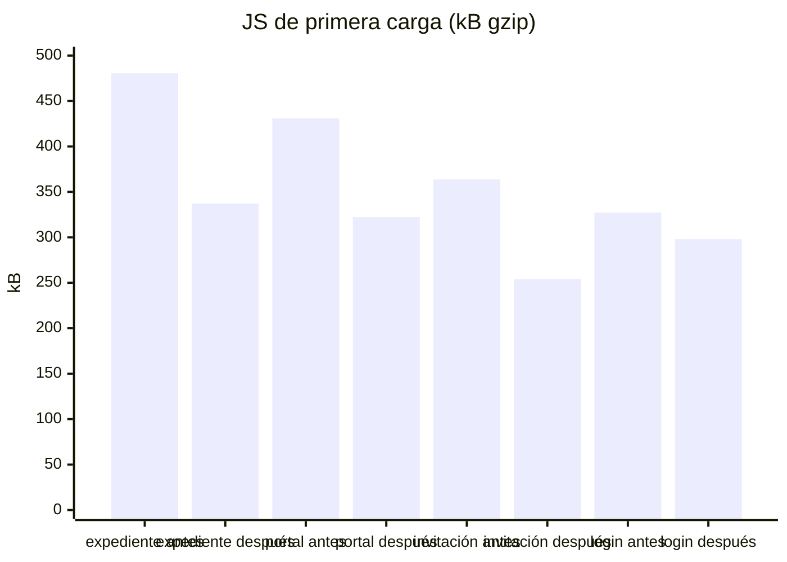
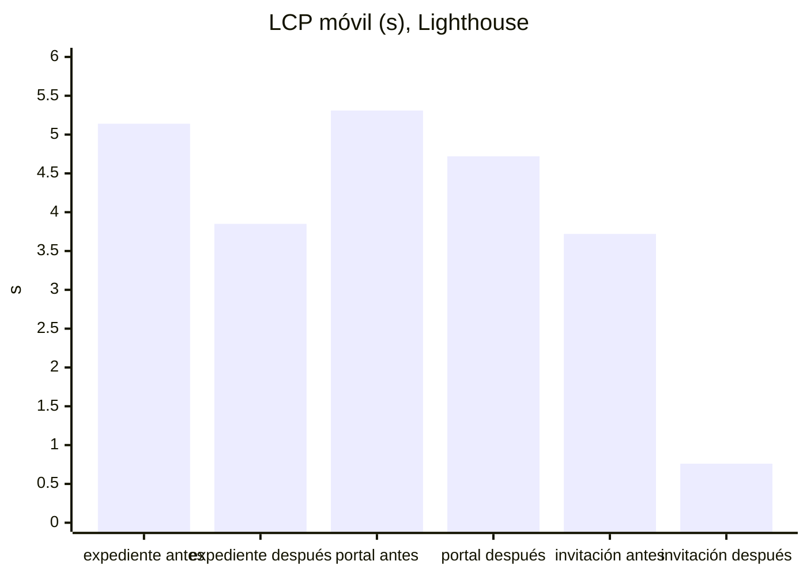

# Performance

Informe de la auditoría de performance del backoffice de crédito hipotecario, en dos partes:

- **Frontend:** Next.js 16.4 (App Router, Turbopack), React 19.3 y Ant Design 6.7. Hecha en noviembre de 2026 (#39).
- **Backend:** la carga y el estrés con k6, que la agrega otra tarea *(en curso)*.

Cada hallazgo dice cómo se solucionó; el detalle está en [`performance/frontend-hallazgos.md`](performance/frontend-hallazgos.md) y la línea base completa en [`performance/frontend-linea-base.md`](performance/frontend-linea-base.md).

Todo se midió en local, en un portátil y con los datos de demo. Las únicas credenciales que aparecen son las de la demo, que son públicas y solo funcionan en local.

## Frontend

### 1. Resumen ejecutivo

**Qué se midió.**
- **13 páginas** con el usuario que corresponde a cada una: las 3 públicas, 3 del administrador, 5 de la asesora, la del broker y el portal del comprador.
- **Lighthouse** en móvil (Moto G Power, 4G lento, CPU ×4) y en escritorio, en caché fría y tibia.
- **Web Vitals de laboratorio:** LCP, CLS, INP, FCP y TTFB.
- **Tres interacciones reales:** abrir el filtro del listado, cambiar de pestaña en el expediente y abrir "Registrar respuesta".
- **El JS de primera carga** de cada ruta y las peticiones a la API de cada página.

**Los 3 hallazgos más importantes:**
1. **El expediente (PERF-01) era la peor página:**
   - 480 kB de JS de primera carga, porque traía de entrada todas sus pestañas, paneles y modales;
   - 14 peticiones en 4 etapas encadenadas;
   - un repintado completo por cada respuesta.

   LCP móvil: **5,14 → 3,85 s**; JS: **480,6 → 337,1 kB (−30 %)**.
2. **Abrir "Registrar respuesta" (PERF-04) congelaba la página:** INP de **360 ms → 104 ms**.
3. **El dashboard se movía al llegar los datos (PERF-02):** CLS de 0,19–0,56 → **0,000**, y lo mismo, en menor grado, en Mi día y Prospectos (PERF-06).

**Mejora principal en números:**
- **JS de primera carga:** −30 % en el expediente y en `/aceptar-invitacion`, −25 % en el portal y −9 % en el login.
- **LCP móvil:** 5,1 → 3,9 s en el expediente, 3,7 → 0,8 s en `/aceptar-invitacion` y 5,3 → 4,7 s en el portal.
- **El resto de las páginas** queda igual dentro del ruido de la medición (ver §7).
- **Lo que no cambia:** ninguna página bajó de 100 en accesibilidad ni de 96 en buenas prácticas.

**Qué quedó en el CI:**
- un presupuesto de JS por ruta que bloquea;
- Lighthouse CI en las páginas públicas.

**Lo que no se cerró, con su motivo:**
- **El LCP móvil del portal** (PERF-03) sigue en 4,7 s y necesita un cambio del backend.
- **El LCP de las páginas con sesión** (PERF-05) está en 2,2–2,6 s; bajarlo pide renderizar la sesión en el servidor.
- **El costo de hidratar antd** (PERF-07 y PERF-10) queda como propuesta (`zeroRuntime`).

**Una lección del proceso.** Dos correcciones que parecían buenas se revirtieron cuando el A/B del mismo día las desmintió:
- el cambio de `ScrollTabs` (PERF-07);
- adelantar el bootstrap desde la guarda (PERF-05).

Una tercera medición, la del portal en la Parte 2, había medido otra pantalla y se corrigió. Ver §4.

### 2. Método

| Herramienta | Versión | Para qué |
|---|---|---|
| Next.js (`next build` + `next start`) | 16.4.6, Turbopack | Siempre el build de producción, limpio (`rm -rf .next`); nunca `next dev`. |
| `lighthouse` (API de Node) | 13.6.0 | Lighthouse en modo navegación. |
| `@lhci/cli` | 0.16.0 (trae Lighthouse 13.6.0) | Lighthouse CI de las páginas públicas. |
| `web-vitals` | 6.2.3 | Web Vitals de laboratorio, inyectadas con Playwright. |
| Playwright + Chromium | 1.65.0 + Chromium 158 | Login, sesión, Web Vitals, red e interacciones. |
| `next analyze` | el de Next 16.4.6 | Peso por módulo (`@next/bundle-analyzer` no funciona con Turbopack). |
| `node:zlib` | Node 24.14 | JS de primera carga por ruta, gzip nivel 9, desde `.next/diagnostics/route-bundle-stats.json`. |

- **Equipo:** Intel Core i5-11300H (4 núcleos, 8 hilos), 15,7 GB de RAM y Windows 11. El índice de benchmark de Lighthouse es ~2.240. El backend corre en Docker en el mismo equipo, con la demo ampliada (64 solicitudes en 6 meses).
- **Perfiles:**
  - **Lighthouse móvil:** el perfil por defecto (4G lento simulado: RTT de 150 ms, 1,6 Mbps, CPU ×4).
  - **Lighthouse escritorio:** el preset `desktop`.
  - **Web Vitals:** escritorio 1440×900 con CPU ×4 y red sin limitar, porque el backoffice se usa en escritorio.
- **Sesión:**
  - Playwright inicia sesión por la pantalla real, y Lighthouse corre en ese mismo Chrome por el puerto de depuración.
  - **Caché fría:** perfil nuevo y caché HTTP limpia en cada corrida.
  - **Caché tibia:** con una carga previa y sin limpiar.
- **Corridas:** 5 por página y perfil, y se reporta la **mediana**. Una corrida rara (un GC, un salto del reloj de la VM, el antivirus) mueve el promedio, pero no la mediana.
- **Antes y después en el mismo día.** La línea base de la Parte 1 se midió el 2026-11-19, con el equipo cargado (recién terminada la demo de punta a punta, ~4 GB libres). Al medir de nuevo, el mismo código daba otros números: por ejemplo, el TBT del listado pasó de 1.244 a 644 ms sin cambiar nada. Por eso la comparación de este informe es un **A/B del mismo día**:
  - el código de la línea base (`19c75c7`) y el código final, compilados limpios y medidos el 2026-11-20 con 5–6 GB libres;
  - intercalados por grupo de páginas, primero uno y después el otro;
  - la línea base original queda en [`frontend-linea-base.md`](performance/frontend-linea-base.md).

### 3. Resultados antes y después

A/B del mismo día, mediana de 5. "Antes" es `19c75c7` y "después" es el código final de este PR.

#### Lighthouse y Web Vitals

| Página | Perf. móvil | LCP móvil | TBT móvil | CLS móvil | Perf. escritorio | LCP Web Vitals | CLS Web Vitals |
|---|---:|---:|---:|---:|---:|---:|---:|
| `/login` | 98 → 97 | 0,91 s → 0,91 s | 173 → 195 ms | 0,000 → 0,000 | 100 → 100 | 400 → 376 ms | 0,002 → 0,002 |
| `/aceptar-invitacion` | 88 → **99** | 3,72 s → **0,76 s** | 150 → 121 ms | 0,000 → 0,001 | 100 → 100 | 1.024 → **236 ms** | 0,001 → 0,000 |
| `/acceso` | 100 → 99 | 0,76 s → 0,76 s | 86 → 113 ms | 0,002 → 0,002 | 100 → 100 | 228 → 224 ms | 0,000 → 0,000 |
| `/dashboard` | 86 → 80 | 2,40 s → 2,42 s | 368 → 514 ms | 0,000 → 0,000 | 91 → **100** | 1.588 → 1.920 ms | 0,213 → **0,000** |
| `/reportes` | 91 → 89 | 2,21 s → 2,22 s | 273 → 333 ms | 0,000 → 0,000 | 100 → 100 | 2.048 → 1.860 ms | 0,000 → 0,000 |
| `/admin/usuarios` | 88 → 86 | 2,40 s → 2,27 s | 305 → 421 ms | 0,000 → 0,000 | 100 → 100 | 1.760 → 1.824 ms | 0,003 → 0,003 |
| `/mi-dia` | 77 → 84 | 2,51 s → 2,38 s | 492 → 487 ms | 0,148 → **0,010** | 100 → 100 | 1.784 → 1.908 ms | 0,009 → 0,000 |
| `/solicitudes` | 77 → 79 | 2,55 s → 2,42 s | 644 → 630 ms | 0,000 → 0,000 | 99 → 100 | 1.816 → 1.784 ms | 0,000 → 0,000 |
| `/solicitudes/<id>` | 56 → **68** | 5,14 s → **3,85 s** | 992 → 809 ms | 0,036 → 0,036 | 95 → 98 | 2.664 → **2.180 ms** | 0,030 → 0,000 |
| `/clientes` | 82 → 82 | 2,38 s → 2,38 s | 510 → 521 ms | 0,000 → 0,000 | 100 → 100 | 1.612 → 1.640 ms | 0,000 → 0,000 |
| `/mis-comisiones` | 84 → 83 | 2,31 s → 2,33 s | 472 → 476 ms | 0,000 → 0,000 | 100 → 100 | 1.656 → 1.648 ms | 0,000 → 0,000 |
| `/prospectos` | 84 → 84 | 2,45 s → 2,27 s | 425 → 473 ms | 0,000 → 0,000 | 99 → 100 | 1.768 → 1.720 ms | 0,065 → **0,009** |
| `/portal` | 63 → **70** | 5,31 s → **4,72 s** | 590 → **416 ms** | 0,000 → 0,000 | 98 → 99 | 1.936 → **1.656 ms** | 0,000 → 0,000 |

**El CLS en detalle:**
- **Dashboard:** en la línea base se mueve en escritorio (0,191), en Web Vitals (0,213) y en móvil con caché tibia (0,564), cada vez que los datos llegan después de la primera pintura. Con la corrección da 0,000 en todas las corridas.
- **Prospectos:** en caché tibia pasa de 0,214 a 0,000.

**El TBT del dashboard:** sube en la tabla (368 → 514 ms), pero la bisección muestra que es ruido de la campaña:
- la línea base más solo el cambio del dashboard da ~387 ms;
- la línea base y el código final, medidos uno detrás de otro, dan ~385 y ~410 ms.

Ver §7.

#### JS de primera carga (gzip)

| Ruta | Antes | Después | Diferencia |
|---|---:|---:|---:|
| `/login` | 327,2 kB | 298,0 kB | −29,2 kB (−9 %) |
| `/aceptar-invitacion` | 363,7 kB | 254,0 kB | −109,7 kB (−30 %) |
| `/acceso` | 260,8 kB | 261,5 kB | +0,7 kB |
| `/dashboard` | 363,7 kB | 364,2 kB | +0,5 kB |
| `/reportes` | 385,1 kB | 386,1 kB | +1,0 kB |
| `/admin/usuarios` | 425,7 kB | 426,4 kB | +0,6 kB |
| `/mi-dia` | 421,5 kB | 423,3 kB | +1,7 kB |
| `/solicitudes` | 380,2 kB | 381,1 kB | +1,0 kB |
| `/solicitudes/[id]` | 480,6 kB | 337,1 kB | −143,5 kB (−30 %) |
| `/clientes` | 384,5 kB | 383,7 kB | −0,8 kB |
| `/mis-comisiones` | 380,1 kB | 380,7 kB | +0,6 kB |
| `/prospectos` | 435,8 kB | 436,3 kB | +0,5 kB |
| `/portal` | 431,0 kB | 322,3 kB | −108,7 kB (−25 %) |
| compartido por todas las rutas | 249,6 kB | 250,3 kB | +0,7 kB |

#### Interacciones (INP, escritorio con CPU ×4)

| Interacción | Antes | Después |
|---|---:|---:|
| Abrir el filtro del listado | 152 ms | 144 ms |
| Cambiar de pestaña en el expediente | 64 ms | 72 ms |
| Abrir el modal "Registrar respuesta" | 360 ms | **104 ms** |

#### Red

- **Expediente:** sigue haciendo 14 peticiones a la API, pero en 3 etapas en lugar de 4. Ahora salen a la vez que el detalle; antes se pedían recién cuando llegaba.
- **Las demás páginas** hacen las mismas peticiones que antes, ninguna repetida.
- **La respuesta más grande** sigue siendo `metadata/bootstrap` (36 kB, PERF-11, depende del backend).

### 4. Hallazgos y cómo se solucionó cada uno

13 hallazgos: 4 altos, 5 medios, 1 bajo y 3 informativos. La ficha completa de cada uno (causa, archivos, prueba y números) está en [`performance/frontend-hallazgos.md`](performance/frontend-hallazgos.md).

| Id | Problema | Causa | Cómo se solucionó | Antes → después | Commit | Estado |
|---|---|---|---|---|---|---|
| PERF-01 | El expediente tardaba en pintar su título (Alta) | Pedía sus secciones después del detalle; cargaba de entrada pestañas, paneles y modales; se repintaba con cada respuesta | Secciones en paralelo con el detalle, y la guarda las adelanta al entrar por esa ruta; pestañas, paneles y modales con `next/dynamic` y precarga en reposo; una suscripción por tarjeta (`workspace-screen.tsx`, `workspace-header.tsx`, `route-prefetch.ts`, `use-lazy.ts`) | LCP móvil 5,14 → 3,85 s · JS 480,6 → 337,1 kB · perf. 56 → 68 | `aaa7810` + Parte 4 | corregido; el resto depende del backend (endpoint agregado o HTTP/2) |
| PERF-02 | El dashboard se movía al llegar los datos (Alta) | Bloques de carga de 84 y 160 px para contenidos de 200 a 850 px | Las tarjetas de cifras se pintan con sus etiquetas y un esqueleto en el número; los bloques reservan su alto (`summary-blocks.tsx`, `block-state.tsx`) | CLS: escritorio 0,191 → 0, Web Vitals 0,213 → 0, caché tibia 0,564 → 0 | `38c1dda` | corregido |
| PERF-03 | El texto principal del portal tardaba (Alta) | Formularios y cargador en la primera carga; cadena sesión → solicitud | Retiro y carga de documentos con `next/dynamic` (`home-screen.tsx`) | LCP 5,31 → 4,72 s · JS 431,0 → 322,3 kB · TBT 590 → 416 ms | `a3b57b9` | depende del backend: `/buyer/session` con el resumen de la solicitud |
| PERF-04 | Abrir "Registrar respuesta" congelaba la página (Alta) | Estilos de antd y layout forzado de la animación, en el mismo clic | El modal se abre en `startTransition` (`response-timeline.tsx`) | INP 360 → 104 ms | `7fd0768` | corregido |
| PERF-05 | Las páginas con sesión pintan después de `/auth/me` (Media) | La guarda espera la sesión antes de montar la página | Se probó adelantar el bootstrap y se revirtió: no movía el LCP y sumaba ~115 ms de TBT | LCP 2,2–2,6 s, sin cambio | Parte 4 | aceptado: pide sesión en el servidor (§7 de la spec) |
| PERF-06 | Mi día y Prospectos se movían (Media) | Mismo patrón que PERF-02 | Esqueletos con la forma final (`tray.tsx`, `broker-screen.tsx`) | CLS de Mi día 0,148 → 0,010; Prospectos en caché tibia 0,214 → 0 | `38c1dda` | corregido |
| PERF-07 | TBT alto en el listado (Media) | Hidratación de antd y de la tabla | Se probó cambiar `ScrollTabs` y se revirtió: el A/B mostró que no ayudaba y empeoraba otras páginas | TBT 644 → 630 ms (sin cambio) | `15e39b5`, revertido en la Parte 4 | aceptado: va con la propuesta `zeroRuntime` |
| PERF-08 | `/aceptar-invitacion` pintaba tarde (Media) | El aviso se pintaba después de hidratar; formulario entero en la primera carga | El servidor sabe si hay token y pinta el aviso; el formulario se carga con `next/dynamic` | LCP 3,72 → 0,76 s · JS 363,7 → 254,0 kB | `a3b57b9` | corregido |
| PERF-09 | `/auth/refresh` quedaba abierta (Baja) | El cuerpo de la respuesta no se leía | Se lee el cuerpo (`session.ts`) | Corridas de Lighthouse sin terminar: 5 de 5 → 0 | `f35f660` | corregido |
| PERF-10 | El login cargaba Zod para dos campos (Media) | Esquema en la primera carga | El esquema se carga al validar (`login-schema.ts`) | JS 327,2 → 298,0 kB; Lighthouse CI en GitHub: 93/100/96 | `a3b57b9` | corregido; el CSS-in-JS de antd queda como propuesta |
| PERF-11 | `metadata/bootstrap` (36 kB) en cada carga (Informativa) | `Cache-Control: no-store` | — | — | — | depende del backend |
| PERF-12 | Fuentes sin `preload` (Informativa) | `@fontsource` en el CSS | No se migra: ninguna métrica que mover | — | — | aceptado |
| PERF-13 | Cada fila del listado precarga su expediente (Informativa) | El prefetch de `next/link` | Se deja: hace instantánea la navegación | 19 peticiones RSC por vista | — | aceptado; dato para la prueba de carga |

**Dos correcciones revertidas, por la medición:**
- **El cambio de `ScrollTabs` (PERF-07).** El perfil le atribuía 270 ms de layout forzado en `/solicitudes`. En el A/B del mismo día no mejoraba esa página (~529 → ~508 ms) y empeoraba el TBT de `/reportes` (~271 → ~464 ms) y de `/admin/usuarios` (~326 → ~465 ms): el layout no se ahorraba, se cambiaba de lugar.
- **Adelantar el bootstrap desde la guarda (PERF-05).** En `/admin/usuarios` sumaba ~115 ms de TBT, porque pedía 36 kB que esa página no usa, y no movía el LCP de ninguna. También se dejó de cargar el módulo de adelanto en las rutas que no lo usan (+4 kB que no hacían falta).

**Una corrección del informe de la Parte 2.** El "después" del portal (LCP 2,08 s, performance 95) se había medido sobre otra solicitud de demo, cuyo comprador tenía consentimientos pendientes, así que lo que se midió fue esa pantalla. Los números de arriba son los del mismo comprador antes y después. El script ahora fija la solicitud (`PERF_BUYER_APP_CODE`).

### 5. Presupuestos en el CI

Hay dos pasos nuevos en `.github/workflows/frontend.yml`. Los dos bloquean y salen como dos filas del reporte del CI en el PR.

1. **Bundle budget** (`frontend/scripts/check-bundle-budget.ts`):
   - Suma el gzip (nivel 9) de los chunks de primera carga de cada ruta, desde `.next/diagnostics/route-bundle-stats.json`, y compara con [`frontend/performance-budget.json`](../frontend/performance-budget.json).
   - El presupuesto cubre las 35 rutas y es lo medido al cierre + 10 %, redondeado hacia arriba a 5 kB. Por ejemplo: `/login` 330, `/solicitudes/[id]` 375, `/portal` 355 y `/aceptar-invitacion` 280 kB.
   - Falla si una ruta se pasa o si es nueva y no tiene presupuesto.
2. **Lighthouse (public pages)** (`frontend/lighthouserc.json`, `@lhci/cli` 0.16.0):
   - `/login`, `/aceptar-invitacion` y `/acceso`, 3 corridas en móvil contra `next start`, sin backend, con la corrida mediana.
   - Accesibilidad ≥ 0,95, buenas prácticas ≥ 0,95, LCP ≤ 2,5 s y CLS ≤ 0,1.
   - Performance ≥ 0,90 y TBT ≤ 300 ms en `/aceptar-invitacion` y `/acceso`; performance ≥ 0,85 y TBT ≤ 500 ms en `/login`.
   - Lighthouse CI abre un Chrome en frío en cada corrida, y el TBT del login varió entre 244 y 464 ms en 4 campañas locales. Por eso esos dos umbrales salen de lo medido, con la regla de la spec ("lo medido menos 0,03"); ver P17 en [`specs/TAREA-performance-front.md`](../specs/TAREA-performance-front.md).
   - **Primera corrida en el runner de GitHub (#39):** `/login` 93/100/96, `/aceptar-invitacion` 98/100/96 y `/acceso` 98/100/96, todas dentro de los umbrales.

**Cómo se actualizan:**
- **El presupuesto:** si el aumento de una ruta es a propósito (una pantalla nueva o una librería que hace falta), `node scripts/check-bundle-budget.ts --update` en `frontend/` lo reescribe con lo medido + 10 %. El número va explicado en el PR.
- **Los umbrales de Lighthouse:** se cambian en `lighthouserc.json`, con la misma regla (lo medido en varias corridas, menos 0,03 en las puntuaciones). Los informes de cada corrida quedan en el artefacto `ci-report-frontend` (`.ci-report/lighthouse/`).

### 6. Cómo reproducir la medición en local

Todo está en [`frontend/scripts/perf/README.md`](../frontend/scripts/perf/README.md). En resumen:

1. Levanta el backend con la demo (`backend/README.md`, "Demo Data").
2. Instala las herramientas fuera del repo: `npm install --prefix ../../_perf-tools lighthouse@13.6.0 web-vitals@6.2.3`.
3. Haz un build limpio: `rm -rf .next && pnpm build`.
4. Mide con `scripts/perf/with-server.sh --out <carpeta>/run-<grupo> --roles … --pages …`. Levanta `next start -p 3003`, inicia sesión por rol, corre Lighthouse y Web Vitals y detiene el servidor.
5. Arma las tablas con `node scripts/perf/report.mjs <carpeta> [<carpeta de antes>]`.

**Para un antes/después:** compila los dos códigos limpios y mídelos el mismo día, intercalados por grupo de páginas.

**El bundle:** `node scripts/check-bundle-budget.ts` (necesita el build).

### 7. Límites del análisis

- **Laboratorio, no usuarios reales.** No hay despliegue ni datos de campo (RUM).
  - La red móvil es la simulación de Lighthouse (4G lento con 6 conexiones HTTP/1.1, porque `next start` no sirve HTTP/2). Penaliza las páginas con muchas peticiones en paralelo, como el expediente; con HTTP/2 en producción, ese costo baja.
  - El INP por página es el de un clic neutro; solo las 3 interacciones medidas son interacciones reales.
- **Un solo equipo, un portátil con Windows, y el backend en el mismo equipo.** El TTFB es de 10–30 ms, sin la latencia de una red real.
- **El ruido de la medición:** con el mismo código, el TBT móvil de una página varía hasta ±100 ms entre campañas separadas por minutos (en el dashboard, 410–524 ms), y el LCP simulado ±0,2 s.
  - Diferencias de ese tamaño en las páginas que no se tocaron no son ni mejoras ni regresiones.
  - Por eso el antes/después es un A/B del mismo día, con la mediana de 5, y cada diferencia que motivó un cambio se confirmó con una bisección.
- **Los datos son los de la demo:** 64 solicitudes y listas de 20 filas. Con más datos, las tablas y los listados pesarían más, y eso lo mide la prueba de carga del backend.
- **El CLS depende del orden de llegada.** Las páginas se mueven solo cuando los datos llegan después de la primera pintura. Con el backend local muy rápido, a veces no pasa: la línea base del dashboard dio CLS 0 en móvil y 0,56 en caché tibia el mismo día. La corrección es estructural (los esqueletos ocupan el alto final), y la bisección confirma CLS 0 en todas las corridas.

## Backend: carga y estrés *(en curso)*

La agrega la tarea de pruebas de carga con k6 (escenarios, usuarios concurrentes y el objetivo de RNF-17: p95 menor a 800 ms en las lecturas normales). Lo que esta auditoría del front le deja como datos:
- PERF-11: `metadata/bootstrap` con `no-store`.
- PERF-03: `/buyer/session` sin el resumen de la solicitud.
- PERF-01: un endpoint agregado del expediente.
- PERF-13: unas 30 peticiones RSC al servidor de Next por cada vista del listado.
