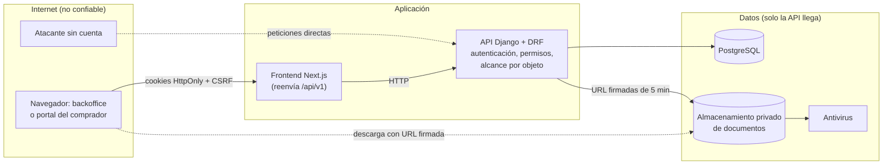

# Seguridad del backend

Informe de la auditoría de seguridad del backoffice de crédito hipotecario (Django 5.2 +
DRF, PostgreSQL 16). **Fase A: encontrar y documentar** (noviembre de 2026). La Fase B
corrige; cada hallazgo dice abajo cómo quedó.

Este documento no contiene secretos: ni contraseñas reales, ni tokens, ni cookies, ni URL
firmadas. La única contraseña que aparece en el repo es la de los datos de demo, que es
pública y solo funciona en local.

## 1. Resumen ejecutivo

**Qué se revisó.** La API del backend completa: las 235 operaciones del contrato
(`contracts/openapi.json`), con los cinco tipos de usuario (administración, asesor, broker
independiente, constructora y comprador con enlace mágico), más el código, las dependencias,
el historial de git y los contenedores.

**Cómo.** Con herramientas automáticas (analizadores de código, de dependencias y de
secretos), con ataques simulados contra una copia local de la API (más de 110 000
peticiones), con una prueba que pide **cada operación como cada tipo de usuario** (2115
casos) y con una revisión manual del código de los controles más sensibles. Todo en local,
sobre datos de demo. Lo que se pudo automatizar quedó como prueba en el repo y corre en cada
cambio.

**Resultado.** **20 hallazgos: ninguno crítico ni alto, 5 medios, 10 bajos y 5
informativos.** Lo más importante es lo que **no** apareció: nadie puede ver ni tocar
expedientes, documentos, clientes o comisiones que no le corresponden; sin sesión no se llega
a ningún dato; no hay inyecciones; los archivos se validan por su contenido real; los
enlaces del comprador, las radicaciones y los pagos no se duplican aunque lleguen diez
peticiones a la vez.

**Los tres más importantes, en una frase cada uno:**
1. **Prueba de contraseñas a escala** (SEC-09, medio): el límite de intentos de inicio de
   sesión es por "dirección IP + correo", así que alguien puede probar una contraseña contra
   todas las cuentas desde un solo equipo, o atacar una cuenta desde muchos equipos.
2. **Dos fallas conocidas en una librería** (SEC-04, medio): la versión de Django REST
   Framework tiene dos vulnerabilidades públicas que permiten, sin cuenta, dejar sin
   respuesta al servidor con pocas peticiones; la versión corregida existe pero hay que
   cambiar el rango permitido.
3. **Datos personales en la caché del navegador** (SEC-08, medio): las respuestas con datos
   de clientes no le dicen al navegador que no las guarde; en un equipo compartido podrían
   quedar en disco.

## 2. Alcance y método

**En el alcance:** el backend (`backend/`), su contrato, su CI y sus contenedores; las
dependencias del frontend solo se informaron. **Fuera:** el frontend como aplicación, la
infraestructura de producción (no existe todavía) y cualquier sistema externo. Fuentes de "quién
puede qué": `docs/REQUERIMIENTOS_MVP_CREDITO.md` §3 y §9 y `docs/API_REST_MVP_CREDITO.md` §3,
§25 y las secciones de cada módulo; si se contradicen, manda REQ.

| Parte | Qué | Herramienta (versión) | Detalle |
| --- | --- | --- | --- |
| 1 | Configuración de Django | `manage.py check --deploy` (Django 5.2.19) | [`01-automatico.md`](seguridad/01-automatico.md) |
| 1 | Código | bandit 1.9.4 · semgrep 1.186.0 (188 reglas de la comunidad) | idem |
| 1 | Dependencias | pip-audit 2.10.1 · pnpm audit (pnpm 12.18.0) | idem |
| 1 | Secretos en todo el historial | gitleaks 8.30.1 | idem |
| 1 | Contenedores | hadolint 2.15.1 y revisión manual | idem |
| 2 | Fuzzing de la API con 4 sesiones | schemathesis 4.33.4 (~42 000 casos) | [`02-dinamico.md`](seguridad/02-dinamico.md) |
| 2 | Escaneo pasivo y activo | OWASP ZAP 2.17.0 (~72 000 peticiones) | idem |
| 2 | Cabeceras, CORS, cookies, límites, errores | curl 8.23.0 y scripts propios | idem |
| 3 | Matriz de acceso (BOLA/BFLA): 235 operaciones × 9 actores | pytest (`tests/security`) | [`03-matriz-acceso.md`](seguridad/03-matriz-acceso.md) |
| 4 | Revisión manual de 10 áreas | lectura de código, pytest y `race_checks.py` | [`04-manual.md`](seguridad/04-manual.md) |

Todo corrió en un servidor local propio, con una base de datos de usar y tirar y contenedores
de un solo uso. Escala de severidad: **Crítica** (acceso sin sesión a datos personales, tomar
la cuenta de otro, ejecución de código), **Alta** (ver o cambiar datos de otro alcance, saltar
la autenticación del comprador, secreto real filtrado), **Media** (campos de más dentro del
propio alcance, límites que se saltan, enumeración de usuarios, una cabecera que importa),
**Baja** (endurecimiento), **Informativa** (buena práctica o aplica solo al desplegar).
Categorías: OWASP API Security Top 10 (2023).

## 3. Modelo de amenazas

**Quién podría atacar:**

| Actor | Qué intentaría |
| --- | --- |
| Asesor curioso | Ver o cambiar expedientes de otro asesor cambiando un id. |
| Broker que quiere datos de otro | Ver clientes, solicitudes o comisiones de otro broker; ver montos o documentos. |
| Comprador que cambia un id | Ver la solicitud, los documentos o las notificaciones de otro comprador. |
| Constructora | Ver expedientes de compradores de sus proyectos. |
| Atacante externo sin cuenta | Adivinar contraseñas, enumerar usuarios, tumbar el servicio, inyectar. |
| Alguien con un enlace mágico robado | Entrar al portal de otro comprador, o reusar el enlace. |

**Qué se protege:** los expedientes de crédito; los documentos de identidad e ingresos;
los datos personales y financieros de compradores y codeudores; las comisiones; las
credenciales y sesiones de los usuarios internos.

**Fronteras de confianza:**



Cada flecha que cruza una frontera es un punto de control: la API valida la sesión, el
permiso del rol y el alcance del objeto en **cada** petición; los archivos solo se sirven con
una URL firmada de vida corta; la base y el almacenamiento no se exponen.

## 4. Controles que ya existen

| Control | Dónde vive | Verificado en |
| --- | --- | --- |
| JWT HS256 con algoritmo fijo, claims obligatorios, leeway de 5 s y sesión viva en cada petición | `apps/identity/tokens.py`, `authentication.py` | Parte 4.1, `tests/identity`, `tests/security/test_auth.py` |
| Refresh opaco rotativo con detección de reuso; revocación al cambiar o restablecer la contraseña | `apps/identity/services.py` | `tests/identity/test_sessions.py`, `test_passwords.py` |
| CSRF en toda escritura autenticada por cookie | `apps/identity/authentication.py` (`enforce_csrf`) | Partes 2 y 4.1 |
| Cookies `HttpOnly`, `Secure`, `SameSite=Lax`, prefijo `__Host-` | `apps/identity/cookies.py` | Parte 2.3 |
| Argon2id (≥ mínimos OWASP) y validadores de contraseña | `config/settings/base.py` | Parte 4.1 |
| Permiso por código en cada vista (403) | `apps/identity/permissions.py` (`HasPermissionCode`, `required_permissions`) | Parte 3: 2115 casos |
| Alcance por objeto: fuera del alcance responde 404 | `apps/*/services.py` (`*_visible_to`) | Parte 3 |
| Portal del comprador limitado a su solicitud | `apps/identity/buyer_authentication.py`, `buyer_sessions.py` | Partes 3 y 4.2 |
| Enlace mágico de 256 bits, hasheado, un solo uso, a prueba de carreras | `apps/identity/buyer_access.py`, `buyer_sessions.py` | Parte 4.2 (`race_checks.py`) |
| Rechazo de campos no declarados (asignación masiva) | `config/serializers.py` (`StrictSerializer`) | Parte 4.5: 95 escrituras |
| `ordering` con lista cerrada | `config/filters.py` (`StrictOrderingFilter`) | Parte 4.4: 18 listados |
| Validación de archivos por contenido, nombre saneado, tamaño, antivirus | `apps/documents/file_validation.py`, `scanning.py` | Parte 4.3 |
| Descarga solo de archivos limpios, con URL firmada de 5 min, adjunta y `nosniff` | `apps/documents/downloads.py`, `storage.py`, `storage_views.py` | Parte 4.3 |
| Límites de consumo de login, recuperación, enlace, cargas, descargas y reportes | `apps/identity/throttling.py`, `AUTH_RATE_LIMITS` | Parte 2.4 |
| Idempotencia y `If-Match` en mutaciones críticas | `apps/idempotency`, servicios de cada módulo | Parte 4.7 |
| CSV con fórmulas neutralizadas | `apps/reporting/exports.py` | Parte 4.4 |
| Auditoría técnica sin datos personales | `apps/audit` | Parte 4.6: 390 eventos |
| `X-Request-ID` validado; URL firmadas fuera del log | `config/middleware.py`, `config/log_redaction.py` | Partes 4.4 y 4.6 |
| CORS con lista cerrada y credenciales | `config/settings/base.py` | Parte 2.3 |
| En el CI: pip-audit, gitleaks, bandit y la matriz al día | `.github/workflows/backend.yml`, `scripts/ci_report.py` | este informe |

## 5. Matriz de acceso

Cada operación de la API se probó como cada uno de estos actores: sin sesión, admin, la
asesora dueña del recurso, otro asesor, el broker que originó la oportunidad, otro broker, la
constructora, el comprador dueño y otro comprador. **2115 casos, todos con el resultado
esperado: ninguna brecha de acceso.**

| Actor | Permitido | 401 | 403 | 404 (fuera de alcance) |
| --- | --- | --- | --- | --- |
| sin sesión | 7 | 228 | 0 | 0 |
| admin | 200 | 33 | 2 | 0 |
| asesora dueña | 128 | 33 | 74 | 0 |
| otro asesor | 53 | 33 | 74 | 75 |
| broker dueño | 38 | 33 | 164 | 0 |
| otro broker | 23 | 33 | 161 | 18 |
| constructora | 20 | 33 | 182 | 0 |
| comprador dueño | 39 | 196 | 0 | 0 |
| otro comprador | 13 | 196 | 0 | 26 |

Además: ids de otro alcance en el cuerpo, filtros de listados, el detalle de la solicitud
que ve el broker (solo el resumen), la constructora en todas las rutas de expedientes, y un
usuario desactivado o sin rol con la cookie todavía vigente. Tabla completa, generada desde
la prueba: [`seguridad/03-matriz-acceso.md`](seguridad/03-matriz-acceso.md).

## 6. Hallazgos

Estado: `abierto` (pendiente de la Fase B), `corregido en #NN` o `aceptado` con el motivo.
Criterio de la Fase B: Crítica y Alta se corrigen todas; Media, si el esfuerzo es pequeño
(si no, se acepta con el motivo); Baja e Informativa se documentan y se corrigen si son de
una línea. Ficha completa de cada uno (cómo reproducirlo, impacto, dónde): [`seguridad/hallazgos.md`](seguridad/hallazgos.md).

| Id | Título | Severidad | OWASP API | Estado |
| --- | --- | --- | --- | --- |
| [SEC-01](seguridad/hallazgos.md#sec-01--no-hay-configuración-de-producción-y-los-puntos-de-entrada-cargan-local-que-fuerza-debugtrue) | No hay configuración de producción y los puntos de entrada cargan `local` (`DEBUG=True`) | Baja | API8 | abierto |
| [SEC-02](seguridad/hallazgos.md#sec-02--la-configuración-base-no-endurece-https) | La configuración base no endurece HTTPS | Baja | API8 | abierto |
| [SEC-03](seguridad/hallazgos.md#sec-03--las-claves-no-se-validan-al-arrancar-la-clave-jwt-local-tiene-31-bytes) | Las claves no se validan al arrancar | Baja | API8 | abierto |
| [SEC-04](seguridad/hallazgos.md#sec-04--djangorestframework-3172-tiene-dos-cve-de-denegación-de-servicio-sin-sesión) | DRF 3.17.2 con dos CVE de denegación de servicio | **Media** | API4 | corregido |
| [SEC-05](seguridad/hallazgos.md#sec-05--el-compose-publica-postgresql-y-el-backend-en-todas-las-interfaces-del-equipo) | El compose publica PostgreSQL y el backend en todas las interfaces | Baja | API8 | abierto |
| [SEC-06](seguridad/hallazgos.md#sec-06--imagen-del-backend-base-sin-digest-pip-sin-versión-y-runserver-como-comando) | Imagen del backend sin digest y con `runserver` | Informativa | API8 | abierto |
| [SEC-07](seguridad/hallazgos.md#sec-07--options-responde-500-en-27-rutas-una-de-ellas-pública) | `OPTIONS` responde 500 en 27 rutas | Baja | API8 | corregido |
| [SEC-08](seguridad/hallazgos.md#sec-08--las-respuestas-con-datos-personales-no-llevan-cache-control-no-store-ni-vary-cookie) | Respuestas con datos personales sin `Cache-Control: no-store` | **Media** | API8 | corregido |
| [SEC-09](seguridad/hallazgos.md#sec-09--el-límite-de-login-y-de-recuperación-se-salta-con-otros-correos-o-con-otras-ip) | El límite de login y recuperación se salta con otros correos u otras IP | **Media** | API2 | corregido |
| [SEC-10](seguridad/hallazgos.md#sec-10--no-existen-los-límites-generales-por-usuario-que-piden-req-93-y-api-26) | Faltan los límites generales por usuario | **Media** | API4 | corregido |
| [SEC-11](seguridad/hallazgos.md#sec-11--un-json-de-más-de-25-mb-responde-500-sin-debug-o-la-página-de-depuración-con-debug-no-413) | Un JSON de más de 2,5 MB responde 500 y no 413 | Baja | API8 | corregido |
| [SEC-12](seguridad/hallazgos.md#sec-12--las-rutas-inexistentes-y-los-ids-que-no-son-uuid-responden-html-de-django-no-el-formato-de-error-de-la-api) | Rutas inexistentes responden HTML de Django | Baja | API8 | corregido |
| [SEC-13](seguridad/hallazgos.md#sec-13--el-contrato-no-coincide-con-la-api-en-2-respuestas-y-no-documenta-varios-estados) | El contrato no coincide con la API en 2 respuestas | Informativa | API9 | abierto |
| [SEC-14](seguridad/hallazgos.md#sec-14--la-recuperación-de-contraseña-revela-si-el-correo-existe-cuando-falla-el-envío) | La recuperación revela si el correo existe cuando falla el envío | **Media** | API2 | corregido |
| [SEC-15](seguridad/hallazgos.md#sec-15--el-log-de-peticiones-guarda-la-búsqueda-completa-documento-o-nombre) | El log de peticiones guarda la búsqueda completa | Baja | API8 | corregido |
| [SEC-16](seguridad/hallazgos.md#sec-16--un-409-al-crear-un-cliente-confirma-que-esa-cédula-ya-está-registrada) | El `409` de documento duplicado confirma que la cédula existe | Baja | API3 | abierto |
| [SEC-17](seguridad/hallazgos.md#sec-17--textos-de-la-configuración-de-bancos-sin-longitud-máxima) | Textos de la configuración de bancos sin longitud máxima | Informativa | API4 | corregido |
| [SEC-18](seguridad/hallazgos.md#sec-18--admin-de-django-está-publicado-con-la-api-y-su-login-no-tiene-límite-de-intentos) | `/admin/` publicado y sin límite de intentos | Baja | API8 | corregido |
| [SEC-19](seguridad/hallazgos.md#sec-19--el-esquema-openapi-y-la-documentación-interactiva-son-públicos) | Esquema OpenAPI y documentación públicos | Informativa | API9 | corregido |
| [SEC-20](seguridad/hallazgos.md#sec-20--la-documentación-de-la-api-promete-9-rutas-que-no-existen-y-omite-5-que-sí) | La documentación no coincide con las rutas | Informativa | API9 | abierto |

### Fichas

Cada ficha: qué pasa, qué riesgo trae, el estado y cómo se soluciona. La prueba que lo
reproduce está en `backend/tests/security/` (marcada `xfail` con su id) o el comando, en la
ficha completa.

**SEC-01 · Baja · API8 — Sin configuración de producción.** Los puntos de entrada (`wsgi`,
`asgi`, Celery) cargan `config.settings.local`, que fija `DEBUG=True`, correo a la consola y
cookies sin `Secure` aunque el entorno diga lo contrario. Riesgo: si se despliega así, páginas
de depuración y enlaces con token en el log. Estado: abierto.
**Cómo se solucionó:** Pendiente (Fase B). Corrección sugerida: `config/settings/production.py`
con `DEBUG=False` fijo y que `wsgi`, `asgi` y `celery` lo usen por defecto.

**SEC-02 · Baja · API8 — HTTPS sin endurecer.** `base.py` no define HSTS, redirección a HTTPS,
`SESSION_COOKIE_SECURE` ni `SECURE_PROXY_SSL_HEADER`. Estado: abierto.
**Cómo se solucionó:** Pendiente (Fase B). Corrección sugerida: esos cuatro ajustes en
`production.py`.

**SEC-03 · Baja · API8 — Claves sin validar.** El arranque acepta cualquier clave no vacía; la
JWT local tiene 31 bytes (RFC 7518 pide 32). Estado: abierto.
**Cómo se solucionó:** Pendiente (Fase B). Corrección sugerida: un *system check* que exija
≥ 32 bytes sin `DEBUG`; regenerar las claves locales.

**SEC-04 · Media · API4 — DRF con dos CVE de DoS.** CVE-2026-114136 (el `charset` de
compresión salta el límite del cuerpo: 101 bytes llegan como 5 MB) y CVE-2026-114138 (`Accept`
en tiempo cuadrático). El arreglo, 3.18.2, quedaba fuera del rango `<3.18`. Estado: corregido.
**Cómo se solucionó (Fase B, este PR) — corregido.** *Causa:* el rango `<3.18` de
`requirements.txt` dejaba fuera el arreglo. *Cambio:* `backend/requirements.txt` (DRF
`>=3.18.2,<3.19`, stubs compatibles) y `backend/security/pip-audit-ignore.txt` sin las dos
excepciones. *Verificación:* `tests/security/test_resources.py::test_a_compressed_charset_is_not_expanded`;
en el 8010, el cuerpo bz2 de 96 bytes pasó de `400 VALIDATION_ERROR` (expandido a 5 MB, 586 ms)
a `400 MALFORMED_REQUEST` (66 ms), y el `Accept` de 9 KB de 64 ms a 7 ms (`406`).

**SEC-05 · Baja · API8 — Puertos en todas las interfaces.** El compose publica PostgreSQL y la
API en `0.0.0.0`. Estado: abierto.
**Cómo se solucionó:** Pendiente (Fase B). Corrección sugerida: `127.0.0.1:` delante de cada
puerto publicado.

**SEC-06 · Informativa · API8 — Imagen del backend.** Base sin digest, `pip` sin versión,
`runserver` como comando y cabecera `Server` con la versión de Python. Estado: abierto.
**Cómo se solucionó:** Pendiente (Fase B). Corrección sugerida: `FROM ...@sha256:`, `pip`
fijado y `gunicorn` en la imagen de producción.

**SEC-07 · Baja · API8 — `OPTIONS` con 500.** 27 vistas genéricas fallan al describir sus
campos; una es pública. Estado: corregido.
**Cómo se solucionó (Fase B, este PR) — corregido.** *Causa:* la metadata de DRF describía los
campos con `get_serializer()`. *Cambio:* `REST_FRAMEWORK["DEFAULT_METADATA_CLASS"] = None`
(`backend/config/settings/base.py`): `OPTIONS` responde `405` y el *preflight* sigue en
`corsheaders`. *Verificación:* `tests/security/test_http_responses.py` (las 175 rutas con y sin
sesión, sin 5xx; *preflight* desde `localhost:3000`); en el 8011, de 29 × `500` a ninguno.

**SEC-08 · Media · API8 — Sin `Cache-Control: no-store`.** Las respuestas con datos personales
(y el CSV de reportes) se pueden guardar en caché, y no varían por `Cookie`. Estado: corregido.
**Cómo se solucionó (Fase B, este PR) — corregido.** *Causa:* DRF no pone `Cache-Control`.
*Cambio:* `ApiNoStoreMiddleware` (`backend/config/middleware.py`, en `MIDDLEWARE`): `no-store` en
`/api/v1/` cuando la vista no trae uno propio, y `Vary: Cookie` siempre. *Verificación:*
`tests/security/test_http_responses.py` (listado, detalle, `/auth/me`, CSV y catálogo con ETag);
en el 8011, `/auth/me`, clientes, solicitud y CSV pasaron de sin cabecera a `no-store`.

**SEC-09 · Media · API2 — Límite de login saltable.** La clave del límite es "IP + correo":
12 correos desde una IP pasan sin freno, y la misma cuenta suma 5 intentos por cada IP nueva.
Estado: corregido.
**Cómo se solucionó (Fase B, este PR) — corregido.** *Causa:* una sola clave "IP + correo".
*Cambio:* `backend/apps/identity/throttling.py` y `views.py` suman, al límite de IP + correo, uno
por IP (login `20/15m`, recuperación `10/1h`) y uno por cuenta (`10/15m`, `5/1h`), con tasas en
`AUTH_RATE_LIMITS` (`backend/config/settings/base.py`). Decisión: sin demora con `sleep`; el
límite por cuenta es el control progresivo. *Verificación:* `tests/security/test_rate_limits.py`
(rociado, una cuenta desde varias IP y recuperación a muchos correos); en el 8010, el rociado
corta en el 21.º correo y la cuenta en el 11.º fallo aunque cambie de IP. *Riesgo residual:*
quien conozca un correo puede bloquear esa cuenta 15 minutos.

**SEC-10 · Media · API4 — Sin límites generales.** No existen los 120/min de escrituras, 600/min
de lecturas ni 20/min de cambios de estado que pide REQ §9.3. Estado: corregido.
**Cómo se solucionó (Fase B, este PR) — corregido.** *Causa:* sin `DEFAULT_THROTTLE_CLASSES`.
*Cambio:* `backend/apps/identity/throttling.py` (lecturas `600/1m`, escrituras `120/1m` por usuario,
sesión del comprador o IP, y `20/1m` común a cambios de estado, desistimientos, radicaciones y
transiciones de oportunidad con `throttle_scope`), `backend/config/settings/base.py` y las vistas
con límites propios, que ahora los suman a los generales. *Verificación:*
`tests/security/test_rate_limits.py` (lectura, escritura y cambio de estado con `429`,
`Retry-After` y el texto en español); en el 8010, `POST /clients` corta en el 121.º, `GET
/clients` en el 601.º y los cambios de estado en el 21.º.

**SEC-11 · Baja · API8 — 500 con un JSON grande.** El límite de 2,5 MB sí corta, pero responde
500 en vez de 413. Estado: corregido.
**Cómo se solucionó (Fase B, este PR) — corregido.** *Causa:* `RequestDataTooBig` no es de
DRF. *Cambio:* `backend/config/exceptions.py` la convierte en `413 PAYLOAD_TOO_LARGE`.
*Verificación:* `tests/security/test_http_responses.py` (3 MB en el login y en `POST /clients`); en
el 8011, de `500` a `413` con el formato de la API.

**SEC-12 · Baja · API8 — 404 en HTML.** Las rutas inexistentes y los ids que no son UUID
responden la página de Django. Estado: corregido.
**Cómo se solucionó (Fase B, este PR) — corregido.** *Causa:* sin `handler404`/`handler500`.
*Cambio:* `backend/config/views.py` y `backend/config/urls.py`: JSON con `build_error_body` en
`/api/`, la página de Django fuera. *Verificación:* `tests/security/test_http_responses.py`
(`/api/v1/no-existe` y `/api/v1/applications/abc` → `404 RESOURCE_NOT_FOUND` con `request_id`); en
el 8011, de `text/html` a JSON. Con `DEBUG` (solo local) sigue la página de depuración.

**SEC-13 · Informativa · API9 — Contrato desalineado.** Dos respuestas no siguen el esquema y
faltan códigos 400/404/428. Estado: abierto.
**Cómo se solucionó:** Pendiente (Fase B). Corrección sugerida: corregir los serializers o su
`extend_schema` y regenerar el contrato.

**SEC-14 · Media · API2 — Enumeración por la recuperación.** El correo se envía dentro de la
petición y solo si el usuario existe: con el correo caído, 500 para los que existen y 202 para
los que no. Estado: corregido.
**Cómo se solucionó (Fase B, este PR) — corregido.** *Causa:* `send_mail` síncrono en la
petición, solo si el usuario existía. *Cambio:* `backend/apps/identity/tasks.py` (nuevo),
`services.py` e `invitations.py`: la petición solo encola después del commit; el worker busca el
usuario, genera el token (que no pasa por el broker) y envía; un fallo queda en el log. Las
invitaciones, que también eran síncronas, van igual. *Verificación:*
`tests/security/test_auth.py::test_reset_request_answers_the_same_when_the_mail_fails` (sin
`xfail`) y tres pruebas más; en el 8010 con worker, `202` siempre y +4,1 ms de mediana (antes
+14 ms y `500` con el SMTP caído). *Riesgo residual:* en el modo local simple (tareas en el
mismo proceso) el tiempo del envío se suma cuando el correo existe.

**SEC-15 · Baja · API8 — Búsquedas en el log.** El log de peticiones guarda la URL con
`?search=` (documento, nombre). Estado: corregido.
**Cómo se solucionó (Fase B, este PR) — corregido.** *Causa:* el filtro solo ocultaba los
tokens. *Cambio:* `backend/config/log_redaction.py` escribe `***` en el valor de `search`, `email`,
`document_number` y `q` de cualquier mensaje. *Verificación:*
`tests/security/test_exposure.py::test_search_terms_are_not_written_to_the_access_log` (sin `xfail`)
y tres pruebas más; en el 8010, `"GET /api/v1/clients?search=*** HTTP/1.1"`.

**SEC-16 · Baja · API3 — El 409 confirma la cédula.** Crear un cliente con un documento ya
registrado responde 409 aunque el cliente sea de otro alcance (sin revelar sus datos). Estado:
abierto (documentado en API §13).
**Cómo se solucionó:** Pendiente (Fase B). Corrección sugerida: decisión de producto; o un
flujo de "cliente ya existente" que revise un asesor, o aceptarlo con el límite de SEC-10.

**SEC-17 · Informativa · API4 — Textos de bancos sin tope.** `operational_notes` acepta 1 MB
(solo admin). Estado: corregido.
**Cómo se solucionó (Fase B, este PR) — corregido.** *Cambio:* `max_length=4000` en los dos
campos (`backend/apps/banking/serializers.py`). *Verificación:*
`tests/security/test_resources.py::test_bank_operational_notes_have_a_maximum_length` (sin `xfail`)
y la de edición; en el 8011, 100 000 caracteres pasaron de `201` a `400`.

**SEC-18 · Baja · API8 — Admin de Django expuesto.** `/admin/` en el mismo host, con 42 modelos
y sin límite de intentos; hoy no hay usuarios que puedan entrar. Estado: corregido.
**Cómo se solucionó (Fase B, este PR) — corregido.** *Causa:* `admin/` montado siempre y sin
límite. *Cambio:* `backend/config/urls.py`, `views.py` y `settings/base.py`: solo con `DEBUG` o
`ADMIN_ENABLED` (por defecto `False`), en `ADMIN_URL_PATH`, y su login con un límite por IP de
`10/15m`. *Verificación:* `tests/security/test_config_inventory.py` (apagado → `404`; encendido →
`429` al 11.º intento); en el 8011, de 12 × `200` a `404`, y encendido 10 × `200` + `429`.

**SEC-19 · Informativa · API9 — Esquema y docs públicos.** `/openapi.json` y `/docs` sin sesión,
también sin `DEBUG`. Estado: corregido.
**Cómo se solucionó (Fase B, este PR) — corregido.** *Cambio:* `/openapi.json` y `/docs` solo
con `DEBUG` o `API_DOCS_PUBLIC` (por defecto `False`) en `backend/config/urls.py`; el frontend usa
`contracts/openapi.json`. *Verificación:*
`tests/security/test_config_inventory.py::test_api_schema_and_docs_need_a_session` (sin `xfail`);
en el 8011, de `200` a `404` (y `200` con la variable).

**SEC-20 · Informativa · API9 — Documentación desalineada.** 9 rutas documentadas no existen y
las 5 de direcciones del cliente no están documentadas. Estado: abierto.
**Cómo se solucionó:** Pendiente (Fase B). Corrección sugerida: marcar las 9 como fuera del MVP
y documentar las 5.

## 7. Riesgo residual

Lo que queda aunque se corrija todo lo anterior, y cómo se acota:

- **Fuerza bruta distribuida.** Ningún límite por IP frena un ataque desde miles de IP; hace
  falta protección perimetral (WAF o *rate limiting* en el proxy) al desplegar.
- **Archivos con contenido activo.** Un PDF con JavaScript pasa la validación (es un PDF
  válido): lo cubren el antivirus, la descarga siempre adjunta y con `nosniff`, y el visor del
  usuario. ClamAV solo corre en el modo completo; en el modo local simple el antivirus es
  falso.
- **Enlace mágico reenviado.** Quien tenga el enlace antes que el comprador entra a su portal
  (es la naturaleza del acceso sin contraseña): lo acotan el solo uso, el vencimiento, la
  revocación y que la sesión dure 24 h y quede limitada a esa solicitud.
- **Producción todavía no existe.** HTTPS, HSTS, secretos de producción, logs y backups se
  revisan al desplegar (SEC-01, SEC-02, SEC-03, SEC-06).
- **Lo que no se probó:** el frontend como aplicación (XSS en la interfaz, CSP del sitio), el
  modo completo con S3 real y Celery distribuido, y la carga sostenida.
- **Pruebas que vigilan:** la matriz exige que cada operación nueva del contrato tenga su fila;
  `pip-audit`, `gitleaks` y `bandit` corren en cada PR.

## 8. Cómo reproducir

Los comandos de cada parte (preparación, herramientas, escaneos, matriz y carreras) están en
[`backend/security/README.md`](../backend/security/README.md). En corto, desde `backend/`:

```
pytest tests/security                     # la matriz y la revisión manual (~105 s)
python security/render_matrix.py --check  # el documento de la matriz está al día
```

Y en cada PR, el CI corre la suite completa más `pip-audit`, `gitleaks`, `bandit` y la
verificación de la matriz; el resultado sale en el comentario del PR.
