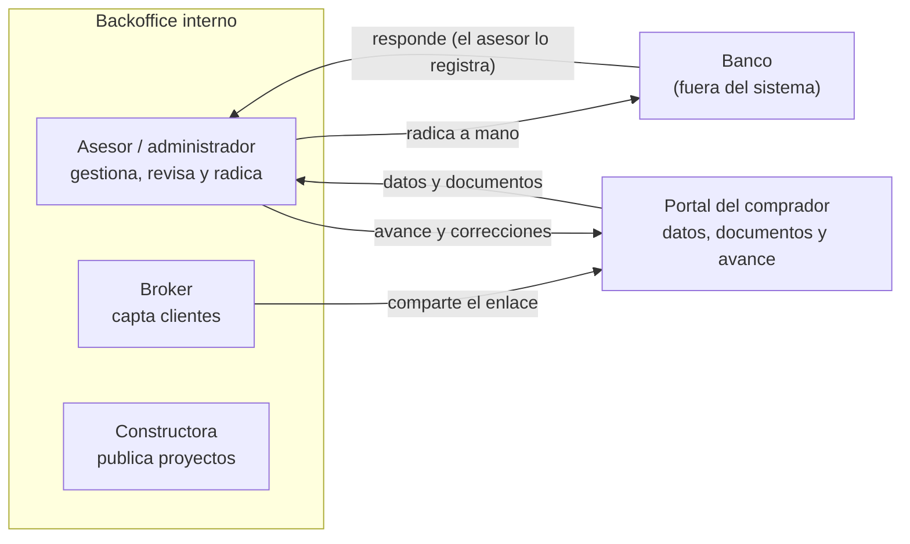
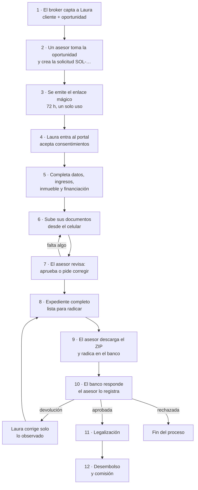

# 01 · El producto

> **En una frase:** una plataforma para gestionar solicitudes de crédito de vivienda en Colombia, con dos caras: un **backoffice** donde el equipo interno arma, revisa y radica los expedientes, y un **portal** donde el comprador completa sus datos y sube sus documentos desde el celular, sin crear cuenta.

Este documento cuenta **qué es el producto y para quién es**. El *cómo está hecho* está en [03 · Arquitectura](03-arquitectura.md) y las reglas del dominio, en [02 · Negocio](02-negocio.md).

Cifras y estados de este documento: contados en `master` el **18 de noviembre de 2026**; las vistas, actualizadas el **19 de noviembre** (entró la F6, administración).

---

## 1. El problema

Comprar vivienda con crédito en Colombia exige armar un **expediente**: la carpeta con los datos del comprador, sus ingresos, el inmueble y una docena de documentos (cédula, certificados laborales, extractos, desprendibles de nómina…). Ese expediente se entrega al banco para que lo estudie.

Sin una herramienta, ese trabajo se hace así:

- **El asesor de crédito arma cada expediente a mano.** Pide documentos uno por uno, revisa si están completos, los renombra, los junta en una carpeta y lleva la cuenta en una hoja de cálculo.
- **El comprador manda los documentos por WhatsApp o por correo.** Llegan fotos torcidas, PDF vencidos, archivos sin nombre. Nadie sabe cuál es la última versión.
- **El estado vive en la cabeza del asesor.** El comprador no sabe en qué va su solicitud, y el broker que trajo al cliente tampoco.
- **La respuesta del banco no queda trazada.** Si el banco devuelve el expediente con observaciones, se corrige "por chat" y no queda registro de qué se pidió ni de qué se corrigió.

El objetivo del producto (fuente: [`docs/REQUERIMIENTOS_MVP_CREDITO.md`](../REQUERIMIENTOS_MVP_CREDITO.md) §1) es ordenar ese proceso: que el asesor haga seguimiento, revise documentos y radique en el banco; y que el comprador complete sus datos, elija la financiación, cargue sus documentos y vea el avance.

## 2. Qué hace

El producto tiene **dos interfaces que comparten la misma base de datos** (REQ §1). Las dos viven en una sola aplicación Next.js; cambian la navegación y la sesión.

*Qué mirar: el banco está **fuera** del sistema. Nada se envía al banco por API: el asesor radica a mano y registra lo que el banco le contesta.*

En concreto, el producto cubre (REQ §2, "Incluido"):

- **Acceso.** Contraseña para el equipo interno y **enlace mágico** (un enlace de un solo uso, sin contraseña) para el comprador.
- **CRM.** Clientes, oportunidades comerciales, tareas y la bandeja "Mi día" del asesor.
- **Proyectos de constructora** que la operación valida antes de usarlos.
- **Solicitudes de crédito** con titular, co-solicitantes y deudores solidarios, datos financieros, inmueble y financiación.
- **Bancos, productos y requisitos documentales** configurables desde el backend.
- **Expediente documental**: carga desde el portal, antivirus, revisión por el asesor, versiones y descarga del expediente completo en un ZIP.
- **Radicación manual** y **registro de las respuestas del banco**, con notificación al comprador por el portal y por correo.
- **Dashboard y reportes** con exportación CSV.
- **Historial** de estados y actividad.
- **Comisiones** sobre créditos desembolsados: cálculo, reparto y registro del pago.

### Lo que no hace (a propósito)

Fuera del MVP, por decisión (REQ §2 "Fuera de alcance" y el Anexo A de [`specs/TAREA-documentacion.md`](../../specs/TAREA-documentacion.md)):

| Fuera | Por qué |
| --- | --- |
| Integración con bancos (APIs, portales, correos) | Cada banco tiene su canal; el MVP termina en la radicación manual y el registro de la respuesta. |
| DataCrédito, score, reglas automáticas de riesgo | El producto no decide si se presta: eso lo hace el banco. |
| Firma electrónica, seguros, bots, calendario | Ninguno es necesario para llevar un expediente de punta a punta. |
| Retenciones, impuestos y facturación de comisiones | Las comisiones se calculan y se registra su pago; la parte contable queda afuera. |
| Multi-tenant comercial | Es una sola operación. Sí hay aislamiento de acceso por broker, partner y proyecto. |
| Campana de notificaciones internas en el backoffice | Las notificaciones son para el comprador (ver [02 · Negocio §8](02-negocio.md#8-notificaciones)). |
| "Deshacer" una aprobación de documento | Se decide otra vez sobre la versión vigente (se rechaza la aprobada). |
| Aplicación móvil nativa | El portal es web y está diseñado **móvil primero**. |
| Despliegue | El proyecto corre en local y en CI. La única publicación prevista es el Storybook del design system (Anexo A). |

## 3. Los cinco roles

Hay cuatro roles internos, con usuario y contraseña, y el comprador, que entra sin cuenta (REQ §3). Los permisos se aplican **siempre en el servidor**: ocultar un botón no autoriza nada (REQ §3, última línea).

| Rol | Código | Qué hace | Qué **no** hace |
| --- | --- | --- | --- |
| Administrador | `ADMIN` | Todo. Administra usuarios, partners, proyectos, bancos, productos, requisitos documentales, catálogos, planes de comisión y pagos. Consulta la auditoría técnica. | — |
| Asesor de crédito | `ADVISOR` | Gestiona sus clientes y **sus solicitudes asignadas**: tareas, revisión de documentos, paquete, radicación y respuestas del banco. Valida los proyectos de las constructoras. Ve sus comisiones. | No ve solicitudes de otros asesores. No administra catálogos. |
| Broker independiente | `INDEPENDENT_BROKER` | Capta al cliente: crea el contacto y la oportunidad inicial, emite el enlace de invitación al portal y consulta un **resumen** del estado de lo que originó. Ve su parte de las comisiones. | No ve archivos ni datos financieros, no carga documentos, no radica, no aprueba. |
| Usuario de constructora | `CONSTRUCTION_PARTNER` | Crea y edita los proyectos de **su** constructora (en borrador) y los envía a validación. | No ve expedientes de compradores ni documentos. No cobra comisión. |
| Comprador | `BUYER` (sin usuario) | Entra con el enlace mágico. Acepta los consentimientos, completa sus datos, ingresos, inmueble y financiación, carga sus documentos, ve el avance y sus avisos, y puede desistir. | No aprueba documentos. Después de radicar solo reemplaza lo que el banco observó. |

De dónde sale cada fila en el código:

- Los cuatro roles internos son filas de la tabla `roles` y los permisos se siembran por migración en cada app (por ejemplo, `backend/apps/filings/migrations/0002_seed_catalogs_permissions_transitions.py`, líneas 35-38: `filings.read` para admin, asesor y broker; `filings.create`, `filings.update` y `filings.record_response` solo para admin y asesor).
- La vista revisa el **código de permiso**, no el nombre del rol: `backend/apps/identity/permissions.py` (`HasPermissionCode`).
- El **alcance** ("sus solicitudes asignadas", "lo que originó") se aplica al construir la consulta: `backend/apps/applications/services.py` (`applications_visible_to`, con la regla en `crm.services.application_scope_condition`). Un recurso fuera del alcance responde `404`, para no revelar que existe.
- El comprador no tiene fila en `users`: es un `client` con una sesión temporal (`backend/apps/identity/models/`, tablas `buyer_access_links` y `buyer_sessions`).

La matriz completa por recurso está en REQ §8.6 y el detalle por módulo, en [06 · Módulos](06-modulos.md).

## 4. El recorrido del comprador, contado como historia

Para entender el producto, sirve seguir a una compradora ficticia, **Laura**, desde que un broker la conoce hasta que el banco le desembolsa el crédito. Cada paso dice qué pasa en el sistema y dónde está en el código.

*Qué mirar: los dos ciclos. El primero (pasos 6-7) es el ida y vuelta normal de documentos antes de radicar. El segundo (devolución del banco) vuelve a abrir solo los documentos que el banco observó.*

**1. El broker capta a Laura.** Juan, un broker independiente, conoce a Laura en una feria de vivienda. Desde el backoffice crea a Laura como **cliente** (el sistema valida que su tipo y número de documento no estén repetidos, RF-10) y abre una **oportunidad**: el registro de que Laura quiere comprar. Como la creó un broker, la oportunidad queda en `NEW` y **sin asesor**; si la hubiera creado un asesor, quedaría asignada a él en `ASSIGNED` (`backend/apps/crm/services.py`, `SELF_ASSIGNMENT_REASON`; decisión de [`specs/TAREA-brechas-2.md`](../../specs/TAREA-brechas-2.md), Parte 1, punto 6). El origen de la oportunidad queda como `BROKER`, y eso importará al final, en la comisión.

**2. Un asesor toma el caso.** Un administrador asigna a Marta, asesora de crédito. Marta contacta a Laura y crea la **solicitud de crédito** a partir de la oportunidad: el sistema le da un código legible (`SOL-000123`, de una secuencia de PostgreSQL en `backend/apps/applications/models/application.py`) y la deja en `DRAFT` (borrador). Crear la solicitud **convierte** la oportunidad (`CONVERTED`).

**3. El enlace mágico.** Marta (o Juan, el broker) emite un **enlace de acceso** para Laura. Es de un solo uso, vence en 72 horas por defecto (máximo 168) y siempre es para el titular de la solicitud (`backend/apps/identity/buyer_access.py` y `BUYER_ACCESS_LINK_DEFAULT_HOURS` en `backend/config/settings/base.py`). Se copia o se envía por correo. Emitir uno nuevo revoca el anterior que no se usó.

**4. Laura entra al portal.** Abre el enlace en su celular. La página `/acceso` consume el token, **lo borra de la URL** y abre una sesión de 24 horas que no se renueva (`frontend/src/app/acceso/page.tsx`, `BUYER_SESSION_LIFETIME`). Lo primero que ve son los **consentimientos**: el tratamiento de datos personales y, si hay co-solicitantes, la autorización para compartir sus datos. Mientras no los acepte, el portal no la deja guardar nada (`403 CONSENT_REQUIRED`).

**5. Completa su información.** En el portal llena sus datos de contacto, el perfil financiero y los ingresos (suyos y de su co-solicitante, si lo hay), el inmueble y la financiación: elige el banco y el producto entre los que el backend le muestra como disponibles para su caso. Cada formulario solo valida formato; las reglas las valida la API ([`specs/TAREA-front-portal.md`](../../specs/TAREA-front-portal.md), "Validación").

**6. Sube sus documentos.** El sistema calculó la lista de documentos que su caso exige (según banco, producto, finalidad y perfil laboral). Laura ve qué le falta ("Te falta"), qué está en revisión y qué debe corregir ("Corrígelo"). Desde el celular toma una foto de su cédula o elige un PDF. El backend valida el tipo real del archivo (por sus primeros bytes), el tamaño y la cuota, lo guarda en almacenamiento privado y lo pasa por el **antivirus** antes de que alguien lo pueda abrir (`backend/apps/documents/file_validation.py`, `scans.py`).

**7. Marta revisa.** En el expediente, Marta abre cada documento en el visor y decide: **aprobar**, **rechazar** (con un motivo y un mensaje para Laura) o **exonerar** (cuando el documento no aplica). Si rechaza, Laura recibe un aviso en el portal y un correo, y vuelve al paso 6 solo para ese documento.

**8. Expediente completo.** Cuando el banco y el producto están elegidos y todos los documentos obligatorios están aprobados o exonerados, Marta marca la solicitud como **lista para radicar** (`READY_TO_FILE`). El sistema lo verifica: si falta algo, no la deja (guarda `APPLICATION_READY_TO_FILE`, `backend/apps/catalogs/workflow.py`). Laura recibe "Tu expediente está completo".

**9. Radicación.** Marta pide el **paquete**: un ZIP con la última versión aprobada de cada documento, ordenado en carpetas por persona y con un manifiesto. Lo descarga, lo entrega en el banco (por su portal, por correo o en persona) y registra la **radicación** en el sistema con la fecha, el canal y el número de radicado. Desde ese momento los datos de Laura quedan bloqueados (`FILED`).

**10. El banco responde.** Cada respuesta del banco la registra Marta a mano: recibida, en análisis, devuelta con observaciones, aprobada, rechazada o "otra". Si el banco **devuelve** el expediente porque un extracto está ilegible, Marta marca ese documento como observado; Laura recibe el aviso y **solo puede reemplazar ese documento**. Marta lo aprueba, marca la solicitud lista para radicar de nuevo y crea una segunda radicación (`backend/apps/filings/responses.py`).

**11. Legalización.** El banco aprueba el crédito con un monto y un plazo. Laura recibe "¡Tu crédito fue aprobado!". Marta inicia la **legalización** (escrituras, registro), que en el MVP es un paso manual.

**12. Desembolso y comisión.** El banco desembolsa. Marta registra la respuesta "desembolsada" con el monto. Laura recibe el aviso y la solicitud se cierra en `DISBURSED`. En ese mismo momento el sistema **liquida la comisión**: como la oportunidad vino de un broker, se reparte entre Marta y Juan según el plan del producto (en la demo, 1 % del monto desembolsado, 70 % para la asesora y 30 % para el broker). El administrador registra después el pago de cada parte (`backend/apps/commissions/settlement.py`).

A lo largo de todo el camino, cada cambio de estado deja historial y actividad, y la actividad que puede ver Laura está separada de las notas internas (`backend/apps/activity/models.py`, `ActivityVisibility`).

## 5. Las 22 vistas

REQ §6 define **22 vistas: 14 de operación y 8 del portal**. Todas son una sola app Next.js; la navegación cambia según los permisos que devuelve `GET /auth/me`.

Estado en `master` al 19 de noviembre de 2026 (rutas contadas en `frontend/src/app/**/page.tsx`): **las 22 vistas están en `master`**.

### Operación, brokers y partners (14)

| # | Vista (REQ §6) | Ruta | Quién la usa | Estado |
| ---: | --- | --- | --- | --- |
| 1 | Login interno | `/login` | Todo usuario interno | ✅ En `master` |
| 2 | Dashboard | `/dashboard` | Admin, asesor, broker (solo conteos) | ✅ En `master` |
| 3 | Mi día | `/mi-dia` | Asesor (y admin) | ✅ En `master` |
| 4 | Listado de clientes | `/clientes` | Admin, asesor | ✅ En `master` |
| 5 | Crear / editar cliente | `/clientes/nuevo`, `/clientes/[id]/editar` | Admin, asesor | ✅ En `master` |
| 6 | Detalle de cliente | `/clientes/[id]` (pestañas resumen, oportunidades y solicitudes) | Admin, asesor | ✅ En `master` |
| 7 | Listado de solicitudes | `/solicitudes` | Admin, asesor | ✅ En `master` |
| 8 | Espacio de trabajo de la solicitud | `/solicitudes/[id]` (pestañas resumen, documentos e historial) | Admin, asesor | ✅ En `master` |
| 9 | Radicación manual | `/solicitudes/[id]?tab=radicacion` | Admin, asesor (con `filings.read`) | ✅ En `master` |
| 10 | Reportes | `/reportes` | Admin, asesor | ✅ En `master` |
| 11 | Administración de usuarios | `/admin/usuarios` (usuarios e invitaciones) y `/aceptar-invitacion` (pública) | Admin | ✅ En `master` (F6, #34) |
| 12 | Listado y detalle de proyectos | `/proyectos` | Admin, asesor, constructora | ✅ En `master` (F6, #34) |
| 13 | Administración de partners | `/admin/constructoras` (con sus miembros) | Admin | ✅ En `master` (F6, #34) |
| 14 | Catálogos: bancos, productos y requisitos | `/admin/bancos` (y `/admin/bancos/productos/[id]`), `/admin/documentos`, `/admin/catalogos` (y `/admin/catalogos/[id]`), `/admin/flujos` | Admin | ✅ En `master` (F6, #34) |

La radicación (vista 9) no tiene ruta propia: es una pestaña del expediente que solo aparece con el permiso `filings.read` (`frontend/src/features/applications/workspace-screen.tsx`, `TABS`). Las vistas 11 a 14 viven en el grupo "Administración" del menú; la de aceptar una invitación es pública, en el grupo de rutas `(public)` ([`specs/TAREA-front-admin.md`](../../specs/TAREA-front-admin.md)). Las vistas propias del broker (su bandeja y sus comisiones) llegan con la F7, en curso en la rama `feat/front-f7`.

### Portal del comprador (8)

| # | Vista (REQ §6) | Ruta | Estado |
| ---: | --- | --- | --- |
| 1 | Acceso por enlace mágico y formulario de autogestión | `/acceso`, `/portal/consentimientos`, `/portal/datos` | ✅ En `master` |
| 2 | Mis procesos | Sin pantalla propia (ver nota) | ➖ Cubierta por el inicio |
| 3 | Tablero del proceso | `/portal` | ✅ En `master` |
| 4 | Datos financieros | `/portal/ingresos` | ✅ En `master` |
| 5 | Segundo solicitante | `/portal/ingresos` (una sección por participante) | ✅ En `master` |
| 6 | Financiación | `/portal/financiacion` y `/portal/inmueble` | ✅ En `master` |
| 7 | Documentos | `/portal/documentos` | ✅ En `master` |
| 8 | Seguimiento, notificaciones, desistimiento y contacto | `/portal` (avance, respuesta del banco, tarjeta del asesor y desistimiento) y `/portal/avisos` | ✅ En `master` |

Nota sobre "Mis procesos": cada enlace mágico abre una sesión ligada a **una** solicitud (decisión 2 de [`specs/TAREA-buyer-access.md`](../../specs/TAREA-buyer-access.md)), así que el portal entra directo a su tablero. La API sí tiene `GET /buyer/processes` para cuando un comprador pueda tener varios procesos.

En el inicio del portal, la tarjeta del asesor muestra su nombre, su correo y un enlace a WhatsApp (Anexo A; regla del número en `specs/TAREA-front-portal.md`, Parte 2). La API también expone la línea de tiempo filtrada del comprador (`GET /buyer/applications/{id}/activity`, sin notas internas), que el front de `master` todavía no muestra.

## 6. Glosario

Términos del dominio y del sistema, en orden alfabético. Entre paréntesis, el código que usa el sistema cuando aplica.

| Término | Qué significa |
| --- | --- |
| **Alcance** | El subconjunto de datos que un usuario puede ver: el asesor, sus solicitudes asignadas; el broker, lo que originó. Lo que está fuera de su alcance le responde `404`. |
| **Asesor de crédito** (`ADVISOR`) | Persona del equipo interno responsable del expediente: lo revisa, lo radica y registra las respuestas del banco. |
| **Broker independiente** (`INDEPENDENT_BROKER`) | Persona que trae clientes. No es empleado ni empresa en el sistema; es un usuario individual (REQ §13.2). |
| **Catálogo** | Lista de opciones administrada en el backend (finalidades, motivos de rechazo, canales…). El frontend nunca tiene listas de negocio propias (REQ §8.5). |
| **Cesantías** | Ahorro obligatorio del trabajador en Colombia que se puede usar para comprar vivienda. Es un campo de la financiación. |
| **Co-solicitante** (`CO_APPLICANT`) | Segunda persona que pide el crédito junto al titular y aporta ingresos. |
| **Consentimiento** | Autorización que el comprador acepta en el portal (tratamiento de datos, autorización de co-solicitantes). Se guarda con versión, fecha, IP y sesión (RNF-10). |
| **Constructora partner** (`CONSTRUCTION_PARTNER`) | Empresa que vende proyectos de vivienda nueva. Publica sus proyectos; no ve expedientes ni cobra comisión. |
| **Crédito externo aprobado** (`EXTERNAL_CREDIT_APPROVED`) | Cierre de una solicitud porque el comprador consiguió el crédito por fuera. No se radica. |
| **Desembolso** (`DISBURSED`) | El momento en que el banco entrega el dinero del crédito. Cierra la solicitud y dispara la comisión. |
| **Desistimiento** (`WITHDRAWN`) | El comprador decide no seguir. Lo puede registrar él mismo desde el portal, con un motivo. |
| **Deudor solidario** (`SOLIDARY_DEBTOR`) | Persona que responde por la deuda si el titular no paga. En el sistema es un participante más de la solicitud. |
| **Devolución / observación del banco** (`RETURNED` → `BANK_OBSERVATION`) | El banco regresa el expediente pidiendo correcciones puntuales. El comprador solo puede corregir los documentos observados. |
| **Enlace mágico** | Enlace de un solo uso, con vencimiento, que abre una sesión temporal del comprador sin contraseña. En la base solo se guarda su hash. |
| **Estado público** | La versión del estado de un documento que ve el comprador: "Te falta", "Corrígelo", "En revisión", "Listo", "No aplica" (`backend/apps/documents/models/slot.py`, `PublicSlotStatus`). |
| **Evaluación bancaria** | Revisión automática de reglas configurables del banco/producto (rangos de monto, plazo, etc.). No decide el crédito: marca bloqueos o advertencias. |
| **Exonerar** (`WAIVED`) | Decisión del asesor de que un documento no aplica para este caso. Cuenta como cumplido. Se puede reabrir. |
| **Expediente** | Todo lo que forma la solicitud: datos, participantes, inmueble, financiación y documentos. |
| **Finalidad** | Para qué es el crédito: vivienda nueva (`PURCHASE_NEW`), vivienda usada (`PURCHASE_USED`) o remodelación (`HOME_IMPROVEMENT`). |
| **Huella documental** | Un SHA-256 del estado de todos los documentos vigentes. Sirve para comprobar que el paquete que se radica corresponde al expediente actual. |
| **Leasing habitacional** | Producto financiero en el que el banco compra la vivienda y el comprador la usa pagando un canon, con opción de compra. Aparece como producto en la demo. |
| **Legalización** (`LEGALIZATION`) | Etapa después de la aprobación: escrituras, firma y registro del inmueble. En el MVP el asesor la inicia a mano. |
| **Liquidación de comisión** | El cálculo de la comisión de una solicitud desembolsada, con sus partes (asesor y broker). Es única e inmutable. |
| **Lista para radicar** (`READY_TO_FILE`) | Estado de una solicitud con banco y producto elegidos y todos los documentos obligatorios aprobados o exonerados. |
| **Mi día** | Bandeja del asesor con sus solicitudes asignadas, la siguiente acción y los días que llevan en la etapa. |
| **Oportunidad** | Registro comercial de que un cliente quiere comprar (por ejemplo, en un proyecto). Puede convertirse en una solicitud de crédito. |
| **Origen** (`lead_origin`) | Por dónde llegó el cliente: broker, proyecto de constructora, contacto directo o referido. Decide el reparto de la comisión. |
| **Paquete** | ZIP con la última versión aprobada de cada documento y un manifiesto con sus SHA-256. Es asistencia para radicar, no prueba de que el banco lo recibió (REQ §13.6). |
| **Producto bancario** | Lo que ofrece un banco, por ejemplo "crédito hipotecario" de Bancolombia. Tiene requisitos documentales y reglas propias. |
| **Proyecto** | Desarrollo inmobiliario de una constructora. Solo un proyecto `ACTIVE` puede recibir oportunidades. |
| **Radicar / radicación** | Entregar formalmente el expediente al banco para su estudio. En el MVP es manual: el asesor lo entrega y registra la radicación con fecha, canal y número de radicado. |
| **Recursos propios** (`OWN_FUNDS`) | Cierre de una solicitud porque el comprador paga sin crédito. No se radica. |
| **Respuesta del banco** | Lo que el banco contesta sobre una radicación: recibida, en análisis, devuelta, aprobada, rechazada, desembolsada u otra. Cada una se registra a mano y es inmutable. |
| **Slot** | Cada documento concreto que la solicitud espera, por ejemplo "Desprendible de nómina 2 de 3 de Laura". Cada carga es una versión nueva del slot. |
| **Solicitud de crédito** | El caso de crédito de un comprador, con su código `SOL-…`, su estado y su expediente. |
| **Titular** (`PRIMARY`) | El comprador principal de la solicitud. Es quien recibe el enlace mágico. |

## 7. Fuentes

- Requerimientos: [`docs/REQUERIMIENTOS_MVP_CREDITO.md`](../REQUERIMIENTOS_MVP_CREDITO.md) §1, §2, §3, §6 y §13.
- Decisiones de producto: Anexo A de [`specs/TAREA-documentacion.md`](../../specs/TAREA-documentacion.md).
- Rutas del front: `frontend/src/app/` (`(auth)`, `(backoffice)`, `(portal)` y `acceso`).
- Roles y permisos: migraciones de permisos de cada app en `backend/apps/*/migrations/` y `backend/apps/identity/permissions.py`.
- Recorrido: las specs de cada módulo en [`specs/`](../../specs/) y los servicios citados en cada paso.

Siguiente: [02 · Negocio](02-negocio.md) — los estados, las reglas y el porqué de cada decisión.
