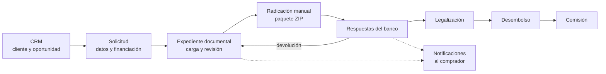
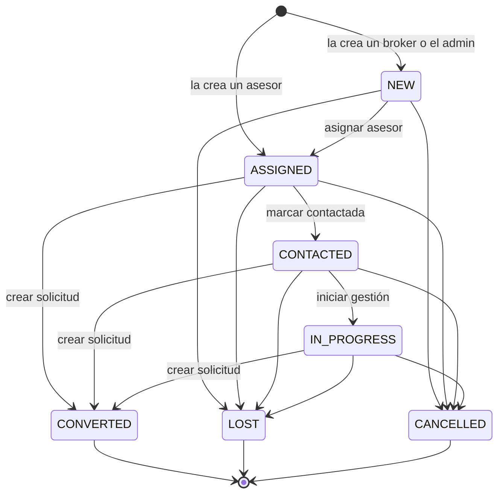
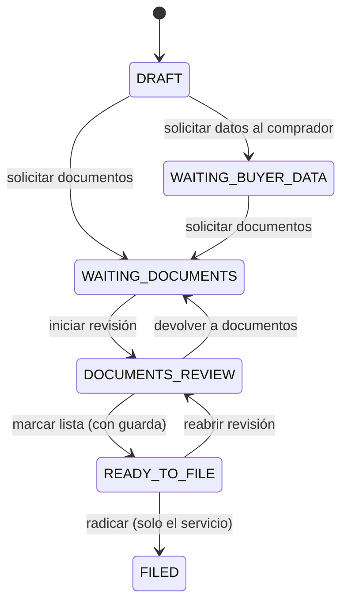
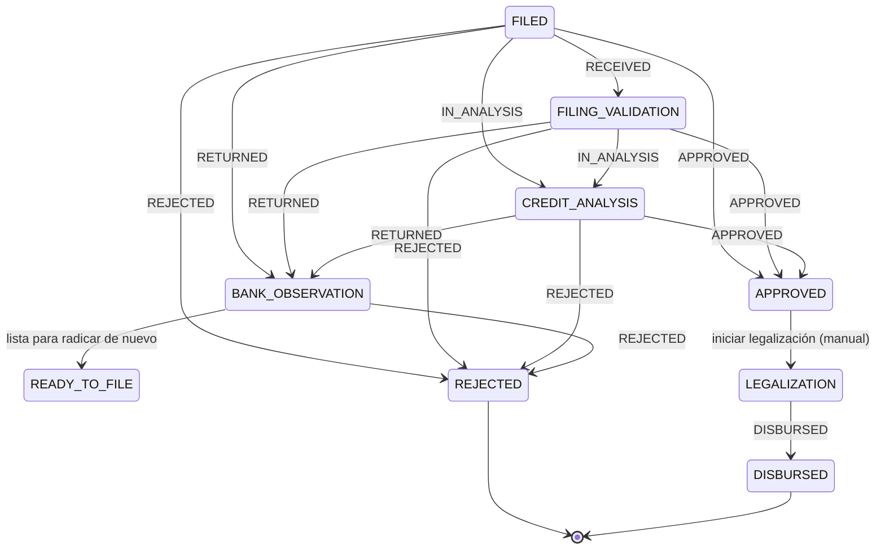
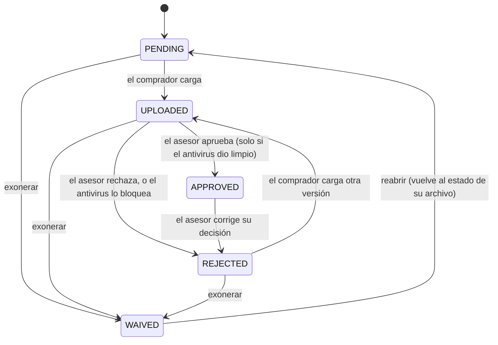
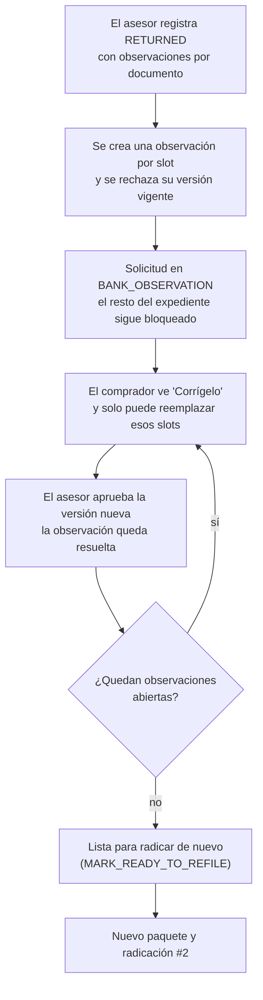
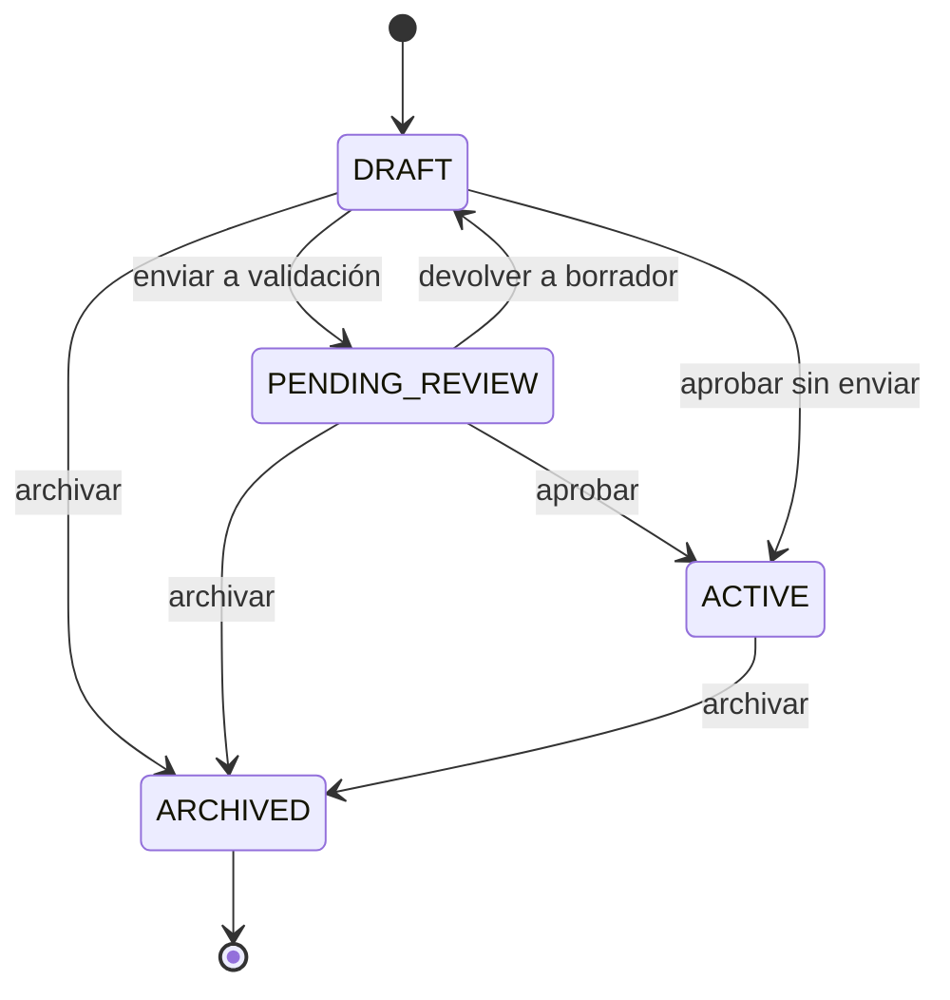

# 02 · Negocio: el crédito de vivienda como dominio

> **En simple:** una solicitud de crédito avanza por etapas, desde el borrador hasta el desembolso. Cada etapa tiene reglas: quién puede moverla, qué tiene que estar completo y qué ve cada persona. Este documento explica esas reglas y **por qué** se decidieron así.

Es el documento más largo de la guía porque aquí vive la lógica del negocio. Si buscas cómo está construido, ve a [03 · Arquitectura](03-arquitectura.md); si buscas qué es el producto, a [01 · El producto](01-el-producto.md).

**Fuentes de verdad**, en este orden: el código en `master`, el contrato [`contracts/openapi.json`](../../contracts/openapi.json), los documentos de [`docs/`](../) y las "Precisiones acordadas" de cada [`specs/TAREA-*.md`](../../specs/). Cuando la documentación vieja dice una cosa y el código otra, manda el código y se anota como **"la spec decía X; quedó Y"**. Revisado el 18 de noviembre de 2026.

---

## Índice

1. [El contexto colombiano](#1-el-contexto-colombiano)
2. [La oportunidad comercial](#2-la-oportunidad-comercial)
3. [La solicitud de crédito](#3-la-solicitud-de-crédito)
4. [Documentos y su revisión](#4-documentos-y-su-revisión)
5. [Radicación y respuestas del banco](#5-radicación-y-respuestas-del-banco)
6. [El comprador y el enlace mágico](#6-el-comprador-y-el-enlace-mágico)
7. [Consentimientos](#7-consentimientos)
8. [Notificaciones](#8-notificaciones)
9. [Tareas y "Mi día"](#9-tareas-y-mi-día)
10. [Reportes](#10-reportes)
11. [Comisiones](#11-comisiones)
12. [Proyectos de constructora](#12-proyectos-de-constructora)
13. [Todas las decisiones de negocio y su porqué](#13-todas-las-decisiones-de-negocio-y-su-porqué)
14. ["La spec decía X; quedó Y"](#14-la-spec-decía-x-quedó-y)

---

## 1. El contexto colombiano

Las decisiones de base están en REQ §2, "Decisiones adoptadas para el MVP" ([`docs/REQUERIMIENTOS_MVP_CREDITO.md`](../REQUERIMIENTOS_MVP_CREDITO.md)):

- **País y moneda:** Colombia, pesos colombianos (COP). Los montos se guardan como **enteros de pesos**, nunca como `float` (REQ §8.4). Las fechas viajan en UTC y el backend calcula "hoy" con la zona `America/Bogota` (`TIME_ZONE` en `backend/config/settings/base.py`).
- **Bancos de prueba:** Bancolombia, Fondo Nacional del Ahorro (FNA) y Banco de Bogotá, cada uno con su producto de vivienda. La demo agrega "Leasing habitacional" en Bancolombia y Banco de Bogotá (P0.6 de [`specs/TAREA-brechas.md`](../../specs/TAREA-brechas.md)).
- **Finalidades:** vivienda nueva (incluye sobre planos), vivienda usada y remodelación. La vivienda nueva puede ir ligada a un proyecto de constructora; las otras dos registran el inmueble directamente (RF-34).
- **Todo es manual frente al banco.** No hay integración. El sistema no afirma que el banco recibió o aprobó algo hasta que el asesor lo registra (REQ §2, "Flujo operativo completo").
- **Las opciones son configurables.** Bancos, productos, documentos exigidos, motivos de rechazo y demás listas se administran en el backend. El frontend no tiene listas ni estados de negocio propios (REQ §8.5).

*Qué mirar: la cadena principal de izquierda a derecha y la única vuelta atrás que existe después de radicar: la devolución del banco regresa al expediente documental, no al principio.*

---

## 2. La oportunidad comercial

Una **oportunidad** es el registro de que un cliente quiere comprar. Un cliente puede tener varias, por ejemplo una por proyecto (RF-12).

*Qué mirar: las dos entradas. Si la crea un asesor, nace asignada a él; si la crea un broker o el admin, nace sin asesor. Y que solo se convierte en solicitud después de tener asesor.*

Reglas:

- **Transiciones y permisos** se siembran en `backend/apps/crm/migrations/0002_seed_permissions_catalogs_transitions.py` (líneas 81-96): `ASSIGN` exige `opportunities.assign`; contactar, gestionar, perder y cancelar exigen `opportunities.transition`; todas para `ADMIN` y `ADVISOR`. Las conversiones (`CONVERT_*`) las siembra `applications` y exigen `applications.create` (`backend/apps/applications/migrations/0002_seed_permissions_catalogs_transitions.py`, líneas 253-266).
- **Auto-asignación:** si quien crea la oportunidad tiene el rol `ADVISOR`, queda asignada a él y pasa a `ASSIGNED` en la misma transacción, con su registro en `opportunity_assignments` y el motivo "Asignación automática: la creó el asesor." (`backend/apps/crm/services.py`, `SELF_ASSIGNMENT_REASON`). Si la crea un broker o el admin, queda `NEW` y sin asesor. Decisión del Anexo A y de [`specs/TAREA-brechas-2.md`](../../specs/TAREA-brechas-2.md), Parte 1, punto 6.
- **Perder la oportunidad exige motivo** (catálogo `opportunity_lost_reason`); en el contrato, la acción trae `reason_required = true` (Parte 1 de `TAREA-brechas-2.md`).
- **El origen** (catálogo `lead_origin`: `BROKER`, `PARTNER_PROJECT`, `DIRECT`, `REFERRAL`) se guarda en la oportunidad y decide el reparto de la comisión ([§11](#11-comisiones)).
- **Broker:** solo ve y modifica sus propios contactos y oportunidades, y recibe un resumen (RF-14).

Pendiente que sigue abierto (REQ §12, última fila): qué hace un broker que registra un cliente cuyo documento ya existe fuera de su alcance. Hoy `POST /clients` responde `409 DUPLICATE_CLIENT_DOCUMENT` y solo incluye el `resource_id` si el usuario puede ver ese cliente.

---

## 3. La solicitud de crédito

La **solicitud** es el corazón del sistema. Tiene un código legible (`SOL-000123`), un asesor asignado obligatorio, uno o más participantes (titular, co-solicitantes, deudores solidarios), un inmueble, una financiación y un expediente documental.

### 3.1 Estados

Los 17 estados están en `backend/apps/catalogs/workflow.py` (`ApplicationStatus`). Sus etiquetas visibles viven en el catálogo `application_status`.

**Antes de radicar:**

*Qué mirar: `READY_TO_FILE` es la única puerta a `FILED`, y esa puerta no es un botón genérico: solo la abre el servicio de radicación.*

**Después de radicar:**

*Qué mirar: las flechas con nombre en mayúsculas son **respuestas del banco** que registra el asesor; solo dos flechas son botones manuales (legalización y "lista para radicar de nuevo").*

**Salidas en cualquier momento:**

- Antes de radicar (de `DRAFT` a `READY_TO_FILE`): `CANCELLED` (cancelada), `OWN_FUNDS` (recursos propios) y `EXTERNAL_CREDIT_APPROVED` (crédito aprobado por otra entidad). Estas tres exigen motivo (`REASON_REQUIRED_STATUSES` en `backend/apps/applications/actions.py`).
- Desde cualquier estado no terminal, también después de radicar: `WITHDRAWN` (desistimiento), por `POST /withdrawals`, con motivo obligatorio.

**Terminales** (`TERMINAL_APPLICATION_STATUSES`, `backend/apps/applications/models/application.py`): `DISBURSED`, `REJECTED`, `EXTERNAL_CREDIT_APPROVED`, `OWN_FUNDS`, `WITHDRAWN` y `CANCELLED`. Una solicitud terminada no admite más cambios; la sesión del comprador sigue viva solo para leer (`409 APPLICATION_CLOSED` en las escrituras).

**Editables** (`EDITABLE_APPLICATION_STATUSES`, mismo archivo): de `DRAFT` a `READY_TO_FILE`. Desde `FILED`, nadie cambia los datos del expediente por el portal; el comprador recibe `409 APPLICATION_NOT_EDITABLE` (RF-46).

### 3.2 Quién mueve cada estado

| Transición | Desde → hacia | Quién | Cómo |
| --- | --- | --- | --- |
| `REQUEST_BUYER_DATA` | `DRAFT` → `WAITING_BUYER_DATA` | Admin, asesor | Botón (`applications.transition`) |
| `REQUEST_DOCUMENTS`, `REQUEST_DOCUMENTS_FROM_DRAFT` | → `WAITING_DOCUMENTS` | Admin, asesor | Botón |
| `START_DOCUMENTS_REVIEW` | `WAITING_DOCUMENTS` → `DOCUMENTS_REVIEW` | Admin, asesor | Botón |
| `RETURN_TO_DOCUMENTS` | `DOCUMENTS_REVIEW` → `WAITING_DOCUMENTS` | Admin, asesor | Botón (secundario) |
| `MARK_READY_TO_FILE` | `DOCUMENTS_REVIEW` → `READY_TO_FILE` | Admin, asesor | Botón **con guarda** `APPLICATION_READY_TO_FILE` |
| `REOPEN_REVIEW` | `READY_TO_FILE` → `DOCUMENTS_REVIEW` | Admin, asesor | Botón (secundario) |
| `FILE` | `READY_TO_FILE` → `FILED` | Admin, asesor | **Solo** el servicio de radicación |
| `BANK_*` | ver diagrama | Admin, asesor | **Solo** al registrar una respuesta del banco |
| `START_LEGALIZATION` | `APPROVED` → `LEGALIZATION` | Admin, asesor | Botón |
| `MARK_READY_TO_REFILE` | `BANK_OBSERVATION` → `READY_TO_FILE` | Admin, asesor | Botón con guarda `APPLICATION_READY_TO_REFILE` |
| `CANCEL_*`, `MARK_OWN_FUNDS_*`, `MARK_EXTERNAL_CREDIT_*` | estados previos → cierre | Admin, asesor | Botón, con motivo |
| `WITHDRAW_*` | no terminal → `WITHDRAWN` | Admin, asesor **o el comprador** | `POST /withdrawals`, con motivo |

Fuentes: `backend/apps/applications/migrations/0002_seed_permissions_catalogs_transitions.py` (líneas 148-251) y `backend/apps/filings/migrations/0002_seed_catalogs_permissions_transitions.py` (líneas 86-155).

Tres detalles que importan:

- **Las transiciones son datos, los estados son código.** Las transiciones viven en la tabla `workflow_transitions` (quién, con qué permiso, con qué guarda), pero nunca pueden inventar un estado: los estados son constantes del backend (docstring de `backend/apps/catalogs/workflow.py`).
- **Transiciones de sistema.** `FILE` y las `BANK_*` tienen `system_only = true`: `POST /status-transitions` las rechaza con `409` y `available-actions` no las ofrece. Solo las ejecutan los servicios de radicación, que igual exigen rol y permiso (Precisión 1 de la Parte 1 de [`specs/TAREA-radicacion.md`](../../specs/TAREA-radicacion.md)).
- **Los botones los decide el backend.** El frontend pide `GET /applications/{id}/available-actions` y pinta lo que llega, con su tipo (`primary`, `secondary`, `destructive`) y si exige motivo (`backend/apps/applications/actions.py`).

### 3.3 La regla de "lista para radicar"

Una solicitud está lista para radicar si **tiene banco y producto elegidos y todos los documentos obligatorios están aprobados o exonerados** (REQ §2, "Regla de expediente listo"). La guarda la evalúa dentro de la misma transacción, con los documentos bloqueados, y además revisa que la evaluación bancaria no tenga bloqueos. Si falla, responde `422 APPLICATION_NOT_READY` con un detalle por problema (`DOCUMENT_PENDING`, `DOCUMENT_EXPIRED`, `DOCUMENTS_NOT_CONFIGURED`…), que el front muestra tal cual ([`specs/TAREA-document-file.md`](../../specs/TAREA-document-file.md), decisión 21).

**Si una solicitud lista deja de cumplir** (se rechaza un documento, se reabre una exoneración, el comprador carga otra versión o vence un aprobado), **sigue en `READY_TO_FILE`**. No cambia sola de estado: `/completeness` muestra `ready_to_file = false` con el motivo y la radicación la frena. El asesor puede volver a revisión con "Reabrir revisión" (decisión 29 de `TAREA-document-file.md`). Por qué: los documentos no tocan la versión de la solicitud (ver [§4.6](#46-los-documentos-no-cambian-la-versión-de-la-solicitud)), y un cambio de estado automático por un documento la tocaría.

### 3.4 Concurrencia: nadie pisa el trabajo de otro

Dos personas pueden tener abierta la misma solicitud. Para que una no borre los cambios de la otra, `credit_applications` tiene un entero `version` (REQ §8.3, principio 6):

- Cada respuesta del expediente trae la versión en la cabecera `ETag`.
- Para editar, el cliente reenvía esa versión en `If-Match` (o `expected_version` en el cuerpo de las acciones). Si alguien cambió la solicitud mientras tanto, la API responde `409 STALE_VERSION` y el front avisa "Alguien cambió esta solicitud" sin pisar nada.
- Sin `If-Match` en un `PUT`/`PATCH`: `428`.

El detalle técnico está en [04 · System design §3.4](04-system-design.md#34-etag--if-match-no-pisar-la-edición-de-otro).

---

## 4. Documentos y su revisión

### 4.1 Qué documentos se piden

El administrador configura **tipos de documento** (cédula, certificado laboral, extractos…) y **requisitos** por banco, producto, finalidad, rol del participante y perfil laboral (RF-50). Cuando la solicitud cambia (producto, finalidad, inmueble, participantes, perfil laboral), el sistema recalcula la lista **en la misma transacción** y crea los **slots**: cada documento concreto que espera la solicitud, con una copia de las reglas del requisito en ese momento (`backend/apps/documents/slots.py`, `sync_slots`; decisiones 5 y 6 de `TAREA-document-file.md`).

- **Un slot por archivo.** Si se piden tres desprendibles de nómina, hay tres slots: "Desprendible de nómina 1 de 3", "2 de 3", "3 de 3" (Tanda 1, decisión 3).
- **Del participante o de la solicitud.** Un documento puede ser de una persona (su cédula) o de la solicitud entera (el estudio de títulos del inmueble): `document_types.holder_scope` (Tanda 1, decisión 4).
- **Grupo alternativo.** Algunos requisitos se cumplen con uno de varios documentos (por ejemplo, certificado de ingresos **o** extractos). El grupo queda cumplido con un juego completo aprobado (decisiones 7 y 30).
- **Un slot que deja de aplicar no se borra:** se retira (`retired_at`) con sus versiones, y revive si vuelve a aplicar (decisión 5).
- **El recálculo solo ocurre antes de `FILED`.** Después, la lista queda congelada.

### 4.2 Estados de un documento

Cada slot tiene un estado interno (`SlotStatus`) y un **estado público** que ve el comprador (`PublicSlotStatus`), los dos en `backend/apps/documents/models/slot.py`:

| Estado interno | Qué significa | Lo que ve el comprador |
| --- | --- | --- |
| `PENDING` | Aún no hay archivo | "Te falta" |
| `UPLOADED` | Hay un archivo esperando análisis o revisión | "En revisión" |
| `APPROVED` | El asesor lo aprobó | "Listo" |
| `REJECTED` | El asesor lo rechazó, el banco lo observó o el antivirus lo bloqueó | "Corrígelo" |
| `WAIVED` | El asesor lo exoneró: no aplica | "No aplica" |

*Qué mirar: no hay flecha del comprador sobre un documento aprobado o exonerado. Si el asesor quiere un archivo nuevo, primero rechaza el aprobado.*

Cada **versión** (`document_files`) tiene además su propio estado: `UPLOADED` (análisis pendiente), `IN_REVIEW` (análisis limpio, espera al asesor), `APPROVED` o `REJECTED` (`backend/apps/documents/models/document_file.py`). Las versiones anteriores nunca se borran (RF-53).

### 4.3 La carga

Solo **el comprador** carga documentos, desde el portal (REQ §2, "Carga documental"; RF-47). Ni el asesor, ni el broker, ni la constructora tienen un endpoint de carga.

Lo que valida el backend en cada carga (decisión 11 de `TAREA-document-file.md`, `backend/apps/documents/file_validation.py`):

- **El tipo real del archivo**, por sus primeros bytes: PDF (`%PDF-`), JPG (`FF D8 FF`) o PNG. Una doble extensión, una extensión ejecutable o un tipo declarado que no coincide responden `422 UNSUPPORTED_FILE_TYPE`.
- **El tamaño:** vacío, `400`; mayor que el máximo del tipo, `422 FILE_TOO_LARGE`; un cuerpo mayor que el límite global se corta antes de leerlo con `413`.
- **El nombre:** se le quita la ruta y los caracteres de control.
- **La cuota:** 20 versiones por slot y 200 MB por solicitud (`409 DOCUMENT_QUOTA_EXCEEDED`).
- **El ritmo:** 60 cargas por hora por sesión y solicitud (`buyer_document_upload` en `AUTH_RATE_LIMITS`).
- **Los consentimientos** deben estar aceptados.

**Qué puede cargar y cuándo:**

| Momento | Puede cargar en | Si no |
| --- | --- | --- |
| Antes de `FILED` | Slots `PENDING`, `UPLOADED` o `REJECTED` | `409 DOCUMENT_LOCKED` sobre uno aprobado o exonerado |
| Después de `FILED` | Solo slots `REJECTED` con una **observación abierta del banco** | `409 DOCUMENT_NOT_REJECTED` o `409 DOCUMENT_LOCKED` |
| Solicitud terminada | Nada | `409 APPLICATION_CLOSED` |

Después de guardar, el archivo pasa por el **antivirus** (ClamAV en el modo completo, un escáner de prueba en el modo simple). Mientras no dé limpio, nadie lo puede aprobar ni descargar (`409 FILE_NOT_CLEAN`). Si el antivirus lo marca infectado o inválido, la versión queda rechazada y el comprador ve un mensaje fijo: "El archivo no pasó la validación de seguridad" (decisión 3). Si el antivirus no responde, el archivo **sigue pendiente, nunca limpio** (Tanda 1, decisión 2).

### 4.4 La revisión

El asesor revisa con `PATCH /document-slots/{slot_id}/review` (decisión 8):

- **Aprobar** exige que el archivo sea el vigente del slot (si el comprador subió otro mientras tanto, `409 DOCUMENT_NOT_CURRENT`) y que el antivirus haya dado limpio. Si el documento tiene vigencia (por ejemplo, un certificado de 30 días), exige la fecha del documento y no se aprueba uno vencido (`422 DOCUMENT_EXPIRED`).
- **Rechazar** exige un motivo del catálogo `document_rejection_reason` (ilegible, incompleto, desactualizado, documento equivocado, datos que no coinciden, otro) y un **mensaje para el comprador** (RF-51).
- **Exonerar** exige que el documento sea exonerable, un motivo y el permiso `documents.waive`. En un grupo alternativo exonera los slots no aprobados del grupo, en una sola transacción.
- **Reabrir** una exoneración hecha por error deja una revisión `REOPENED` con comentario interno obligatorio (Tanda 3, decisión 25).
- **Cada decisión es una fila nueva** en `document_reviews`; nunca se edita la anterior. El comentario interno nunca sale hacia el comprador.

### 4.5 La vigencia

Un requisito puede tener `validity_days`. Al aprobar, `expires_at = fecha del documento + validity_days`. Antes de radicar, un aprobado vencido cuenta como no cumplido; **después de radicar, la vigencia ya no bloquea nada** (decisión 8).

### 4.6 Los documentos no cambian la versión de la solicitud

Cargar, analizar, revisar, exonerar o recalcular documentos **no** sube `credit_applications.version` ni exige `If-Match` (decisión 6). Si lo hicieran, cada carga del comprador invalidaría la pantalla del asesor que está editando la financiación. Para saber si el expediente documental cambió se usa la **huella documental**: un SHA-256 de los slots vigentes con su estado y su archivo vigente (decisión 23, `backend/apps/documents/fingerprint.py`).

---

## 5. Radicación y respuestas del banco

### 5.1 El paquete

Antes de radicar, el asesor pide un **paquete** (`POST /applications/{id}/document-package-jobs`):

- **El contenido se fija al pedirlo**: se guarda la lista exacta de versiones y su huella. Una carga posterior no se cuela (decisión 15).
- Lleva la última versión aprobada de cada slot, en carpetas por persona (`01_TITULAR_Laura_Gomez`, `02_COSOLICITANTE_…`), con nombres en ASCII seguro, y un `manifest.json` para el banco **sin** nombres originales, ids internos ni motivos de exoneración (decisiones 38 y 39).
- Antes de empaquetar se verifica el SHA-256 de cada archivo; si no coincide, `FAILED` con `CHECKSUM_MISMATCH` (decisión 15).
- **Vence a los 7 días** (`DOCUMENT_PACKAGE_TTL_DAYS`).
- El ZIP es asistencia operativa, **no** prueba de que el banco recibió algo (REQ §13.6).

### 5.2 Radicar

`POST /applications/{id}/filings` registra la entrega manual: producto, paquete, canal (portal del banco, correo o presencial), número de radicado opcional, fecha (no futura) y la versión esperada. Precondiciones, cada una con su error (Parte 2 de las Precisiones de [`specs/TAREA-radicacion.md`](../../specs/TAREA-radicacion.md)):

| Precondición | Error |
| --- | --- |
| La versión coincide | `409 STALE_VERSION` |
| La solicitud no terminó | `409 APPLICATION_CLOSED` |
| Está en `READY_TO_FILE` | `409 INVALID_STATE_TRANSITION` |
| El producto es el de la financiación | `422 BANK_PRODUCT_MISMATCH` |
| Documentos y reglas del banco al día | `422 APPLICATION_NOT_READY` |
| El paquete es de esta solicitud | `400 VALIDATION_ERROR` |
| El paquete no se usó en otra radicación | `409 PACKAGE_ALREADY_FILED` |
| El paquete está listo y no venció | `409 PACKAGE_NOT_READY` / `409 PACKAGE_EXPIRED` |
| La huella del paquete es la vigente | `409 PACKAGE_OUTDATED` |
| El radicado no se repite en ese producto | `409 FILING_REFERENCE_EXISTS` |

Al radicar, en una transacción: se crea la radicación con su número de intento (`sequence_number` 1, 2…), se guarda una **instantánea** de cada versión de archivo entregada (`filing_document_snapshots`), se **bloquean** los documentos entregados (`locked_at`) y la solicitud pasa a `FILED`. Si el banco tiene un plazo de respuesta configurado (al FNA se le sembraron 7 días), se calcula `target_response_at`, y el expediente marca `is_response_overdue` si pasa sin respuesta.

### 5.3 Las respuestas del banco y qué cambia cada una

Cada respuesta se registra a mano, **solo contra la última radicación** (`409 FILING_NOT_LATEST`), y es **inmutable**. Las reglas por tipo viven en una sola tabla de código, `RULES`, en `backend/apps/filings/responses.py` (líneas 112-148); el frontend recibe de ahí mismo qué campos pide cada tipo (metadata del catálogo `filing_response_type`).

| Respuesta | Desde qué estados | Obligatorio | La solicitud pasa a | El comprador recibe |
| --- | --- | --- | --- | --- |
| `RECEIVED` (recibida) | `FILED`, `FILING_VALIDATION` | — | `FILING_VALIDATION` (si ya está, no cambia) | Nada nuevo (sin aviso) |
| `IN_ANALYSIS` (en análisis) | `FILED`, `FILING_VALIDATION` | — | `CREDIT_ANALYSIS` | Avance en su tablero |
| `RETURNED` (devuelta) | `FILED`, `FILING_VALIDATION`, `CREDIT_ANALYSIS` | Motivo (`filing_return_reason`), mensaje público y al menos una observación de documento | `BANK_OBSERVATION` | Aviso "El banco pidió correcciones" + un aviso por cada documento observado |
| `APPROVED` (aprobada) | `FILED`, `FILING_VALIDATION`, `CREDIT_ANALYSIS` | Monto aprobado, plazo en meses y mensaje público | `APPROVED` | "¡Tu crédito fue aprobado!" con monto y plazo |
| `REJECTED` (rechazada) | `FILED`, `FILING_VALIDATION`, `CREDIT_ANALYSIS`, `BANK_OBSERVATION` | Motivo (`filing_rejection_reason`) y mensaje público | `REJECTED` (cierra) | "El banco rechazó tu solicitud" con el mensaje |
| `DISBURSED` (desembolsada) | `LEGALIZATION` | Monto desembolsado | `DISBURSED` (cierra) | "Se desembolsó tu crédito" con la fecha |
| `OTHER` (otra) | Cualquiera no terminal | Comentario interno | No cambia | Nada |

Además:

- **Mensaje público y nota interna van separados.** El asesor puede guardar el texto completo del banco como `internal_comment`; el comprador solo ve `public_message` (REQ §4.5).
- **Evidencia opcional:** cada respuesta admite **un** archivo (PDF, JPG o PNG, hasta 10 MB) que pasa por el mismo antivirus y solo ven el administrador y el asesor asignado (decisión 4 de `TAREA-radicacion.md`; `EVIDENCE_MAX_BYTES` en `backend/apps/filings/`).
- **Lo que ve cada actor de una respuesta** (Precisiones 7 y 8 de la Parte 3):
  - administrador y asesor: todo;
  - broker: tipo, fecha y mensaje público; ni nota interna, ni evidencia, ni montos;
  - comprador: la última respuesta con mensaje público, como `latest_bank_update` en su tablero.

### 5.4 La devolución, paso a paso

*Qué mirar: la observación del banco usa el mismo mecanismo de rechazo de documentos que ya existía, y no se puede volver a radicar mientras quede una abierta.*

Detalles (Parte 3 de las Precisiones de `TAREA-radicacion.md`):

- Resolver una observación exige aprobar una versión **cargada después** de la observación. Aprobar otra vez la versión observada responde `409 DOCUMENT_OBSERVED`.
- El paquete ya radicado no se reutiliza para la segunda radicación (Parte 2, Precisión 3).

### 5.5 Correcciones de una respuesta

Como las respuestas son inmutables, un error se corrige con **otra respuesta** que apunta a la anterior (`corrects_response`). Reglas (`backend/apps/filings/responses.py`, docstring y `RULES`):

- Solo la **última** respuesta de la radicación, y del **mismo tipo**.
- Solo de `RECEIVED`, `IN_ANALYSIS`, `OTHER` y `DISBURSED` (otras: `409 RESPONSE_CORRECTION_NOT_ALLOWED`).
- Corregir **no cambia el estado** de la solicitud ni su versión.
- **El desembolso solo lo corrige el administrador** (el asesor recibe `403`), aunque la solicitud ya esté cerrada en `DISBURSED`. Puede cambiar monto, fecha, referencia y comentarios; comisiones reacciona sola ([§11.5](#115-corrección-del-desembolso)). Al comprador no se le reenvía el aviso.

---

## 6. El comprador y el enlace mágico

El comprador **no tiene cuenta ni contraseña** (RF-02, RNF-02). Entra con un enlace de un solo uso. Las reglas están en las decisiones de [`specs/TAREA-buyer-access.md`](../../specs/TAREA-buyer-access.md) y en `backend/apps/identity/buyer_access.py` y `buyer_sessions.py`:

| Regla | Valor | Fuente |
| --- | --- | --- |
| Quién emite | Admin (cualquier solicitud), asesor (las asignadas), broker (las que originó). La constructora nunca. | Decisión 1 |
| Para quién | Siempre el titular (`PRIMARY`) activo. La API no acepta otro `client_id`. | Decisión 2 |
| Cuándo | En cualquier estado no terminal, también después de radicar. | Decisión 3 |
| Vencimiento | 72 h por defecto, de 1 a 168 h. | `BUYER_ACCESS_LINK_DEFAULT_HOURS`, `_MAX_HOURS` |
| Uso | Una sola vez. En la base solo se guarda el hash del token. | Docstring de `buyer_access.py` |
| Rotación | Emitir uno nuevo revoca los pendientes de la misma solicitud. | Decisión 5 |
| Sesión | 24 h absolutas, sin renovación. Consumir un enlace cierra las otras sesiones del mismo comprador y solicitud: queda una sola viva. | `BUYER_SESSION_LIFETIME`, decisión 5 |
| Canal | Copiar el enlace o enviarlo por correo. | Catálogo `buyer_access_channel` |
| Límites | Consumir: 5 por hora por IP. Emitir: 3 por hora por emisor y solicitud. | `AUTH_RATE_LIMITS` |
| Errores | `401 MAGIC_LINK_EXPIRED`, `_CONSUMED`, `_REVOKED`, `_INVALID`. | Decisión 9 |

**Qué puede editar el comprador antes de `FILED`** (decisión 11): su correo, teléfono, fecha de nacimiento y direcciones; los perfiles financieros e ingresos suyos y de los co-solicitantes activos; el inmueble; la financiación y el producto. **Nombres y número de documento** solo los corrige el asesor. Agregar o retirar participantes es interno.

**Confirmación de datos** (decisión 14): el comprador puede confirmar su perfil financiero (`data_confirmed_at`). Cualquier cambio real posterior, del asesor o del comprador, borra la confirmación.

**Desistimiento** (decisión 15): el comprador puede desistir desde el portal en cualquier estado no terminal, también después de radicar, con un motivo del catálogo. La autorización es la sesión; el historial registra la sesión del comprador como actor.

**Lo que ve el comprador** (Anexo A):

- su tablero con el avance por etapas (`backend/apps/applications/stages.py`, `BUYER_STAGES`), lo que falta y la última respuesta del banco con mensaje público;
- la **tarjeta de su asesor** con nombre, correo y WhatsApp; si el asesor ya no puede entrar (desactivado), la tarjeta no aparece, para no mostrar el contacto de alguien que ya no atiende (P2.1 de `TAREA-brechas.md`);
- su **línea de tiempo filtrada**: solo las filas de actividad con visibilidad `BUYER`, nunca las notas internas (`backend/apps/activity/models.py`; P3.3 de [`specs/TAREA-tareas-actividad.md`](../../specs/TAREA-tareas-actividad.md));
- sus avisos.

---

## 7. Consentimientos

Decisión 16 de `TAREA-buyer-access.md` y `backend/apps/identity/consents.py`:

- Hay dos definiciones con versión: `DATA_PROCESSING` (tratamiento de datos personales, **siempre obligatorio**) y `CO_APPLICANT_AUTHORIZATION` (el titular declara que tiene la autorización de sus co-solicitantes, **obligatorio solo si hay co-solicitantes activos**).
- **El texto es provisional**: REQ §12 deja el texto legal para antes de producción. Las versiones nuevas se publican por migración; no hay CRUD por API.
- Mientras falte aceptar la versión vigente de uno obligatorio, **las escrituras del portal responden `403 CONSENT_REQUIRED`**; leer, aceptar consentimientos, ver avisos y salir siguen permitidos.
- Cada aceptación o retiro es una **fila nueva e inmutable** en `consent_records`, con IP, agente de usuario y sesión (RNF-10). Retirar uno lo vuelve a dejar pendiente.
- El asesor y el admin ven el estado de los consentimientos de la solicitud; el broker no.

---

## 8. Notificaciones

Cada evento importante de la solicitud le crea al comprador un **aviso en el portal** y un **correo**. El aviso del portal es la fuente de verdad: si el correo falla, no se revierte nada (RNF-21; [`specs/TAREA-notificaciones.md`](../../specs/TAREA-notificaciones.md)).

Los 8 tipos (`backend/apps/notifications/models.py`, `NotificationType`; textos en `backend/apps/notifications/messages.py`):

| Tipo | Cuándo | Contenido |
| --- | --- | --- |
| `ACCESS_GRANTED` (Acceso al portal) | La primera vez que el comprador entra a esa solicitud | La siguiente acción según el estado |
| `DOCUMENT_REJECTED` (Documento por corregir) | Cada rechazo de un documento, también los que salen de una devolución del banco | El nombre del documento (y de quién es) y el mensaje del asesor |
| `READY_TO_FILE` (Expediente completo) | La solicitud queda lista para radicar | Texto fijo. Avisa otra vez si vuelve a quedar lista después de una devolución |
| `FILED` (Solicitud radicada) | Se registra la radicación | El banco y la fecha |
| `BANK_RETURNED` (Devolución del banco) | Respuesta `RETURNED` | El mensaje público |
| `BANK_APPROVED` (Crédito aprobado) | Respuesta `APPROVED` | El mensaje público y "Monto aprobado: $… a N meses." |
| `BANK_REJECTED` (Crédito rechazado) | Respuesta `REJECTED` | El mensaje público |
| `DISBURSED` (Crédito desembolsado) | Respuesta `DISBURSED` | Texto fijo con la fecha, **sin monto** |

Reglas:

- **Sin duplicados:** cada aviso tiene una clave única (tipo + id del objeto que lo origina, por ejemplo `BANK_APPROVED:<id de la respuesta>`). Un evento repetido no crea otro (Precisiones 4 y 5 de la Parte 1).
- **Nunca** llevan notas internas, números de identificación completos ni ingresos. Una revisión de rechazo dentro de una devolución lleva el mensaje de la observación; la nota interna "Observación del banco en la radicación #N" nunca sale (Precisión 6).
- **El correo** no lleva el enlace mágico (los enlaces los emite el asesor), ni adjuntos, ni datos financieros. Dice: "Entra a tu portal con el enlace que te envió tu asesor; si se venció, pídele uno nuevo".
- **Reintentos del correo:** hasta 6 intentos (el primero y 5 reintentos a 1, 5, 15, 60 y 240 minutos). Después, `FAILED`. Un comprador sin correo deja la entrega en `FAILED` con `NO_DESTINATION`, sin reintentos (Parte 2).
- El asesor ve, en el expediente, cada aviso con sus entregas (canal, estado, intentos, último error), para saber si el correo salió.
- **Fuera del MVP:** las notificaciones internas del backoffice (la campana) y WhatsApp (Anexo A; REQ §2).

---

## 9. Tareas y "Mi día"

**"Mi día"** (`/workday/applications`) es la bandeja del asesor: **solo sus solicitudes asignadas** (RF-21), con la siguiente acción, el banco y producto, la fecha de actualización y los días en la etapa. Los segmentos de atención, que no son excluyentes, están en `backend/apps/workday/rules.py` (`AttentionSegment` y sus condiciones, líneas 85-91):

| Segmento | Qué agrupa |
| --- | --- |
| Documentos por revisar | Tiene algún documento cargado (`UPLOADED`) esperando al asesor |
| Listas para radicar | En `READY_TO_FILE` |
| Radicadas | En `FILED` o `FILING_VALIDATION` |
| En análisis | En `CREDIT_ANALYSIS` |
| Observadas por el banco | En `BANK_OBSERVATION` |
| Comprador sin actividad | Espera al comprador y lleva más de 3 días sin actividad en el portal (`BUYER_INACTIVITY_DAYS`) |
| Con tareas vencidas o de hoy | Tiene tareas pendientes que vencen hoy o antes |

"Hoy" es la fecha de Bogotá (P1.4 de `TAREA-tareas-actividad.md`). El administrador ve todo y puede filtrar por asesor; el broker y la constructora no tienen "Mi día" (`403`).

**Tareas** (`/tasks`): con responsable, fecha, prioridad y estado (`PENDING`, `COMPLETED`, `CANCELLED`), ligadas a **una** solicitud **o** a una oportunidad (P2.1). **Todas son manuales** (Anexo A): aunque el modelo tiene el valor `AUTOMATIC` en `TaskSource` (`backend/apps/tasks/models.py`), ningún código del backend crea tareas automáticas. Una solicitud terminada no admite tareas nuevas, pero las pendientes se pueden cerrar (P2.8).

---

## 10. Reportes

Alcance "medio", decidido con Carlos ([`specs/TAREA-reportes.md`](../../specs/TAREA-reportes.md)):

- **Entra:** el dashboard (resumen, embudo, carga por asesor y resultados por banco), el embudo de reportes, el listado de solicitudes, el CSV directo y la exportación asíncrona **solo en CSV**.
- **No entra:** XLSX y los reportes por asesor, por banco y de calidad documental (el dashboard ya cubre carga y bancos).

| Regla | Detalle |
| --- | --- |
| Quién ve qué | Admin: todo. Asesor: sus solicitudes. Broker: **solo conteos** de lo que originó, sin montos, sin datos personales y sin exportar. Constructora y comprador: nada (`403`). |
| Fechas | El usuario elige `date_from` y `date_to` (ambas incluidas, hora de Bogotá). Por defecto, **el mes en curso**. Máximo **366 días** (`REPORTS_MAX_RANGE_DAYS`). Una fecha futura se recorta a hoy. |
| Filtro fuera de alcance | Responde **`403 FILTER_OUT_OF_SCOPE`**, nunca un resultado vacío: el asesor que filtra por otro asesor, o el broker que filtra por asesor, partner o proyecto. |
| Embudo | Por **cohorte**: de las solicitudes **creadas** en el periodo, cuántas llegaron alguna vez a cada etapa (creadas, documentos completos, lista para radicar, radicada, aprobada, desembolsada), con la conversión total y la de cada paso. Además, una **foto** de cuántas están hoy en cada estado. |
| "Documentos completos" | Se cuenta como "llegó alguna vez a `DOCUMENTS_REVIEW`", porque "llegó con todo aprobado" no se puede reconstruir del historial. |
| Privacidad | El documento de identidad sale enmascarado (`******1234`). Nunca correo, teléfono, dirección, datos financieros ni archivos (RNF-08). |
| CSV directo | UTF-8 con BOM (para que Excel lea las tildes), encabezados en español, hasta 5.000 filas (`REPORTS_CSV_MAX_ROWS`); más allá, `422 EXPORT_TOO_LARGE` e invitación a la exportación asíncrona. Las celdas que empiezan con `=`, `+`, `-` o `@` se neutralizan con `'` (inyección CSV). |
| Exportación asíncrona | Hasta 100.000 filas, máximo 3 en curso por usuario (`429 TOO_MANY_EXPORTS`), recalcula el alcance al ejecutarse y el archivo dura 24 h. |
| Ritmo | 20 consultas por minuto por usuario (`reports` en `AUTH_RATE_LIMITS`). |

---

## 11. Comisiones

La comisión premia el crédito que **de verdad se desembolsó**. Reglas en REQ §5.9 (RF-80 a RF-86), en [`specs/TAREA-comisiones.md`](../../specs/TAREA-comisiones.md) y en `backend/apps/commissions/settlement.py`.

### 11.1 Cuándo se genera

**Solo cuando la solicitud llega a `DISBURSED`.** Una aprobación no genera comisión, porque el crédito todavía puede caerse en la legalización (regla 1 de la spec). El disparo es automático: un receptor de la señal `filing_response_recorded` actúa cuando la respuesta es `DISBURSED` (`backend/apps/commissions/receivers.py`). El administrador también puede liquidar a mano (`POST /applications/{id}/commission-settlement`).

### 11.2 Cómo se calcula

- **Base:** el monto desembolsado de la respuesta del banco.
- **Plan:** el vigente **en la fecha de desembolso** para el **producto que se radicó** (`filing.bank_product`). Un plan define la tasa (`rate_pct`) y el reparto asesor/broker; las vigencias de un mismo producto no se pueden solapar y el fin es exclusivo: `[valid_from, valid_until)` (P1.3).
- **Reparto según el origen de la oportunidad:**
  - origen `BROKER`: asesor y broker según el plan; **el asesor siempre lleva la porción mayor** (`CHECK advisor_share_pct > broker_share_pct`);
  - cualquier otro origen (proyecto de constructora, directo, referido): **100 % para el asesor**. **La constructora no cobra**: su beneficio es vender el inmueble (REQ §2, "Comisiones").
- **Redondeo:** siempre con `Decimal`, nunca `float`, y `ROUND_HALF_UP` al peso. Primero el total; luego se redondea la parte del broker y **el asesor se lleva el resto**, para que la suma cuadre exacta (`split` en `settlement.py`, líneas 70-73).

Ejemplo con el plan de la demo (1 %, 70/30) y un desembolso de $123.456.789:

| Paso | Cálculo | Resultado |
| --- | --- | --- |
| Total | 123.456.789 × 1 / 100 = 1.234.567,89 | **$1.234.568** |
| Broker | 1.234.568 × 30 / 100 = 370.370,4 | **$370.370** |
| Asesor | 1.234.568 − 370.370 | **$864.198** |

La suma de las partes da el total exacto, aunque el 70 % "teórico" del asesor fuera 864.197,6.

### 11.3 Reglas de la liquidación

- **Única:** una sola liquidación `ACTIVE` por solicitud (índice único parcial). Un evento repetido devuelve la existente; dos liquidaciones simultáneas se serializan bloqueando la fila de la solicitud (P2.3).
- **Instantánea e inmutable:** la base, la tasa, los porcentajes y el origen se copian a la liquidación; cambiar o cerrar el plan después no la toca (RF-83). Un plan ya usado no se edita: se cierra y se crea otro (P1.6, P1.7).
- **Pago por partes:** el administrador marca pagada cada parte por separado, con fecha (no futura) y referencia de pago. Una parte ya pagada no se paga dos veces (`409 COMMISSION_SHARE_NOT_PAYABLE`) (RF-84, P3.1).
- **Anulación:** con motivo obligatorio; no se anula una liquidación con alguna parte pagada (`409 COMMISSION_SETTLEMENT_HAS_PAYMENTS`).

### 11.4 Casos borde

| Caso | Qué pasa |
| --- | --- |
| No hay plan vigente | La respuesta del banco **ya quedó guardada**: el receptor no falla. Deja una actividad visible para el admin ("No se liquidó la comisión: no hay plan vigente") y un aviso en el log. El admin crea el plan y liquida a mano, que sí responde `422 COMMISSION_PLAN_NOT_FOUND`. |
| Origen `BROKER` sin usuario broker | 100 % al asesor y la liquidación queda marcada `needs_review`. |
| Plan con porción de broker 0 | Todo al asesor; no se crea la parte del broker. No es un caso a revisar: es lo que dice el plan (P2.5). |

### 11.5 Corrección del desembolso

Cuando el administrador corrige la respuesta `DISBURSED` ([§5.5](#55-correcciones-de-una-respuesta)), la misma señal llega a comisiones (RF-85, Anexo A):

- **Sin pagos:** se anula la liquidación y se crea otra con el monto corregido, en la misma transacción.
- **Con alguna parte pagada:** no se toca; se marca `needs_review` para manejo manual (los ajustes de montos quedan fuera de la v1).

Está probado de punta a punta en `backend/tests/applications/filings/test_disbursement_correction_commissions.py`.

### 11.6 Quién ve qué

| | Admin | Asesor | Broker | Constructora |
| --- | --- | --- | --- | --- |
| Planes | Administra | No | No | No |
| Liquidaciones y pagos | Todo | No | No | No |
| "Mis comisiones" (`/me/commissions`) | No (`403`) | Su parte | Su parte | No |

En "mis comisiones", cada fila trae solo el código de la solicitud, el nombre del cliente, la fecha de desembolso, el porcentaje y el monto propios, el estado y la fecha de pago (P3.4). El broker **no** ve la base, la tasa, el total ni la parte del asesor, y el asesor no ve la del broker (RF-86). Por eso la actividad de la solicitud (que el asesor ve) dice "Comisión liquidada" **sin montos**, y la auditoría tampoco guarda montos (P2.11).

**Plan de demo:** 1 % sobre el monto desembolsado, 70 % asesor y 30 % broker, vigente desde el 1 de enero de 2026, uno por cada producto (`backend/apps/commissions/demo_data.py`; P3.6).

---

## 12. Proyectos de constructora

Una constructora partner crea sus proyectos en borrador y los envía a validación; un asesor o el admin los aprueba. Solo un proyecto `ACTIVE` puede recibir oportunidades (REQ §13.3).

*Qué mirar: la constructora solo puede "enviar a validación"; aprobar es de asesor y admin, y archivar es solo del admin.*

Fuente: `backend/apps/partners/migrations/0002_seed_permissions_and_project_transitions.py` (líneas 36-66). La API deriva la constructora de la membresía del usuario y rechaza cualquier `partner_id` ajeno (RF-15). Archivar no borra expedientes históricos.

---

## 13. Todas las decisiones de negocio y su porqué

Las decisiones vienen del Anexo A de [`specs/TAREA-documentacion.md`](../../specs/TAREA-documentacion.md) (tomadas con Carlos) y de las "Precisiones acordadas" y "Decisiones" de cada spec. Cuando el porqué no está escrito en la fuente, se indica qué parte del código lo hace necesario.

### Alcance

| Decisión | Por qué | Fuente |
| --- | --- | --- |
| 16 módulos y 22 vistas (14 de operación y 8 del portal); solo local y CI, sin despliegue | Mostrar un flujo completo y verificable sin el costo de operar infraestructura. La única publicación prevista es el Storybook. | Anexo A |
| Sin integración con bancos, DataCrédito ni firma electrónica | El riesgo del MVP está en la consistencia del expediente, no en integraciones (REQ §8.1). | REQ §2, Anexo A |
| El banco nunca "responde solo" | El sistema no afirma que el banco recibió o aprobó nada hasta que el asesor lo registra. | REQ §2 |

### Oportunidades y solicitudes

| Decisión | Por qué | Fuente |
| --- | --- | --- |
| La oportunidad que crea un asesor queda asignada a él; la de un broker o del admin queda sin asesor | El asesor que crea un caso es quien lo va a atender; el broker no asigna asesores. | Anexo A; `TAREA-brechas-2.md` P1.6 |
| Toda solicitud tiene un asesor asignado obligatorio | El asesor es el responsable de la radicación, venga de broker o de proyecto. | REQ §2 "Responsable de radicación" |
| Los estados son código; las transiciones, datos | Una transición se puede activar o restringir desde la administración, pero nunca puede inventar un estado ni saltarse una invariante. | `backend/apps/catalogs/workflow.py` |
| Radicar y las respuestas del banco son transiciones "de sistema" | Para que nadie mueva una solicitud a `FILED` o `APPROVED` con un botón genérico, sin la radicación o la respuesta que lo respalda. | `TAREA-radicacion.md` P1.1 |
| Una solicitud lista que deja de cumplir sigue en `READY_TO_FILE` | Los documentos no tocan la versión de la solicitud; la guarda de radicación la frena. | `TAREA-document-file.md` decisión 29 |
| Los cierres sin radicar (cancelar, recursos propios, crédito externo) y el desistimiento exigen motivo | Para que el reporte y el historial digan por qué se cerró. | `backend/apps/applications/actions.py` |

### Documentos

| Decisión | Por qué | Fuente |
| --- | --- | --- |
| Solo el comprador carga documentos | Los documentos son del comprador; el broker solo comparte la invitación y no accede a archivos. | REQ §2 "Carga documental", RF-47 |
| Un slot por archivo | Cada desprendible se carga y se revisa por separado, con su propio estado y su propio mensaje. | `TAREA-document-file.md` decisión 3 |
| El tipo de archivo se verifica por sus bytes, con lista cerrada | Una extensión se falsifica fácil; los primeros bytes no. | Decisión 11 |
| Un archivo sin análisis limpio no se aprueba ni se descarga | Ningún archivo malicioso llega a la máquina del asesor ni al banco. | Decisiones 2 y 13 |
| Si el antivirus falla, el archivo sigue pendiente, nunca limpio | Fallar cerrado: un error de infraestructura no puede aprobar un archivo. | Tanda 1, decisión 2 |
| Los documentos no cambian la versión de la solicitud | Una carga del comprador no debe invalidar lo que el asesor está editando. | Decisión 6 |
| 60 cargas por hora por sesión | Lo fijó Carlos al confirmar las decisiones; equilibra el uso real desde el celular con el abuso. | Decisión 12 |
| El paquete se fija al pedirlo y vence en 7 días | Lo que se radica es exactamente lo que se revisó; un ZIP viejo no se reutiliza. | Decisión 15 |
| "Deshacer" una aprobación queda fuera | Se resuelve rechazando la versión aprobada, que deja su propia fila de revisión. | Anexo A; `TAREA-brechas-2.md` |

### Radicación

| Decisión | Por qué | Fuente |
| --- | --- | --- |
| Tipos de respuesta del catálogo más `DISBURSED` | El desembolso necesita su fecha y su monto, que usa comisiones. | `TAREA-radicacion.md` decisión 1; Anexo A |
| La legalización es una transición manual | No hay una respuesta del banco que la marque; la inicia el asesor. | Decisión 2; Anexo A |
| La devolución lleva a `BANK_OBSERVATION` y el comprador corrige solo lo observado | Mantiene bloqueado lo que ya se entregó y deja trazado qué pidió el banco. | Decisión 3; Anexo A |
| La evidencia de la respuesta es opcional y solo la ven admin y asesor | No todos los bancos entregan un documento de respuesta. | Decisión 4; Anexo A |
| Las respuestas son inmutables y solo van contra la última radicación | El historial de lo que dijo el banco no se reescribe. | Parte 3, `responses.py` |
| Corregir el desembolso: solo el admin y solo la última respuesta | El monto desembolsado mueve dinero (comisiones); por eso lo controla el admin. | Anexo A; `TAREA-brechas-2.md` Parte 2, punto 10 |

### Comprador

| Decisión | Por qué | Fuente |
| --- | --- | --- |
| Acceso sin cuenta, con enlace de un solo uso | El comprador entra pocas veces y desde el celular; una contraseña sería una barrera. | RF-02 |
| El enlace es siempre del titular | Un solo responsable por solicitud. Los enlaces por participante son una mejora futura. | `TAREA-buyer-access.md` decisión 2 |
| La sesión dura 24 h sin renovación | Limita el daño de un enlace reenviado o un celular prestado. | Decisión 6 |
| Los consentimientos bloquean escrituras, no lecturas | El comprador puede ver su proceso, pero no entregar datos sin autorizar su tratamiento. | Decisión 16 |
| Nombres y documento los corrige el asesor | Son los datos que identifican al cliente frente al banco. | Decisión 11 |
| Se puede desistir también después de radicar | Desistir es un derecho del comprador en cualquier momento del proceso. | Decisión 15 |
| La tarjeta del asesor muestra nombre, correo y WhatsApp | Es el canal real de contacto del comprador. | Anexo A |
| La línea de tiempo del comprador va filtrada | Las notas internas y el texto completo del banco no son para él (RF-13, RF-44). | Anexo A; `TAREA-tareas-actividad.md` P3.3 |

### Comunicación, tareas y reportes

| Decisión | Por qué | Fuente |
| --- | --- | --- |
| El aviso del portal es la fuente de verdad; el correo se reintenta | Un fallo del correo nunca pierde el resultado del banco. | RNF-21; `TAREA-notificaciones.md` |
| El correo no lleva el enlace mágico | Un correo reenviado no da acceso al expediente. | `TAREA-notificaciones.md` Parte 2 |
| Sin campana de notificaciones internas | Fuera del alcance del MVP. | Anexo A |
| Sin tareas automáticas | Todas las tareas son manuales en el MVP. | Anexo A |
| Reportes con alcance "medio", solo CSV | Lo necesario para operar; XLSX y reportes extra no aportaban para el MVP. | Anexo A; `TAREA-reportes.md` |
| Embudo por cohorte más foto actual | La cohorte responde "de lo que entró, cuánto avanzó"; la foto, "cómo está hoy". | Anexo A |
| Un filtro fuera de alcance responde `403` | Un resultado vacío haría creer que no hay datos. | Anexo A |

### Comisiones

| Decisión | Por qué | Fuente |
| --- | --- | --- |
| Solo al desembolsar | Una aprobación todavía se puede caer en la legalización. | Anexo A; `TAREA-comisiones.md` regla 1 |
| Sobre el monto desembolsado, con el plan vigente ese día | Es el dinero que de verdad salió y la regla que regía en ese momento. | RF-81 |
| Broker: reparto según el plan; otro origen: 100 % al asesor; la constructora no cobra | El broker trajo el cliente; la constructora gana vendiendo el inmueble. | REQ §2; Anexo A |
| Liquidación única e inmutable | Un evento repetido no paga dos veces y cambiar un plan no reescribe el pasado. | RF-83 |
| Pago de cada parte por separado | Asesor y broker se pagan en momentos distintos. | RF-84 |
| Corrección: sin pagos se anula y recalcula; con pagos, revisión manual | No se puede "despagar" automáticamente. | RF-85; Anexo A |
| Ninguna actividad ni auditoría lleva montos | El asesor ve la actividad y no debe ver la parte del broker. | `TAREA-comisiones.md` P2.11 |

### Seguridad del negocio

| Decisión | Por qué | Fuente |
| --- | --- | --- |
| Límites de intentos estrictos (login 5 en 15 minutos, enlace 5 por hora…) | Protegen contra fuerza bruta. | Anexo A; `AUTH_RATE_LIMITS` |
| En local se pueden aflojar solo con `DEBUG` | Las pruebas de punta a punta hacen muchos logins; en producción el multiplicador se ignora siempre. | Anexo A; `TAREA-brechas-2.md` Parte 3 |
| Fuera del alcance responde `404` | No revelar que un expediente existe. | REQ §8.4 |

---

## 14. "La spec decía X; quedó Y"

Desvíos entre los documentos originales y lo que quedó en el código, con su motivo:

| La spec decía | Quedó | Por qué | Fuente |
| --- | --- | --- | --- |
| REQ §4.5: una devolución pasa a `BANK_OBSERVATION` "y luego `WAITING_DOCUMENTS`" | Queda en `BANK_OBSERVATION` y vuelve a `READY_TO_FILE` con `MARK_READY_TO_REFILE`; nunca pasa por `WAITING_DOCUMENTS` | `WAITING_DOCUMENTS` es un estado editable (`EDITABLE_APPLICATION_STATUSES`): volver ahí desbloquearía todo el expediente ya radicado. | `TAREA-radicacion.md` decisión 3 |
| REQ §4.5: seis tipos de respuesta | Siete: se agregó `DISBURSED` | El desembolso necesita monto y fecha. | Decisión 1 |
| API §20.2 usaba `UNDER_REVIEW` y estados que no existen | Tipos reales del catálogo; la API se reescribió | La tabla estaba desactualizada. | Decisión 1 |
| API §20.1: `If-Match` al radicar | `expected_version` en el cuerpo, como las demás acciones | Consistencia con `/status-transitions`. | Parte 2 |
| REQ RF-64: la devolución crea "la tarea de corrección" | No se crean tareas automáticas; el comprador ve el documento "Corrígelo" y recibe el aviso | Todas las tareas son manuales en el MVP. | Anexo A |
| REQ §8.3 y la spec de comisiones: patrón outbox y evento `APPLICATION_DISBURSED` | Señales de Django enviadas después del commit; sin tabla `outbox_events` | Ver [03 · Arquitectura §5](03-arquitectura.md#5-cómo-se-hablan-los-módulos-señales-después-del-commit). | `TAREA-comisiones.md`, precisión 1 del orquestador |
| SQL y DER: 58 tablas | 57 tablas en el código | La que falta es `outbox_events`, que no se implementó. | Conteo de `db_table` en `backend/apps/` (18-11-2026) |
| REQ §8.3: `Idempotency-Key` obligatoria en las creaciones repetibles | Opcional: sin cabecera la vista funciona igual; con ella, una repetición devuelve la respuesta original | No romper el front, que todavía no la enviaba. | `TAREA-notificaciones.md` Parte 3 |
| REQ §9.3: cargas 30 por minuto; API §26: 30 por hora | 60 por hora por sesión y solicitud | Lo fijó Carlos al confirmar las decisiones. | `TAREA-document-file.md` decisión 12 |
| La spec de comisiones: corregir el desembolso | Primero no se podía (`filings` solo corregía `RECEIVED`, `IN_ANALYSIS` y `OTHER`); después se permitió, solo al admin | Comisiones ya reaccionaba a la corrección; faltaba permitirla en `filings`. | `TAREA-comisiones.md` P2.7; `TAREA-brechas-2.md` Parte 2, punto 10 |
| SQL: `UNIQUE (filing_response_id)` en las liquidaciones | Índice único parcial solo entre las vigentes | Con el único total, una liquidación anulada impedía volver a liquidar el mismo desembolso. | `TAREA-comisiones.md` P2.4 |
| API §19: estados del documento `MISSING` e `IN_REVIEW` | Mandan los del esquema: `PENDING`, `UPLOADED`, `APPROVED`, `REJECTED`, `WAIVED` | El esquema SQL era la fuente acordada. | `TAREA-document-file.md` decisión 3 |
| API §19.2: paquete sin documentos listos responde `409` | Responde `422 APPLICATION_NOT_READY`, como la guarda | El código ya era `422` desde el paso 8. | Decisión 15 |
| Almacenamiento con MinIO | SeaweedFS | La edición comunitaria de MinIO dejó de publicar imágenes. | Tanda 1, decisión 1 |

---

Siguiente: [03 · Arquitectura](03-arquitectura.md) — cómo está hecho y por qué.
