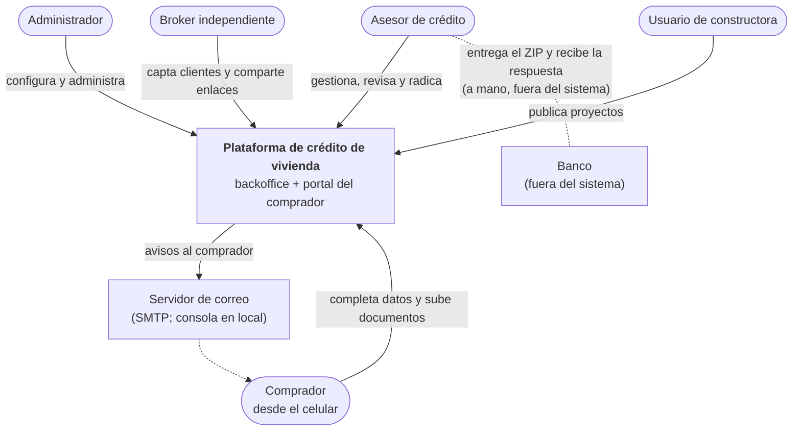
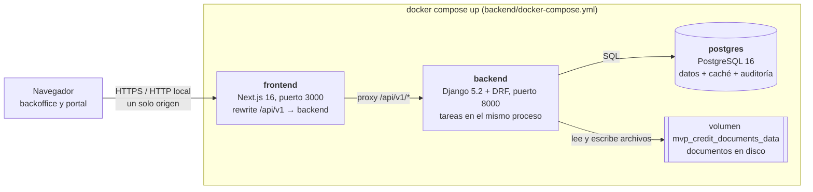
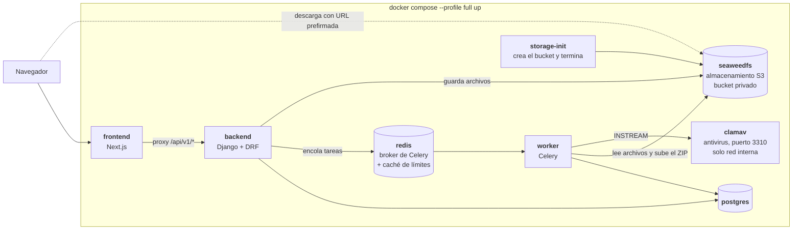
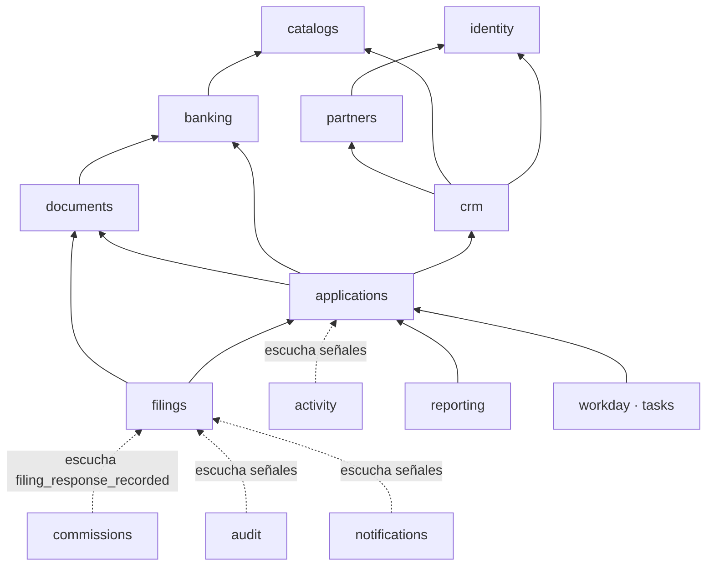
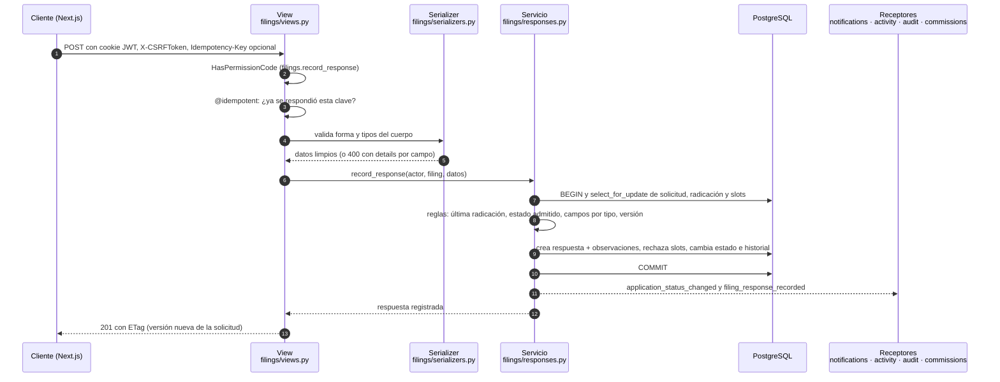
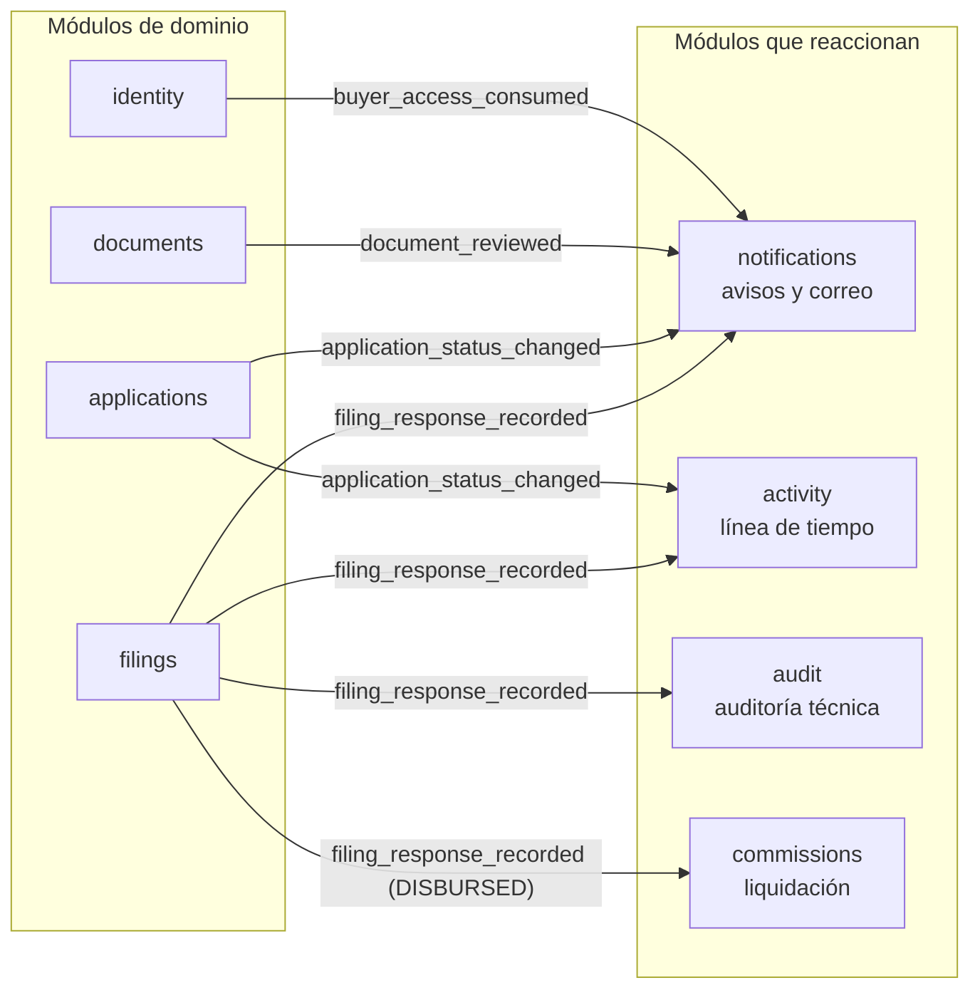
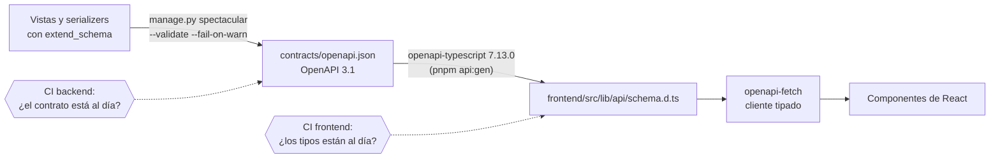
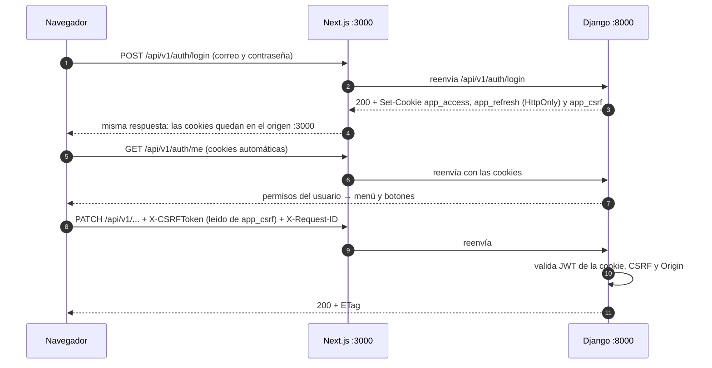

# 03 · Arquitectura

> **En simple:** es un **monolito modular**. Una sola API en Django, partida por dentro en 16 apps de dominio que comparten la misma base PostgreSQL y la misma transacción. Un frontend Next.js le habla a esa API como si fuera del mismo sitio web, y los dos se ponen de acuerdo con un **contrato OpenAPI** que genera el backend y que el CI vigila.

Este documento explica las piezas, cómo se conectan y por qué se eligieron. Las reglas del negocio están en [02 · Negocio](02-negocio.md); los requisitos no funcionales (seguridad, concurrencia, rendimiento…) con su detalle, en [04 · System design](04-system-design.md) *(en preparación)*. Conteos hechos en `master` el **18 de noviembre de 2026**.

---

## Índice

1. [Contexto: quién usa el sistema y con qué habla](#1-contexto-quién-usa-el-sistema-y-con-qué-habla)
2. [Contenedores: las piezas que corren](#2-contenedores-las-piezas-que-corren)
3. [El monolito modular](#3-el-monolito-modular)
4. [Las capas dentro de un módulo](#4-las-capas-dentro-de-un-módulo)
5. [Cómo se hablan los módulos: señales después del commit](#5-cómo-se-hablan-los-módulos-señales-después-del-commit)
6. [El contrato OpenAPI primero](#6-el-contrato-openapi-primero)
7. [Front ↔ API: mismo origen por el proxy de Next](#7-front--api-mismo-origen-por-el-proxy-de-next)
8. [Los dos modos locales](#8-los-dos-modos-locales)
9. [Cómo se pasaría a producción](#9-cómo-se-pasaría-a-producción)
10. [Stack y versiones](#10-stack-y-versiones)

---

## 1. Contexto: quién usa el sistema y con qué habla

Primer nivel del modelo C4 (*contexto*): el sistema como una caja, las personas que lo usan y los sistemas externos.



*Qué mirar: no hay ninguna flecha entre el sistema y el banco. Esa relación la hace una persona, el asesor, y por eso el sistema registra las respuestas del banco en lugar de recibirlas.*

- **El sistema solo envía correo.** Los avisos al comprador salen por el backend de correo de Django desde la tarea de entrega (`backend/apps/notifications/tasks.py`); en local, `EMAIL_BACKEND` es la consola (`backend/config/settings/local.py`), así que el correo aparece en el log ([`specs/TAREA-notificaciones.md`](../../specs/TAREA-notificaciones.md), Parte 2).
- **Todas las personas entran por la misma aplicación web.** Los cuatro roles internos usan el backoffice; el comprador, el portal. No hay un tercer frontend para el broker ni para la constructora (REQ §6).

## 2. Contenedores: las piezas que corren

Segundo nivel del C4 (*contenedores*): los procesos que corren y cómo se comunican. El proyecto tiene **dos modos locales**; los dos usan el mismo código y cambian solo la configuración (ver [§8](#8-los-dos-modos-locales)).

### Modo simple (por defecto: 3 contenedores)



*Qué mirar: el navegador solo conoce el puerto 3000. La API está detrás del frontend, que le reenvía `/api/v1/*`.*

### Modo completo (perfil `full`: 8 contenedores)



*Qué mirar: lo lento (antivirus, ZIP del expediente, correo, exportaciones CSV) sale de la petición HTTP y lo hace el worker. Y la descarga de un documento no pasa por la API: el navegador va directo al almacenamiento con una URL firmada que vence en 5 minutos.*

| Contenedor | Imagen o build | Para qué | Modo |
| --- | --- | --- | --- |
| `postgres` | `postgres:16-alpine` | Base de datos. En el modo simple también guarda la caché de los límites de consumo (`createcachetable`). | Los dos |
| `backend` | `backend/Dockerfile` (`python:3.11-slim`) | La API. Al arrancar corre `migrate`, `createcachetable`, `refresh_application_completeness` y `describe_local_services`, y después `runserver`. | Los dos |
| `frontend` | `frontend/Dockerfile` (build de producción de Next.js) | Backoffice y portal. Se construye con `API_ORIGIN=http://backend:8000`. | Los dos |
| `redis` | `redis:7-alpine` | Broker de Celery y caché compartida de los límites de consumo. | `full` |
| `seaweedfs` | `chrislusf/seaweedfs:3.85` | Almacenamiento compatible con S3. Se eligió porque la edición comunitaria de MinIO dejó de publicar imágenes. | `full` |
| `storage-init` | `backend/Dockerfile` | Crea el bucket privado (`init_document_storage`) y termina. | `full` |
| `worker` | `backend/Dockerfile` | `celery -A config worker`: antivirus, paquetes ZIP, correos y exportaciones. | `full` |
| `clamav` | `clamav/clamav:1.4.3` | Antivirus `clamd` por TCP, solo en la red interna. La primera descarga de firmas tarda minutos. | `full` |

Fuente: [`backend/docker-compose.yml`](../../backend/docker-compose.yml) y [`specs/TAREA-local-simple.md`](../../specs/TAREA-local-simple.md).

## 3. El monolito modular

### Qué es

Un **monolito** es una sola aplicación que se despliega entera. **Modular** quiere decir que por dentro está partida en módulos con fronteras claras, cada uno dueño de sus tablas y de sus reglas. Es lo contrario de tener una carpeta `models.py` gigante, y también es lo contrario de tener microservicios (varias aplicaciones separadas que se hablan por red).

### Por qué no microservicios

La decisión está en REQ §8.1 ([`docs/REQUERIMIENTOS_MVP_CREDITO.md`](../REQUERIMIENTOS_MVP_CREDITO.md)):

> El riesgo principal está en la consistencia de expedientes, permisos, documentos y auditoría, no en cómputo asíncrono masivo. Los módulos se despliegan juntos, comparten una única transacción de base de datos y se separan por límites de dominio para evitar acoplamiento.

En la práctica, eso significa:

- **Una sola transacción para un cambio de negocio.** Registrar una devolución del banco toca la radicación, la respuesta, las observaciones, los documentos rechazados, el estado de la solicitud y su historial. En un monolito eso es un `transaction.atomic()`: se guarda todo o nada (REQ §8.3, principio 3). Con microservicios haría falta coordinar varias bases (sagas, compensaciones), que es complejidad sin beneficio a esta escala.
- **Un solo lugar para los permisos.** El alcance por rol se calcula con la misma función en todo el sistema (`backend/apps/applications/services.py`, `applications_visible_to`).
- **Un solo despliegue y un solo contrato.** Un PR cambia el backend, el contrato y los tipos del front a la vez, y el CI verifica que coincidan ([§6](#6-el-contrato-openapi-primero)).

Qué haría cambiar la decisión: una parte que necesite escalar muy distinto del resto. Si pasara, el candidato natural es el trabajo asíncrono (antivirus, ZIP, exportaciones), que **ya** corre en un proceso aparte (el worker) en el modo completo.

### Las 16 apps

Los "16 módulos" del README son el **orden de construcción** (DER §15). En el código son 16 apps de Django bajo `backend/apps/`, registradas en `INSTALLED_APPS` (`backend/config/settings/base.py`, líneas 18-43). `identity` cubre tres de los módulos del orden (núcleo, invitaciones y acceso del comprador) y `tasks`, `workday` y `activity` son juntas el módulo 12.

| App | Qué resuelve | Tablas principales |
| --- | --- | --- |
| `identity` | Usuarios internos, roles, permisos, sesiones JWT, recuperación de contraseña, invitaciones, enlace mágico, sesiones del comprador y consentimientos | `users`, `roles`, `user_roles`, `permissions`, `role_permissions`, `auth_sessions`, `password_reset_tokens`, `internal_invitations`, `buyer_access_links`, `buyer_sessions`, `consent_definitions`, `consent_records` |
| `catalogs` | Catálogos administrables y transiciones de flujo por rol | `catalogs`, `catalog_items`, `workflow_transitions`, `workflow_transition_roles` |
| `partners` | Constructoras, membresías y proyectos | `partners`, `partner_memberships`, `projects` |
| `crm` | Clientes, direcciones, oportunidades y asignación de asesor | `clients`, `client_addresses`, `opportunities`, `opportunity_assignments` |
| `banking` | Bancos, productos, finalidades y reglas del banco | `banks`, `bank_products`, `bank_product_purposes`, `bank_policy_rules` |
| `documents` | Tipos y requisitos documentales, slots, versiones, archivos, revisión, descargas y paquetes ZIP | `document_types`, `document_requirements`, `application_document_slots`, `document_files`, `file_objects`, `document_reviews`, `document_package_jobs` |
| `applications` | Solicitud, participantes, perfil financiero, ingresos, inmueble, financiación, evaluación bancaria e historial de estados | `credit_applications`, `application_participants`, `financial_profiles`, `income_sources`, `properties`, `financing_preferences`, `application_assignments`, `bank_rule_evaluations`, `application_status_history` |
| `filings` | Radicación manual, respuestas del banco, observaciones y evidencia | `filings`, `filing_document_snapshots`, `filing_responses`, `filing_response_observations` |
| `notifications` | Avisos del comprador por portal y correo, con reintentos | `notifications`, `notification_deliveries` |
| `idempotency` | `Idempotency-Key` en los `POST` críticos | `idempotency_keys` |
| `tasks` | Tareas manuales | `tasks` |
| `workday` | "Mi día" del asesor (sin tablas propias) | — |
| `activity` | Línea de tiempo y notas internas | `activity_logs` |
| `audit` | Auditoría técnica inmutable y su retención | `audit_events` |
| `reporting` | Dashboard, embudo, reportes y exportaciones CSV | `report_export_jobs` |
| `commissions` | Planes, liquidación automática, reparto y pagos | `commission_plans`, `commission_settlements`, `commission_shares` |

En total, **57 tablas propias** (cada una con su `db_table` explícito, contadas en `backend/apps/`). El esquema SQL de referencia tiene 58: la diferencia es `outbox_events`, que no se implementó ([§5](#5-cómo-se-hablan-los-módulos-señales-después-del-commit)). El detalle por grupo está en [05 · Modelo de datos](05-modelo-de-datos.md) *(en preparación)*.

### Dependencias entre apps



*Qué mirar: las flechas continuas son imports directos y van "hacia abajo", hacia lo más básico. Las punteadas son señales: `notifications`, `activity`, `audit` y `commissions` reaccionan a lo que pasa en los módulos de dominio sin que esos módulos llamen a su código.*

Las flechas continuas siguen el orden de construcción y los imports reales (por ejemplo, `backend/apps/filings/responses.py` importa de `apps.applications.services` y de `apps.documents`). El diagrama está simplificado; los imports cruzados que no dibuja, revisados con `grep` sobre `backend/apps/`:

- casi todo importa `identity` y `catalogs`;
- `banking`, `documents`, `filings`, `commissions` y `reporting` importan **solo el enum** `AuditAction` de `apps.audit.actions`, para declarar `audit_actions` en sus vistas; nunca un servicio de auditoría;
- ningún módulo de dominio (`crm`, `identity`, `applications`, `documents`, `filings`) importa `notifications`, `activity` ni `commissions`;
- hay dos imports "hacia arriba" que se resuelven sin ciclos: `applications` usa `apps.filings.observations.open_observation_problems` (un archivo que solo importa modelos, Precisión 3 de la Parte 1 de [`specs/TAREA-radicacion.md`](../../specs/TAREA-radicacion.md)) y `documents` usa modelos y servicios de `applications` para sincronizar los slots.

## 4. Las capas dentro de un módulo

Cada app sigue el mismo recorrido para una petición. Un ejemplo real: registrar una respuesta del banco (`POST /api/v1/filings/{filing_id}/responses`).



*Qué mirar: la vista no tiene reglas de negocio; el servicio las tiene todas y trabaja dentro de una transacción con las filas bloqueadas. Las señales salen **después** del commit.*

| Capa | Archivo típico | Responsabilidad | No hace |
| --- | --- | --- | --- |
| Rutas | `urls.py` | Asocia la URL de `/api/v1` con la vista. Todas cuelgan de `backend/config/urls.py`. | — |
| Vista | `views.py` | Autenticación (cookie JWT), permiso por código (`required_permissions` + `HasPermissionCode`), alcance (busca el recurso con `*_visible_to`; si no está, `404`), `@idempotent`, `audit_actions` y el esquema OpenAPI con `extend_schema`. | No decide reglas de negocio. |
| Serializer | `serializers.py` | Valida la **forma** de la entrada y arma la **forma** de la salida, con etiquetas (`ChoiceLabelField`, `backend/config/serializers.py`). | No cambia estado. |
| Servicio | `services.py` y archivos por tema (`responses.py`, `settlement.py`, `reviews.py`…) | Las reglas, en `transaction.atomic()`, con `select_for_update` para bloquear filas, la comprobación de versión (`ensure_version`, `backend/apps/applications/concurrency.py`) y los errores de negocio (`ApiError` con un `code` estable). | No conoce HTTP. |
| Modelo | `models.py` o `models/` | Tablas, relaciones y restricciones de la base (`CheckConstraint`, únicos parciales). La base es la última barrera. | No orquesta. |

Por qué así: REQ §8.3, principios 1 a 3. **Autorización antes de consulta** (cada consulta nace filtrada por el alcance del actor), **servicios de dominio para los cambios críticos** (transiciones, revisión, radicación no viven en vistas ni en componentes de React) y **transacciones atómicas**.

Dos piezas transversales que ve toda petición:

- **`request_id`.** `backend/config/middleware.py` (`RequestIDMiddleware`) acepta el `X-Request-ID` que manda el front (si es corto y seguro) o crea uno, y lo devuelve en la respuesta. Va en los logs y en todo error.
- **Errores homogéneos.** `backend/config/exceptions.py` convierte cualquier error en `{"code", "message", "details", "request_id"}` (REQ §8.4). El front decide qué hacer por el `code`, nunca por el texto.

## 5. Cómo se hablan los módulos: señales después del commit

Cuando un módulo de dominio hace algo importante, **no llama** a notificaciones, actividad, auditoría ni comisiones. Emite una **señal** de Django (un evento dentro del mismo proceso) y quien esté interesado la escucha.

Las señales que emite cada app (`backend/apps/*/signals.py`) y quién las escucha (`backend/apps/*/receivers.py`):

| Señal | La emite | La escuchan |
| --- | --- | --- |
| `application_created`, `application_assigned`, `participant_added`, `participant_removed` | `applications` | `activity` (y `audit` la asignación) |
| `application_status_changed` | `applications` | `activity`, `audit`, `notifications` |
| `opportunity_created` | `crm` | `activity` |
| `document_uploaded`, `document_reviewed` | `documents` | `activity`, `audit` (y `notifications` la revisión) |
| `filing_created` | `filings` | `activity`, `audit`, `notifications` |
| `filing_response_recorded` | `filings` | `activity`, `audit`, `notifications`, **`commissions`** |
| `buyer_access_link_issued`, `buyer_access_consumed`, `consent_recorded` | `identity` | `activity`, `audit` (y `notifications` el consumo) |
| `task_created`, `task_completed`, `task_cancelled` | `tasks` | `activity` |
| `commission_settled`, `commission_settlement_voided`, `commission_share_paid`, `commission_plan_missing` | `commissions` | `activity`, `audit` |
| `report_exported` | `reporting` | `audit` |
| `bank_*_status_changed`, `document_type_status_changed`, `document_requirement_status_changed` | `banking`, `documents` | `audit` |



*Qué mirar: una sola señal (`filing_response_recorded`) alimenta cuatro módulos que no se conocen entre sí. Agregar comisiones no exigió tocar la radicación.*

### Por qué "después del commit"

Las señales se envían **cuando la transacción del dominio ya se confirmó**: al salir del bloque `transaction.atomic()` (por ejemplo, al final de `record_response` en `backend/apps/filings/responses.py`) o con `transaction.on_commit` (documentos, tareas, comisiones). Así:

- un aviso nunca anuncia algo que después se deshizo por un error;
- cada receptor trabaja en su propia transacción (un punto de guardado si quien emite sigue dentro de otra), y un error en él **se registra en el log y nunca rompe la operación original** (`never_raises`, Precisión 12 de la Parte 1 de [`specs/TAREA-notificaciones.md`](../../specs/TAREA-notificaciones.md); P3.8 de [`specs/TAREA-tareas-actividad.md`](../../specs/TAREA-tareas-actividad.md));
- los receptores son **idempotentes**: una clave de deduplicación en las notificaciones, la liquidación única en comisiones, `metadata.status_history_id` en la actividad.

### Por qué no un *outbox*

REQ §8.3 y el diseño original proponían el **patrón outbox**: guardar cada evento en una tabla dentro de la misma transacción y que un proceso aparte los publique. Garantiza que ningún evento se pierda, aunque el proceso muera justo después del commit.

Se decidió no implementarlo y usar señales después del commit (precisión 1 del orquestador en [`specs/TAREA-comisiones.md`](../../specs/TAREA-comisiones.md)). La cuenta:

- **A favor:** sin tabla extra, sin proceso publicador y sin otra cola que vigilar; el código de cada receptor es una función simple que se prueba con una llamada.
- **En contra (aceptado):** si el proceso muere entre el commit y el receptor, ese efecto no ocurre. Se mitiga donde importa: lo que manda trabajo afuera queda como estado en la base y tiene comandos para reintentarlo (`retry_notification_deliveries`, `requeue_pending_scans`, `requeue_document_packages`), y la liquidación de comisiones tiene un endpoint manual idempotente.

## 6. El contrato OpenAPI primero

**OpenAPI** es un archivo que describe cada endpoint de una API: rutas, parámetros, cuerpos, respuestas y errores. En este proyecto es la **frontera** entre el backend y el frontend.



*Qué mirar: nadie escribe el contrato a mano. Sale del código del backend, los tipos del front salen del contrato, y cada CI falla si alguno quedó viejo.*

- **El backend genera el contrato** con drf-spectacular desde las vistas y los serializers, y valida que no tenga advertencias. El CI lo regenera y falla si hay diferencias: `git diff --exit-code -- ../contracts/openapi.json` (`.github/workflows/backend.yml`, paso "OpenAPI contract is up to date", líneas 121-128).
- **El frontend genera sus tipos** con `openapi-typescript` y los commitea. El CI los regenera y falla si cambian (`.github/workflows/frontend.yml`, paso "API contract is up to date", líneas 151-160).
- **El cliente es tipado de punta a punta.** `frontend/src/lib/api/client.ts` crea el cliente con `createClient<paths>()`: una ruta mal escrita o un campo que no existe no compila.
- **Nombres estables.** drf-spectacular nombra solo los enums y puede renombrarlos si otro campo coincide. Los nombres publicados se fijan en `ENUM_NAME_OVERRIDES` (`backend/config/settings/base.py`) y una prueba los protege: `backend/tests/test_contract_names.py`. Otra prueba exige que toda operación con `If-Match` declare su `ETag`: `backend/tests/test_etag_contract.py`.
- **Solo se agrega.** Una vez que el front usa un campo, no se quita ni se renombra (regla de oro de [`specs/TAREA-brechas-2.md`](../../specs/TAREA-brechas-2.md)). La compatibilidad dentro de `/api/v1` es un requisito (RNF-20).

Tamaño del contrato al 18 de noviembre de 2026 (contado sobre `contracts/openapi.json`): **175 rutas, 235 operaciones** (201 internas y 34 del comprador) y **374 esquemas**.

**Por qué "contrato primero":** el frontend nunca adivina la forma de una respuesta, y un cambio del backend que rompería al front se ve en el mismo PR, no en producción. También es la base de la regla de REQ §8.5: las listas, etiquetas y transiciones vienen de la API, así que el front no necesita copiarlas.

## 7. Front ↔ API: mismo origen por el proxy de Next

El navegador **solo habla con el origen del frontend** (`http://localhost:3000` en local). Next.js reenvía todo lo que empieza por `/api/v1/` a la API:

```ts
// frontend/next.config.ts
async rewrites() {
  return [{ source: "/api/v1/:path*", destination: `${apiOrigin}/api/v1/:path*` }];
}
```

`apiOrigin` sale de `API_ORIGIN` (en Docker, `http://backend:8000`; en `pnpm dev`, `http://localhost:8000`).



*Qué mirar: el JavaScript del navegador nunca ve el token de sesión (está en una cookie `HttpOnly`). Solo lee la cookie CSRF, que no es secreta, para copiarla en una cabecera.*

Lo que esto resuelve:

- **Cookies en un solo origen.** La sesión interna son dos JWT (acceso de 15 minutos y renovación de 8 horas, `AUTH_ACCESS_TOKEN_LIFETIME` y `AUTH_REFRESH_TOKEN_LIFETIME`) en cookies `HttpOnly`, `SameSite=Lax`. Con `AUTH_COOKIE_SECURE` activo llevan el prefijo `__Host-`, que el navegador solo acepta en HTTPS y sin dominio (`backend/apps/identity/cookies.py`). La sesión del comprador es otra cookie (`buyer_session`, con el mismo prefijo) que solo sirve en las rutas `/buyer/*`.
- **CSRF.** Django pone la cookie `app_csrf` (legible por JavaScript) y el front la copia en `X-CSRFToken` en cada `POST`, `PUT`, `PATCH` y `DELETE` (`frontend/src/lib/api/fetch.ts`; `CSRF_COOKIE_NAME` en `backend/config/settings/base.py`). Django valida el `Origin` contra `CSRF_TRUSTED_ORIGINS`.
- **Sin CORS en la demo.** Como todo va por el mismo origen, el navegador no hace peticiones *cross-origin*. La configuración de `django-cors-headers` existe (`CORS_ALLOWED_ORIGINS` con `http://localhost:3000` por defecto) para cuando el front se corre en otro puerto durante el desarrollo.
- **La renovación de la sesión** la hace el cliente: ante un `401` del backoffice, un solo `POST /auth/refresh` y se reintenta; si falla, va a `/login` (`frontend/src/lib/api/fetch.ts` y `session.ts`). En el portal, un `401` muestra "Tu acceso venció".
- **El `proxy.ts` de Next no es seguridad.** `frontend/src/proxy.ts` solo manda al login a quien no tiene ninguna cookie de sesión, para no pintar el backoffice vacío. No mira permisos ni valida la cookie: "la seguridad la pone la API" (comentario del archivo).
- **Las descargas en el modo simple** son rutas relativas firmadas (`/api/v1/storage/objects/{token}`) que pasan por el mismo proxy (Precisión 1 de [`specs/TAREA-local-simple.md`](../../specs/TAREA-local-simple.md)).

## 8. Los dos modos locales

El proyecto **no tiene despliegue**: corre en local y en CI (Anexo A). El modo lo deciden las variables de `backend/.env` (qué implementación usar) y el perfil de compose (qué contenedores levantar). Fuente: [`specs/TAREA-local-simple.md`](../../specs/TAREA-local-simple.md), Precisión 6, y `backend/config/settings/base.py`.

| Pieza | Modo simple (por defecto) | Modo completo (`--profile full`) | Variable |
| --- | --- | --- | --- |
| Contenedores | `postgres`, `backend`, `frontend` | + `redis`, `seaweedfs`, `storage-init`, `worker`, `clamav` | — |
| Almacenamiento de documentos | Disco, en el volumen `mvp_credit_documents_data`, con URL firmadas por Django | SeaweedFS (S3), bucket privado, URL prefirmadas | `DOCUMENT_STORAGE_BACKEND=filesystem` / `s3` |
| Caché de los límites de consumo | Tabla de PostgreSQL (`DatabaseCache`), compartida entre procesos | Redis | `CACHE_BACKEND=database` / `redis` |
| Tareas asíncronas | En el mismo proceso, después del commit; un fallo nunca llega a la petición | Worker de Celery con Redis como broker | `CELERY_TASK_ALWAYS_EAGER=true` / `false` |
| Antivirus | Escáner de prueba: todo limpio salvo la firma EICAR | ClamAV (`clamd` por TCP) | `DOCUMENT_SCANNER=fake` / `clamd` |

Reglas de seguridad de los modos:

- El almacenamiento en disco o en memoria y el antivirus de prueba **solo arrancan con `DEBUG`** (o en las pruebas). Con `DEBUG=False`, la configuración falla al arrancar (`fake_services_allowed` y `validate_storage_settings` en `backend/apps/documents/storage.py`).
- En modo inmediato, el broker de Celery es `memory://` y nada intenta conectarse a Redis. Sin modo inmediato y sin `REDIS_URL`, el backend no arranca (Precisión 5).
- Al arrancar, el backend escribe una línea con el modo de cada servicio (`describe_local_services`), y `check_document_services` comprueba que respondan.
- Hay un solo almacenamiento activo por proceso: los archivos guardados en un modo no se ven desde el otro (Precisión 3).

Cómo correr cada modo, los puertos y los problemas comunes van en [10 · Operación local](10-operacion-local.md) *(en preparación)*.

## 9. Cómo se pasaría a producción

El proyecto no se despliega, pero se construyó para que pasar a producción sea **cambiar configuración, no código**. Esto es lo que cambiaría y lo que falta, sin adornos:

| Tema | Hoy (local) | En producción | Estado |
| --- | --- | --- | --- |
| Modo de Django | `DJANGO_DEBUG=True` | `False`. Con `False` se niegan a arrancar el disco, la memoria y el antivirus de prueba. | ✅ Listo por configuración |
| Servidor de aplicación | `runserver` (comando del compose) | `gunicorn`, que ya está en `backend/requirements.txt` ("Servidor de aplicación para entornos no locales") | 🔧 Falta el comando de arranque |
| Almacenamiento | Disco o SeaweedFS | S3 real con cifrado SSE (`DOCUMENT_STORAGE_SSE=AES256`, el valor por defecto): solo cambian las variables `DOCUMENT_STORAGE_*` | ✅ Listo por configuración |
| Antivirus | Escáner de prueba o ClamAV en compose | ClamAV gestionado, con firmas actualizadas | ✅ Listo por configuración |
| Tareas | En el proceso o worker local | Worker(s) de Celery con Redis | ✅ Listo por configuración |
| Tareas periódicas | Comandos a mano | Agendar `retry_notification_deliveries`, `requeue_pending_scans`, `requeue_document_packages`, `expire_document_packages`, `purge_idempotency_keys`, `purge_report_exports` y `purge_audit_events` (por ejemplo, con Celery beat) | 🔧 No hay agenda configurada (`beat_schedule` no existe en el código) |
| HTTPS y cookies | HTTP local, `AUTH_COOKIE_SECURE=False` | HTTPS obligatorio (RNF-01), `AUTH_COOKIE_SECURE=True` (el valor por defecto): cookies `__Host-` | ✅ Listo por configuración |
| Dominio y proxy | Next.js reenvía `/api/v1` a la API | Decidir el dominio final y si se mantiene el proxy de Next o un balanceador delante; con proxies de confianza, `NUM_PROXIES` para leer la IP real en los límites de consumo | ⏳ Decisión pendiente (REQ §12: "estrategia de cookies entre Next.js y API") |
| Correo | Consola | Proveedor transaccional y plantillas aprobadas | ⏳ Decisión pendiente (REQ §12) |
| Textos legales | Consentimientos provisionales | Texto legal validado, responsable de tratamiento y retención | ⏳ Decisión pendiente (REQ §12) |
| Respaldo | Volúmenes de Docker | Copia diaria y pruebas de restauración (RNF-09, REQ §11.1) | ⏳ Fuera del alcance actual |
| Observabilidad | Logs con `request_id` y auditoría en la base | Métricas (latencia, errores, colas), alertas y trazas (REQ §11.1) | ⏳ Fuera del alcance actual |
| Secretos | `backend/.env` local | Un gestor de secretos; `DJANGO_SECRET_KEY` y `AUTH_JWT_SIGNING_KEY` distintas y de alta entropía | 🔧 A definir con la plataforma |

Lo que **no** cambia: el código de dominio, el contrato, las migraciones y el frontend. El frontend ya se construye como build de producción en su contenedor (`frontend/Dockerfile`).

## 10. Stack y versiones

Versiones fijadas en el repositorio (`backend/requirements.txt`, `frontend/package.json`, `backend/docker-compose.yml`):

| Capa | Pieza | Versión |
| --- | --- | --- |
| Backend | Python | 3.11 (`python:3.11-slim`) |
| | Django | 5.2 |
| | Django REST Framework | 3.17 |
| | drf-spectacular | 0.30 |
| | PyJWT, argon2-cffi | 2.x, 25.x |
| | Celery | 5.6 |
| | psycopg | 3.2 o superior |
| Datos | PostgreSQL | 16 |
| | Redis | 7 (modo completo) |
| | SeaweedFS | 3.85 (modo completo) |
| | ClamAV | 1.4.3 (modo completo) |
| Frontend | Next.js (App Router) | 16.4.6 |
| | React | 19.3.1 |
| | Ant Design | 6.7.0 |
| | Tailwind CSS | 4.3.5 |
| | TanStack Query | 5.107.1 |
| | React Hook Form + Zod | 7.92.0 + 4.6.7 |
| | openapi-fetch + openapi-typescript | 0.17.0 + 7.13.0 |
| Pruebas | pytest, Vitest, MSW, Playwright, Storybook | ver [09 · Calidad](09-calidad.md) *(en preparación)* |

La estructura del repositorio es un **monorepo** ([`specs/TAREA-monorepo.md`](../../specs/TAREA-monorepo.md)):

```
/
├── backend/      API Django (apps/, config/, tests/), Dockerfile y docker-compose.yml
├── frontend/     Next.js (src/app, src/features, src/components/ui, src/lib), e2e/
├── contracts/    openapi.json: lo genera el backend, lo consume el frontend
├── design/       design system Umbral: tokens, mockups y generados
├── docs/         requerimientos, API, DER, modelo, SQL y esta guía
├── specs/        las tareas de construcción con sus decisiones
└── .github/      CI del backend y del frontend
```

---

Siguiente: [04 · System design](04-system-design.md) *(en preparación)* — cada requisito no funcional y cómo se cumple.
