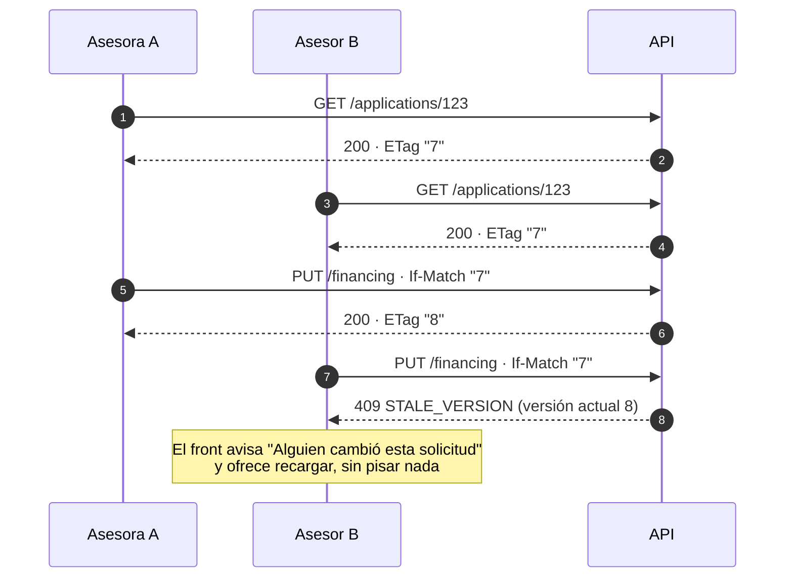

# 04 · System design: los requisitos no funcionales

> **En simple:** además de *qué* hace (los requisitos funcionales), el sistema tiene que cumplir *cómo* lo hace: ser seguro, no perder ni pisar datos, no bloquear al usuario con tareas lentas, responder rápido, dejar rastro de lo que pasa y proteger los datos personales. Este documento toma cada uno de esos requisitos y cuenta **qué pide**, **cómo se resolvió**, **dónde está en el código** y **qué prueba lo cubre**.

Las piezas y su conexión están en [03 · Arquitectura](03-arquitectura.md). Los requisitos vienen de [`docs/REQUERIMIENTOS_MVP_CREDITO.md`](../REQUERIMIENTOS_MVP_CREDITO.md) §8.3, §9 y §11 (los `RNF-xx`). Cifras contadas en `master` el **18 de noviembre de 2026**.

---

## Índice

1. [Resumen](#1-resumen)
2. [Seguridad por diseño](#2-seguridad-por-diseño)
3. [Consistencia y concurrencia](#3-consistencia-y-concurrencia)
4. [Trabajo asíncrono](#4-trabajo-asíncrono)
5. [Rendimiento](#5-rendimiento)
6. [Observabilidad](#6-observabilidad)
7. [Límites de consumo](#7-límites-de-consumo)
8. [Privacidad](#8-privacidad)
9. [Escalabilidad](#9-escalabilidad)
10. [Lo que queda pendiente, dicho claro](#10-lo-que-queda-pendiente-dicho-claro)

---

## 1. Resumen

| Requisito | Qué pide en una línea | Cómo quedó | Estado |
| --- | --- | --- | --- |
| Autenticación (§9.1, RNF-02, RNF-11) | Contraseñas con Argon2, JWT corto en cookie, refresh rotativo, comprador sin contraseña | Argon2, JWT de 15 min en cookie `HttpOnly`, refresh opaco de un solo uso con detección de reutilización, enlace mágico de un solo uso | ✅ |
| Autorización (§9.2, RNF-05, RNF-12) | Rol y objeto validados en el servidor; sin BOLA/IDOR | Permiso por código en cada vista y consultas que nacen filtradas por alcance; fuera del alcance, `404` | ✅ |
| Archivos (§9.2, RNF-03, RNF-15) | Privados, verificados, con antivirus y URL firmadas | Tipo real por bytes, tamaño, cuota, antivirus que falla cerrado, URL firmadas de 5 min | ✅ |
| Auditoría (RNF-04, §9.5) | Quién hizo qué, sin secretos | `audit_events` inmutable (también con un trigger de PostgreSQL), saneada | ✅ |
| Atomicidad (RNF-06, §8.3) | Un cambio de estado y sus efectos, juntos o nada | Servicios con `transaction.atomic()` y `select_for_update` | ✅ |
| Concurrencia (§8.3.6) | No pisar ediciones | `version` + `ETag`/`If-Match` → `409 STALE_VERSION` | ✅ |
| Idempotencia (§8.3.5) | Un reintento no duplica | `Idempotency-Key` en los `POST` críticos (opcional) + unicidades en la base | ✅ con desvío |
| Asincronía (RNF-17, RNF-19, RNF-21) | ZIP, antivirus, correo y CSV fuera de la petición, reintentables | Celery (worker o modo inmediato), tareas idempotentes con reintentos | ✅ |
| Rendimiento (RNF-07, RNF-17) | Listas paginadas; p95 < 800 ms | Paginación de 25 (máx. 100), sin consultas por fila (48 pruebas de número de consultas), agregados en la base, 54 índices con nombre | ✅ diseño · ⏳ medición en la auditoría de carga |
| Observabilidad (RNF-16, RNF-18) | `request_id`, logs sin secretos, `health`/`ready` | `X-Request-ID` en cada respuesta y log; filtro que tacha URL firmadas; `/health` y `/ready` | ✅ parcial (sin métricas) |
| Límites de consumo (§9.3, RNF-13) | Límites en Redis o equivalente | 10 límites en `AUTH_RATE_LIMITS`, en caché compartida (Redis o PostgreSQL) | ✅ parcial (sin límite general) |
| Privacidad (RNF-08, §9.2) | Respuestas por rol, sin PII de más | Serializers por rol, documento enmascarado, auditoría y logs saneados | ✅ |

La auditoría de seguridad independiente está **en curso** en la rama `chore/security-audit` (aún sin fusionar): su matriz de acceso cubre las **235 operaciones × 9 actores sin brechas**. El informe será [`docs/SEGURIDAD.md`](../SEGURIDAD.md) *(en preparación)*; los hallazgos y su corrección se resumen en [12 · Auditorías](12-auditorias.md) *(en preparación)*.

---

## 2. Seguridad por diseño

### 2.1 Autenticación del equipo interno

**Qué pide** (REQ §9.1, RNF-02, RNF-11): contraseñas con Argon2id; JWT validado en algoritmo, firma, `iss`, `aud`, `exp`, `nbf` y `jti`; acceso de 15 minutos en cookie `HttpOnly`, `Secure`, `SameSite=Lax`; refresh opaco, rotativo, de un solo uso, guardado como hash y de 8 horas; cerrar sesión o desactivar un usuario corta el acceso.

**Cómo se resolvió:**

- **Contraseñas:** `PASSWORD_HASHERS = ["django.contrib.auth.hashers.Argon2PasswordHasher"]` (`backend/config/settings/base.py`, línea 108), con los parámetros por defecto de Django. El comprador no tiene contraseña.
- **JWT en cookie, nunca en el cuerpo.** La API pone tres cookies: `app_access` (JWT HS256 de 15 minutos con `iss`, `aud`, `exp`, `nbf`, `jti` y el id de sesión `sid`), `app_refresh` (token opaco de un solo uso; en la base solo su SHA-256) y `app_csrf` (legible por el front). Con `AUTH_COOKIE_SECURE` llevan el prefijo `__Host-` (`backend/apps/identity/cookies.py`; tabla en `backend/README.md`, "Internal Authentication"). La clave de firma es dedicada y distinta de `SECRET_KEY` (`AUTH_JWT_SIGNING_KEY`).
- **Cada petición revisa la sesión, no solo la firma.** `CookieJWTAuthentication` (`backend/apps/identity/authentication.py`) valida el token y además busca la sesión `sid` en `auth_sessions`: si se cerró, venció o el usuario ya no puede entrar, responde `401 SESSION_EXPIRED`. Así, desactivar a alguien corta su acceso **de inmediato**, sin esperar a que venza el JWT.
- **Refresh rotativo con detección de robo.** Cada `POST /auth/refresh` crea una sesión nueva encadenada a la anterior (`auth_sessions.rotated_from`). Si alguien reutiliza un refresh ya rotado, se revoca **toda la cadena** (`_revoke_descendants` en `backend/apps/identity/services.py`). La rotación no alarga las 8 horas del login.
- **CSRF en toda escritura autenticada por cookie** (`enforce_csrf`, mismo archivo), con `CSRF_TRUSTED_ORIGINS` explícitos.
- **Recuperación de contraseña:** siempre `202` exista o no el correo (no revela cuentas), token de un solo uso de 30 minutos que revoca todas las sesiones; cambiar la contraseña exige la actual y cierra las demás sesiones (`backend/README.md`).
- **Invitaciones:** un usuario interno entra por invitación de un solo uso (72 h, solo el hash), y una invitación nunca puede tomar una cuenta que ya tiene contraseña.

**Qué se probó:** `backend/tests/identity/test_sessions.py` (rotación, el token de una sesión rotada deja de servir, la reutilización revoca la cadena), `test_login.py`, `test_passwords.py`, `test_invitations.py`, `test_users.py` y `test_models.py` ("una sesión solo se rota una vez").

### 2.2 Acceso del comprador

**Qué pide** (REQ §9.1, RF-02): token aleatorio hasheado, un solo uso, 72 horas; limpiar la URL; sesión opaca, revocable, ligada al expediente, de 24 horas.

**Cómo se resolvió** (detalle de negocio en [02 · Negocio §6](02-negocio.md#6-el-comprador-y-el-enlace-mágico)):

- El token se genera con `generate_opaque_token` y se guarda solo su hash (`backend/apps/identity/tokens.py`, `buyer_access.py`). El token en claro existe solo en la respuesta `201` de la emisión y en el correo; nunca en listados ni en logs.
- Consumir bloquea la fila: de dos consumos simultáneos, gana uno. El front borra el token de la URL con `history.replaceState` **antes** de cualquier otra cosa (`frontend/src/features/buyer-portal/access-screen.tsx`).
- La sesión del comprador es otra cookie (`buyer_session`, `__Host-` en HTTPS) que **solo** autentica rutas `/buyer/*`; la cookie interna no sirve ahí y la del comprador no sirve en las internas. Cada ruta compara el recurso con `session.application_id`: otro id responde `404` (`BuyerSessionAuthentication`, decisión de diseño "Sesión del comprador" en [`specs/TAREA-buyer-access.md`](../../specs/TAREA-buyer-access.md)).

**Qué se probó:** `backend/tests/applications/buyer_access/test_links_api.py`, `test_portal_api.py`, `test_consents_api.py`, `test_editing_api.py` y `test_financing_api.py` (151 pruebas en la carpeta).

### 2.3 Permisos por código

**Qué pide** (REQ §3, §8.6): permisos aplicados en el servidor; ocultar un botón no autoriza.

**Cómo se resolvió:**

- **Seguro por defecto:** todo endpoint exige sesión salvo que declare lo contrario (`DEFAULT_PERMISSION_CLASSES = IsAuthenticated`, `backend/config/settings/base.py`).
- Cada vista declara un mapa `required_permissions = {método: código}` y `HasPermissionCode` (`backend/apps/identity/permissions.py`) lo exige. **Un método sin permiso declarado se niega** (`return False` si no hay código).
- Los permisos son datos (`permissions`, `role_permissions`) sembrados por migración en cada app; hay **89 códigos** de permiso (contados en las migraciones de semillas de `backend/apps/*/migrations/`). El front decide qué mostrar con los permisos de `GET /auth/me`, nunca con el nombre del rol.

**Qué se probó:** cada módulo prueba su matriz de roles; por ejemplo, `backend/tests/commissions/` prueba los 10 endpoints de administración con asesor, broker y constructora (`403`) y sin sesión (`401`) (P3.5 de [`specs/TAREA-comisiones.md`](../../specs/TAREA-comisiones.md)).

### 2.4 Alcance por rol con `404`

**Qué pide** (REQ §8.3 principio 1, §9.2, RNF-05, RNF-12): "cada queryset nace filtrado por el alcance del actor"; evitar BOLA/IDOR (acceder a un objeto ajeno cambiando su id).

**Cómo se resolvió:**

- La consulta **empieza** filtrada: `applications_visible_to(user)` en `backend/apps/applications/services.py`, `clients_visible_to` en CRM, `links_visible_to` en el acceso del comprador, `responses_visible_to` en radicación… La regla de las solicitudes vive en un solo lugar (`crm.services.application_scope_condition`) y la reutilizan el listado, el conteo por cliente y los reportes.
- Si el recurso no está en ese conjunto, la respuesta es `404 RESOURCE_NOT_FOUND`, **no** `403`: no se confirma que existe (docstring de `backend/apps/crm/services.py`).
- Ningún id que mande el front amplía privilegios: la constructora no puede usar un `partner_id` ajeno (se deriva de su membresía) y el enlace mágico ignora el `client_id` de la entrada (REQ §8.6).

**Qué se probó:** 156 comprobaciones de `404` en `backend/tests/` y 22 pruebas cuyo nombre habla de "otro asesor", "no asignado" o "fuera de alcance". La auditoría en curso recorre la matriz completa (235 operaciones × 9 actores).

### 2.5 Entrada validada

**Qué pide** (RNF-14, §9.2): validar formato, rango, longitud y listas permitidas; nada de *mass assignment* (aceptar objetos completos).

**Cómo se resolvió:** los serializers de escritura rechazan campos no declarados (`StrictSerializer`, `backend/config/serializers.py`); los filtros y el orden de las listas solo aceptan campos de una lista blanca (`backend/README.md`, "Key Conventions"); cada código de catálogo se valida contra **su** catálogo y rechaza ítems inactivos o vencidos (`CatalogItemCodeField`, `backend/apps/catalogs/fields.py`). Las reglas bancarias son JSON que se interpreta como árbol, **sin `eval`** ni nada parecido (`backend/apps/banking/rule_engine.py`).

### 2.6 Archivos

**Qué pide** (§9.2, §9.5, RNF-03, RNF-15): archivos privados; verificar tamaño, extensión, MIME real y antimalware; rechazar ejecutables, doble extensión y MIME incoherente; servir con URL firmada de corta duración; nunca renderizar un archivo como HTML en el mismo origen.

**Cómo se resolvió** (`backend/apps/documents/`):

| Control | Dónde |
| --- | --- |
| Tipo real por firma de bytes, lista cerrada (PDF, JPG, PNG), coherente con la extensión | `file_validation.py`, `constants.py` |
| Tamaño máximo por tipo y corte del cuerpo antes de leerlo (`413`) | `file_validation.py`, `uploads.py` |
| Cuota: 20 versiones por slot, 200 MB por solicitud | `DOCUMENT_UPLOAD_MAX_VERSIONS_PER_SLOT`, `DOCUMENT_UPLOAD_QUOTA_BYTES` |
| Nombre saneado (sin ruta, sin caracteres de control, NFC, 255) | `file_validation.py` |
| Almacenamiento privado; la clave del objeto no lleva el nombre original (`documents/<solicitud>/<uuid>`) | `storage.py` |
| Antivirus (ClamAV `INSTREAM`); si falla, el archivo **sigue pendiente, nunca limpio** | `scanning.py`, `scans.py`, `tasks.py` |
| Nada se aprueba ni se descarga sin análisis limpio (`409 FILE_NOT_CLEAN`) | `reviews.py`, `downloads.py` |
| Descarga por URL prefirmada de 5 minutos (`DOCUMENT_DOWNLOAD_URL_SECONDS = 300`), siempre `Content-Disposition: attachment`, `Cache-Control: no-store` y `nosniff`; la URL nunca va a los logs | `downloads.py`, `storage_views.py` |
| SHA-256 verificado antes de empaquetar el ZIP (`CHECKSUM_MISMATCH`) | `packages.py` |
| Cifrado del lado del servidor en S3 real (`DOCUMENT_STORAGE_SSE=AES256`) | `storage.py` |

El `attachment` siempre y el `nosniff` son la respuesta a "nunca renderizar un archivo como HTML": el navegador lo descarga, no lo abre en el origen de la app.

**Qué se probó:** `backend/tests/documents/test_file_validation.py` (detecta el tipo real, rechaza el contenido desconocido aunque tenga nombre `.pdf` y el tipo declarado que contradice el contenido), `test_filesystem_storage.py` (enlaces vencidos o alterados → `403`), `test_storage.py`, `test_scanning.py`, y en `backend/tests/applications/dossier/`: `test_scans.py` (un infectado rechaza la versión y el slot), `test_downloads_api.py` y `test_packages.py`.

### 2.7 Auditoría inmutable

**Qué pide** (RNF-04, §9.5, API §24.1): registrar actor, fecha y acción de lo sensible (inicios de sesión, fallos, descargas, cambios de permisos, todo `403`, acciones del expediente) **sin** contraseñas, tokens, `Authorization`, documentos completos ni URL firmadas.

**Cómo se resolvió** (`backend/apps/audit/`; [`specs/TAREA-auditoria.md`](../../specs/TAREA-auditoria.md)):

- **Inmutable en tres capas:** el modelo rechaza `save()` sobre una fila existente y `delete()`; el `QuerySet` rechaza `update()` y `delete()` salvo dentro de `allow_purge()` (solo la retención); y un **trigger de PostgreSQL** bloquea cualquier `UPDATE`, también por SQL directo (`backend/apps/audit/migrations/0002_block_updates_trigger.py`).
- **Dos fuentes de eventos:** las señales del dominio (login, enlace, consentimiento, carga y revisión de documentos, cambio de estado, radicación, respuesta del banco, comisiones, exportaciones, configuración) en `receivers.py`, y lo que no tiene señal se marca en la vista con `audit_actions` / `audit_failure_action`; el `AuditContextMiddleware` lo registra desde la respuesta (`hooks.py`). Todo `403` queda como `ACCESS_DENIED` y todo `429` como `AUTH_RATE_LIMITED`.
- **Lo fallido no se pierde con el rollback:** los eventos `DENIED` y `FAILED` dentro de una transacción se escriben por una conexión aparte (`DATABASES["audit"]`, con `lock_timeout` de 2 s) (P1.2).
- **Saneamiento único** (`sanitize.py`): descarta toda clave que contenga `password`, `token`, `authorization`, `cookie`, `secret`, `signature`, `url`… a cualquier profundidad; enmascara documentos (últimos 4); reemplaza URL con consulta por `[URL omitida]`; recorta textos largos. De una vista solo se guardan los **nombres** de los campos enviados, nunca sus valores.
- **43 acciones** en `AuditAction` (`backend/apps/audit/actions.py`). Solo el administrador lee la auditoría (`audit.read`).
- **Retención:** `purge_audit_events` borra lo de más de 365 días (`AUDIT_RETENTION_DAYS`); es la única forma de borrar.

**Qué se probó:** `backend/tests/applications/audit/test_audit_core.py` (entre otras, `test_the_database_blocks_updates` y el saneamiento), `test_audit_events.py`, `test_audit_api.py`. Además, un fixture automático revisa **todos** los eventos al terminar cada prueba de la carpeta y la hace fallar si encuentra claves prohibidas, URL con consulta o números de 6 o más dígitos (P1.10).

### 2.8 Secretos y configuración

- Los secretos viven en `backend/.env` (fuera de git) y se leen con `django-environ`; `DJANGO_SECRET_KEY` y `AUTH_JWT_SIGNING_KEY` son obligatorias (sin valor por defecto, `backend/config/settings/base.py`).
- La configuración insegura **no arranca**: almacenamiento en disco o memoria y antivirus falso exigen `DEBUG` (`validate_storage_settings`, `backend/apps/documents/storage.py`); sin modo inmediato y sin `REDIS_URL`, tampoco.
- Las tareas de Celery solo reciben ids, nunca archivos ni datos personales (`CELERY_TASK_SERIALIZER = "json"` y comentario en `base.py`).

---

## 3. Consistencia y concurrencia

### 3.1 Transacciones atómicas

**Qué pide** (RNF-06, §8.3 principio 3, §4.4): un cambio de estado, su historial, su actividad y sus efectos se guardan juntos o no se guarda ninguno.

**Cómo se resolvió:** cada servicio de dominio abre un `transaction.atomic()` y hace todo adentro: por ejemplo, `record_response` (`backend/apps/filings/responses.py`) crea la respuesta, las observaciones, rechaza los slots observados, cambia el estado de la solicitud y su historial, y actualiza la radicación en un solo bloque. El historial de estados y la versión pasan siempre por el mismo servicio de transición (`apply_system_transition` / `transition_application` en `backend/apps/applications/services.py`).

### 3.2 Bloqueo de filas (`select_for_update`)

**El problema:** dos peticiones al mismo tiempo leen el mismo dato, cada una decide con lo que leyó y la segunda pisa a la primera.

**Cómo se resolvió:** los servicios bloquean las filas que van a cambiar con `select_for_update` (**55 usos** en `backend/apps/`), siempre en el mismo orden para no crear interbloqueos: **primero la solicitud y después los slots, ordenados por id** (decisión 22 de [`specs/TAREA-document-file.md`](../../specs/TAREA-document-file.md)). Ejemplos:

- liquidar una comisión bloquea la solicitud: dos liquidaciones simultáneas se serializan y la segunda ve la primera (P2.3 de `TAREA-comisiones.md`);
- validar el solapamiento de planes bloquea la fila del **producto**, porque bloquear solo los planes existentes no impide que entre uno nuevo en paralelo (P1.2);
- el worker toma un paquete con un `UPDATE` condicional ("solo si sigue en el estado esperado"), para que dos workers no lo procesen a la vez (decisión 42).

La base es la última barrera: índices únicos parciales como "una sola solicitud abierta por oportunidad" (`uq_credit_applications_open_opportunity`) o "una sola liquidación vigente por solicitud" (`uq_commission_settlements_active`).

**Qué se probó:** pruebas con hilos y conexiones reales (`transaction=True`) en `backend/tests/commissions/test_settlement.py` (dos liquidaciones a la vez), `backend/tests/applications/dossier/test_packages.py` (dos ejecuciones del mismo paquete: un solo ZIP y un solo `COMPLETED`), `test_buyer_dossier_api.py` y `backend/tests/documents/test_scanning.py`.

### 3.3 Efectos después del commit (`on_commit`)

Lo que sale del sistema (encolar el antivirus, el ZIP, el correo, emitir señales) se hace **después** de confirmar la transacción, con `transaction.on_commit` o al salir del bloque atómico. Así nunca se encola trabajo sobre datos que al final no se guardaron (docstring de `backend/config/celery.py`). El porqué de usar señales en lugar de un *outbox* está en [03 · Arquitectura §5](03-arquitectura.md#5-cómo-se-hablan-los-módulos-señales-después-del-commit).

### 3.4 `ETag` / `If-Match`: no pisar la edición de otro

**Qué pide** (§8.3 principio 6): `credit_applications.version`; `PATCH` y acciones críticas reciben `If-Match` o la versión esperada; `409 CONFLICT` ante una edición obsoleta.

**Cómo se resolvió** (`backend/apps/applications/concurrency.py`; Parte 2 de las decisiones de [`specs/TAREA-applications.md`](../../specs/TAREA-applications.md)):

*Qué mirar: B no pierde su trabajo en silencio ni borra el de A; la API rechaza el cambio porque se basó en una versión vieja.*

- Toda respuesta del expediente lleva `ETag: "<version>"`; `If-Match` acepta `"3"`, `3` o `W/"3"`. Sin `If-Match` en un `PUT`/`PATCH`: `428 PRECONDITION_REQUIRED`.
- Las **acciones** (transiciones, radicar, responder) mandan `expected_version` en el cuerpo.
- Un `PATCH` sin cambios reales no sube la versión.
- **Los documentos no tocan la versión** (decisión 6 de `TAREA-document-file.md`): una carga del comprador no invalida lo que edita el asesor.
- Los planes de comisión también tienen `version` para su `If-Match` (P1.1 de `TAREA-comisiones.md`).
- Las tareas no tienen versión: bloquean la fila y validan el estado adentro (P2.9 de [`specs/TAREA-tareas-actividad.md`](../../specs/TAREA-tareas-actividad.md)).

**Qué se probó:** `backend/tests/test_etag_contract.py` genera el esquema y exige que toda operación con `If-Match` declare `ETag` en todos sus `2xx` y que el `GET` del mismo recurso también lo declare; las pruebas de cada formulario cubren `409 STALE_VERSION` y `428`.

### 3.5 Idempotencia con `Idempotency-Key`

**El problema:** la red falla justo después de que el servidor radicó; el cliente reintenta y se crea una segunda radicación.

**Cómo se resolvió** (`backend/apps/idempotency/`; Parte 3 de [`specs/TAREA-notificaciones.md`](../../specs/TAREA-notificaciones.md)):

- El decorador `@idempotent` está en los `POST` críticos: transición de estado, paquete, radicación, respuesta del banco, enlace mágico, liquidar/anular/pagar comisiones y exportación de reportes.
- Con la cabecera: misma clave y mismo cuerpo → la **respuesta original** (código, JSON, `ETag` y `Location`); misma clave con otro cuerpo → `422 IDEMPOTENCY_CONFLICT`; dos a la vez → la segunda recibe `409 IDEMPOTENCY_IN_PROGRESS` sin esperar. Solo se guardan las respuestas `2xx`; una clave vence a las 24 h (`purge_idempotency_keys` las borra).
- La huella del cuerpo es el SHA-256 del JSON canónico: reordenar el cuerpo no es un conflicto.
- **Excepción:** el enlace mágico lleva el token en claro, que nunca se guarda; repetir su clave responde `409 IDEMPOTENCY_REPLAY_UNAVAILABLE` sin crear otro enlace.
- **Desvío:** REQ §9.3 y §8.3 la pedían **obligatoria**; quedó **opcional** para no romper el front, que todavía no la enviaba. Mientras tanto, la idempotencia natural la dan las unicidades de la base (un paquete solo se radica una vez, una sola solicitud abierta por oportunidad, una sola liquidación vigente).

**Qué se probó:** `backend/tests/applications/idempotency/test_idempotency.py` (21 pruebas: sin cabecera nada cambia, la repetición devuelve lo original, el orden del cuerpo no importa, otro cuerpo es conflicto, solo se guardan los éxitos, una clave en curso responde `409`, clave de otro actor, vencimiento y las vistas).

---

## 4. Trabajo asíncrono

**Qué pide** (§8.3 principio 7, RNF-17, RNF-19, RNF-21): el antivirus, el ZIP, los correos y los CSV no bloquean la petición HTTP; las tareas son reintentables e idempotentes; un fallo nunca cambia en silencio el estado del crédito; el aviso del portal se guarda antes de encolar el correo.

**Cómo se resolvió:** Celery (`backend/config/celery.py`) con cinco tareas:

| Tarea | Archivo | Qué hace | Reintentos | Si se agota |
| --- | --- | --- | --- | --- |
| `scan_file_object` | `apps/documents/tasks.py` | Antivirus de una versión cargada | 8, con espera creciente: 30 s, 1, 2, 4 y 8 min y después cada 15 min (≈ 1 h 15 min) | El archivo sigue `PENDING`; `requeue_pending_scans` lo retoma |
| `build_document_package` | `apps/documents/tasks.py` | Arma el ZIP del expediente | 5 | `FAILED` con `STORAGE_UNAVAILABLE`; se pide otro paquete |
| `scan_filing_evidence` | `apps/filings/tasks.py` | Antivirus de la evidencia de una respuesta del banco | 8, igual que los documentos | Sigue `PENDING` |
| `deliver_notification_email` | `apps/notifications/tasks.py` | Envía el correo de un aviso | 6 intentos: el primero y 5 reintentos a 1, 5, 15, 60 y 240 min | `FAILED`; `retry_notification_deliveries` reencola los vencidos |
| `build_report_export` | `apps/reporting/tasks.py` | CSV asíncrono, con el alcance recalculado al ejecutar | 5 | `FAILED` con su código |

Reglas comunes:

- **Solo ids, nunca datos** en el mensaje de la tarea (serialización JSON).
- **Idempotentes:** cada tarea mira el estado antes de actuar y no hace nada si ya no está pendiente; el correo bloquea la fila de la entrega (`select_for_update`) para no enviar dos veces aunque llegue un mensaje repetido (P2.3 de `TAREA-notificaciones.md`).
- **`acks_late=True`:** si el worker muere a mitad, la tarea vuelve a la cola.
- **Un fallo no toca el crédito:** el antivirus caído deja el archivo pendiente, no aprobado; un correo fallido deja la entrega `FAILED` y el aviso del portal sigue ahí (RNF-21).
- **Modo inmediato en local** (`CELERY_TASK_ALWAYS_EAGER=true`): la tarea corre en el mismo proceso **después del commit**, y su fallo nunca llega a la petición del usuario (`CELERY_TASK_EAGER_PROPAGATES = False`); queda en el log y en el estado del archivo o del paquete. Celery ignora el `countdown` en este modo, así que los reintentos corren seguidos; el estado final es el mismo (Precisión 5 de [`specs/TAREA-local-simple.md`](../../specs/TAREA-local-simple.md)). El correo no usa `self.retry` justamente por eso: en modo inmediato no se reencola y lo retoma el comando cuando vence su espera (P2.2 de `TAREA-notificaciones.md`).

**Qué va en segundo plano y por qué:** lo que depende de un servicio externo o puede tardar (antivirus, almacenamiento, SMTP, archivos grandes). Lo que es una regla de negocio (cambiar un estado, aprobar un documento, liquidar una comisión) **no** va en segundo plano: se hace en la transacción de la petición y responde con su resultado.

**Qué se probó:** `backend/tests/applications/dossier/test_local_mode.py` (con almacenamiento que falla, la carga responde lo de siempre y el archivo queda `PENDING`; el paquete queda `FAILED`; un error inesperado no se vuelve `500`), `test_scans.py`, `test_packages.py`, `backend/tests/applications/notifications/test_emails.py` y `backend/tests/reporting/test_export_jobs.py`.

---

## 5. Rendimiento

**Qué pide** (RNF-07, RNF-17): listas paginadas y filtrables; lecturas normales con p95 < 800 ms bajo la carga objetivo; lo pesado no bloquea la petición.

**Cómo se resolvió:**

- **Paginación siempre:** `StandardResultsSetPagination` (`backend/config/api.py`), 25 por página y máximo 100, con `{items, page, page_size, total, next, previous}`.
- **Sin consultas por fila.** Los datos de cada fila salen de anotaciones y subconsultas en la misma consulta (`Count`, `Exists`, `Subquery`), no de un bucle. Ejemplos: los conteos de participantes del listado (`_active_participants`, `backend/apps/applications/services.py`), `applications_count` del cliente, `in_use` de los planes, el último comentario al comprador de cada documento.
- **Se mide en las pruebas:** 48 aserciones de número de consultas (`CaptureQueriesContext`, `django_assert_num_queries` y `django_assert_max_num_queries`) en 20 archivos de `backend/tests/`; varias comparan el listado con 1 y con 25 filas para probar que no crece.
- **Agregados en la base:** el resumen de "Mi día" es **un** `aggregate` con un `Count(filter=…)` por segmento (P1.9 de `TAREA-tareas-actividad.md`); el embudo de reportes se calcula con `Exists` sobre el historial; el dashboard no trae filas para contarlas en Python.
- **Desnormalizar donde una medición lo justificó.** Calcular la completitud del expediente por fila costaba 6 a 10 consultas y 13 a 22 ms por fila (150 a 250 consultas para 25 filas). Se descartó y se guardan `completeness_pct` y `ready_to_file_ok` en `credit_applications`, recalculados en `on_commit` después de cada cambio que los afecta y con el comando `refresh_application_completeness` (Precisión A de [`specs/TAREA-applications-listado.md`](../../specs/TAREA-applications-listado.md)).
- **Índices** pensados para las pantallas: 54 índices con nombre (`ix_*`) y 39 únicos (`uq_*`) en los `Meta` de los modelos, varios parciales (por ejemplo `ix_applications_workday` para "Mi día", `ix_doc_slots_pending`, `ix_notification_delivery_queue` para la cola de correos).
- **Lo pesado, fuera:** ZIP, antivirus, correo y CSV grande van al worker ([§4](#4-trabajo-asíncrono)); el CSV directo tiene un tope de 5.000 filas.
- **Caché de catálogos con `ETag`:** `/metadata/bootstrap` y `/metadata/catalogs/*` responden `304` con `If-None-Match` (P3.3 de [`specs/TAREA-brechas.md`](../../specs/TAREA-brechas.md)).

**La medición del p95** bajo carga es parte de la auditoría de carga y estrés del backend, en preparación; el informe será [`docs/PERFORMANCE.md`](../PERFORMANCE.md) *(en preparación)* y el resumen, [12 · Auditorías](12-auditorias.md).

---

## 6. Observabilidad

**Qué pide** (RNF-16, RNF-18, REQ §11.1): `request_id` en cada petición y en logs estructurados sin secretos; `health` y `ready` sin datos sensibles; métricas, trazas y alertas.

**Cómo se resolvió:**

- **`request_id`** (`backend/config/middleware.py`): cada petición recibe uno. Si el front manda `X-Request-ID` y es seguro (8 a 64 caracteres de `[A-Za-z0-9._-]`), se conserva; si no, se genera un UUID. Vuelve en la cabecera de la respuesta, en el cuerpo de todo error y en cada línea de log (`RequestIDLogFilter`, formato `[request_id=…]` en `LOGGING`). El front manda uno nuevo por petición (`frontend/src/lib/api/fetch.ts`).
- **Logs sin secretos:** `RedactObjectTokensFilter` (`backend/config/log_redaction.py`) tacha el token de las URL firmadas en cualquier mensaje; los servicios registran ids y clases de error, nunca correos ni documentos (por ejemplo, el correo fallido registra la clase de la excepción, no el destinatario).
- **`/health`** responde `{"status": "ok"}` sin tocar dependencias; **`/ready`** abre un cursor de PostgreSQL y responde `503` si no puede (`backend/config/views.py`).
- **Arranque:** el backend escribe una línea con el modo de cada servicio (`describe_local_services`) y `check_document_services` verifica almacenamiento y antivirus.
- **Auditoría técnica** ([§2.7](#27-auditoría-inmutable)) y **actividad funcional** (la línea de tiempo del expediente, `backend/apps/activity/`) son las dos trazas de negocio: la primera para investigar, la segunda para operar.
- **Entregas de correo visibles:** el asesor ve en el expediente cada aviso con sus intentos y su último error (`GET /applications/{id}/notifications`).

**Qué se probó:** `backend/tests/test_platform.py` (todo responde con `request_id`, uno entrante válido se conserva, uno inseguro se reemplaza, el cuerpo de error lo incluye) y las pruebas de auditoría.

**Lo que no hay:** métricas (latencia, errores por endpoint, longitud de colas), trazas distribuidas y alertas de REQ §11.1. El `request_id` **no** viaja todavía al worker de Celery: las tareas se correlacionan por el id del archivo, paquete o entrega que reciben.

---

## 7. Límites de consumo

**Qué pide** (§9.3, RNF-13): límites por flujo sensible, guardados en Redis o equivalente (no en la memoria del proceso).

**Cómo se resolvió:** `AUTH_RATE_LIMITS` (`backend/config/settings/base.py`) y la clase base `AuthRateThrottle` (`backend/apps/identity/throttling.py`), de la que heredan todos:

| Flujo | Límite | REQ §9.3 pedía |
| --- | --- | --- |
| Login | 5 por correo + IP cada 15 min | Igual |
| Pedir recuperación de contraseña | 3 por hora | Igual |
| Confirmar la recuperación | 10 cada 15 min | — |
| Cambiar contraseña | 5 cada 15 min | — |
| Aceptar invitación | 10 cada 15 min | — |
| Consumir enlace mágico | 5 por hora por IP | Igual |
| Emitir enlace mágico | 3 por hora por emisor y solicitud | Igual |
| Cargar documentos | 60 por hora por sesión y solicitud | 30 por minuto (lo cambió Carlos) |
| Descargar documentos | 60 por hora por usuario o sesión | — |
| Dashboard y reportes | 20 por minuto por usuario | "Límite inferior para endpoints costosos" |

- **Guardados en una caché compartida:** Redis en el modo completo y una tabla de PostgreSQL (`django_cache`, `DatabaseCache`) en el modo simple, que también es compartida entre procesos (`backend/config/runtime_services.py`; Parte 2 de `TAREA-local-simple.md`).
- **Un solo mensaje en español** para todo `429`: "Hiciste demasiados intentos. Vuelve a intentarlo en N minutos.", con `code: "RATE_LIMITED"` y `Retry-After` (`rate_limited_message` en `backend/config/exceptions.py`).
- **Aflojar solo en local:** `AUTH_RATE_LIMIT_MULTIPLIER` multiplica cada cupo **solo si `DEBUG=True`**; con `DEBUG=False` se ignora siempre (Parte 3 de [`specs/TAREA-brechas-2.md`](../../specs/TAREA-brechas-2.md)). Existe porque cada corrida de Playwright hace login.
- **Auditados:** todo `429` queda en la auditoría como `AUTH_RATE_LIMITED`.
- **La IP real:** `NUM_PROXIES` (0 por defecto) define cuántos proxies de confianza hay delante; con 0 se ignora `X-Forwarded-For`, así nadie lo falsifica desde internet (REQ §9.5).

**Qué se probó:** `backend/tests/identity/test_rate_limits.py` (el mensaje, el redondeo, `Retry-After`, el multiplicador con y sin `DEBUG`) y `test_database_cache.py` (los límites funcionan con la caché en PostgreSQL).

**Lo que no hay:** el límite general de 120 por minuto para toda la API autenticada ni el de 20 por minuto para transiciones y radicación (§9.3). Hoy solo tienen límite los flujos de la tabla.

---

## 8. Privacidad

**Qué pide** (RNF-05, RNF-08, §9.2): respuestas construidas por rol; el comprador no recibe notas internas ni datos de otros; los correos sin datos sensibles; los reportes sin exponer documentos; logs y auditoría sin documentos completos.

**Cómo se resolvió:**

| Quién | Qué no ve | Dónde se decide |
| --- | --- | --- |
| Comprador | Notas internas, comentario interno del banco, evidencia, datos de otros clientes, actividad interna | DTO propios bajo `/buyer/*` (`backend/apps/identity/buyer_portal_serializers.py`); actividad filtrada por `visibility = BUYER` |
| Broker | Archivos, datos financieros, montos de la respuesta del banco, nota interna; documento de identidad enmascarado; en comisiones, la base, la tasa, el total y la parte del asesor | Serializers de resumen (`BrokerClient`, `ApplicationSummary`, `restricted` en radicación) |
| Asesor | Solicitudes de otros asesores; la parte del broker en las comisiones | Alcance y "mis comisiones"; la actividad no lleva montos |
| Constructora | Todo expediente | Sin permisos de `applications` |
| Reportes | Correo, teléfono, dirección, datos financieros del comprador y archivos; documento como `******1234` | `backend/apps/reporting/` (RNF-08) |
| Correos al comprador | Enlace mágico, adjuntos, notas internas, números completos de identificación, ingresos | `backend/apps/notifications/messages.py` y plantillas |
| Auditoría y logs | Contraseñas, tokens, cookies, URL firmadas, documentos completos | `backend/apps/audit/sanitize.py`, `backend/config/log_redaction.py` |

El enmascarado del documento es una sola función, `mask_document_number` (`backend/apps/crm/validators.py`): `1032445908` → `••••••5908`.

**Qué se probó:** `backend/tests/crm/test_validators.py` (`test_mask_document_number`), `backend/tests/crm/test_clients_api.py` (el broker ve solo sus contactos con el documento enmascarado), `backend/tests/applications/buyer_access/test_editing_api.py` (el titular con documento enmascarado), el saneamiento de la auditoría y las pruebas de contenido de los correos ("contenido sin datos prohibidos", Parte 2 de `TAREA-notificaciones.md`).

---

## 9. Escalabilidad

El MVP no tiene una carga objetivo publicada más allá del p95 de RNF-17, así que esto es **qué se escalaría primero y cómo**, sin cambiar el diseño:

1. **El worker.** Es lo primero que crece con el uso (antivirus y ZIP por cada documento). Ya es un proceso aparte que solo recibe ids: se agregan workers sin tocar la API. Las tareas son idempotentes y toman su trabajo con bloqueo o `UPDATE` condicional, así que varios workers no se pisan.
2. **La API.** No guarda estado en memoria: la sesión está en la base (`auth_sessions`, `buyer_sessions`), los límites en una caché compartida y los archivos en el almacenamiento de objetos. Se pueden correr varias réplicas detrás de un balanceador, con `NUM_PROXIES` configurado.
3. **Las descargas no pasan por la API** en el modo S3: el navegador baja el archivo directo del almacenamiento con la URL prefirmada.
4. **La base.** Es el punto central. Las listas no crecen en consultas con las filas y las pantallas calientes tienen índices; lo siguiente sería un pool de conexiones y réplicas de lectura para reportes y dashboard, que ya son solo lectura.
5. **Lo que no escala sin cambios:** las señales corren en el mismo proceso que la petición; si los receptores (actividad, auditoría, notificaciones) se volvieran lentos, el siguiente paso sería moverlos a tareas o adoptar el *outbox* que se descartó ([03 · Arquitectura §5](03-arquitectura.md#5-cómo-se-hablan-los-módulos-señales-después-del-commit)).

---

## 10. Lo que queda pendiente, dicho claro

Requisitos de REQ que el código de `master` **no** cumple todavía, para que nadie los dé por hechos:

| Requisito | Estado | Fuente |
| --- | --- | --- |
| Cabeceras de seguridad (HSTS, `Content-Security-Policy`, `Referrer-Policy`, `frame-ancestors`) | No configuradas en `backend/config/settings/` | REQ §9.2, §9.5 |
| Límite general de la API (120/min) y de transiciones y radicación (20/min) | No implementados | REQ §9.3 |
| `Idempotency-Key` obligatoria | Opcional por decisión | REQ §9.3; `TAREA-notificaciones.md` |
| MFA para `ADMIN` y `ADVISOR` | No implementado | REQ §9.5 |
| Análisis de dependencias y detección de secretos en el CI | No hay pasos en `.github/workflows/` | REQ §9.5 |
| Métricas, trazas y alertas | No implementadas | REQ §11.1 |
| `request_id` hasta el worker | No se propaga | REQ §11.1 |
| Respaldo y restauración probados | Fuera del alcance (sin despliegue) | RNF-09 |
| Medición del p95 | En la auditoría de carga, en preparación | RNF-17 |

Varios de estos puntos son materia de la auditoría de seguridad en curso; su resultado y sus correcciones quedarán en [12 · Auditorías](12-auditorias.md) *(en preparación)*.

---

Siguiente: [05 · Modelo de datos](05-modelo-de-datos.md) — las tablas por grupo y los desvíos del SQL.
