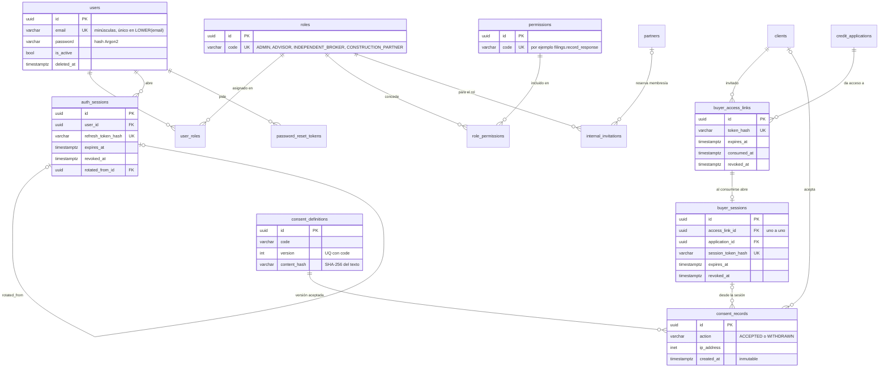
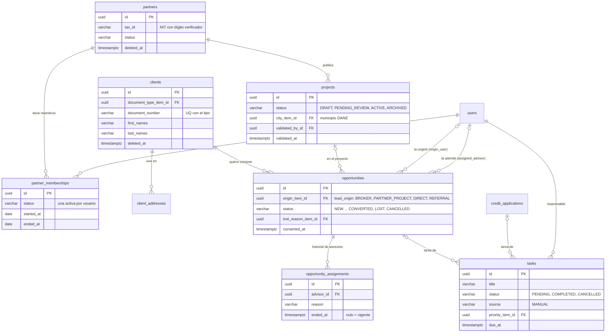
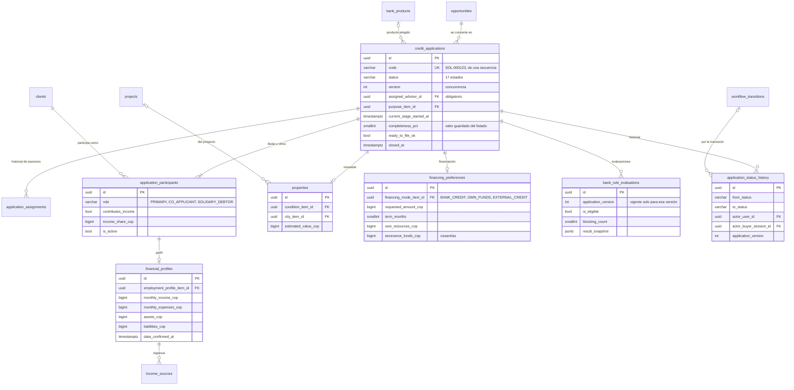
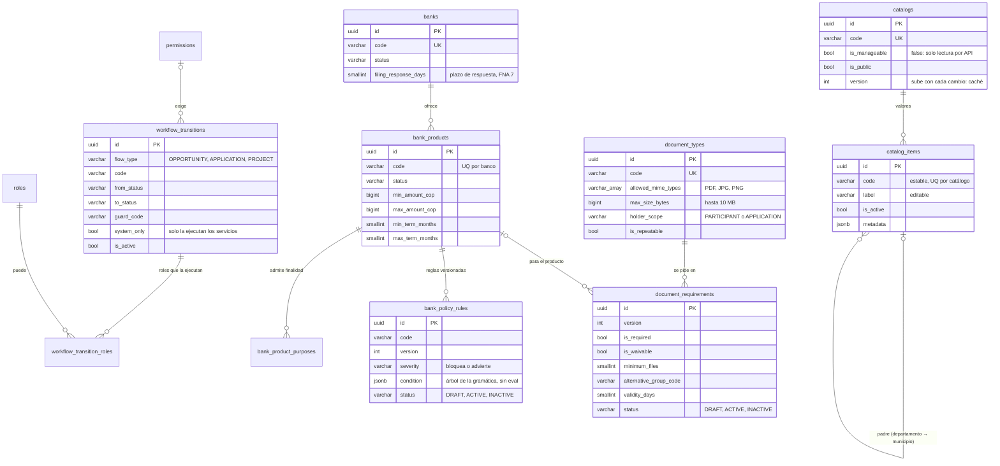
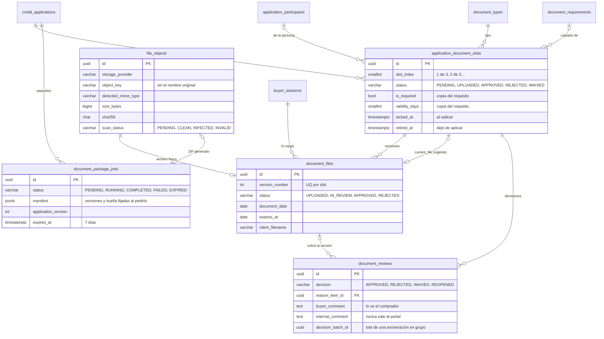
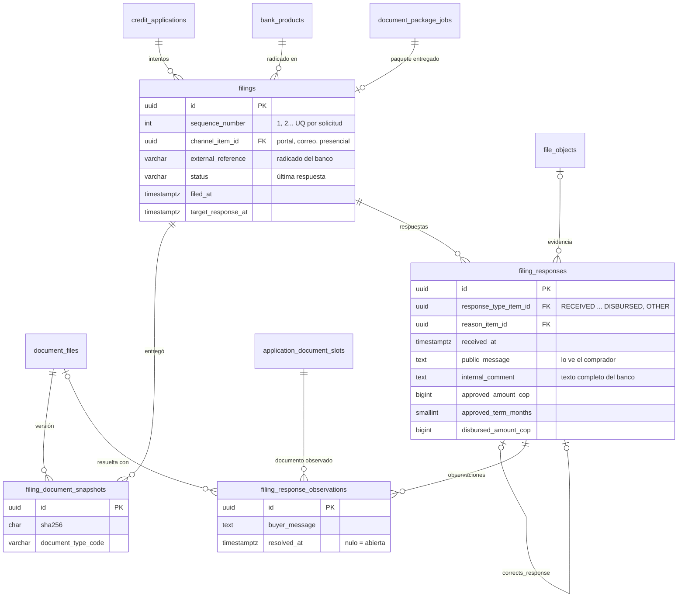
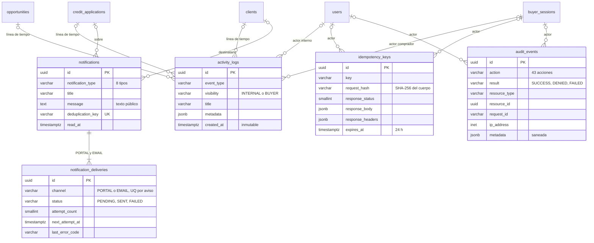
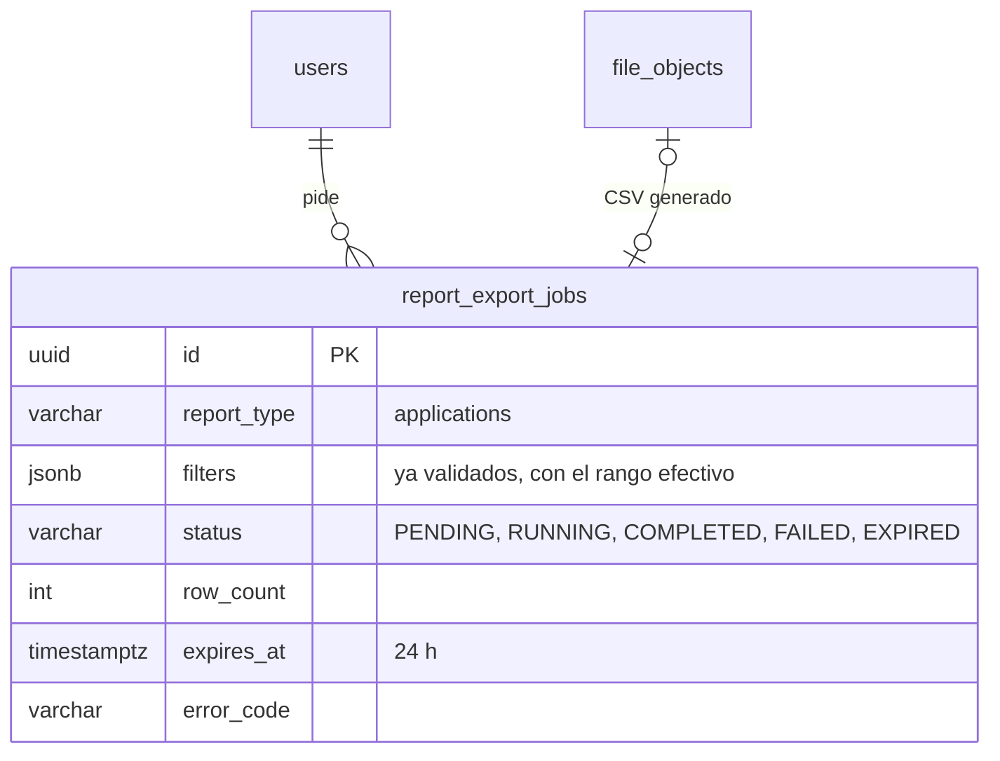
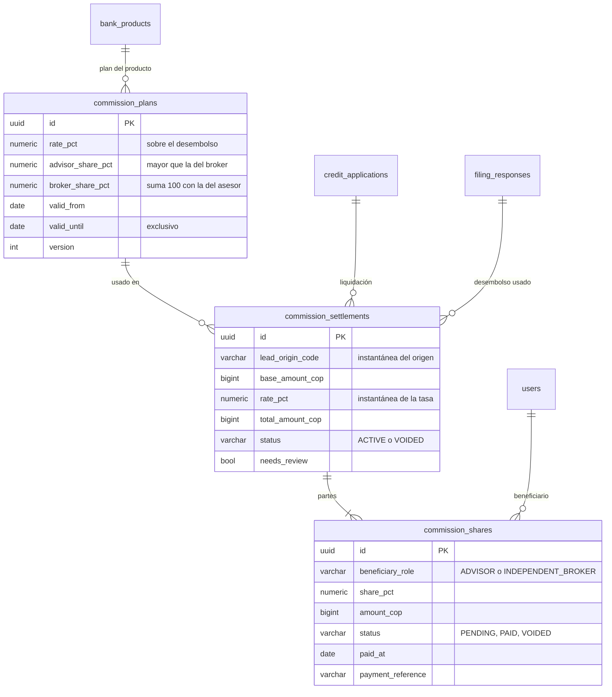

# 05 · Modelo de datos

> **En simple:** toda la información vive en **una base PostgreSQL** con **57 tablas**, cada una propiedad de una sola app. Las tablas siguen las mismas reglas: identificadores UUID, fechas de creación y edición, dinero como enteros de pesos, estados protegidos por `CHECK` y opciones de negocio como referencias a catálogos. Lo que es historia (respuestas del banco, revisiones, auditoría) no se edita: se agrega.

Este documento resume el modelo por grupos, con un diagrama entidad-relación de cada uno. El diccionario completo, columna por columna, sigue en los documentos de referencia:

- [`docs/MODELO_DATOS_DER_MVP_CREDITO.md`](../MODELO_DATOS_DER_MVP_CREDITO.md): cada tabla con sus campos, tipos y el porqué de cada relación.
- [`docs/DER_COMPLETO_MVP_CREDITO.md`](../DER_COMPLETO_MVP_CREDITO.md): los diagramas completos por módulo y el orden de construcción (§15).
- [`docs/ESQUEMA_POSTGRESQL_MVP_CREDITO.sql`](../ESQUEMA_POSTGRESQL_MVP_CREDITO.sql): el SQL de referencia.

Los diagramas de esta guía muestran **solo los campos clave** (llaves, estados, montos y lo que explica la relación) y se sacaron de los modelos de `backend/apps/*/models*`. Conteos del **18 de noviembre de 2026**.

---

## Índice

1. [Cuántas tablas y de quién](#1-cuántas-tablas-y-de-quién)
2. [Convenciones](#2-convenciones)
3. [Identidad y acceso](#3-identidad-y-acceso)
4. [Constructoras y CRM](#4-constructoras-y-crm)
5. [Solicitud de crédito](#5-solicitud-de-crédito)
6. [Configuración: catálogos, bancos y requisitos](#6-configuración-catálogos-bancos-y-requisitos)
7. [Expediente documental](#7-expediente-documental)
8. [Radicación](#8-radicación)
9. [Comunicación y plataforma](#9-comunicación-y-plataforma)
10. [Reportes](#10-reportes)
11. [Comisiones](#11-comisiones)
12. [Desvíos del SQL](#12-desvíos-del-sql)

---

## 1. Cuántas tablas y de quién

Cada tabla tiene **un único dueño**: la app que la crea en sus migraciones y la única que cambia sus reglas (DER §15). Las otras la leen o la referencian con llaves foráneas.

| Grupo | App dueña | Tablas | Cuántas |
| --- | --- | --- | ---: |
| Identidad y acceso | `identity` | `users`, `roles`, `permissions`, `user_roles`, `role_permissions`, `auth_sessions`, `password_reset_tokens`, `internal_invitations`, `buyer_access_links`, `buyer_sessions`, `consent_definitions`, `consent_records` | 12 |
| Constructoras y CRM | `partners`, `crm`, `tasks` | `partners`, `partner_memberships`, `projects`, `clients`, `client_addresses`, `opportunities`, `opportunity_assignments`, `tasks` | 8 |
| Solicitud de crédito | `applications` | `credit_applications`, `application_assignments`, `application_participants`, `financial_profiles`, `income_sources`, `properties`, `financing_preferences`, `bank_rule_evaluations`, `application_status_history` | 9 |
| Configuración | `catalogs`, `banking`, `documents` | `catalogs`, `catalog_items`, `workflow_transitions`, `workflow_transition_roles`, `banks`, `bank_products`, `bank_product_purposes`, `bank_policy_rules`, `document_types`, `document_requirements` | 10 |
| Expediente documental | `documents` | `file_objects`, `application_document_slots`, `document_files`, `document_reviews`, `document_package_jobs` | 5 |
| Radicación | `filings` | `filings`, `filing_document_snapshots`, `filing_responses`, `filing_response_observations` | 4 |
| Comunicación y plataforma | `activity`, `notifications`, `idempotency`, `audit` | `activity_logs`, `notifications`, `notification_deliveries`, `idempotency_keys`, `audit_events` | 5 |
| Reportes | `reporting` | `report_export_jobs` | 1 |
| Comisiones | `commissions` | `commission_plans`, `commission_settlements`, `commission_shares` | 3 |
| **Total** | 16 apps (`workday` no tiene tablas) | | **57** |

Además están las tablas técnicas de Django (migraciones, sesiones, `django_cache` del modo local simple), que no son del dominio. El SQL de referencia tiene 58 tablas: la que falta en el código es `outbox_events` ([§12](#12-desvíos-del-sql)).

Cómo se contó: cada modelo declara su `db_table` en su `Meta`; hay 57 nombres distintos en `backend/apps/`.

---

## 2. Convenciones

Las convenciones están en [`docs/MODELO_DATOS_DER_MVP_CREDITO.md`](../MODELO_DATOS_DER_MVP_CREDITO.md) §2 y se cumplen en los modelos así:

| Convención | Regla | Cómo se ve en el código |
| --- | --- | --- |
| Identificadores | `UUID` como llave primaria en todas las tablas | `id = models.UUIDField(primary_key=True, default=uuid.uuid4, editable=False)` en los 57 modelos. Los códigos legibles (`SOL-000123`) son de consulta, nunca de autorización (REQ §8.4). |
| Fechas | `created_at` en todas; `updated_at` en las que cambian | Las tablas de historia (`application_status_history`, `document_files`, `document_reviews`, `filing_responses`, `consent_records`, `activity_logs`, `audit_events`…) solo tienen `created_at`. Se guardan en UTC; la app calcula "hoy" en `America/Bogota`. |
| Dinero | Pesos colombianos como **entero** (`BIGINT`), nunca `float` | Campos `*_cop` con `BigIntegerField`: `requested_amount_cop`, `disbursed_amount_cop`, `amount_cop`… |
| Porcentajes | `NUMERIC(8,4)` | `DecimalField(max_digits=8, decimal_places=4)` (`_pct_field` en `backend/apps/commissions/models.py`); los cálculos con `Decimal`. |
| Estados | Texto con `CHECK` y constantes del backend | `TextChoices` en el modelo más un `CheckConstraint` `ck_<tabla>_status`. En total, **134 `CHECK`** con nombre en los `Meta` de los modelos. |
| Opciones de negocio | Llave foránea a `catalog_items` | Campos `*_item` (por ejemplo `purpose_item`, `origin_item`, `channel_item`). El catálogo valida que el ítem sea de **su** catálogo. |
| Unicidad | Restricciones con nombre, muchas parciales | **39 únicos** (`uq_*`), por ejemplo "una solicitud abierta por oportunidad" o "un solo slot vigente por documento". |
| Índices | Pensados para las pantallas | **54 índices** con nombre (`ix_*`), varios parciales. Django limita los nombres a 30 caracteres, por eso algunos se acortaron. |
| Borrado | `RESTRICT` para lo que tiene historia; `CASCADE` solo en hijos sin sentido propio; `SET NULL` para conservar historia | 117 `RESTRICT`, 18 `CASCADE` y 22 `SET NULL` en `backend/apps/`. Clientes, usuarios, constructoras y proyectos tienen `deleted_at` (borrado lógico); los slots, `retired_at`; los participantes, `is_active`. |
| Secretos | Solo hashes | `token_hash`, `refresh_token_hash`, `session_token_hash` (SHA-256); el token en claro nunca se guarda. |
| Correo | Único sin distinguir mayúsculas | Se normaliza a minúsculas al guardar, con un índice único sobre `LOWER(email)` (`backend/apps/identity/models/user.py`). |
| Concurrencia | Entero `version` | En `credit_applications` y `commission_plans` ([04 · System design §3.4](04-system-design.md#34-etag--if-match-no-pisar-la-edición-de-otro)). |

Dos duplicaciones son **a propósito** (MODELO §2.1): el asesor actual se guarda en `opportunities` y `credit_applications` además de su tabla de asignaciones, y el estado actual se guarda en `credit_applications.status` además del historial. Así "Mi día" no calcula el último registro por fila; las dos copias se actualizan en la misma transacción.

---

## 3. Identidad y acceso

Quién entra al sistema y cómo: usuarios internos con roles y permisos, sus sesiones, y el acceso del comprador sin cuenta.

*Qué mirar: el comprador no está en `users`. Es un `client` que entra por un enlace que al consumirse abre **una** sesión ligada a **una** solicitud. Y la cadena `rotated_from` de las sesiones internas, que permite revocar todo si alguien reutiliza un refresh viejo.*

Reglas en la base: un enlace no puede estar consumido y revocado a la vez (`ck_buyer_access_links_terminal`); un enlace pendiente tiene un índice parcial (`ix_buyer_access_links_pending`); un consentimiento lo registra un cliente **o** un usuario (`ck_consent_records_actor`). El estado del enlace (`PENDING`, `CONSUMED`, `REVOKED`, `EXPIRED`) no es una columna: se deriva de las fechas.

---

## 4. Constructoras y CRM

Las constructoras con sus usuarios y proyectos, y el CRM: clientes, oportunidades, asignaciones y tareas.

*Qué mirar: la oportunidad tiene **dos** usuarios distintos: quien la originó (el broker, que decide el reparto de la comisión) y el asesor que la atiende. Y que una tarea siempre cuelga de algo: la base exige al menos una oportunidad o una solicitud (`ck_tasks_parent`), y el servicio exige exactamente una al crear (P2.1 de [`specs/TAREA-tareas-actividad.md`](../../specs/TAREA-tareas-actividad.md)).*

Reglas en la base: solo una oportunidad `LOST` puede tener motivo de pérdida (`ck_opportunities_lost_reason`; que perderla lo **exija** lo valida la transición); un usuario tiene como máximo una membresía activa (`uq_partner_memberships_active_user`); un cliente tiene una sola dirección principal (`uq_client_addresses_primary`); un proyecto validado tiene quién y cuándo, o ninguno de los dos (`ck_projects_validation`).

---

## 5. Solicitud de crédito

El caso de crédito con sus participantes, finanzas, inmueble, financiación, evaluación del banco e historial.

*Qué mirar: `credit_applications` es el centro, y casi todo lo demás es "uno a uno" (inmueble, financiación) o "uno a muchos" (participantes, historial). La evaluación del banco guarda la versión de la solicitud que evaluó: si la solicitud cambia, la evaluación deja de estar vigente.*

Reglas en la base:

- **Una sola solicitud abierta por oportunidad** (`uq_credit_applications_open_opportunity`), que además protege la creación contra reintentos.
- **Un solo titular activo** por solicitud (`uq_application_participants_primary`) y un cliente no se repite (`uq_application_participants_client`).
- **Un solo asesor vigente** en el historial de asignaciones (`uq_application_assignments_active`).
- **El historial tiene un actor o ninguno**, nunca dos: usuario interno **o** sesión del comprador (`ck_application_status_actor`).
- Los montos son no negativos (`ck_financial_profiles_income`, `ck_financing_*`) y las cesantías exigen marcar que se usan (`ck_financing_severance`).

`completeness_pct`, `ready_to_file_ok` y `completeness_refreshed_at` son una desnormalización medida: calcular la completitud por fila del listado costaba de 6 a 10 consultas por fila ([04 · System design §5](04-system-design.md#5-rendimiento)).

---

## 6. Configuración: catálogos, bancos y requisitos

Lo que el administrador configura: listas de opciones, transiciones de flujo, bancos, productos, reglas y qué documentos se piden.

*Qué mirar: las reglas y los requisitos son **versionados**. Se publica una versión nueva y la anterior pasa a inactiva; nunca se edita una publicada. Así un expediente de ayer conserva las reglas con que se armó.*

Reglas en la base: como máximo **un borrador y una versión activa** por regla y por alcance de requisito (`uq_bank_policy_rules_one_draft`, `uq_bank_policy_rules_one_active`, `uq_document_requirements_one_draft`, `uq_document_requirements_one_active`; los de requisitos con `UNIQUE NULLS NOT DISTINCT`, porque un campo vacío del alcance cuenta como un valor más: decisión 1 de [`specs/TAREA-documents-config.md`](../../specs/TAREA-documents-config.md)); un código de catálogo no se repite en su catálogo (`uq_catalog_items_catalog_code`) y un ítem no puede ser su propio padre (`ck_catalog_items_not_own_parent`).

---

## 7. Expediente documental

Los documentos que espera cada solicitud, sus versiones, el archivo físico, las revisiones y el paquete para radicar.

*Qué mirar: el slot guarda una **copia** de las reglas del requisito (obligatorio, vigencia, cantidad), así cambiar la plantilla mañana no altera el expediente de hoy. Y separa tres cosas: el documento esperado (slot), cada versión cargada (`document_files`) y el archivo físico (`file_objects`).*

Reglas en la base:

- **Un solo slot vigente** por solicitud, participante, tipo y número (`uq_document_slots_active`, parcial sobre `retired_at IS NULL`, con `NULLS NOT DISTINCT` para los documentos de la solicitud sin participante).
- **Versiones consecutivas** por slot (`uq_document_files_slot_version`).
- Una revisión de rechazo exige motivo y mensaje al comprador (`ck_document_reviews_rejection`); aprobar y rechazar exigen la versión; exonerar y reabrir pueden ir sin archivo (`ck_document_reviews_file`), y toda exoneración o reapertura lleva lote (`ck_document_reviews_batch`).
- Un archivo con análisis terminado tiene su fecha (`ck_file_objects_scan_date`); la cola de análisis tiene su índice parcial (`ix_file_objects_scan_queue`).

---

## 8. Radicación

Cada entrega al banco, la instantánea de lo que se entregó, cada respuesta del banco y las observaciones de una devolución.

*Qué mirar: la respuesta del banco **no se edita**. Una corrección es otra fila que apunta a la anterior (`corrects_response`, uno a uno). Y la instantánea guarda el SHA-256 de cada archivo entregado: se puede probar qué se radicó aunque el expediente cambie después.*

Reglas en la base: el radicado del banco no se repite por producto (`uq_filings_external_reference`, parcial); los montos aprobados y desembolsados no son negativos (`ck_filing_responses_*_amount`; el servicio además exige al menos 1, P3.1 de [`specs/TAREA-radicacion.md`](../../specs/TAREA-radicacion.md)); una respuesta no se corrige a sí misma (`ck_filing_responses_not_self_correction`); una observación está resuelta con archivo y fecha, o con ninguno (`ck_filing_response_observations_resolution`); un slot se observa una sola vez por respuesta (`uq_filing_response_observations_slot`).

---

## 9. Comunicación y plataforma

La actividad del expediente, los avisos al comprador con sus entregas, la idempotencia de los `POST` y la auditoría técnica.

*Qué mirar: actividad y auditoría parecen lo mismo y no lo son. La actividad es la historia **funcional** que leen el asesor y el comprador (con `visibility`); la auditoría es **técnica**, la lee solo el administrador y ni siquiera PostgreSQL permite editarla.*

Reglas en la base: un aviso tiene exactamente un destinatario, cliente **o** usuario (`ck_notifications_recipient`); una entrega por canal (`uq_notification_deliveries_channel`), para que un reintento nunca la duplique; una clave de idempotencia es única por actor con índices parciales (`uq_idempotency_keys_user`, `uq_idempotency_keys_buyer`); `audit_events` tiene un trigger que bloquea `UPDATE` (`trg_audit_events_block_update`).

---

## 10. Reportes

*Qué mirar: el trabajo guarda los filtros **ya validados**, nunca la consulta cruda, y el CSV es un `file_object` como cualquier documento: se descarga con la misma URL firmada.*

Los reportes no tienen tablas propias de datos: leen solicitudes, historial y radicaciones con agregados en la base.

---

## 11. Comisiones

*Qué mirar: la liquidación **copia** la base, la tasa y el origen. Cambiar el plan después no reescribe lo que ya se liquidó.*

Reglas en la base: asesor + broker = 100 y el asesor lleva la mayor (`ck_commission_plans_shares_sum`, `ck_commission_plans_advisor_major`); tasa entre 0 y 100 (`ck_commission_plans_rate`); una sola liquidación vigente por solicitud y por respuesta de desembolso (`uq_commission_settlements_active`, `uq_commission_settlements_response_active`, los dos parciales); una parte por rol (`uq_commission_shares_role`); una parte pagada tiene fecha (`ck_commission_shares_paid`). El solapamiento de vigencias entre planes del mismo producto no es un `CHECK`: lo valida el servicio con la fila del producto bloqueada (P1.2 de [`specs/TAREA-comisiones.md`](../../specs/TAREA-comisiones.md)).

---

## 12. Desvíos del SQL

El SQL de referencia se fue corrigiendo en cada tarea: casi todos los cambios de diseño **ya están** en `docs/ESQUEMA_POSTGRESQL_MVP_CREDITO.sql`. Aquí van las dos listas.

### 12.1 Lo que sigue distinto entre el SQL y el código

| El SQL dice | El código hace | Por qué |
| --- | --- | --- |
| `outbox_events` (tabla 58) | No existe | Los efectos entre módulos usan señales de Django después del commit ([03 · Arquitectura §5](03-arquitectura.md#5-cómo-se-hablan-los-módulos-señales-después-del-commit)). |
| `email CITEXT` (correo sin distinguir mayúsculas) | `VARCHAR`, normalizado a minúsculas al guardar, con único sobre `LOWER(email)` (`uq_users_email_lower`) | Misma garantía sin depender de la extensión `citext` (docstring de `backend/apps/identity/models/user.py`). |
| Nombres largos de índices (`ix_document_requirements_active`, `ix_notification_deliveries_queue`) | `ix_doc_requirements_active`, `ix_notification_delivery_queue` | Django limita los nombres de índice a 30 caracteres. |
| Hash como `CHAR(64)` | `CharField(max_length=64)` (`VARCHAR(64)`) | El tipo de Django para texto; el largo es el mismo. |

### 12.2 Cambios de diseño que nacieron en el código y se llevaron al SQL

| Cambio | Por qué | Fuente |
| --- | --- | --- |
| `application_document_slots.slot_index` | Un slot por archivo: "Desprendible 2 de 3" se carga y se revisa solo | `TAREA-document-file.md`, Tanda 1, decisión 3 |
| `application_document_slots.retired_at` y único parcial de slots vigentes | Un slot que deja de aplicar se retira sin perder sus versiones | Decisiones 5 y 20 |
| `document_types.holder_scope` | Hay documentos de la persona y documentos de la solicitud (estudio de títulos) | Tanda 1, decisión 4 |
| `document_reviews.slot_id`, `decision_batch_id`, `REOPENED` y `document_file_id` nulable | Exonerar y reabrir también dejan historia, en lote para los grupos | Tanda 3, decisiones 25 y 26 |
| `credit_applications.completeness_pct`, `ready_to_file_ok`, `completeness_refreshed_at` | Evitar de 6 a 10 consultas por fila en el listado | `TAREA-applications-listado.md`, Precisión A |
| `workflow_transitions.system_only` | Radicar y las respuestas del banco no son botones genéricos | `TAREA-radicacion.md`, P1.1 |
| `banks.filing_response_days` y `ck_filings_status` | Plazo esperado de respuesta y estado validado como en las demás tablas | P1.5 y P1.6 |
| `commission_plans.version` | El `If-Match` del proyecto se basa en un entero | `TAREA-comisiones.md`, P1.1 |
| `UNIQUE (filing_response_id)` → único parcial entre las liquidaciones vigentes | Con el único total, una liquidación anulada impedía volver a liquidar ese desembolso | P2.4 |
| `notification_deliveries`: `UNIQUE (notification_id, channel)` | Un reintento nunca duplica una entrega | `TAREA-notificaciones.md`, Parte 1, P10 |
| `idempotency_keys`: únicos parciales por actor en lugar de `UNIQUE NULLS NOT DISTINCT`, y `response_headers` | Con `NULLS NOT DISTINCT`, dos usuarios internos con la misma clave chocaban; las cabeceras (`ETag`, `Location`) se repiten en la respuesta guardada | Parte 3, P5 y P8 |
| `audit_events.request_id` como `VARCHAR(64)` y no `UUID` | El `request_id` puede venir del cliente y no siempre es un UUID | `TAREA-auditoria.md`, P1.1 |
| Textos opcionales: nulos en `filings` (como el SQL) y vacíos en `commissions` | Convención de Django en el módulo nuevo; el `CHECK` de anulación exige un motivo no vacío | `TAREA-radicacion.md` P1.6; `TAREA-comisiones.md` P1.8 |

---

Siguiente: [06 · Módulos](06-modulos.md) — cada app con sus tablas, endpoints, permisos, eventos, decisiones y pruebas.
