# 06 · Módulos

> **En simple:** el backend se construyó en **16 pasos**, uno por módulo, en el orden en que dependen unos de otros: primero quién entra (identidad), después las listas de opciones (catálogos), después constructoras, clientes, bancos, documentos, solicitudes… hasta las comisiones. Cada sección de este documento es una ficha de un módulo: qué resuelve, sus tablas, sus endpoints, quién puede usarlo, sus reglas, qué eventos emite y escucha, las decisiones que se tomaron, cómo se prueba y qué quedó fuera.

Las piezas comunes (capas, señales, contrato) están en [03 · Arquitectura](03-arquitectura.md); las tablas con sus diagramas, en [05 · Modelo de datos](05-modelo-de-datos.md); las reglas de negocio contadas como historia, en [02 · Negocio](02-negocio.md).

**Cómo se contó** (18 de noviembre de 2026): las operaciones salen de cruzar cada `urls.py` de `backend/apps/` con `contracts/openapi.json` (las 235 quedan asignadas, ninguna sin dueño); las pruebas son las funciones `test_*` de cada carpeta de `backend/tests/` (sin contar las combinaciones de `parametrize`).

---

## Índice

| # | Módulo | App | Qué resuelve | Tablas | Depende de | Operaciones | Pruebas |
| ---: | --- | --- | --- | ---: | --- | ---: | ---: |
| 1 | [Identidad (núcleo)](#1-identidad-núcleo) | `identity` | Usuarios internos, roles, permisos, sesiones JWT y contraseñas | 7 | — | 15 | 133 (carpeta `identity`, con el 4) |
| 2 | [Catálogos y flujos](#2-catálogos-y-flujos) | `catalogs` | Listas administrables y transiciones de estado por rol | 4 | 1 | 19 | 67 |
| 3 | [Constructoras y proyectos](#3-constructoras-y-proyectos) | `partners` | Constructoras, sus usuarios y sus proyectos | 3 | 1, 2 | 19 | 61 |
| 4 | [Invitaciones internas](#4-invitaciones-internas) | `identity` | Alta de usuarios internos por invitación | 1 | 1, 3 | 5 | (en la carpeta `identity`) |
| 5 | [CRM](#5-crm) | `crm` | Clientes, direcciones, oportunidades y asignación de asesor | 4 | 1, 2, 3 | 16 | 90 |
| 6 | [Bancos](#6-bancos) | `banking` | Bancos, productos, finalidades y reglas del banco | 4 | 1, 2 | 21 | 81 |
| 7 | [Configuración documental](#7-configuración-documental) | `documents` | Tipos de documento y requisitos versionados | 2 | 2, 6 | 13 | 135 (carpeta `documents`, con la infraestructura del 10) |
| 8 | [Solicitudes](#8-solicitudes) | `applications` | La solicitud, participantes, finanzas, inmueble, financiación, evaluación e historial | 9 | 1, 2, 3, 5, 6 | 31 | 310 |
| 9 | [Acceso del comprador](#9-acceso-del-comprador) | `identity` | Enlace mágico, sesión del comprador, consentimientos y portal | 4 | 5, 8 | 28 | 151 |
| 10 | [Expediente documental](#10-expediente-documental) | `documents` | Slots, carga, antivirus, revisión, descargas y paquete ZIP | 5 | 7, 8, 9 | 17 | 284 |
| 11 | [Radicación](#11-radicación) | `filings` | Radicación manual, respuestas del banco, observaciones y evidencia | 4 | 6, 8, 10 | 10 | 98 |
| 12 | [Mi día, tareas y actividad](#12-mi-día-tareas-y-actividad) | `workday`, `tasks`, `activity` | Bandeja del asesor, tareas manuales, línea de tiempo y notas | 2 | 5, 8, 9 | 12 | 74 |
| 13 | [Notificaciones e idempotencia](#13-notificaciones-e-idempotencia) | `notifications`, `idempotency` | Avisos al comprador por portal y correo; `Idempotency-Key` | 3 | 8, 9, 11 | 5 | 73 |
| 14 | [Auditoría](#14-auditoría) | `audit` | Bitácora técnica inmutable | 1 | 1, 9 | 2 | 38 |
| 15 | [Reportes](#15-reportes) | `reporting` | Dashboard, embudo, reportes y exportación CSV | 1 | 8, 10, 11 | 11 | 83 |
| 16 | [Comisiones](#16-comisiones) | `commissions` | Planes, liquidación al desembolso, reparto y pagos | 3 | 6, 8, 11 | 11 | 65 |
| | **Total** | 16 apps | | **57** | | **235** | **1.794** |

El orden y las dependencias son los de [`docs/DER_COMPLETO_MVP_CREDITO.md`](../DER_COMPLETO_MVP_CREDITO.md) §15. Las 1.794 pruebas (contadas el 18 de noviembre) incluyen 21 transversales en la raíz de `backend/tests/` (contrato, etiquetas, `request_id`, servicios del modo local) y 30 del reporte del CI (`backend/tests/ci/`). Desde el 19 de noviembre se suman 57 en `backend/tests/security/` (la matriz de acceso y la revisión manual de la auditoría de seguridad, #32) y las pruebas de las verificaciones de seguridad del reporte del CI: el total era 1.860 en 129 archivos. Con la F7 y la demo completa (#33 y #36, el mismo 19) son 1.879 en 133, y el #36 sumó una operación a bancos (`GET /bank-policy-rules/fields`): 236. Con la fase B de la auditoría (#37, también el 19) son **1.937 en 136**: 115 de ellas en `backend/tests/security/` ([09 · Calidad §2](09-calidad.md#2-los-números)). Las cuatro tablas de `identity` del módulo 9 y la de invitaciones suman, con las 7 del núcleo, las 12 de `identity`.

```mermaid
flowchart LR
    m1["1 identity"] --> m2["2 catalogs"] --> m3["3 partners"] --> m4["4 invitaciones"]
    m4 --> m5["5 crm"] --> m6["6 banking"] --> m7["7 documentos: config"]
    m7 --> m8["8 applications"] --> m9["9 acceso comprador"] --> m10["10 expediente"]
    m10 --> m11["11 filings"] --> m12["12 tareas y actividad"] --> m13["13 notificaciones"]
    m13 --> m14["14 audit"] --> m15["15 reporting"] --> m16["16 commissions"]
```

*Qué mirar: es una cadena. Cada paso se construyó con los anteriores ya en `master`, así que nunca hizo falta simular una tabla que no existía; cuando un paso necesitó algo del siguiente, dejó un punto de enganche que "falla cerrado" (por ejemplo, `slot_has_open_observation` devolvía `False` hasta que llegó la radicación).*

---

## 1. Identidad (núcleo)

**Qué resuelve:** que el equipo interno entre con correo y contraseña, con sesiones que se pueden cortar al instante, y que cada acción se autorice por permiso.

**Tablas:** `users`, `roles`, `permissions`, `user_roles`, `role_permissions`, `auth_sessions`, `password_reset_tokens`.

**Endpoints principales** (`backend/apps/identity/urls.py`, `user_urls.py`):

| Método | Ruta | Permiso |
| --- | --- | --- |
| `POST` | `/auth/login` | Público, 5 intentos por correo + IP cada 15 min |
| `POST` | `/auth/refresh` | Cookie de refresh |
| `POST` | `/auth/logout` | Sesión |
| `GET` | `/auth/me` | Sesión: perfil, rol, permisos y alcance |
| `POST` | `/auth/password-reset-requests`, `/auth/password-resets/confirm` | Público |
| `POST` | `/auth/change-password` | Sesión |
| `GET`, `POST` | `/users` | `users.read`, `users.create` |
| `POST` | `/users/{id}/activate`, `/deactivate` | `users.manage_status` |
| `PUT` | `/users/{id}/roles` | `roles.assign` |
| `GET` | `/roles` | `roles.read` |

**Permisos y alcance:** los de usuarios y roles son solo del `ADMIN` (`backend/apps/identity/migrations/0008_seed_user_admin_permissions.py`). `/auth/me` es la fuente de verdad del frontend para pintar el menú.

**Reglas clave** (`backend/README.md`, "Internal Authentication" y "Users and Roles"):

- La API nunca devuelve tokens en el cuerpo: pone cookies `HttpOnly` (`app_access` de 15 min, `app_refresh` de 8 h) y `app_csrf`.
- Cada petición revisa que la sesión siga activa (`CookieJWTAuthentication`): desactivar a un usuario corta su acceso de inmediato.
- Reutilizar un refresh ya rotado revoca toda la cadena de sesiones.
- La recuperación responde siempre `202` (no revela si el correo existe) y su token de 30 minutos revoca todas las sesiones.
- `CONSTRUCTION_PARTNER` no se combina con otros roles y exige constructora; un admin no puede desactivarse ni quitarse su propio rol.

**Eventos:** usa `user_logged_in` y `user_logged_out` de Django y emite `user_status_changed`; los escucha `audit`.

**Decisiones:** clave de firma JWT dedicada y distinta de `SECRET_KEY` (`AUTH_JWT_SIGNING_KEY`); el refresh no se alarga al rotar; en local, sin HTTPS, las cookies pierden el prefijo `__Host-` porque el navegador lo rechaza sin `Secure`.

**Cómo se prueba:** `backend/tests/identity/` — `test_login.py`, `test_sessions.py`, `test_passwords.py`, `test_users.py`, `test_models.py`, `test_rate_limits.py`, `test_database_cache.py`.

**Qué quedó fuera:** MFA para `ADMIN` y `ADVISOR` (REQ §9.5) y la reautenticación para operaciones sensibles más allá de pedir la contraseña actual al cambiarla.

---

## 2. Catálogos y flujos

**Qué resuelve:** que ninguna lista de negocio (finalidades, motivos, canales, estados visibles) viva en el frontend, y que las transiciones de estado se configuren por rol sin poder inventar estados.

**Tablas:** `catalogs`, `catalog_items`, `workflow_transitions`, `workflow_transition_roles`.

**Endpoints principales** (`backend/apps/catalogs/urls.py`):

| Método | Ruta | Permiso |
| --- | --- | --- |
| `GET` | `/metadata/bootstrap` | Cualquier usuario interno; `304` con `If-None-Match` |
| `GET` | `/metadata/catalogs/{code}` | Cualquier usuario interno; filtros `parent_code`, `parent_id` |
| `GET`, `POST` | `/catalogs`, `/catalogs/{id}/items` | `catalogs.read`, `catalogs.create` |
| `PATCH` | `/catalog-items/{id}` | `catalogs.update` |
| `PUT` | `/catalogs/{id}/items/order` | `catalogs.update` |
| `GET`, `POST` | `/workflow-transitions` | `workflow.read`, `workflow.create` |
| `POST` | `/workflow-transitions/{id}/activate`, `/deactivate` | `workflow.publish` |

**Permisos y alcance:** administrar es solo del `ADMIN` (`backend/apps/catalogs/migrations/0002_seed_permissions_and_catalogs.py`); los metadatos los lee cualquier usuario interno. El comprador tiene su propio endpoint con la lista cerrada de catálogos de sus formularios (`/buyer/metadata/catalogs/{code}`, módulo 9).

**Reglas clave** (`backend/README.md`, "Catalogs and Workflow"):

- Los **códigos son estables**: no se renombran ni se borran; un ítem se desactiva y los registros viejos conservan su etiqueta.
- Cada cambio sube `catalogs.version`, que invalida la caché de los metadatos.
- Los catálogos con `is_manageable = false` (estados estructurales, tipos de respuesta del banco) son de solo lectura por la API.
- Los **estados son constantes del backend** (`backend/apps/catalogs/workflow.py`); una transición solo conecta estados de su flujo, solo usa una guarda implementada y nace inactiva.
- `CatalogItemCodeField` valida que un código sea de **su** catálogo y esté activo y vigente.

**Eventos:** no emite señales; sus cambios de configuración se auditan por la vista (`audit_actions`).

**Decisiones:** `system_only` en las transiciones de radicación y del banco (P1.1 de [`specs/TAREA-radicacion.md`](../../specs/TAREA-radicacion.md)); el `ActionKind` (`primary`, `secondary`, `destructive`) vive aquí para que `crm` no importe `applications` (Parte 1 de [`specs/TAREA-brechas-2.md`](../../specs/TAREA-brechas-2.md)); metadata calculada en el catálogo de tipos de respuesta (`register_computed_metadata`), sacada de las reglas de `filings`.

**Cómo se prueba:** `backend/tests/catalogs/` — `test_catalog_admin.py`, `test_fields.py`, `test_metadata.py`, `test_workflow.py`.

**Qué quedó fuera:** la lista completa de municipios DIVIPOLA. La semilla trae los departamentos DANE y sus capitales; el resto se importa aparte (`backend/README.md`).

---

## 3. Constructoras y proyectos

**Qué resuelve:** que una constructora publique sus proyectos de vivienda y que la operación los valide antes de asociarles oportunidades.

**Tablas:** `partners`, `partner_memberships`, `projects`.

**Endpoints principales** (`backend/apps/partners/urls.py`):

| Método | Ruta | Permiso |
| --- | --- | --- |
| `GET`, `POST` | `/partners` | `partners.read`, `partners.create` |
| `POST` | `/partners/{id}/activate`, `/deactivate` | `partners.manage_status` |
| `GET`, `POST` | `/partners/{id}/members` | `partner_members.read`, `partner_members.create` |
| `GET`, `POST` | `/projects` | `projects.read`, `projects.create` |
| `PATCH` | `/projects/{id}` | `projects.update` |
| `POST` | `/projects/{id}/submit` | `projects.submit` |
| `POST` | `/projects/{id}/activate`, `/reject` | `projects.approve` |
| `POST` | `/projects/{id}/archive` | `projects.archive` |

**Permisos y alcance** (`backend/README.md`, "Partners and Projects"):

| Rol | Constructoras | Proyectos |
| --- | --- | --- |
| `ADMIN` | Todas | Todos |
| `ADVISOR` | Todas (lectura) | Todos; aprueba y corrige |
| `CONSTRUCTION_PARTNER` | Solo la suya | Los de su constructora; edita solo en `DRAFT` |
| `INDEPENDENT_BROKER` | — | Proyectos `ACTIVE` de constructoras activas (lectura) |

**Reglas clave:** la constructora del usuario sale de su membresía activa y un `partner_id` del cliente se ignora; un usuario tiene como máximo una membresía activa; el NIT se valida con su dígito verificador; los estados del proyecto siguen el flujo `PROJECT` ([02 · Negocio §12](02-negocio.md#12-proyectos-de-constructora)); el detalle del proyecto trae `available_actions` para el usuario.

**Eventos:** emite `project_status_changed` y `partner_status_changed`, con el motivo.

**Decisiones:** fuera del alcance, `404`; terminar una membresía la conserva como historia.

**Cómo se prueba:** `backend/tests/partners/` — `test_partners_api.py`, `test_projects_api.py`, `test_validators.py`.

**Qué quedó fuera:** `GET /projects/{id}/summary` con conteos (anotado en `backend/README.md`). Las vistas del frontend, `/proyectos` y `/admin/constructoras` (vistas 12 y 13), entraron con la F6 (#34).

---

## 4. Invitaciones internas

**Qué resuelve:** que un usuario interno entre por una invitación de un solo uso y defina su propia contraseña.

**Tablas:** `internal_invitations`.

**Endpoints** (`backend/apps/identity/invitation_urls.py`):

| Método | Ruta | Permiso |
| --- | --- | --- |
| `GET`, `POST` | `/invitations` | `invitations.read`, `invitations.create` |
| `POST` | `/invitations/{id}/resend` | `invitations.create` |
| `DELETE` | `/invitations/{id}` | `invitations.revoke` |
| `POST` | `/invitations/accept` | Público, 10 intentos por IP cada 15 min |

**Permisos y alcance:** solo `ADMIN` (`backend/apps/identity/migrations/0007_seed_invitation_permissions.py`).

**Reglas clave** (`backend/README.md`, "Internal Invitations"): dura 72 h y solo se guarda su hash; aceptar crea el usuario (o vincula uno que nunca tuvo contraseña), asigna el rol y crea la membresía de constructora si aplica; **un correo que ya tiene cuenta con contraseña no se puede invitar ni aceptar**, así una invitación nunca toma una cuenta existente; una sola invitación pendiente por correo; aceptar no inicia sesión.

**Eventos:** ninguno propio.

**Cómo se prueba:** `backend/tests/identity/test_invitations.py`.

**Qué quedó fuera:** nada pendiente en el backend. La pantalla `/admin/usuarios` (con la pestaña de invitaciones) y la pública `/aceptar-invitacion`, que quita el token de la URL al cargar, entraron con la F6 (#34).

---

## 5. CRM

**Qué resuelve:** registrar clientes y sus oportunidades de compra, y asignar el asesor que las atiende.

**Tablas:** `clients`, `client_addresses`, `opportunities`, `opportunity_assignments`.

**Endpoints principales** (`backend/apps/crm/urls.py`):

| Método | Ruta | Permiso |
| --- | --- | --- |
| `GET`, `POST` | `/clients` | `clients.read`, `clients.create` |
| `GET`, `PATCH` | `/clients/{id}` | `clients.read`, `clients.update` |
| `GET`, `POST` | `/clients/{id}/addresses` | `clients.read`, `clients.update` |
| `GET`, `POST` | `/opportunities` | `opportunities.read`, `opportunities.create` |
| `GET`, `PATCH` | `/opportunities/{id}` | `opportunities.read`, `opportunities.update` |
| `POST` | `/opportunities/{id}/assignments` | `opportunities.assign` |
| `POST` | `/opportunities/{id}/transitions` | `opportunities.transition` |
| `GET` | `/broker/opportunities` | Bandeja del broker |

**Permisos y alcance** (docstring de `backend/apps/crm/services.py`): `ADMIN` todo; `ADVISOR` las oportunidades asignadas a él o que capturó, sus clientes y los participantes de sus solicitudes; `INDEPENDENT_BROKER` lo que capturó y los clientes que creó, solo con datos de contacto y un resumen; `CONSTRUCTION_PARTNER` no usa el CRM. Fuera del alcance, `404`. Crear clientes y oportunidades lo pueden hacer admin, asesor y broker; asignar y transicionar, solo admin y asesor.

**Reglas clave:**

- Tipo y número de documento no se repiten (RF-10); `409 DUPLICATE_CLIENT_DOCUMENT` trae el `resource_id` solo si el usuario puede ver ese cliente.
- La oportunidad que crea un asesor queda asignada a él y en `ASSIGNED`; la de un broker o del admin, en `NEW` sin asesor.
- Las acciones de la oportunidad salen de `WorkflowTransition` filtradas por rol, con su tipo y si exigen motivo (`backend/apps/crm/actions.py`).
- El broker recibe otra forma de respuesta (`BrokerClient`, documento enmascarado); el contrato la describe con `oneOf`.

**Eventos:** emite `opportunity_created`, `opportunity_assigned` y `opportunity_status_changed`; `activity` registra la creación (y su nota inicial).

**Decisiones** (Parte 1 de [`specs/TAREA-brechas-2.md`](../../specs/TAREA-brechas-2.md)): auto-asignación del asesor; `notes` al crear la oportunidad va como una nota de actividad, porque la oportunidad no tiene campo de texto; `applications_count` del cliente cuenta solo las solicitudes **visibles** para el usuario, con la misma regla de alcance (`crm.services.application_scope_condition`), que `applications` reutiliza.

**Cómo se prueba:** `backend/tests/crm/` — `test_clients_api.py`, `test_addresses_api.py`, `test_opportunities_api.py`, `test_opportunity_actions.py`, `test_opportunity_workflow.py`, `test_crm_contract.py`, `test_validators.py`.

**Qué quedó fuera:** qué hace un broker con un cliente que ya existe fuera de su alcance (REQ §12, pendiente).

---

## 6. Bancos

**Qué resuelve:** configurar los bancos, sus productos de crédito, las finalidades que admiten y sus reglas, para que el sistema avise si un caso no cumple (sin decidir el crédito).

**Tablas:** `banks`, `bank_products`, `bank_product_purposes`, `bank_policy_rules`.

**Endpoints principales** (`backend/apps/banking/urls.py`):

| Método | Ruta | Permiso |
| --- | --- | --- |
| `GET`, `POST` | `/banks` | `banks.read`, `banks.create` |
| `POST` | `/banks/{id}/activate`, `/deactivate` | `banks.update` |
| `GET`, `POST` | `/bank-products` | `banks.read`, `banks.create` |
| `PUT` | `/bank-products/{id}/purposes` | `banks.update` |
| `GET`, `POST` | `/bank-policy-rules` | `bank_rules.read`, `bank_rules.create` |
| `PATCH` | `/bank-policy-rules/{id}` | `bank_rules.update` (edita el borrador o crea una versión) |
| `POST` | `/bank-policy-rules/{id}/activate`, `/deactivate` | `bank_rules.publish` |
| `POST` | `/bank-policy-rules/{id}/test` | `bank_rules.update`; prueba casos sin tocar solicitudes |

**Permisos y alcance:** lectura `ADMIN` y `ADVISOR`; escritura y publicación, solo `ADMIN` (`backend/apps/banking/migrations/0002_seed_permissions_and_banks.py`).

**Reglas clave:**

- **Las reglas son JSON interpretado como árbol**, con una gramática cerrada (`eq`, `gte`, `lte`, `in`, `and`, `or`, `sum`, `ratio`) sobre una lista blanca de campos (`backend/apps/banking/rule_engine.py`, `rule_fields.py`). No usa `eval` ni `getattr` sobre el JSON: un operador desconocido es un error.
- El resultado es `PASSED`, `FAILED` o `MISSING_DATA`, con lógica de tres valores; la severidad de la regla decide si bloquea o advierte. Las etiquetas visibles están en `OUTCOME_LABELS`.
- Las reglas son **versionadas**: un borrador y una activa como máximo; publicar desactiva la anterior.
- Además de las reglas configuradas, se revisan los rangos de monto y plazo del producto (`PRODUCT_AMOUNT_RANGE`, `PRODUCT_TERM_RANGE`).

**Eventos:** emite `bank_status_changed`, `bank_product_status_changed` y `bank_policy_rule_status_changed`; los escucha `audit`.

**Decisiones:** no se calcula score ni se toma una decisión automática de crédito (REQ §2, "Reglas bancarias"); `filing_response_days` en el banco para el plazo esperado de respuesta, sembrado en 7 para el FNA (P1.5 de `TAREA-radicacion.md`).

**Cómo se prueba:** `backend/tests/banking/` — `test_rule_engine.py`, `test_rules_api.py`, `test_banks_api.py`, `test_products_api.py`, `test_bank_short_name.py`, `test_seed.py`.

**Qué quedó fuera:** integración con los bancos y decisión automática de crédito. Las pantallas `/admin/bancos` (productos, finalidades, reglas con sus versiones y su prueba), `/admin/documentos`, `/admin/catalogos` y `/admin/flujos` (vista 14) entraron con la F6 (#34).

---

## 7. Configuración documental

**Qué resuelve:** decidir desde el backend qué documentos se piden, a quién y en qué condiciones.

**Tablas:** `document_types`, `document_requirements`.

**Endpoints principales** (`backend/apps/documents/urls.py`):

| Método | Ruta | Permiso |
| --- | --- | --- |
| `GET`, `POST` | `/document-types` | `document_requirements.read`, `.create` |
| `GET`, `POST` | `/document-requirements` | `document_requirements.read`, `.create` |
| `PATCH` | `/document-requirements/{id}` | `document_requirements.update` |
| `POST` | `/document-requirements/{id}/activate`, `/deactivate` | `document_requirements.publish` |
| `POST` | `/document-requirements/preview` | Simula la lista documental de un caso |

**Permisos y alcance:** lectura `ADMIN` y `ADVISOR`; escribir y publicar, solo `ADMIN`; broker y constructora, `403` (decisión 2 de [`specs/TAREA-documents-config.md`](../../specs/TAREA-documents-config.md)).

**Reglas clave:**

- **Versionado por alcance:** un requisito se identifica por producto, tipo, finalidad, perfil laboral, rol del participante y condición del inmueble. Editar una versión publicada crea un borrador `version + 1`; el alcance no se edita.
- Un campo vacío del requisito aplica a cualquier valor; un requisito sin producto es general.
- Tipos con lista cerrada de formatos (PDF, JPEG, PNG) y máximo 10 MB; `minimum_files > 1` exige un tipo repetible.

**Eventos:** emite `document_type_status_changed` y `document_requirement_status_changed`; los escucha `audit`.

**Decisiones:** `INCOME_TAX_PROOF` es un **grupo alternativo** de dos tipos (certificado de ingresos y retenciones o declaración de renta), no un tipo; la semilla trae 17 tipos y el checklist de Bancolombia (9 requisitos); FNA y Banco de Bogotá quedan sin requisitos (decisiones 3 y 4).

**Cómo se prueba:** `backend/tests/documents/` — `test_document_types_api.py`, `test_requirements_api.py`, `test_preview.py`, `test_seed.py` (y en la misma carpeta, la infraestructura de almacenamiento y antivirus del módulo 10).

**Qué quedó fuera:** requisitos para FNA y Banco de Bogotá (una solicitud con esos productos no puede llegar a `READY_TO_FILE`: `DOCUMENTS_NOT_CONFIGURED`); `CO_APPLICANT_INCOME_SUPPORT` y `EXTERNAL_APPROVAL_LETTER` sin requisito; la huella y firma física del documento de identidad (decisión 16 de `TAREA-document-file.md`).

---

## 8. Solicitudes

**Qué resuelve:** el caso de crédito de punta a punta antes de radicar: crearlo desde una oportunidad, sus participantes y finanzas, el inmueble, la financiación con su producto, la evaluación del banco, los estados y la completitud.

**Tablas:** `credit_applications`, `application_assignments`, `application_participants`, `financial_profiles`, `income_sources`, `properties`, `financing_preferences`, `bank_rule_evaluations`, `application_status_history`.

**Endpoints principales** (`backend/apps/applications/urls.py`):

| Método | Ruta | Permiso |
| --- | --- | --- |
| `GET`, `POST` | `/applications` | `applications.read`, `applications.create` |
| `GET`, `PATCH` | `/applications/{id}` | `applications.read`, `applications.update` (`If-Match`) |
| `GET` | `/applications/quick-filters` | Pestañas del listado con sus conteos |
| `GET`, `POST` | `/applications/{id}/participants` | `applications.read`, `applications.update` |
| `GET`, `PUT` | `/application-participants/{id}/financial-profile` | `applications.update` (`If-Match`) |
| `GET`, `PUT` | `/applications/{id}/property`, `/financing` | `applications.update` (`If-Match`) |
| `POST` | `/applications/{id}/bank-rule-evaluations` | `applications.update` |
| `GET` | `/applications/{id}/eligible-bank-products` | `applications.read` |
| `POST` | `/applications/{id}/status-transitions` | `applications.transition` (`expected_version`, `Idempotency-Key`) |
| `POST` | `/applications/{id}/withdrawals` | `applications.withdraw` |
| `GET` | `/applications/{id}/available-actions`, `/completeness`, `/status-history` | `applications.read` / `read_history` |
| `POST` | `/applications/{id}/assignments` | `applications.assign` |

**Permisos y alcance:** crear, editar, transicionar y reasignar, `ADMIN` y `ADVISOR`; el broker lee solo el **resumen** de las solicitudes de las oportunidades que originó (`applications.read`, `read_summary`) y recibe `403` en el expediente; la constructora no tiene acceso (manda REQ §3 sobre API §27.4). El asesor ve las asignadas a él, no las que solo originó.

**Reglas clave** (decisiones y Partes 1 a 6 de [`specs/TAREA-applications.md`](../../specs/TAREA-applications.md)):

- Crear la solicitud **convierte** la oportunidad en la misma transacción; una oportunidad `NEW` (sin asesor) se rechaza; una ya convertida admite otro intento solo si las anteriores terminaron mal.
- Como máximo **una solicitud abierta por oportunidad** (restricción de la base).
- Todo cambio del expediente sube la versión; todo `PUT`/`PATCH` exige `If-Match`.
- Financiación con tres modos: crédito bancario (exige producto y monto), recursos propios y crédito externo (sin producto); las reglas que cruzan campos se reportan juntas, por campo.
- La evaluación del banco se guarda al elegir producto y solo vale para la versión con que se hizo.
- Estados, guarda de "lista para radicar" y completitud: [02 · Negocio §3](02-negocio.md#3-la-solicitud-de-crédito).

**Eventos:** emite `application_created`, `application_updated`, `application_assigned`, `participant_added`, `participant_removed` y `application_status_changed`; los escuchan `activity`, `audit` y `notifications`.

**Decisiones:** `ParticipantRole` se reutiliza de `documents` para que requisitos y participantes no diverjan; la completitud del listado se **guarda** (`completeness_pct`, `ready_to_file_ok`) porque calcularla por fila costaba de 6 a 10 consultas (Precisión A de [`specs/TAREA-applications-listado.md`](../../specs/TAREA-applications-listado.md)); los rangos del producto no se validan al guardar, los revisa la evaluación; las etapas del portal y del expediente salen de una sola tabla (`backend/apps/applications/stages.py`); `seed_demo_data` vive aquí: 64 solicitudes de demo en los últimos seis meses y en todos los estados, en 16 bloques idempotentes (`demo_seed.py`, `demo_data.py`, `demo_history.py`; otros once módulos aportan su propio `demo_data.py`), de P0 de [`specs/TAREA-brechas.md`](../../specs/TAREA-brechas.md), la Parte 2 de `TAREA-brechas-2.md` y [`specs/TAREA-brechas-3-demo.md`](../../specs/TAREA-brechas-3-demo.md) (#36). Qué trae: [10 · Operación local §2](10-operacion-local.md#2-la-demo-en-un-comando).

**Cómo se prueba:** `backend/tests/applications/` (raíz) — `test_applications_api.py`, `test_participants_api.py`, `test_financial_profiles_api.py`, `test_property_financing_api.py`, `test_bank_rules_api.py`, `test_status_api.py`, `test_quick_filters.py`, `test_list_fields.py`, `test_action_kinds.py`, `test_stages.py`, `test_demo_data.py`, entre otros (17 archivos).

**Qué quedó fuera:** decisión automática de crédito; agregar o retirar participantes desde el portal (es interno).

---

## 9. Acceso del comprador

**Qué resuelve:** que el comprador entre sin cuenta, acepte los consentimientos y complete su solicitud desde el portal.

**Tablas:** `consent_definitions`, `buyer_access_links`, `buyer_sessions`, `consent_records`.

**Endpoints principales** (`backend/apps/identity/buyer_access_urls.py`, `buyer_portal_urls.py`, `consent_urls.py`):

| Método | Ruta | Quién |
| --- | --- | --- |
| `GET`, `POST` | `/applications/{id}/buyer-access-links` | `buyer_access.read`, `.create` (admin, asesor, broker) |
| `DELETE` | `/buyer-access-links/{id}` | `buyer_access.revoke` |
| `POST` | `/buyer-access/consume` | Público, 5 por hora por IP |
| `GET` | `/buyer/session`, `/buyer/applications/{id}` | Sesión del comprador |
| `GET`, `POST` | `/buyer/applications/{id}/consents` | Sesión del comprador |
| `GET`, `PATCH` | `/buyer/applications/{id}/profile` | Sesión, `If-Match` |
| `GET`, `PUT` | `/buyer/participants/{id}/financial-profile` | Sesión, `If-Match` |
| `GET`, `PUT` | `/buyer/applications/{id}/property`, `/financing` | Sesión, `If-Match` |
| `POST` | `/buyer/applications/{id}/withdrawals` | Sesión, `expected_version` |
| `GET` | `/applications/{id}/consents` | `consents.read` (admin y asesor) |

**Permisos y alcance:** las rutas `/buyer/*` solo aceptan la cookie del comprador; cada una compara el recurso con la solicitud de la sesión (otra, `404`). Emitir: admin en cualquier solicitud, asesor en las asignadas, broker en las que originó; la constructora nunca.

**Reglas clave:** [02 · Negocio §6 y §7](02-negocio.md#6-el-comprador-y-el-enlace-mágico) — enlace de un solo uso para el titular, 72 h; sesión de 24 h sin renovación y una sola viva; consentimientos que bloquean escrituras (`403 CONSENT_REQUIRED`); edición solo antes de `FILED`; desistimiento en cualquier estado no terminal.

**Eventos:** emite `buyer_access_link_issued`, `buyer_access_consumed` y `consent_recorded`; los escuchan `activity`, `audit` y `notifications` (el primer acceso crea el aviso `ACCESS_GRANTED`).

**Decisiones** (18 decisiones de [`specs/TAREA-buyer-access.md`](../../specs/TAREA-buyer-access.md)): rutas exclusivas `/buyer/*` con DTO propios; los co-solicitantes incluyen a los deudores solidarios; el texto de los consentimientos es provisional y se publica por migración; la tarjeta del asesor desaparece si el asesor ya no puede entrar (P2.1 de `TAREA-brechas.md`); `income_summary` del comprador solo con lo que él cargó (Parte 2 de `TAREA-brechas-2.md`).

**Cómo se prueba:** `backend/tests/applications/buyer_access/` — `test_links_api.py`, `test_portal_api.py`, `test_consents_api.py`, `test_editing_api.py`, `test_financing_api.py`, `test_buyer_catalogs_api.py`, `test_portal_advisor_and_stages.py`, `test_models.py`, `test_seed.py`.

**Qué quedó fuera:** enlaces por participante; que el comprador pida un enlace nuevo a su correo; el texto legal definitivo de los consentimientos (REQ §12).

---

## 10. Expediente documental

**Qué resuelve:** la lista de documentos de cada solicitud, la carga segura desde el portal, el antivirus, la revisión del asesor, las descargas y el paquete para radicar.

**Tablas:** `file_objects`, `application_document_slots`, `document_files`, `document_reviews`, `document_package_jobs`.

**Endpoints principales** (`backend/apps/documents/urls.py`):

| Método | Ruta | Permiso |
| --- | --- | --- |
| `GET` | `/applications/{id}/document-slots` | `documents.read` |
| `POST` | `/applications/{id}/document-slots/refresh` | `documents.manage_requirements` |
| `PATCH` | `/document-slots/{id}/review` | `documents.review` (exonerar y reabrir: `documents.waive`) |
| `GET` | `/document-files/{id}/download` | `documents.download`, 60 por hora |
| `GET`, `POST` | `/applications/{id}/document-package-jobs` | `filings.prepare` (`Idempotency-Key` en el `POST`) |
| `GET` | `/document-package-jobs/{id}/download` | `filings.prepare` |
| `GET` | `/buyer/applications/{id}/document-slots` | Sesión del comprador |
| `POST` | `/buyer/document-slots/{id}/uploads` | Sesión del comprador, 60 por hora |
| `GET` | `/buyer/document-files/{id}/download` | Sesión del comprador |

**Permisos y alcance:** todo lo interno es de `ADMIN` y `ADVISOR`, el asesor dentro de sus solicitudes (`404` fuera); broker y constructora, `403` en todo (decisión 10 de [`specs/TAREA-document-file.md`](../../specs/TAREA-document-file.md)). Solo el comprador carga.

**Reglas clave:** [02 · Negocio §4](02-negocio.md#4-documentos-y-su-revisión) y [04 · System design §2.6](04-system-design.md#26-archivos) — slots copiados del requisito y recalculados en la misma transacción antes de `FILED`; un slot por archivo; tipo real por bytes; antivirus que falla cerrado; revisión con decisión sobre la versión vigente; vigencia; grupos alternativos; paquete fijado al pedirlo, con dos manifiestos (el del banco sin datos internos); los documentos no tocan la versión de la solicitud.

**Eventos:** emite `document_uploaded` y `document_reviewed` (una vez por fila de revisión, al confirmar); los escuchan `activity`, `audit` y `notifications` (cada rechazo avisa al comprador).

**Decisiones:** 42 decisiones en `TAREA-document-file.md` (Tandas 1 a 4); entre ellas, SeaweedFS en lugar de MinIO, el almacenamiento en disco para el modo simple con URL firmadas por Django ([`specs/TAREA-local-simple.md`](../../specs/TAREA-local-simple.md)), y que el ZIP no pase por el antivirus porque se arma con versiones limpias cuyo SHA-256 se verifica.

**Cómo se prueba:** `backend/tests/applications/dossier/` (17 archivos) — `test_slots.py`, `test_slots_api.py`, `test_buyer_dossier_api.py`, `test_reviews_api.py`, `test_scans.py`, `test_downloads_api.py`, `test_packages.py`, `test_packages_api.py`, `test_verification.py`, `test_completeness_snapshot.py`, `test_local_mode.py`, entre otros; y en `backend/tests/documents/`, `test_file_validation.py`, `test_storage.py`, `test_filesystem_storage.py`, `test_scanning.py` y `test_services_commands.py`.

**Qué quedó fuera:** "deshacer" una aprobación (se rechaza la versión aprobada); que el asesor cargue documentos.

---

## 11. Radicación

**Qué resuelve:** registrar la entrega manual del expediente al banco y cada respuesta que el banco da, con su efecto en la solicitud.

**Tablas:** `filings`, `filing_document_snapshots`, `filing_responses`, `filing_response_observations`.

**Endpoints** (`backend/apps/filings/urls.py`):

| Método | Ruta | Permiso |
| --- | --- | --- |
| `GET`, `POST` | `/applications/{id}/filings` | `filings.read`, `filings.create` (`expected_version`, `Idempotency-Key`) |
| `GET`, `PATCH` | `/filings/{id}` | `filings.read`, `filings.update` (solo referencia y comentario) |
| `GET` | `/filings/{id}/document-snapshots` | Admin o asesor asignado |
| `GET`, `POST` | `/filings/{id}/responses` | `filings.read`, `filings.record_response` (`Idempotency-Key`) |
| `GET` | `/filing-responses/{id}` | `filings.read` |
| `POST` | `/filing-responses/{id}/evidence` | Quien la registró o el admin; una vez |
| `GET` | `/filing-responses/{id}/evidence/download` | Admin o asesor asignado |

**Permisos y alcance:** leer, `ADMIN`, `ADVISOR` y broker (lo que originó, recortado); escribir, admin y asesor asignado. La constructora no tiene acceso.

**Reglas clave:** [02 · Negocio §5](02-negocio.md#5-radicación-y-respuestas-del-banco) — precondiciones de radicar con su error; instantánea de cada versión entregada y bloqueo de los documentos; respuestas solo contra la última radicación, inmutables, con las reglas por tipo en `RULES` (`backend/apps/filings/responses.py`); observaciones que rechazan el documento y bloquean la re-radicación mientras estén abiertas; correcciones limitadas.

**Eventos:** emite `filing_created` y `filing_response_recorded` (después de `application_status_changed`); los escuchan `activity`, `audit`, `notifications` y `commissions`.

**Decisiones** (Precisiones de [`specs/TAREA-radicacion.md`](../../specs/TAREA-radicacion.md)): `DISBURSED` como tipo nuevo; transiciones `system_only`; `MARK_READY_TO_REFILE` con su propia guarda; el paquete radicado no se reutiliza; las observaciones se consultan desde un archivo que solo importa modelos, para evitar ciclos; la evidencia pasa por el mismo antivirus con su propia tarea; corrección del desembolso solo para el admin (Parte 2 de `TAREA-brechas-2.md`); `is_response_overdue` y la metadata de campos por tipo para el front.

**Cómo se prueba:** `backend/tests/applications/filings/` — `test_filings_api.py`, `test_responses_api.py`, `test_evidence.py`, `test_transitions.py`, `test_models.py`, `test_seed.py`, `test_filing_gaps.py` y `test_disbursement_correction_commissions.py` (de punta a punta con comisiones).

**Qué quedó fuera:** cualquier integración con el banco; corregir respuestas de tipo `RETURNED`, `APPROVED` o `REJECTED`.

---

## 12. Mi día, tareas y actividad

**Qué resuelve:** la bandeja de trabajo del asesor, las tareas manuales y la línea de tiempo del expediente con sus notas internas.

**Tablas:** `tasks` (app `tasks`) y `activity_logs` (app `activity`). `workday` no tiene tablas: calcula sobre las solicitudes.

**Endpoints** (`backend/apps/workday/urls.py`, `tasks/urls.py`, `activity/urls.py`):

| Método | Ruta | Permiso |
| --- | --- | --- |
| `GET` | `/workday/applications`, `/workday/summary` | `workday.read` (admin y asesor) |
| `GET`, `POST` | `/tasks` | `tasks.read`, `tasks.create` |
| `PATCH` | `/tasks/{id}` | `tasks.update` |
| `POST` | `/tasks/{id}/complete`, `/cancel` | `tasks.complete`, `tasks.cancel` |
| `GET` | `/applications/{id}/activity` | `applications.read` y alcance |
| `GET`, `POST` | `/applications/{id}/notes` | `applications.add_note` |
| `GET` | `/buyer/applications/{id}/activity` | Sesión del comprador |

**Permisos y alcance:** "Mi día" y las tareas son de `ADMIN` y `ADVISOR`; el asesor ve solo lo suyo (un `advisor_id` que mande se ignora). En la actividad, admin y asesor ven las filas `INTERNAL`; el broker (en lo que originó) y el comprador, solo las `BUYER` (P3.3 de [`specs/TAREA-tareas-actividad.md`](../../specs/TAREA-tareas-actividad.md)).

**Reglas clave:** los segmentos de "Mi día" son condiciones de la base, anotadas en la misma consulta, y el resumen es un solo `aggregate`; "hoy" es la fecha de Bogotá; una tarea tiene exactamente un padre (solicitud u oportunidad); una solicitud terminada no admite tareas nuevas, pero las pendientes se pueden cerrar; todo evento que ve el comprador deja también su fila interna.

**Eventos:** `tasks` emite `task_created`, `task_completed` y `task_cancelled`; `activity` **escucha** 20 señales de casi todos los módulos (`backend/apps/activity/receivers.py`) y es la única que crea filas (`record_activity`).

**Decisiones:** "Mi día" en su propia app para no engordar `applications` (P1.1); el tipo de cada acción (`primary`, `secondary`, `destructive`) se decide por el estado destino, salvo las que retroceden (Agregado 2b); el backfill de la actividad desde el historial es idempotente (P3.10); `latest_evaluation` ordena por versión y no por fecha, porque el reloj de Docker podía retroceder (PC.2).

**Cómo se prueba:** `backend/tests/applications/workday/test_workday_api.py`, `backend/tests/applications/tasks/` (`test_tasks_api.py`, `test_task_catalogs.py`) y `backend/tests/applications/activity/` (`test_api.py`, `test_events.py`, `test_backfill.py`).

**Qué quedó fuera:** tareas automáticas (Anexo A), aunque el modelo reserva el valor `AUTOMATIC`.

---

## 13. Notificaciones e idempotencia

**Qué resuelve:** avisar al comprador de cada evento importante por el portal y por correo, con reintentos; y que un `POST` crítico repetido no haga el trabajo dos veces.

**Tablas:** `notifications`, `notification_deliveries` (app `notifications`) e `idempotency_keys` (app `idempotency`).

**Endpoints** (`backend/apps/notifications/urls.py`):

| Método | Ruta | Permiso |
| --- | --- | --- |
| `GET` | `/buyer/notifications` | Sesión del comprador; filtro `unread` |
| `GET` | `/buyer/notifications/unread-count` | Sesión del comprador |
| `PATCH` | `/buyer/notifications/{id}/read` | Sesión del comprador, idempotente |
| `POST` | `/buyer/notifications/read-all` | Sesión del comprador |
| `GET` | `/applications/{id}/notifications` | `notifications.read` (admin y asesor asignado) |

`idempotency` no tiene endpoints: es el decorador `@idempotent` (`backend/apps/idempotency/decorators.py`) en nueve `POST` de otros módulos.

**Permisos y alcance:** el comprador solo ve sus avisos (otro, `404`), y ni `CONSENT_REQUIRED` ni una solicitud cerrada le impiden leerlos; el asesor no asignado recibe `404` y el broker `403` en el endpoint interno.

**Reglas clave:** [02 · Negocio §8](02-negocio.md#8-notificaciones) y [04 · System design §3.5 y §4](04-system-design.md#35-idempotencia-con-idempotency-key) — 8 tipos con sus textos en un solo lugar; deduplicación por clave; portal `SENT` al nacer y correo `PENDING` con 6 intentos; claves de idempotencia de 24 h con respuesta repetida, conflicto `422` y `409` en curso.

**Eventos:** escucha `buyer_access_consumed`, `document_reviewed`, `application_status_changed`, `filing_created` y `filing_response_recorded`; no emite señales.

**Decisiones** (Precisiones de [`specs/TAREA-notificaciones.md`](../../specs/TAREA-notificaciones.md)): la señal `document_reviewed` la creó este módulo; una devolución avisa dos cosas (la devolución y cada documento); el correo no usa `self.retry` para que el modo inmediato no reintente en el acto; `NO_DESTINATION` no cuenta como intento; la idempotencia es una app propia porque es infraestructura de la API; únicos parciales por actor en `idempotency_keys` (corrigió el SQL); el enlace mágico no repite su respuesta porque lleva el token en claro.

**Cómo se prueba:** `backend/tests/applications/notifications/` (`test_events.py`, `test_api.py`, `test_emails.py`; sus datos de demo se prueban desde el #36 en `backend/tests/applications/test_demo_data.py`) y `backend/tests/applications/idempotency/test_idempotency.py`.

**Qué quedó fuera:** notificaciones internas del backoffice (la campana) y WhatsApp.

---

## 14. Auditoría

**Qué resuelve:** una bitácora técnica e inmutable de lo sensible (quién, qué, sobre qué, con qué resultado, desde dónde, con qué `request_id`), sin secretos, para investigar incidentes.

**Tablas:** `audit_events`.

**Endpoints** (`backend/apps/audit/urls.py`):

| Método | Ruta | Permiso |
| --- | --- | --- |
| `GET` | `/audit-events` | `audit.read` (solo `ADMIN`); filtros por acción, resultado, actor, recurso y fechas |
| `GET` | `/audit-events/{id}` | `audit.read` |

**Reglas clave:** [04 · System design §2.7](04-system-design.md#27-auditoría-inmutable) — inmutable en el modelo, en el `QuerySet` y con un trigger de PostgreSQL; eventos por señales y por `audit_actions` en las vistas; todo `403` y todo `429` quedan registrados; saneamiento único; 43 acciones; retención de 365 días con `purge_audit_events`.

**Eventos:** escucha 21 señales (`backend/apps/audit/receivers.py`), entre ellas las de login y logout de Django.

**Decisiones** (Precisiones de [`specs/TAREA-auditoria.md`](../../specs/TAREA-auditoria.md)): `request_id` como texto porque puede venir del cliente; una conexión aparte para que lo fallido no se pierda con el rollback; la IP sale de `REMOTE_ADDR` y no se confía en `X-Forwarded-For`; las vistas con `@idempotent` no tienen `audit_actions`, para no auditar dos veces una respuesta repetida; las lecturas permitidas no se auditan (su traza funcional es la actividad).

**Cómo se prueba:** `backend/tests/applications/audit/` (`test_audit_core.py`, `test_audit_events.py`, `test_audit_api.py`), con un fixture que revisa cada evento al terminar cada prueba; y `backend/tests/reporting/test_audit.py` para las exportaciones.

**Qué quedó fuera:** auditar las lecturas permitidas del expediente (REQ §9.5, alineado en el cierre de la tarea).

---

## 15. Reportes

**Qué resuelve:** el dashboard operativo y los reportes de solicitudes con exportación CSV, respetando el alcance de cada rol.

**Tablas:** `report_export_jobs`.

**Endpoints** (`backend/apps/reporting/urls.py`):

| Método | Ruta | Permiso |
| --- | --- | --- |
| `GET` | `/dashboard/summary`, `/dashboard/funnel` | `dashboard.read` (admin, asesor, broker) |
| `GET` | `/dashboard/workload`, `/dashboard/bank-results` | Admin y asesor |
| `GET` | `/reports/funnel`, `/reports/applications` | `reports.read` |
| `GET` | `/reports/applications.csv` | `reports.export`, hasta 5.000 filas |
| `GET`, `POST` | `/reports/applications/export-jobs` | `reports.export` (`Idempotency-Key`); `?all=true` con `reports.manage` |
| `GET` | `/report-export-jobs/{id}`, `/download` | Dueño o `reports.manage` |

**Permisos y alcance:** [02 · Negocio §10](02-negocio.md#10-reportes) — admin todo; asesor lo suyo; broker solo conteos, sin montos ni exportación; constructora y comprador nada; un filtro fuera del alcance responde `403 FILTER_OUT_OF_SCOPE`. El alcance reutiliza `application_scope_filter` de `applications`, sin duplicarlo.

**Reglas clave:** rango de fechas elegible con el mes en curso por defecto y máximo 366 días; embudo por cohorte con su conversión y foto actual; todo con agregados en la base; documento enmascarado; CSV con BOM y defensa contra inyección de fórmulas; exportación asíncrona con el alcance recalculado al ejecutar, máximo 3 en curso, disponible 24 h; 20 consultas por minuto.

**Eventos:** emite `report_exported` (CSV directo y al completar una exportación); lo escucha `audit`.

**Decisiones** ([`specs/TAREA-reportes.md`](../../specs/TAREA-reportes.md)): alcance "medio"; "documentos completos" = llegó alguna vez a revisión documental, porque lo otro no se reconstruye del historial; el broker no recibe `amounts` (campo ausente, no `null`).

**Cómo se prueba:** `backend/tests/reporting/` — `test_filters.py`, `test_dashboard_api.py`, `test_reports_api.py`, `test_export_jobs.py`, `test_audit.py`.

**Qué quedó fuera:** XLSX; los reportes por asesor, por banco y de calidad documental (documentado en `backend/apps/reporting/__init__.py`); exportación CSV de comisiones.

---

## 16. Comisiones

**Qué resuelve:** calcular automáticamente la comisión de cada crédito desembolsado, repartirla entre asesor y broker, y registrar el pago de cada parte.

**Tablas:** `commission_plans`, `commission_settlements`, `commission_shares`.

**Endpoints** (`backend/apps/commissions/urls.py`):

| Método | Ruta | Permiso |
| --- | --- | --- |
| `GET`, `POST` | `/commission-plans` | `commission_plans.read`, `.manage` |
| `PATCH` | `/commission-plans/{id}` | `commission_plans.manage` (`If-Match`; solo si ninguna liquidación lo usó) |
| `POST` | `/commission-plans/{id}/close` | `commission_plans.manage` |
| `GET` | `/commission-settlements`, `/commission-settlements/{id}` | `commissions.read` |
| `POST` | `/applications/{id}/commission-settlement` | `commissions.manage` (`Idempotency-Key`) |
| `POST` | `/commission-settlements/{id}/void` | `commissions.manage` (`Idempotency-Key`) |
| `POST` | `/commission-shares/{id}/pay` | `commissions.manage` (`Idempotency-Key`) |
| `GET` | `/me/commissions` | `commissions.read_own` (asesor y broker) |

**Permisos y alcance:** todo lo de administración es del `ADMIN`; asesor y broker solo ven su parte en "mis comisiones" (el admin recibe `403` ahí porque no tiene `read_own`).

**Reglas clave:** [02 · Negocio §11](02-negocio.md#11-comisiones) — solo al desembolsar; plan vigente en la fecha de desembolso para el producto radicado; reparto por origen; `Decimal` con `ROUND_HALF_UP` y el asesor se lleva el resto; liquidación única e inmutable; pago por partes; corrección del desembolso con y sin pagos.

**Eventos:** **escucha** `filing_response_recorded` (cuando la respuesta es `DISBURSED`, también en una corrección) y **emite** `commission_settled`, `commission_settlement_voided`, `commission_share_paid` y `commission_plan_missing`, que escuchan `activity` y `audit`. `commissions` no importa ni `activity` ni `audit`.

**Decisiones** (Precisiones de [`specs/TAREA-comisiones.md`](../../specs/TAREA-comisiones.md) y del orquestador): señal en lugar de evento outbox; sin plan vigente, el receptor no falla y deja una actividad para el admin; `version` en los planes para `If-Match`; bloqueo de la fila del **producto** para validar el solapamiento; único parcial de la respuesta entre las liquidaciones vigentes; ni actividad ni auditoría llevan montos; plan de demo de 1 % y 70/30.

**Cómo se prueba:** `backend/tests/commissions/` — `test_plans_api.py`, `test_settlement.py` (cálculo, redondeo con casos `.5`, selección del plan por fecha, idempotencia, dos liquidaciones a la vez con hilos y conexiones reales, corrección y anulación) y `test_payments_api.py` (pago y la matriz de permisos con todos los roles).

**Qué quedó fuera** (spec, "Fuera de alcance (v1)"): retenciones, impuestos y facturación; pagos parciales de una parte y ajustes manuales de montos; comisión para referidos o constructoras; recálculo retroactivo al cambiar planes; exportación CSV de comisiones.

---

Siguiente: [07 · Flujos](07-flujos.md) — la ruta crítica de punta a punta con diagramas de secuencia.
