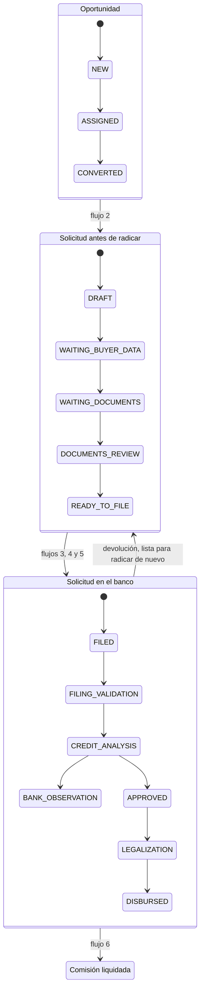
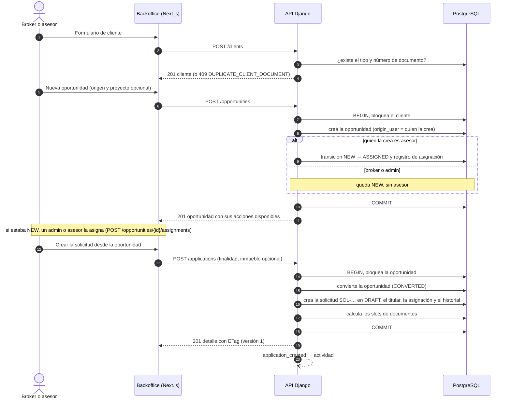
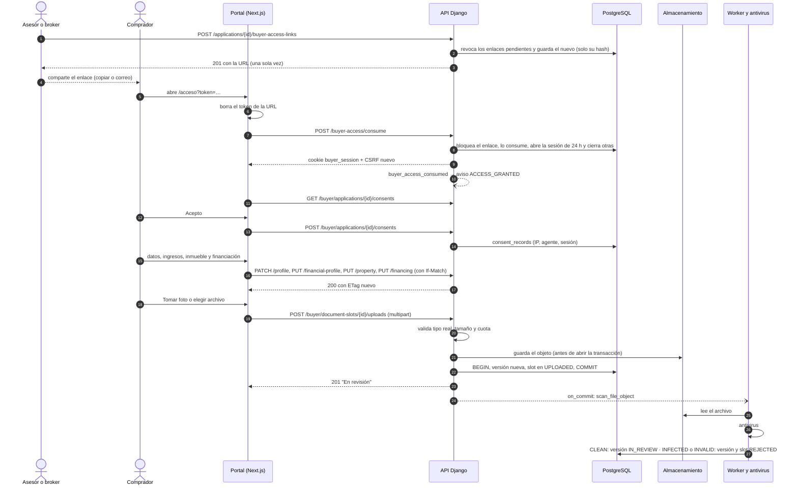
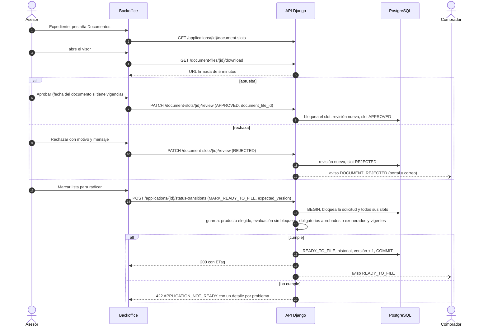
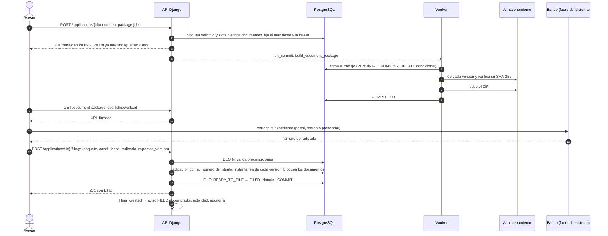
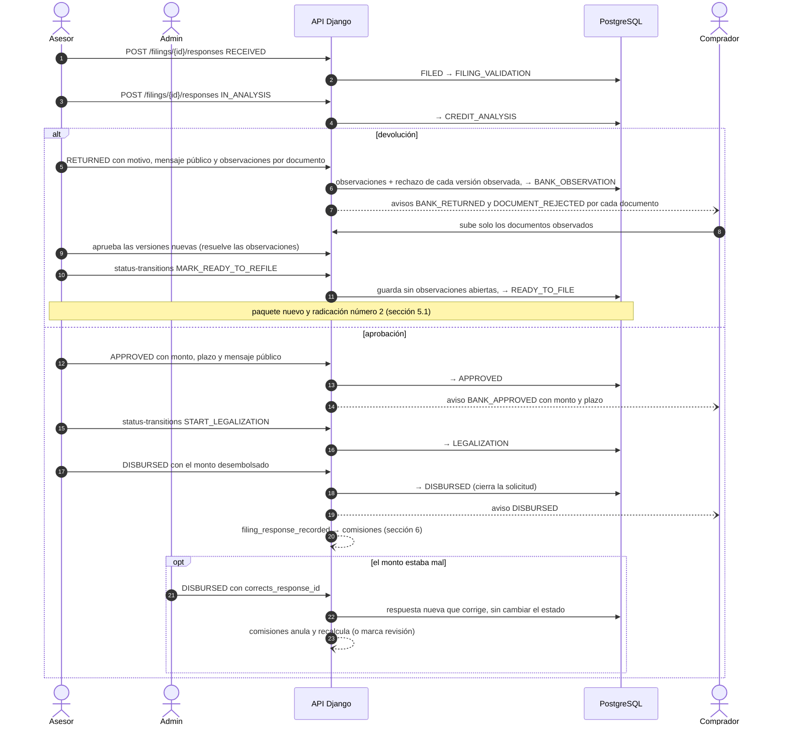
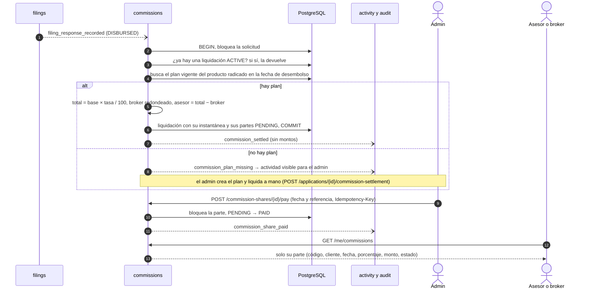
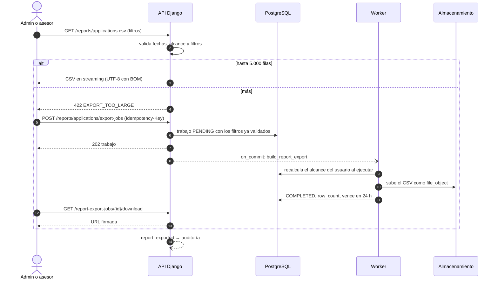

# 07 · Flujos de punta a punta

> **En simple:** este documento sigue la **ruta crítica** del producto paso a paso, como una película: quién hace qué, qué endpoint se llama, qué revisa el backend antes de aceptar y qué cambia en la base. Son seis flujos encadenados, desde que se registra un cliente hasta que se paga la comisión, más la exportación de reportes.

Las reglas del negocio detrás de cada paso están en [02 · Negocio](02-negocio.md); las piezas técnicas (servicios, transacciones, señales), en [03 · Arquitectura](03-arquitectura.md) y [04 · System design](04-system-design.md). Cada endpoint vive bajo `/api/v1`; aquí se omite el prefijo.

---

## Índice

1. [El mapa: la ruta crítica en estados](#1-el-mapa-la-ruta-crítica-en-estados)
2. [Cliente → oportunidad → solicitud](#2-cliente--oportunidad--solicitud)
3. [Enlace mágico → consentimientos → datos → documentos](#3-enlace-mágico--consentimientos--datos--documentos)
4. [Revisión → lista para radicar](#4-revisión--lista-para-radicar)
5. [Paquete → radicación → respuestas del banco](#5-paquete--radicación--respuestas-del-banco)
6. [Liquidación de la comisión y pago](#6-liquidación-de-la-comisión-y-pago)
7. [Exportación de reportes](#7-exportación-de-reportes)

---

## 1. El mapa: la ruta crítica en estados

*Qué mirar: los tres bloques son tres momentos de la misma historia, y la única flecha hacia atrás es la devolución del banco, que vuelve a `READY_TO_FILE`. Todos los estados y transiciones, con quién las ejecuta, están en [02 · Negocio §3](02-negocio.md#3-la-solicitud-de-crédito).*

---

## 2. Cliente → oportunidad → solicitud

**Quién:** un broker o un asesor registra al cliente y su oportunidad; un asesor (o el admin) crea la solicitud.

*Qué mirar: crear la solicitud y convertir la oportunidad son **una sola transacción**. Si dos asesores lo intentan a la vez, la base solo deja una solicitud abierta.*

**Qué valida el backend en cada paso:**

| Paso | Valida | Si no, responde | Dónde |
| --- | --- | --- | --- |
| `POST /clients` | Permiso `clients.create`; el tipo de documento es del catálogo; número normalizado (sin puntos ni guiones) y no repetido | `403`, `400`, `409 DUPLICATE_CLIENT_DOCUMENT` (con `resource_id` solo si el usuario puede ver ese cliente) | `backend/apps/crm/services.py`, `validators.py` |
| `POST /opportunities` | Permiso `opportunities.create`; el cliente está en el alcance; el proyecto, si llega, está `ACTIVE`; no hay otra oportunidad abierta del mismo cliente y proyecto | `404`, `422 PROJECT_NOT_ACTIVE`, `409 DUPLICATE_OPPORTUNITY` | `create_opportunity`, `_ensure_no_open_duplicate` |
| Asignación | Permiso `opportunities.assign`; el asesor es elegible | `409 ADVISOR_NOT_ELIGIBLE` | `backend/apps/crm/services.py` |
| `POST /applications` | Permiso `applications.create`; la oportunidad está en el alcance y tiene asesor; la finalidad es del catálogo; el inmueble cumple las reglas de su finalidad (proyecto solo en vivienda nueva, dirección en usada y remodelación); una sola solicitud abierta por oportunidad | `400` (por campo), `409 INVALID_STATE_TRANSITION`, `409` por solicitud ya abierta | `create_application` en `backend/apps/applications/services.py` |

---

## 3. Enlace mágico → consentimientos → datos → documentos

**Quién:** el asesor (o el broker) emite el enlace; el comprador hace todo lo demás desde el celular.

*Qué mirar: el archivo se guarda en el almacenamiento **antes** de abrir la transacción, para no retener bloqueos mientras viaja por la red, y el antivirus corre **después** del commit. Hasta que el antivirus no dé limpio, nadie puede aprobar ni descargar ese archivo.*

**Qué valida el backend en cada paso:**

| Paso | Valida | Si no, responde | Dónde |
| --- | --- | --- | --- |
| Emitir enlace | Permiso `buyer_access.create` y alcance (admin, asesor asignado, broker que originó); solicitud no terminada; titular activo; correo si el canal es `EMAIL`; 3 por hora por emisor y solicitud | `403`, `404`, `409 APPLICATION_CLOSED`, `400`, `429` | `backend/apps/identity/buyer_access.py` |
| Consumir | Token conocido, vigente, sin usar ni revocar; solicitud abierta y cliente todavía titular; 5 por hora por IP | `401 MAGIC_LINK_INVALID`, `_EXPIRED`, `_CONSUMED`, `_REVOKED`; `429` | `backend/apps/identity/buyer_sessions.py` |
| Cualquier escritura del portal | Sesión del comprador viva; CSRF; el recurso es de la solicitud de la sesión; consentimientos obligatorios aceptados | `401 SESSION_EXPIRED`, `403`, `404`, `403 CONSENT_REQUIRED` | `BuyerSessionAuthentication`, `backend/apps/identity/consents.py` |
| Formularios | Antes de `FILED`; `If-Match` con la versión vigente; campos editables por el comprador; códigos de catálogo válidos; reglas de la financiación (producto disponible para la finalidad, montos) | `409 APPLICATION_NOT_EDITABLE`, `428`, `409 STALE_VERSION`, `400` por campo | `backend/apps/identity/buyer_editing.py` y los servicios de `applications` |
| Carga | El slot admite carga en este momento; tipo real permitido; tamaño; cuota; 60 por hora | `409 DOCUMENT_LOCKED`, `409 DOCUMENT_NOT_REJECTED`, `422 UNSUPPORTED_FILE_TYPE`, `422 FILE_TOO_LARGE`, `413`, `409 DOCUMENT_QUOTA_EXCEEDED`, `429`, `503` si el almacenamiento falla | `backend/apps/documents/uploads.py`, `file_validation.py` |
| Antivirus | El archivo sigue `PENDING`; si el antivirus no responde, reintenta (8 veces) y el archivo **nunca** pasa a limpio por error | — (el estado queda en el archivo) | `backend/apps/documents/tasks.py`, `scans.py` |

---

## 4. Revisión → lista para radicar

**Quién:** el asesor asignado.

*Qué mirar: la revisión de un documento no sube la versión de la solicitud, pero "lista para radicar" sí la revisa: la guarda evalúa todo dentro de la misma transacción, con los documentos bloqueados, así nadie cambia un documento mientras se decide.*

**Qué valida el backend en cada paso:**

| Paso | Valida | Si no, responde | Dónde |
| --- | --- | --- | --- |
| Descargar | Permiso `documents.download`, alcance, análisis limpio; 60 por hora | `403`, `404`, `409 FILE_NOT_CLEAN`, `429` | `backend/apps/documents/downloads.py` |
| Aprobar | Permiso `documents.review`; la versión es la vigente; análisis limpio; fecha del documento si hay vigencia, no futura y no vencida; antes de `FILED` (después, solo para resolver una observación) | `409 DOCUMENT_NOT_CURRENT`, `409 FILE_NOT_CLEAN`, `400`, `422 DOCUMENT_EXPIRED`, `409` | `backend/apps/documents/reviews.py` |
| Rechazar | Motivo del catálogo `document_rejection_reason` y mensaje al comprador | `400` | `reviews.py` (y el `CHECK` `ck_document_reviews_rejection`) |
| Exonerar / reabrir | Permiso `documents.waive`; slot exonerable (en grupo, todos los que se exonerarían); comentario interno al reabrir | `403`, `400` | `reviews.py` |
| `MARK_READY_TO_FILE` | Permiso `applications.transition`; versión; estado `DOCUMENTS_REVIEW`; guarda `APPLICATION_READY_TO_FILE` | `409 STALE_VERSION`, `409 INVALID_STATE_TRANSITION`, `422 APPLICATION_NOT_READY` con `DOCUMENT_PENDING`, `DOCUMENT_EXPIRED`, `DOCUMENTS_NOT_CONFIGURED` o `BANK_RULE_BLOCKED` | `backend/apps/applications/services.py`, `backend/apps/documents/verification.py` |

---

## 5. Paquete → radicación → respuestas del banco

**Quién:** el asesor asignado, frente al banco y frente al sistema.

### 5.1 Paquete y radicación

*Qué mirar: lo que se radica es **exactamente** lo que se revisó. El paquete fija su lista de versiones al pedirlo, el worker verifica el SHA-256 de cada una, y la radicación rechaza un paquete cuya huella ya no es la vigente.*

### 5.2 Las respuestas del banco

*Qué mirar: cada respuesta es una fila nueva y nunca se edita. La devolución reutiliza el mismo mecanismo de rechazo de documentos, y la corrección del desembolso es del administrador y no mueve el estado.*

**Qué valida el backend en cada paso:**

| Paso | Valida | Si no, responde | Dónde |
| --- | --- | --- | --- |
| Pedir paquete | Permiso `filings.prepare` y alcance; documentos obligatorios aprobados, exonerados y vigentes | `403`, `404`, `422 APPLICATION_NOT_READY` | `backend/apps/documents/packages.py` |
| Descargar paquete | Trabajo `COMPLETED` y no vencido (7 días) | `409 PACKAGE_NOT_READY`, `409 PACKAGE_EXPIRED` | `packages.py` |
| Radicar | Versión; solicitud abierta y en `READY_TO_FILE`; producto igual al de la financiación; guarda de documentos y reglas; paquete de esta solicitud, listo, no usado y con la huella vigente; fecha no futura; radicado no repetido | `409 STALE_VERSION`, `409 APPLICATION_CLOSED`, `409 INVALID_STATE_TRANSITION`, `422 BANK_PRODUCT_MISMATCH`, `422 APPLICATION_NOT_READY`, `400`, `409 PACKAGE_ALREADY_FILED`, `409 PACKAGE_NOT_READY`, `409 PACKAGE_EXPIRED`, `409 PACKAGE_OUTDATED`, `409 FILING_REFERENCE_EXISTS` | `backend/apps/filings/services.py` |
| Registrar respuesta | Permiso `filings.record_response` y asesor asignado o admin; es la **última** radicación; estado admitido por el tipo; campos obligatorios del tipo y ningún campo de otro tipo; fecha no futura y no anterior a la radicación; montos y plazo ≥ 1; motivo del catálogo de su tipo | `403`, `409 FILING_NOT_LATEST`, `409 INVALID_STATE_TRANSITION`, `400` ("No aplica a X") | `RULES` en `backend/apps/filings/responses.py` |
| Observaciones | Cada slot es de la solicitud, vigente, con versión y no exonerado, sin repetir | `400` en `observations[i]` | `responses.py` |
| Resolver una observación | Aprobar una versión cargada **después** de la observación | `409 DOCUMENT_OBSERVED` | `backend/apps/documents/reviews.py` |
| `MARK_READY_TO_REFILE` | La guarda de "lista para radicar" más cero observaciones abiertas | `422 APPLICATION_NOT_READY` con `BANK_OBSERVATION_OPEN` | `backend/apps/filings/observations.py` |
| Corregir una respuesta | Última de la radicación, mismo tipo, tipo corregible; el desembolso, solo el admin | `409 RESPONSE_CORRECTION_NOT_ALLOWED`, `403` | `responses.py` |
| Evidencia | Una sola por respuesta; PDF, JPG o PNG hasta 10 MB; pasa por el antivirus | `409 EVIDENCE_ALREADY_ATTACHED`, `422` | `backend/apps/filings/evidence.py` |

---

## 6. Liquidación de la comisión y pago

**Quién:** el sistema liquida solo; el admin paga.

*Qué mirar: si falta el plan, la respuesta del banco **ya quedó guardada** y nada falla; el sistema deja el aviso al admin y la liquidación manual hace el resto.*

**Qué valida el backend en cada paso:**

| Paso | Valida | Si no, responde | Dónde |
| --- | --- | --- | --- |
| Liquidar (automático o manual) | Solicitud en `DISBURSED` con monto; plan vigente; una sola liquidación activa | `409 APPLICATION_NOT_DISBURSED`, `422 COMMISSION_PLAN_NOT_FOUND` (manual); la automática no falla | `backend/apps/commissions/settlement.py` |
| Anular | Permiso `commissions.manage`; motivo; ninguna parte pagada | `409 COMMISSION_SETTLEMENT_HAS_PAYMENTS` | `settlement.py` |
| Pagar | Permiso `commissions.manage`; parte `PENDING`; fecha no futura (Bogotá); referencia | `409 COMMISSION_SHARE_NOT_PAYABLE`, `400` | `backend/apps/commissions/payments.py` |
| Mis comisiones | Permiso `commissions.read_own` (asesor y broker) | `403` (admin y constructora) | `payments.py` |

---

## 7. Exportación de reportes

**Quién:** admin o asesor (el broker no exporta).

*Qué mirar: el trabajo asíncrono vuelve a calcular el alcance **al ejecutarse**. Si el usuario perdió el permiso mientras tanto, la exportación falla en lugar de entregarle datos que ya no puede ver.*

**Qué valida el backend en cada paso:**

| Paso | Valida | Si no, responde | Dónde |
| --- | --- | --- | --- |
| Filtros | Fechas `YYYY-MM-DD`, `date_from ≤ date_to`, máximo 366 días; ids existentes; `status` y `purpose_code` válidos; filtros dentro del alcance | `400 VALIDATION_ERROR`, `403 FILTER_OUT_OF_SCOPE` | `backend/apps/reporting/filters.py` |
| CSV directo | Permiso `reports.export`; hasta 5.000 filas; celdas peligrosas neutralizadas; 20 por minuto | `403`, `422 EXPORT_TOO_LARGE`, `429` | `backend/apps/reporting/exports.py` |
| Exportación asíncrona | Permiso `reports.export`; máximo 3 en curso por usuario; al ejecutar, permiso vigente y hasta 100.000 filas | `429 TOO_MANY_EXPORTS`; el trabajo queda `FAILED` con `PERMISSION_REVOKED` o `EXPORT_TOO_LARGE` | `backend/apps/reporting/export_jobs.py`, `tasks.py` |
| Descargar | Dueño o `reports.manage`; `COMPLETED` y no vencido | `404`, `409 EXPORT_NOT_READY`, `410 EXPORT_EXPIRED` | `export_views.py` |

---

Siguiente: [08 · Frontend](08-frontend.md) — cómo se ve todo esto del lado del navegador.
