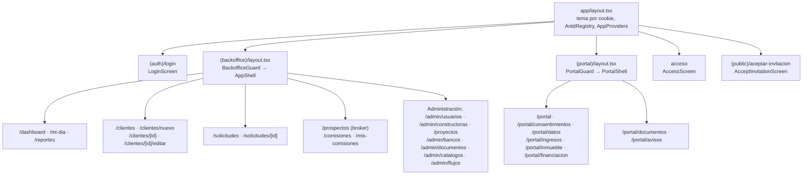
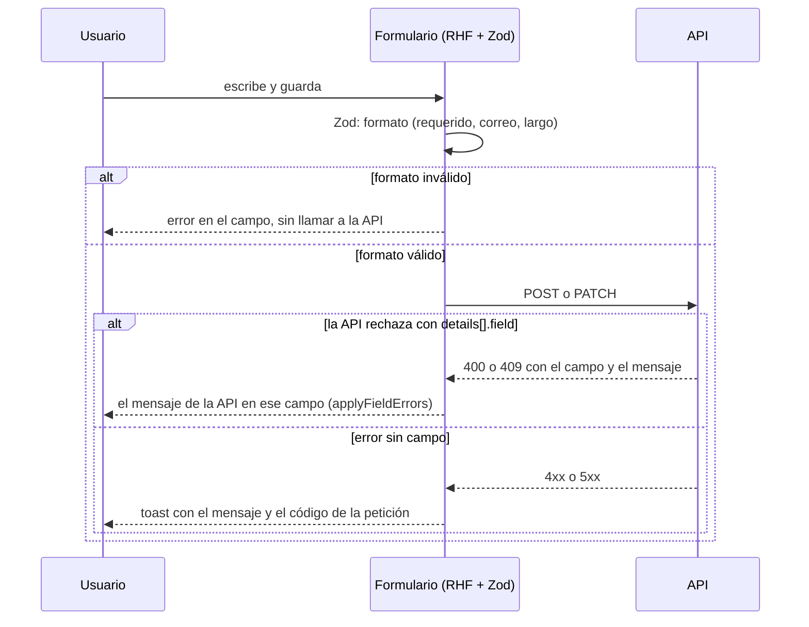

# 08 · Frontend

> **En simple:** el frontend es **una sola aplicación Next.js** con dos caras: el backoffice para el equipo interno y el portal móvil del comprador. No tiene reglas de negocio propias: pinta lo que la API le da (catálogos, etiquetas, acciones disponibles, permisos), valida solo el formato de los formularios y traduce los errores de la API en mensajes claros. Los tipos de cada llamada salen del contrato OpenAPI, así que una llamada mal escrita no compila.

La conexión con la API (mismo origen, cookies, CSRF) está en [03 · Arquitectura §7](03-arquitectura.md#7-front--api-mismo-origen-por-el-proxy-de-next); las pruebas del front, en [09 · Calidad](09-calidad.md). El design system tiene su propio documento, [`docs/DESIGN-SYSTEM.md`](../DESIGN-SYSTEM.md). Revisado en `master` el **18 de noviembre de 2026** y actualizado el **19** con la F6 (administración, #34) y la F7 (comisiones, bandeja del broker y edición del expediente, #33).

---

## Índice

1. [Estructura y rutas](#1-estructura-y-rutas)
2. [`features/`: una carpeta por dominio](#2-features-una-carpeta-por-dominio)
3. [Design system y `components/ui`](#3-design-system-y-componentsui)
4. [Datos: TanStack Query y `openapi-fetch` tipado](#4-datos-tanstack-query-y-openapi-fetch-tipado)
5. [Formularios: formato en el front, negocio en la API](#5-formularios-formato-en-el-front-negocio-en-la-api)
6. [Errores y sesión](#6-errores-y-sesión)
7. [Navegación por permisos](#7-navegación-por-permisos)
8. [El portal: móvil primero](#8-el-portal-móvil-primero)
9. [Accesibilidad](#9-accesibilidad)
10. [Las 22 vistas](#10-las-22-vistas)

---

## 1. Estructura y rutas

Stack (`frontend/package.json`): Next.js 16.4.6 con **App Router** (las rutas son carpetas dentro de `src/app`), React 19.3.1, TypeScript en modo estricto, Ant Design 6.7.0 para componentes, Tailwind CSS 4.3.5 para la maquetación, TanStack Query 5.107.1 para los datos del servidor, React Hook Form 7.92.0 + Zod 4.6.7 para formularios, y `openapi-fetch` 0.17.0 con tipos de `openapi-typescript` 7.13.0.

```
frontend/src/
├── app/                 rutas (App Router)
│   ├── (auth)/login/            login interno
│   ├── (backoffice)/            layout con BackofficeGuard y AppShell
│   ├── (portal)/portal/         layout con PortalGuard y PortalShell
│   ├── (public)/aceptar-invitacion/  aceptar una invitación interna, sin sesión
│   └── acceso/                  consume el enlace mágico
├── features/            una carpeta por dominio (pantallas, consultas, formularios)
├── components/ui/       piezas compartidas del design system
├── lib/                 api/, navigation/, format/, theme/, hooks/
├── providers/           Query, Ant Design, tema y toasts
├── stories/             documentación de Storybook (fundamentos y patrones)
└── proxy.ts             redirección al login sin cookie (solo experiencia de uso)
```

Los paréntesis de `(auth)`, `(backoffice)` y `(portal)` son **grupos de rutas**: agrupan páginas con el mismo `layout.tsx` sin aparecer en la URL.



*Qué mirar: cada zona tiene su guardia. El backoffice pide `GET /auth/me` y el portal `GET /buyer/session` antes de pintar nada; ninguna de las dos decide permisos por su cuenta: solo muestran lo que la API dice.*

- **`BackofficeGuard`** (`frontend/src/features/auth/backoffice-guard.tsx`): pide `/auth/me`; mientras carga, muestra el esqueleto del shell; si la ruta no está permitida para los permisos del usuario, lo manda a su destino por defecto; si `/auth/me` falla, "No pudimos cargar tu sesión" con "Reintentar".
- **`PortalGuard`** (`frontend/src/features/buyer-portal/portal-guard.tsx`): pide `/buyer/session`, programa el aviso de vencimiento con `expires_at`, manda a `/portal/consentimientos` si hay pendientes y muestra "Tu acceso venció" o "Saliste del portal" según el caso.
- **`proxy.ts`** (el `middleware` de Next 16) solo redirige al login a quien no tiene ninguna cookie de sesión; no valida nada (su comentario dice "la seguridad la pone la API").
- **`/aceptar-invitacion`** (F6) es pública: quita el token de la URL al cargar, no envía `Referer` y está fuera del `matcher` de `proxy.ts`, para que el token no termine en el `next` del login (`frontend/src/app/(public)/aceptar-invitacion/page.tsx`).
- `/` redirige a `/login`; `/sin-modulos` es el destino de un usuario sin ningún permiso de navegación.

## 2. `features/`: una carpeta por dominio

Cada carpeta tiene sus pantallas, sus consultas (`queries.ts`) y sus pruebas, sin depender de las demás salvo por `components/ui`, `lib` y `providers` (regla de [`specs/TAREA-frontend-base.md`](../../specs/TAREA-frontend-base.md), "Reglas para no chocar").

| Carpeta | Qué tiene |
| --- | --- |
| `auth/` | Login, `BackofficeGuard`, `useMe`, `useLogin`, `useLogout` |
| `applications/` | Listado de solicitudes (tabla, tarjetas, filtros en la URL) y el espacio de trabajo `/solicitudes/[id]` (encabezado, resumen, historial, modales de acciones). Desde la F7, la edición en el lugar del expediente: participantes, perfil financiero e ingresos, inmueble y financiación (`participant-edit.tsx`, `financing-edit.tsx`, `property-edit.tsx`, `dossier-queries.ts`) |
| `document-review/` | La pestaña Documentos del expediente: revisión, visor, exonerar y reabrir |
| `filings/` | La pestaña Radicación: paquete y su lista de paquetes pedidos, radicaciones, respuestas del banco (los campos de cada tipo salen del `metadata` del catálogo, `response-fields.ts`) y evidencia |
| `clients/` | Listado, formulario, detalle con pestañas y panel de oportunidad con sus transiciones (`available_actions`) |
| `broker/` | La bandeja del broker `/prospectos`: prospectos por estado, "Nuevo prospecto", "Enviar enlace" y el estado de sus solicitudes (F7) |
| `commissions/` | `/comisiones` (liquidaciones y planes, del admin), `/mis-comisiones` (asesor y broker) y la tarjeta "Comisión" del expediente desembolsado (F7) |
| `dashboard/` | Resumen, embudo, carga por asesor y resultados por banco |
| `workday/` | "Mi día": bandeja de atención y tareas |
| `reports/` | Embudo, listado, CSV directo y exportaciones |
| `buyer-portal/` | Acceso, guardia, shell, inicio, consentimientos, desistimiento y los formularios del comprador |
| `buyer-documents/` | Documentos del portal, hoja de carga y visor |
| `buyer-notifications/` | Avisos del comprador y su conteo de no leídos |
| `admin-users/` | Usuarios, roles, invitaciones y la pantalla pública para aceptarlas (F6) |
| `admin-partners/`, `admin-projects/` | Constructoras con sus miembros, y proyectos con su flujo de validación (F6) |
| `admin-banks/` | Bancos, productos, finalidades y reglas con sus versiones y su prueba (F6) |
| `admin-documents/` | Tipos documentales, requisitos y la vista previa de la lista documental (F6) |
| `admin-catalogs/`, `admin-workflow/` | Catálogos con reordenamiento accesible, y transiciones de los flujos (F6) |
| `admin-common/` | Piezas compartidas de la administración (selector de constructora, modal de motivo, estado activo) |

## 3. Design system y `components/ui`

El design system se llama **Umbral** y vive en dos lugares:

- **`design/`**, en la raíz del monorepo: los tokens fuente (`design/tokens/tokens.json`), el script que los genera (`design/scripts/build-tokens.mjs`), los generados (`design/generated/`: `tokens.css`, `tailwind-theme.css`, `antd-theme.ts`, `status-tones.ts` y un `contrast-report.md`), y los mockups aprobados en HTML (`design/screens/`: `login.html`, `solicitudes.html`, `solicitud.html`, `portal.html`, `portal-documentos.html`).
- **`frontend/src/components/ui`**: 23 componentes compartidos (entre otros `app-shell`, `data-table`, `document-uploader`, `document-viewer`, `bottom-sheet`, `side-panel`, `action-modal`, `status-badge`, `money`, `stepper`, `form-field`, `state-views`), con 21 archivos de stories y 7 de pruebas. No hay un archivo índice: cada componente se importa por su ruta.

Cómo se usan los tokens: el front **no copia** valores, los importa. `frontend/src/app/globals.css` importa `tokens.css` y `tailwind-theme.css`; Ant Design recibe `lightTheme` o `darkTheme` de `@design/antd-theme` (`frontend/src/providers/antd-provider.tsx`); el alias `@design/*` apunta a `design/generated/*` (`frontend/tsconfig.json`).

**El color de un estado sale de una sola función**, `toneFor(kind, code)` (`design/generated/status-tones.ts`), y **el texto siempre viene de la API**. Así el front nunca compara etiquetas ni tiene su propia lista de estados.

**Tema claro y oscuro**, sin seguir al sistema operativo: la elección se guarda en `localStorage` con la clave `um-theme` y se copia a una cookie para que el servidor pinte el tema correcto sin parpadeo (`frontend/src/lib/theme/theme.ts`).

**Storybook** (versión 10.6.7): 23 archivos de stories y 17 páginas MDX en `frontend/src/` (introducción, guía, fundamentos como colores, espaciado, tipografía y redacción, y patrones como formulario, tabla, lista con filtros, carga de archivo y panel lateral). Se compila en cada PR y cada story pasa por `axe` ([§9](#9-accesibilidad)). Desde la F7 está **publicado en GitHub Pages**: <https://carlosdev88.github.io/real-estate-credit-backoffice/>, junto con la referencia de la API generada desde el contrato con Redoc en <https://carlosdev88.github.io/real-estate-credit-backoffice/api/> (las dos estáticas y de solo lectura; `.github/workflows/storybook-pages.yml`, en cada push a `master` que toque el frontend, el diseño o el contrato). Qué trae, de dónde salen los tokens y cómo agregar un componente: [`docs/DESIGN-SYSTEM.md`](../DESIGN-SYSTEM.md).

**Una regla automática de colores:** `frontend/src/test/no-hardcoded-colors.test.ts` falla si encuentra un color escrito a mano (hex, `rgb()` o `hsl()`) en `src/`, también en CSS y MDX; todo color sale de los tokens. Es una prueba y no una regla de ESLint justamente para cubrir CSS y MDX (Parte 3 de [`specs/TAREA-design-system.md`](../../specs/TAREA-design-system.md)).

## 4. Datos: TanStack Query y `openapi-fetch` tipado

**TanStack Query** guarda en caché lo que viene del servidor y lo vuelve a pedir cuando hace falta. Configuración en `makeQueryClient()` (`frontend/src/providers/query-provider.tsx`):

- `staleTime` de 30 segundos (los metadatos de `/metadata/bootstrap`, 10 minutos);
- las lecturas se reintentan una sola vez, y nunca ante un `4xx` ("los 4xx no mejoran reintentando");
- las escrituras no se reintentan solas;
- un `MutationCache` global muestra el error de cualquier escritura en un toast, salvo que la mutación diga que lo maneja ella (`meta.handlesErrors`). No hay un manejador global de lecturas: cada pantalla decide su estado de error.

**El cliente de la API** (`frontend/src/lib/api/client.ts`) es `createClient<paths>()` de `openapi-fetch`, con los tipos de `schema.d.ts` (generado desde el contrato, más de 22.000 líneas). `call(api.GET("/api/v1/..."))` devuelve `{data, version}` o lanza un `ApiError`.

**Lo que agrega cada petición** (`frontend/src/lib/api/fetch.ts`): un `X-Request-ID` nuevo y, en las escrituras, el `X-CSRFToken` leído de la cookie `app_csrf`.

**Concurrencia** (`frontend/src/lib/api/version.ts`): `versionOf(response)` lee el `ETag`; los formularios del portal y la edición del expediente por el asesor mandan `If-Match` con la última versión conocida (`frontend/src/features/buyer-portal/forms/form-queries.ts`, `frontend/src/features/applications/dossier-queries.ts`); las acciones del expediente (transiciones, desistimiento) mandan `expected_version` en el cuerpo.

**Idempotencia** (`frontend/src/lib/api/idempotency.ts`, `useIdempotencyKey`): la usan la exportación asíncrona de reportes (`features/reports/reports-screen.tsx`), el enlace para el comprador (`BuyerLinkModal` en `features/applications/action-modals.tsx`, que también usa la bandeja del broker), la radicación (`features/filings/delivery-panel.tsx`) y las de comisiones: liquidar, anular y pagar (`features/commissions/settle-modal.tsx`, `settlement-panel.tsx`). La clave se reinicia al terminar bien. Lo que no la manda funciona igual sin la cabecera ([ADR 0008](../adr/0008-idempotencia-opcional.md)).

**Cargas con progreso** (`frontend/src/lib/api/upload.ts`, `uploadFile`): `XMLHttpRequest` multipart con progreso y botón de cancelar, con las mismas reglas de sesión que el resto. La usan la hoja de carga del portal y la evidencia de una respuesta del banco.

**Listas en la URL:** filtros, búsqueda, orden, página y pestaña viven en los parámetros de la URL (`/solicitudes?bank_id=…&page=2`, `/solicitudes/[id]?tab=radicacion`): un enlace copiado abre la misma vista ([`specs/TAREA-frontend-base.md`](../../specs/TAREA-frontend-base.md), "Estado de las listas en la URL").

**Cero listas de negocio:** catálogos, bancos, productos, estados y etiquetas vienen de la API; las acciones de una solicitud, de `GET /applications/{id}/available-actions`, con su tipo (`primary`, `secondary`, `destructive`) para decidir cuál es el botón principal (REQ §8.5).

## 5. Formularios: formato en el front, negocio en la API

**React Hook Form** maneja el estado del formulario y **Zod** valida el formato (requerido, correo, número ≥ 0, largos del contrato). Las **reglas de negocio** (documento duplicado, producto no disponible, fecha futura…) las valida la API, y su error vuelve al campo. Está escrito así en el propio código: "Las reglas de negocio (formato por tipo de documento, duplicados) las valida la API y su error vuelve al campo" (`frontend/src/features/clients/client-form.tsx`).



*Qué mirar: el front no repite ninguna regla de negocio. Si la API cambia una regla, el formulario muestra el mensaje nuevo sin tocar el front.*

- `applyFieldErrors(error, setError, fields)` (`frontend/src/lib/api/errors.ts`) pone cada `details[].field` en su campo y devuelve lo que sobra.
- `useFormErrorHandler` (`frontend/src/components/ui/form-field.tsx`) lleva lo que sobra a un toast. El portal usa su variante `useSaveErrors` (`frontend/src/features/buyer-portal/forms/form-kit.tsx`).
- Los selectores se llenan con catálogos de la API; un campo que depende de un código de catálogo se muestra siempre y la API dice si falta.
- El patrón está documentado en Storybook: `frontend/src/stories/patrones/formulario.mdx`.

## 6. Errores y sesión

Todo error de la API se convierte en un `ApiError` con `status`, `code`, `message`, `details`, `requestId` y `retryAfter` (`frontend/src/lib/api/errors.ts`). El front decide por el **código**, nunca por el texto:

| Respuesta | Qué hace el front | Dónde |
| --- | --- | --- |
| `401` en el backoffice (`NOT_AUTHENTICATED`, `SESSION_EXPIRED`) | Un solo `POST /auth/refresh` y reintenta; si falla, `/login?next=…`. El refresh se serializa entre pestañas con `navigator.locks`, porque dos refresh simultáneos parecen un robo | `fetch.ts`, `session.ts` (`refreshSession`) |
| `401 SESSION_EXPIRED` en el portal | Pantalla "Tu acceso venció, pide un nuevo enlace a tu asesor" | `notifyBuyerSessionExpired` → `PortalGuard` |
| `403 CONSENT_REQUIRED` | Lleva a `/portal/consentimientos` | `notifyConsentRequired` → `PortalGuard` |
| `409 STALE_VERSION` | Toast persistente "Alguien cambió esta solicitud" con "Recargar"; no pisa nada | `describeMutationError` (`error-feedback.ts`), `api-error-toast.tsx` |
| `409 APPLICATION_NOT_EDITABLE` / `APPLICATION_CLOSED` | Formularios en solo lectura | `isReadOnlyError` |
| `429` | El mensaje de la API con el tiempo de `Retry-After` | `retryAfterMessage` |
| `details[].field` | Al campo del formulario | `applyFieldErrors` |
| Error sin campo | Toast con el mensaje y "Código: `request_id`" para soporte | `describeMutationError` |
| Sin respuesta (red) | Mensaje de conexión | `networkError` |

Los toasts duran 5 segundos (los de error se quedan hasta cerrarlos) y se muestran como máximo 3 a la vez (`frontend/src/providers/toast.tsx`).

## 7. Navegación por permisos

El menú del backoffice se decide **por permiso, nunca por nombre de rol** (comentario de `frontend/src/lib/navigation/access.ts`):

- `NAV_ITEMS` (`frontend/src/lib/navigation/nav-config.tsx`) declara cada entrada con el permiso que la abre y, si hace falta, su **audiencia** (`audience`, abajo).
- `visibleNav(permissions, items, audience)` filtra con los permisos de `/auth/me` y la audiencia; `defaultDestination` lleva a la primera entrada visible (o a `/sin-modulos`); `isForbiddenPath` impide entrar por URL a una zona sin permiso o de otra audiencia.
- Dentro de una pantalla, lo mismo: la pestaña Radicación solo existe con `filings.read`; una pestaña del detalle de cliente sin permiso vuelve al resumen; la tarjeta "Comisión" del expediente, solo con `commissions.read`.

| Grupo | Entrada | Permiso | Audiencia |
| --- | --- | --- | --- |
| Operación | Dashboard (`/dashboard`) | `dashboard.read` | interna |
| Operación | Mi día (`/mi-dia`) | `workday.read` | — |
| Operación | Reportes (`/reportes`) | `reports.read` | — |
| Comercial | Mis prospectos (`/prospectos`) | `opportunities.read` | broker |
| Comercial | Solicitudes (`/solicitudes`) | `applications.read` | interna |
| Comercial | Clientes (`/clientes`) | `clients.read` | interna |
| Finanzas | Comisiones (`/comisiones`) | `commissions.read` | — |
| Finanzas | Mis comisiones (`/mis-comisiones`) | `commissions.read_own` | — |
| Administración | Usuarios (`/admin/usuarios`) | `users.read` | — |
| Administración | Constructoras (`/admin/constructoras`) | `partners.create` (asesor y constructora tienen `partners.read`; así solo la ve el admin) | — |
| Administración | Proyectos (`/proyectos`) | `projects.read` | interna |
| Administración | Bancos (`/admin/bancos`) | `banks.create` (el asesor tiene `banks.read`) | — |
| Administración | Documentos (`/admin/documentos`) | `document_requirements.create` | — |
| Administración | Catálogos (`/admin/catalogos`) | `catalogs.read` | — |
| Administración | Flujos (`/admin/flujos`) | `workflow.read` | — |

**La audiencia, la única excepción al "solo permisos"** (F7, #33). `audienceOf(roles)` (`frontend/src/lib/navigation/access.ts`) devuelve `broker` si el usuario tiene el rol de broker y ningún rol interno (admin o asesor): es la misma regla con la que la API le recorta los datos (`CrmScope.is_restricted`, `backend/apps/crm/services.py`). Al broker la API le responde **otras formas** (el resumen de la solicitud, `BrokerOpportunity`), así que las pantallas internas no son para él aunque tenga el permiso: una entrada `internal` no la ve y una `broker` solo la ve él. Sin `audience`, la ven los dos. Con los permisos de la demo, cada rol queda así:

| Rol | Menú | Entra a |
| --- | --- | --- |
| Admin | Dashboard, Mi día, Reportes, Solicitudes, Clientes, Comisiones y toda la Administración | `/dashboard` |
| Asesor | Dashboard, Mi día, Reportes, Solicitudes, Clientes, Mis comisiones y Proyectos | `/dashboard` |
| Broker | Mis prospectos y Mis comisiones | `/prospectos` |
| Constructora | Proyectos | `/proyectos` |

*Permisos de las migraciones (por ejemplo, `backend/apps/reporting/migrations/0001_seed_reporting_permissions.py`: `dashboard.read` para admin, asesor y broker; `backend/apps/commissions/migrations/0002_seed_commission_permissions.py`: `commissions.read` solo admin y `commissions.read_own` asesor y broker). El broker tiene `dashboard.read`, pero el dashboard es interno: sus conteos los ve en su bandeja.*

Esto es solo experiencia de uso: aunque alguien fuerce una URL, la API responde `403` o `404` ([ADR 0005](../adr/0005-alcance-por-rol-con-404.md)).

## 8. El portal: móvil primero

El comprador usa el celular, así que el portal se diseñó primero para 390 px (`frontend/src/features/buyer-portal/portal-shell.tsx`):

- **Barra inferior fija** por debajo de 900 px con Inicio, Documentos (con el número de documentos por hacer) y Avisos (con los no leídos); respeta la zona segura del teléfono (`env(safe-area-inset-bottom)`). Desde 900 px, la misma navegación va arriba.
- Contenido de 480 px de ancho en el celular y 720 px en escritorio, y un enlace para saltar al contenido.
- **Hoja de carga** desde abajo (`BottomSheet`, `frontend/src/features/buyer-documents/upload-sheet.tsx`) con dos botones en el celular: **"Tomar foto"** (abre la cámara trasera con `capture="environment"`) y "Elegir archivo"; en escritorio, arrastrar y soltar (`frontend/src/components/ui/document-uploader.tsx`). Valida tipo y tamaño **antes** de subir y muestra el progreso.
- Botones y enlaces de al menos 40-44 px de alto para el dedo ([§9](#9-accesibilidad)).
- El acceso borra el token de la URL antes de cualquier otra cosa, y `/acceso` no envía `Referer` (`referrer: "no-referrer"`).

## 9. Accesibilidad

- **`axe` en las pruebas de punta a punta:** las de Playwright pasan `@axe-core/playwright` (WCAG 2.0 y 2.1, niveles A y AA) en cada pantalla y fallan con violaciones serias o críticas; el portal se revisa en claro y en oscuro, en celular y escritorio (`frontend/e2e/backoffice/fixtures.ts`, `frontend/e2e/portal/portal.spec.ts`).
- **`axe` en cada story, en el CI:** el addon de accesibilidad de Storybook corre con `test: "error"` y niveles serio y crítico (`frontend/.storybook/preview.tsx`); el paso "Storybook (a11y)" de `.github/workflows/frontend.yml` lo ejecuta en Chromium en cada PR.
- **Objetivos táctiles** de al menos 40 px en el celular (`frontend/src/stories/fundamentos/espaciado.mdx`); la auditoría del design system subió botones del portal a 40 px y el botón de quitar un filtro de 18 a 26 px.
- **El estado nunca solo por color:** cada estado lleva su etiqueta, además del tono.
- **Contraste:** un estado de carga al 60 % de opacidad bajaba el texto de 4,5:1 y axe lo marcó; se cambió por una barra de progreso (Parte 2 de [`specs/TAREA-design-system.md`](../../specs/TAREA-design-system.md)).
- Errores de formulario asociados al campo (`aria-describedby`) y foco visible ([`specs/TAREA-front-portal.md`](../../specs/TAREA-front-portal.md), reglas de trabajo).

## 10. Las 22 vistas

REQ §6 define 14 vistas de operación y 8 del portal ([01 · El producto §5](01-el-producto.md#5-las-22-vistas) tiene el detalle de cuáles están en `master`). Endpoints principales de cada pantalla, sacados de sus consultas (`features/*/queries.ts`), sin el prefijo `/api/v1`:

### Operación (14)

| # | Vista | Ruta | Quién | Endpoints principales |
| ---: | --- | --- | --- | --- |
| 1 | Login | `/login` | Todo interno | `POST /auth/login`, `GET /auth/me` |
| 2 | Dashboard | `/dashboard` | Admin, asesor | `GET /dashboard/summary`, `/funnel`, `/workload`, `/bank-results`; `/users`, `/banks`, `/metadata/bootstrap` para los filtros |
| 3 | Mi día | `/mi-dia` | Asesor, admin | `GET /workday/summary`, `/workday/applications`, `GET`/`POST /tasks`, `PATCH /tasks/{id}`, `POST /tasks/{id}/complete`, `/cancel` |
| 4 | Clientes | `/clientes` | Admin, asesor | `GET /clients`, `/metadata/bootstrap` |
| 5 | Crear / editar cliente | `/clientes/nuevo`, `/clientes/[id]/editar` | Admin, asesor | `POST /clients`, `GET`/`PATCH /clients/{id}` |
| 6 | Detalle de cliente | `/clientes/[id]` | Admin, asesor | `GET /clients/{id}`, `/addresses`, `/opportunities`, `/applications`; `POST /opportunities`, `/opportunities/{id}/assignments`, `POST /applications`; `GET /projects`, `/users` |
| 7 | Solicitudes | `/solicitudes` | Admin, asesor | `GET /applications`, `/applications/quick-filters`, `/banks`, `/metadata/bootstrap` |
| 8 | Expediente | `/solicitudes/[id]` (resumen, documentos, historial) | Admin, asesor | `GET /applications/{id}`, `/completeness`, `/participants`, `/property`, `/financing`, `/bank-rule-evaluations/latest`, `/buyer-access-links`, `/consents`, `/status-history`; `POST /status-transitions`, `/withdrawals`, `/assignments`, `/buyer-access-links`; documentos: `GET /document-slots`, `/document-files/{id}/download`, `PATCH /document-slots/{id}/review`; edición (F7): `POST /applications/{id}/participants`, `PATCH`/`DELETE /application-participants/{id}`, `PUT …/financial-profile`, `/financial-profiles/{id}/income-sources`, `/income-sources/{id}`, `PUT /applications/{id}/property`, `PUT …/financing` con `GET …/eligible-bank-products` |
| 9 | Radicación | `/solicitudes/[id]?tab=radicacion` | Admin, asesor (`filings.read`) | `GET`/`POST /applications/{id}/document-package-jobs`, `GET /document-package-jobs/{id}/download`, `GET`/`POST /applications/{id}/filings`, `GET`/`POST /filings/{id}/responses`, `POST /filing-responses/{id}/evidence` |
| 10 | Reportes | `/reportes` | Admin, asesor | `GET /reports/funnel`, `/reports/applications`, `/reports/applications.csv`, `GET`/`POST /reports/applications/export-jobs`, `GET /report-export-jobs/{id}/download` |
| 11 | Usuarios | `/admin/usuarios`, `/aceptar-invitacion` | Admin (aceptar: sin sesión) | `GET`/`POST /users`, `GET`/`PATCH /users/{id}`, `PUT /users/{id}/roles`, `GET /roles`, `POST /users/{id}/activate`, `/deactivate`; `GET`/`POST /invitations`, `POST /invitations/{id}/resend`, `DELETE /invitations/{id}`, `POST /invitations/accept` |
| 12 | Proyectos | `/proyectos` | Admin, asesor, constructora | `GET`/`POST /projects`, `GET`/`PATCH /projects/{id}`, `POST /projects/{id}/submit`, `/activate`, `/reject`, `/archive`; `/metadata/catalogs/municipality` |
| 13 | Constructoras | `/admin/constructoras` | Admin | `GET`/`POST`/`PATCH /partners`, `POST /partners/{id}/activate`, `/deactivate`, `GET`/`POST /partners/{id}/members` |
| 14 | Catálogos, bancos y requisitos | `/admin/bancos`, `/admin/bancos/productos/[id]`, `/admin/documentos`, `/admin/catalogos`, `/admin/catalogos/[id]`, `/admin/flujos` | Admin | `/banks`, `/bank-products` (con `PUT …/purposes`), `/bank-policy-rules` (con `/versions` y `POST …/test`), `/document-types`, `/document-requirements` (con `POST …/preview`), `/catalogs`, `/catalog-items`, `PUT /catalogs/{id}/items/order`, `/workflow-transitions` |

### Broker y comisiones (F7)

| Pantalla | Ruta | Quién | Endpoints principales |
| --- | --- | --- | --- |
| Mis prospectos | `/prospectos` | Broker | `GET /broker/opportunities`, `GET /applications` (en su forma de resumen), `GET /dashboard/summary` (la foto por estado); `POST /clients` y `POST /opportunities` ("Nuevo prospecto"); `POST /applications/{id}/buyer-access-links` ("Enviar enlace") |
| Comisiones | `/comisiones` | Admin | `GET /commission-settlements` y `/{id}`, `POST /commission-shares/{id}/pay`, `POST /commission-settlements/{id}/void`, `POST /applications/{id}/commission-settlement`; `GET`/`POST`/`PATCH /commission-plans` (con `If-Match`) y `POST …/close` |
| Mis comisiones | `/mis-comisiones` | Asesor, broker | `GET /me/commissions` |

### Portal del comprador (8)

| # | Vista | Ruta | Endpoints principales |
| ---: | --- | --- | --- |
| 1 | Acceso y autogestión | `/acceso`, `/portal/consentimientos`, `/portal/datos` | `POST /buyer-access/consume`; `GET`/`POST /buyer/applications/{id}/consents`; `GET`/`PATCH /buyer/applications/{id}/profile` (con `If-Match`); `GET /buyer/metadata/catalogs/{code}` |
| 2 | Mis procesos | (sin pantalla: la sesión es de una solicitud) | `GET /buyer/processes` existe en la API |
| 3 | Tablero del proceso | `/portal` | `GET /buyer/session`, `/buyer/applications/{id}`, `/document-slots`, `/buyer/notifications/unread-count` |
| 4 | Datos financieros | `/portal/ingresos` | `GET /buyer/applications/{id}/participants`, `PUT /buyer/participants/{id}/financial-profile`, `POST …/confirmation`, `GET`/`POST /buyer/financial-profiles/{id}/income-sources`, `PATCH`/`DELETE /buyer/income-sources/{id}` |
| 5 | Segundo solicitante | `/portal/ingresos` (una sección por participante) | Los mismos de la vista 4 |
| 6 | Financiación | `/portal/financiacion`, `/portal/inmueble` | `GET`/`PUT /buyer/applications/{id}/financing`, `GET /eligible-bank-products`, `GET`/`PUT /property` (con `If-Match`) |
| 7 | Documentos | `/portal/documentos` | `GET /buyer/applications/{id}/document-slots`, `/buyer/document-slots/{id}/versions`, `/buyer/document-files/{id}/download`; `POST /buyer/document-slots/{id}/uploads` |
| 8 | Seguimiento, avisos, desistimiento y contacto | `/portal`, `/portal/avisos` | `POST /buyer/applications/{id}/withdrawals`; `GET /buyer/notifications`, `PATCH /buyer/notifications/{id}/read`, `POST /buyer/notifications/read-all` |

---

Siguiente: [09 · Calidad](09-calidad.md) — cómo se prueba todo esto y qué filtra el CI.
