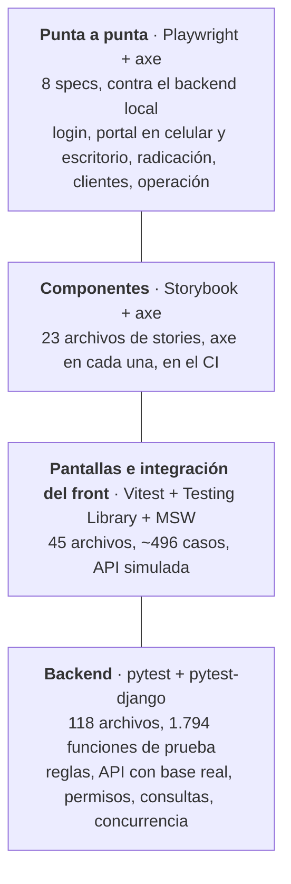
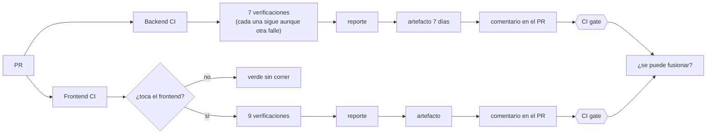
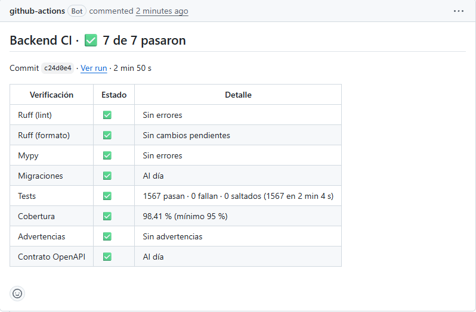

# 09 · Calidad

> **En simple:** nada entra a `master` sin pasar dos revisiones automáticas, una del backend y otra del frontend. Cada una corre linters, tipos, pruebas, cobertura mínima y la verificación del contrato, y deja un **reporte en el PR** con lo que pasó. Debajo hay una pirámide de pruebas: muchas pruebas rápidas de reglas y de API, pruebas de pantallas con la API simulada, y pruebas de punta a punta en el navegador con revisión de accesibilidad.

La estrategia de pruebas viene de REQ §10 ([`docs/REQUERIMIENTOS_MVP_CREDITO.md`](../REQUERIMIENTOS_MVP_CREDITO.md)). Números contados en `master` el **18 de noviembre de 2026**, sin correr ninguna suite (las cuentan las funciones de prueba, no las ejecuciones).

---

## Índice

1. [La pirámide](#1-la-pirámide)
2. [Los números](#2-los-números)
3. [El CI: dos revisiones obligatorias](#3-el-ci-dos-revisiones-obligatorias)
4. [El reporte en cada PR](#4-el-reporte-en-cada-pr)
5. [El contrato verificado](#5-el-contrato-verificado)
6. [Accesibilidad y la regla de colores](#6-accesibilidad-y-la-regla-de-colores)
7. [Qué no cubre el CI](#7-qué-no-cubre-el-ci)
8. [Las auditorías](#8-las-auditorías)

---

## 1. La pirámide

*Qué mirar: la base es la más ancha y la más barata. La mayoría de las reglas se prueban en el backend contra una base PostgreSQL real; las pantallas se prueban con la API simulada; y solo los recorridos completos usan el navegador.*

| Nivel | Herramienta | Qué prueba | Dónde |
| --- | --- | --- | --- |
| Backend | pytest, pytest-django, factory-boy, freezegun | Servicios, reglas, la API con la base real (PostgreSQL), la matriz de permisos por rol, el número de consultas, la concurrencia con hilos, las migraciones de ida y vuelta, el contrato | `backend/tests/` |
| Front: unidades e integración | Vitest, Testing Library, MSW | Cada pantalla con la API simulada: carga, errores de la API en su campo, `409 STALE_VERSION`, solo lectura, permisos | `frontend/src/**/*.test.ts(x)`; servidor MSW en `frontend/src/test/msw-server.ts` |
| Componentes | Storybook 10 + addon de accesibilidad | Cada estado de cada componente y `axe` sobre cada story | `frontend/src/components/ui/*.stories.tsx`, `frontend/src/stories/` |
| Punta a punta | Playwright + `@axe-core/playwright` | Recorridos reales contra el backend local con los datos de demo, en 1440 px, 1280 px y 390 px (con pantalla táctil) | `frontend/e2e/` |

Reglas que se repiten en todas las specs:

- **MSW sin manejadores globales:** cada prueba declara qué responde la API (`server.use`), y una petición no declarada hace fallar la prueba (`onUnhandledFrame: "error"` en `frontend/src/test/setup.ts`).
- **Tiempo congelado** con `freezegun` donde importa la fecha de Bogotá (vencimientos, "Mi día"); el login se hace **dentro** del bloque congelado, porque un JWT emitido con la hora real no vale en otra fecha (P1.11 de [`specs/TAREA-tareas-actividad.md`](../../specs/TAREA-tareas-actividad.md)).
- **Pruebas acotadas en local, suite completa en el CI:** con varios agentes en la misma máquina y poca memoria, cada agente corrió solo las pruebas de lo que tocó, con su propia base de pruebas (`DATABASE_NAME` propio); la suite completa la corre siempre el CI.

## 2. Los números

| Qué | Cuánto | Cómo se contó |
| --- | ---: | --- |
| Pruebas del backend | **1.794** funciones en **118** archivos | `def test_` en `backend/tests/` (sin las combinaciones de `@pytest.mark.parametrize`, que se usa 198 veces) |
| Cobertura mínima del backend | **95 %** | `CI_COVERAGE_MIN: "95"` en `.github/workflows/backend.yml` |
| Pruebas del front | **45** archivos, **~496** casos | `*.test.ts(x)` y `it(`/`test(` en `frontend/` |
| Cobertura mínima del front | **70 %** de líneas | `CI_COVERAGE_MIN: "70"` en `.github/workflows/frontend.yml`, aplicado por `frontend/scripts/ci-report.ts --check-coverage` (REQ §10.5) |
| Stories | **23** archivos `*.stories.tsx` y **17** páginas MDX | `frontend/src/` |
| Punta a punta | **8** specs (~33 pruebas, algunas en bucle por tema o tamaño) | `frontend/e2e/backoffice/*.spec.ts` y `frontend/e2e/portal/portal.spec.ts` |
| Aserciones de número de consultas | **48** en 20 archivos | `CaptureQueriesContext` y `django_assert_*num_queries` |

Las pruebas del backend por módulo están en [06 · Módulos](06-modulos.md#índice).

## 3. El CI: dos revisiones obligatorias

Dos workflows en `.github/workflows/`, uno por lado del monorepo, que corren en cada `push` a `master` y en cada PR:

| | Backend CI | Frontend CI |
| --- | --- | --- |
| Job obligatorio | **"Lint, types and tests"** | **"Frontend: lint, types and tests"** |
| Grupo de concurrencia | `ci-${{ github.ref }}` | `ci-frontend-${{ github.ref }}` |
| Servicios | PostgreSQL 16 | — |
| Verificaciones | Ruff (lint), Ruff (formato), Mypy, migraciones al día (`makemigrations --check`), pytest, cobertura ≥ 95 %, contrato OpenAPI al día | ESLint, Prettier, TypeScript, Vitest, cobertura ≥ 70 %, tipos de la API al día, `next build`, Storybook compila, accesibilidad de Storybook |
| Si el PR no toca su zona | Corre igual | Pasa en verde sin correr las verificaciones ("El PR no toca el frontend: verificaciones omitidas") si ningún archivo cambiado está en `frontend/`, `contracts/openapi.json`, `design/generated/`, `design/README.md` o su propio workflow |

Los dos jobs son los **checks obligatorios** del ruleset `protect-master` de GitHub ([`specs/TAREA-ci-reporte.md`](../../specs/TAREA-ci-reporte.md); [`specs/TAREA-frontend-base.md`](../../specs/TAREA-frontend-base.md), F0): sin los dos en verde, el PR no se fusiona.

*Qué mirar: las verificaciones no se cortan en la primera que falla. Todas corren, el reporte las junta, y al final un paso **CI gate** decide si el job queda en rojo.*

Decisiones de diseño (Precisiones de [`specs/TAREA-ci-reporte.md`](../../specs/TAREA-ci-reporte.md) y comentarios de los workflows):

- **Todas las verificaciones con `continue-on-error`** y un paso final **"CI gate"** que falla si alguna falló o si la instalación no terminó (`::error title=CI gate::<verificación>: …`). Así un PR muestra **todos** sus problemas de una vez, no uno por corrida.
- **Grupos de concurrencia distintos.** Si los dos workflows usaran el mismo grupo (`ci-<ref>`), uno cancelaría al otro con `cancel-in-progress`. El del front es `ci-frontend-<ref>` y el comentario lo explica (`.github/workflows/frontend.yml`, línea 10).
- **Sin filtro `paths:` en el `on:`.** Con un filtro, un PR que no toca el frontend no correría el workflow y el check obligatorio quedaría pendiente para siempre; por eso el filtrado se hace **adentro** del job (paso "Detect frontend changes") y el job pasa en verde ([`specs/TAREA-monorepo.md`](../../specs/TAREA-monorepo.md)).
- **Acciones fijadas por SHA** completo, con la versión en un comentario.
- **Las advertencias de pytest nunca hacen fallar** el job; se reportan aparte.

## 4. El reporte en cada PR

Cada workflow arma un reporte en Markdown y lo deja como **un solo comentario** en el PR, que se actualiza en cada corrida (lo encuentra por una marca oculta: `<!-- ci-report:backend -->` y `<!-- ci-report:frontend -->`). El mismo reporte va al resumen de la corrida y como artefacto por 7 días.

*Una corrida real del reporte en un PR (`docs/images/ci-report.png`).*

- **Backend:** `backend/scripts/ci_report.py`, solo con la biblioteca estándar de Python. Filas: Ruff (lint), Ruff (formato), Mypy, Migraciones, Tests, Cobertura, Advertencias (no bloquea) y Contrato OpenAPI. Incluye las pruebas que fallaron, los 5 módulos con menos cobertura y las rutas y esquemas que cambiaron en el contrato. Si el reporte supera 60.000 caracteres, recorta el detalle.
- **Frontend:** `frontend/scripts/ci-report.ts`, "mismo formato que `backend/scripts/ci_report.py`", en Node sin dependencias. Filas: ESLint, Prettier (formato), TypeScript, Tests, Cobertura, Contrato API, Build, Storybook y Accesibilidad (Storybook).
- **Estados:** ✅ pasó, ⚠️ pasó con advertencias, ❌ falló, ⏭️ no corrió. El título resume ("❌ N de M fallaron…").
- **El reporte nunca hace fallar el job:** si algo sale mal al armarlo, escribe "No se pudo generar el reporte" y sigue. Quien decide es el CI gate.
- **Probado:** `backend/tests/ci/test_ci_report.py` (30 pruebas) y `frontend/scripts/ci-report.test.ts`.

## 5. El contrato verificado

El contrato es la frontera entre backend y frontend ([ADR 0002](../adr/0002-contrato-openapi-generado.md)), así que se verifica **desde los dos lados**:

| Lado | Verificación | Falla si |
| --- | --- | --- |
| Backend | `manage.py spectacular --validate --fail-on-warn` y `git diff --exit-code -- ../contracts/openapi.json` | El código cambió la API y nadie regeneró el contrato, o el esquema tiene advertencias |
| Frontend | `pnpm api:gen` y `git diff --exit-code -- src/lib/api/schema.d.ts` | El contrato cambió y nadie regeneró los tipos del front |
| Backend | `backend/tests/test_contract_names.py` | drf-spectacular renombró un enum ya publicado |
| Backend | `backend/tests/test_etag_contract.py` | Una operación con `If-Match` no declara su `ETag` |
| Backend | `test_the_contract_declares_the_header_in_the_idempotent_operations` en `backend/tests/applications/idempotency/test_idempotency.py` | La lista de operaciones con `Idempotency-Key` no es la esperada |

## 6. Accesibilidad y la regla de colores

- **`axe` en cada story, en cada PR:** el paso "Storybook (a11y)" corre las stories en Chromium con `axe` y falla con violaciones serias o críticas (`frontend/.storybook/preview.tsx`; `.github/workflows/frontend.yml`).
- **`axe` en las pruebas de punta a punta**, en cada pantalla, en claro y en oscuro (`frontend/e2e/backoffice/fixtures.ts`).
- **La regla de colores:** ningún color se escribe a mano. `frontend/src/test/no-hardcoded-colors.test.ts` falla si encuentra un hex, `rgb()` o `hsl()` en `frontend/src/` (también en CSS y MDX; quedan fuera las pruebas y el `schema.d.ts` generado). Todo color sale de los tokens de `design/`, que tienen su propio reporte de contraste (`design/generated/contrast-report.md`). Y el color nunca va solo: cada estado lleva su texto.

La auditoría de consistencia del design system (Parte 3 de [`specs/TAREA-design-system.md`](../../specs/TAREA-design-system.md)) dejó estas reglas en el CI y corrigió lo que encontró: colores fijos pasados a tokens, tamaños fuera de la escala, y objetivos táctiles chicos en el portal.

## 7. Qué no cubre el CI

Dicho claro, para no sobrevender:

- **Las pruebas de punta a punta no corren en el CI:** necesitan el backend con los datos de demo y se corren en local (`pnpm e2e`). Cada corrida hace login, y el límite de 5 intentos en 15 minutos obliga a juntar los specs en una sola corrida (en local se puede aflojar con `AUTH_RATE_LIMIT_MULTIPLIER`, solo con `DEBUG`).
- **No hay análisis de dependencias ni detección de secretos** en los workflows (REQ §9.5); Dependabot quedó pendiente ([`specs/TAREA-ci-reporte.md`](../../specs/TAREA-ci-reporte.md), al final).
- **No hay pruebas de carga** en el CI: son parte de la auditoría de carga del backend ([§8](#8-las-auditorías)).

## 8. Las auditorías

Tres revisiones independientes, con su informe y su seguimiento hasta la corrección:

| Auditoría | Informe | Estado |
| --- | --- | --- |
| Seguridad | `docs/SEGURIDAD.md` *(en curso)* | En curso (rama `chore/security-audit`) |
| Performance del frontend | `docs/PERFORMANCE.md` *(en curso)* | En preparación |
| Carga y estrés del backend | `docs/PERFORMANCE.md` *(en curso)* | En preparación |

El resumen con cada hallazgo y cómo se solucionó está en [12 · Auditorías](12-auditorias.md).

---

Siguiente: [10 · Operación local](10-operacion-local.md) — cómo correrlo.
