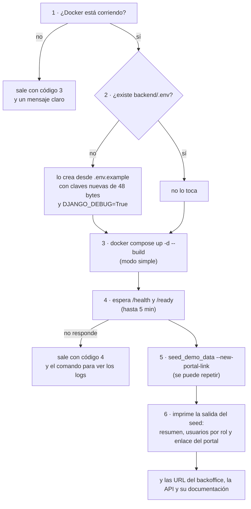

# 10 · Operación local

> **En simple:** el proyecto corre en tu máquina con Docker. Un solo comando (`./demo.ps1` en Windows o `./demo.sh` en Linux y macOS) prepara la configuración, levanta tres contenedores, espera a que la API esté lista, carga datos de demo y te dice dónde entrar y con qué usuario. Este documento explica ese comando, los dos modos de correr el proyecto, los comandos útiles, un recorrido sugerido por cada rol y los problemas más comunes.

Cómo están armadas las piezas: [03 · Arquitectura §2 y §8](03-arquitectura.md#2-contenedores-las-piezas-que-corren). El detalle en inglés, con todos los comandos del backend, está en [`backend/README.md`](../../backend/README.md).

---

## Índice

1. [Requisitos](#1-requisitos)
2. [La demo en un comando](#2-la-demo-en-un-comando)
3. [Recorrido sugerido por rol](#3-recorrido-sugerido-por-rol)
4. [Los dos modos](#4-los-dos-modos)
5. [Puertos](#5-puertos)
6. [Comandos útiles](#6-comandos-útiles)
7. [Detener sin perder datos](#7-detener-sin-perder-datos)
8. [Problemas comunes](#8-problemas-comunes)
9. [Cómo se probaron los scripts](#9-cómo-se-probaron-los-scripts)

---

## 1. Requisitos

| Para | Necesitas |
| --- | --- |
| Correr la demo | **Docker Desktop** (o Docker Engine) con **Compose v2** (`docker compose`), corriendo. Git para clonar. |
| El script de Windows | **PowerShell 7.2 o superior** (`pwsh`). No sirve el Windows PowerShell 5.1. |
| El script de Linux y macOS | **bash** (sirve el 3.2 que trae macOS) y `curl`. En Windows también corre con Git Bash. |
| Programar el frontend | Node 24 y pnpm (con `corepack`). |

No hace falta instalar Python ni crear un entorno virtual: el backend corre dentro de su contenedor (`backend/README.md`, "Prerequisites").

## 2. La demo en un comando

Desde la raíz del repositorio:

```powershell
# Windows (PowerShell 7)
./demo.ps1
```

```bash
# Linux, macOS o Git Bash
./demo.sh        # o: bash demo.sh
```

### Qué hace, paso a paso



*Qué mirar: el `.env` existente **nunca** se toca, y el seed se puede correr las veces que quieras: agrega solo lo que falta y no borra ni duplica. Lo único que cambia en cada corrida es el enlace del portal: siempre sale uno nuevo.*

1. **Docker.** Revisa que existan `docker` y `docker compose` y que Docker responda. Si no, sale con un mensaje en español y el código 3.
2. **`backend/.env`.** Si **no existe**, lo crea copiando `backend/.env.example` y escribe `DJANGO_SECRET_KEY` y `AUTH_JWT_SIGNING_KEY` nuevas (48 bytes de un generador criptográfico, en base64 de URL: 64 caracteres) y `DJANGO_DEBUG=True`. Conserva el resto del archivo tal cual, incluido su fin de línea. **Si ya existe, no lo toca nunca.**
3. **Contenedores.** `docker compose up -d --build` desde `backend/`: `postgres`, `backend` y `frontend`. La primera vez construye las imágenes y tarda varios minutos.
4. **Salud.** Espera a que `http://localhost:8000/health` (el proceso responde) y `/ready` (la base responde) devuelvan `200`, con un máximo de 300 segundos (600 en el modo completo). Al arrancar, el backend aplica las migraciones solo.
5. **Datos de demo.** Corre `python manage.py seed_demo_data --new-portal-link` dentro del contenedor. El comando solo funciona con `DEBUG` y nunca borra nada. Cada uno de sus 16 bloques tiene su marca y se salta si ya existe, así que en una base con una demo vieja agrega solo lo que falta. Sin `--new-portal-link`, si ya hay un enlace del portal sin usar, el comando no emite otro y no imprime ninguna URL (el token solo se ve al emitirlo); con la opción emite uno nuevo y revoca el anterior, así que **la demo siempre muestra un enlace que sirve**.
6. **Resumen.** El script **imprime la salida del seed tal cual**: un resumen por bloque (`creados (N)` o `ya existían`), la **tabla de usuarios por rol** con la contraseña de demo y el **enlace del portal del comprador** (de un solo uso, 72 horas) con el código de su solicitud. Después agrega las URL:

| Qué | Dónde |
| --- | --- |
| Backoffice | http://localhost:3000/login |
| Portal del comprador | El enlace que imprime el seed (`http://localhost:3000/acceso?token=…`) |
| API | http://localhost:8000/api/v1/ |
| Documentación interactiva de la API | http://localhost:8000/docs (solo con `DEBUG`) |
| Salud | http://localhost:8000/health y /ready |

Los usuarios de demo, con la contraseña de demo `DemoUmbral2026!` (está escrita en el código, `backend/apps/applications/demo_data.py`; **solo para local**). Es la tabla que imprime el comando, con los textos de `backend/apps/applications/demo_seed.py` (`PURPOSES`) y de `backend/README.md`, "Demo Data":

| Rol | Correo | Para qué |
| --- | --- | --- |
| `ADMIN` | `admin@demo.local` | Ve todo: administración, reportes, comisiones y auditoría |
| `ADVISOR` | `asesora.lucia@demo.local` | Asesora con cartera: Mi día, solicitudes, tareas y radicaciones |
| `ADVISOR` | `asesor.andres@demo.local` | El otro asesor; sin teléfono (el portal no muestra WhatsApp) |
| `INDEPENDENT_BROKER` | `broker@demo.local` | Sus prospectos, el resumen de sus solicitudes y sus comisiones |
| `CONSTRUCTION_PARTNER` | `constructora@demo.local` | Su constructora y sus proyectos |
| `ADVISOR` (inactivo) | `inactivo@demo.local` | No puede entrar: el login responde `403` |

La tabla que imprime el seed manda sobre esta: si cambia, el script no hay que tocarlo.

**Qué trae la demo** (`backend/README.md`, "Demo Data"; `backend/apps/applications/demo_seed.py`, 16 bloques en orden de dependencia):

| Qué | Cuánto y en qué estados |
| --- | --- |
| Solicitudes | **64**, creadas en los últimos seis meses y repartidas entre Lucía y Andrés; el broker originó un tercio. La demo base: 30 en las pestañas borrador, esperando documentos, en revisión y lista (una lista pero bloqueada y una con el comprador inactivo por asesor) y 4 radicadas. La historia de seis meses: 30 más, cerradas antes de radicar (cancelada, recursos propios, crédito externo, desistida), radicadas con **cada respuesta del banco** (recibida, en análisis, devuelta, devuelta y corregida con segunda radicación, aprobada, legalización, rechazada, desembolsada), una desistida después de radicar y una radicada sin respuesta y ya **vencida** |
| Comisiones | Un plan de 1 % con reparto 70/30 por producto. Liquidaciones pendientes, pagadas, una parte pagada con **revisión pendiente** (un desembolso corregido), una anulada y liquidada de nuevo; con broker (70/30) y directas (100 %) |
| Tareas, notas y actividad | Tareas vencidas, de hoy, próximas, completadas y canceladas de los dos asesores; notas en clientes, oportunidades y solicitudes |
| Avisos y correos | Avisos del comprador leídos y sin leer; un correo fallido con reintento programado y otro fallido del todo |
| Oportunidades | En todos los estados: nueva, asignada, contactada, en gestión, convertida, perdida (con motivo) y cancelada |
| Constructoras y proyectos | Constructora Andina de Demo (activa, de `constructora@demo.local`) con seis proyectos: dos activos, uno en validación, uno en borrador, uno devuelto a borrador con motivo y uno archivado. Inmobiliaria del Valle de Demo, inactiva y con una membresía inactiva (`backend/apps/partners/demo_data.py`) |
| Usuarios e invitaciones | El usuario inactivo e invitaciones pendiente, aceptada, vencida y revocada (`backend/apps/identity/demo_data.py`) |
| Bancos y reglas | Un producto inactivo (VIS del Banco de Bogotá); en el hipotecario de Bancolombia, "Plazo máximo" con tres versiones (v1 reemplazada, v2 activa y v3 en borrador) y "Relación monto / valor" como advertencia (`backend/apps/banking/demo_data.py`) |
| Reportes y auditoría | Dos exportaciones (completada y vencida); eventos de auditoría: inicios de sesión correctos y fallidos, un `403`, descargas de documentos y una exportación |

Las fechas están en el pasado de verdad: cada solicitud de la historia se crea con los servicios del dominio y después se mueve atrás en el tiempo, conservando el orden real (un desembolso nunca queda antes de su radicación). La primera corrida tarda unos dos minutos; las siguientes, unos segundos.

### Opciones

| Windows | Linux / macOS | Qué hace |
| --- | --- | --- |
| `./demo.ps1` | `./demo.sh` | Levanta el modo simple, carga los datos y muestra el acceso |
| `./demo.ps1 -Full` | `./demo.sh --full` | Lo mismo con el perfil `full` (Redis, SeaweedFS, worker y ClamAV). Ver [§4](#4-los-dos-modos): el backend solo los usa si `backend/.env` tiene activo el bloque "Full" |
| `./demo.ps1 -Stop` | `./demo.sh --stop` | Detiene todos los contenedores **sin borrar nada** |
| `./demo.ps1 -Reset` | `./demo.sh --reset` | Borra contenedores **y volúmenes** (base de datos y documentos). Pide escribir `BORRAR` y solo funciona en una terminal interactiva. `backend/.env` no se toca |
| `./demo.ps1 -Help` | `./demo.sh --help` | Muestra la ayuda |

Variables opcionales del entorno: `DEMO_TIMEOUT_SECONDS` (espera máxima de la API) y `BACKEND_HOST_PORT` / `FRONTEND_HOST_PORT` (si cambiaste los puertos; el script también los lee de `backend/.env`). Los colores se apagan solos si la salida no es una terminal, o con `NO_COLOR=1`.

### Códigos de salida

| Código | Significa |
| ---: | --- |
| 0 | Todo bien |
| 1 | Error (no se pudo crear `.env`, falló `docker compose` o el seed) |
| 2 | Opciones inválidas (por ejemplo, detener y borrar a la vez) |
| 3 | Docker no está instalado o no está corriendo |
| 4 | La API no respondió a tiempo |
| 5 | Borrado cancelado (no se escribió `BORRAR` o no había terminal) |

### Dónde está el código

| Archivo | Qué tiene |
| --- | --- |
| `demo.ps1`, `demo.sh` | Los pasos con Docker, en la raíz |
| `scripts/demo/DemoLib.psm1`, `scripts/demo/demo-lib.sh` | La lógica sin Docker: argumentos, generación de claves, creación de `.env`, espera y confirmación |
| `scripts/demo/DemoLib.Tests.ps1`, `scripts/demo/test-demo-lib.sh` | Sus pruebas ([§9](#9-cómo-se-probaron-los-scripts)) |

## 3. Recorrido sugerido por rol

Un recorrido por cada rol, con las pantallas que existen hoy en `frontend/src/app/` y los datos que trae la demo ([§2](#2-la-demo-en-un-comando)). Entra a http://localhost:3000/login con cada usuario (la contraseña es la misma) y cierra la sesión entre uno y otro. Cada usuario ve en el menú solo lo que sus permisos y su audiencia abren ([08 · Frontend §7](08-frontend.md#7-navegación-por-permisos)).

### Administrador (`admin@demo.local`)

1. **Dashboard** (`/dashboard`): con seis meses de historia, cambia el rango de fechas y mira el resumen, el **embudo por cohorte**, la carga por asesor y los resultados por banco. Filtra por un asesor.
2. **Solicitudes** (`/solicitudes`): recorre las pestañas rápidas, busca por código y filtra por banco; copia la URL y ábrela en otra pestaña: abre la misma vista.
3. Abre una solicitud **devuelta por el banco** y mira la pestaña **Radicación**: radicaciones, respuestas y la observación por documento. Busca también la **devuelta y corregida** (dos radicaciones) y la radicada sin respuesta que ya está **vencida**.
4. **Reportes** (`/reportes`): mira las dos exportaciones de la demo (una completada y una vencida), descarga el CSV directo y pide una **exportación asíncrona**; descárgala cuando termine.
5. **Comisiones** (`/comisiones`), pestaña **Liquidaciones**: filtra por "revisión pendiente" y abre esa liquidación (una parte ya pagada sobre un desembolso corregido); **paga** una parte pendiente con fecha y referencia, y mira la liquidación **anulada** y la que la reemplazó. Pestaña **Planes**: el plan de 1 % con reparto 70/30 de cada producto.
6. **Usuarios** (`/admin/usuarios`): mira los usuarios por rol (con `inactivo@demo.local` desactivado) y la pestaña de **invitaciones** en sus cuatro estados (pendiente, aceptada, vencida y revocada); invita a alguien.
7. **Constructoras** (`/admin/constructoras`) y **Proyectos** (`/proyectos`): abre Constructora Andina de Demo, sus miembros y sus seis proyectos en cada estado; mira la Inmobiliaria del Valle de Demo, inactiva y con su membresía inactiva.
8. **Bancos** (`/admin/bancos`): el producto inactivo del Banco de Bogotá; en el hipotecario de Bancolombia, la regla "Plazo máximo" con sus tres versiones (reemplazada, activa y en borrador). Usa **"probar una regla"** con un caso.
9. **Documentos** (`/admin/documentos`), **Catálogos** (`/admin/catalogos`) y **Flujos** (`/admin/flujos`): mira los requisitos por producto, reordena los ítems de un catálogo y revisa las transiciones con su permiso y su guarda.

### Asesora (`asesora.lucia@demo.local`)

1. **Mi día** (`/mi-dia`): mira los segmentos (documentos por revisar, listas para radicar, observadas, comprador sin actividad…) y las tareas vencidas y de hoy; completa una tarea.
2. **Solicitudes**: confirma que solo ves **tus** solicitudes asignadas.
3. Abre una solicitud en **documentos en revisión**: en la pestaña **Documentos**, abre un archivo en el visor, **aprueba** uno y **rechaza** otro con motivo y mensaje para el comprador.
4. En una solicitud que todavía no está radicada, **edita el expediente** en el lugar: el inmueble, la financiación (solo productos elegibles) o un participante con sus ingresos. Después de radicar, la API ya no deja editar y la pantalla muestra su mensaje.
5. En una solicitud **lista para radicar**: pestaña **Radicación** → pide el **paquete** (queda en la lista de paquetes), descárgalo y **registra la radicación**.
6. Registra una **respuesta del banco** (por ejemplo, "en análisis"): el formulario pide los campos que el catálogo define para esa respuesta. Mira cómo cambia el estado y el historial.
7. En una solicitud **aprobada**: inicia la **legalización** y registra el **desembolso** con su monto. La comisión se liquida sola: como admin, la ves en la tarjeta "Comisión" del expediente y en `/comisiones`.
8. Desde el encabezado de una solicitud, **genera un enlace** para el comprador.
9. **Clientes** (`/clientes`): crea un cliente, ábrelo y crea una **oportunidad** (queda asignada a ti); muévela con sus botones o márcala **perdida** con un motivo; desde una abierta, crea la solicitud.
10. **Mis comisiones** (`/mis-comisiones`): tus partes con su estado, filtrables por fechas y estado.
11. Intenta abrir por URL una solicitud de Andrés: la API responde que no existe (`404`), porque no es tuya.

### Asesor (`asesor.andres@demo.local`)

1. **Mi día**: compara con el de Lucía; cada asesor ve lo suyo.
2. Abre una solicitud **devuelta por el banco** (`BANK_OBSERVATION`): mira qué documento observó el banco.
3. Cuando el comprador lo reemplace (recorrido del comprador), **aprueba** la versión nueva: la observación queda resuelta.
4. Marca la solicitud **lista para radicar de nuevo**, pide otro paquete y registra la **segunda radicación**.
5. **Proyectos** (`/proyectos`): **aprueba** "Altos de la Sabana", que la constructora envió a validación, o devuélvelo con un motivo.
6. **Reportes**: confirma que solo aparecen tus solicitudes. Un filtro por otro asesor lo rechaza la API con `403 FILTER_OUT_OF_SCOPE`.
7. Genera un enlace en una de tus solicitudes y ábrelo: en el portal, la tarjeta del asesor no muestra WhatsApp porque Andrés no tiene teléfono.

### Broker (`broker@demo.local`)

1. Entra a **Mis prospectos** (`/prospectos`), su inicio. El menú solo tiene "Mis prospectos" y "Mis comisiones": sin dashboard, solicitudes, clientes, proyectos ni administración.
2. Pestaña **Prospectos**: sus oportunidades, filtradas por estado (las nuevas esperan asesor; las convertidas ya tienen solicitud).
3. **"Nuevo prospecto"**: crea el cliente y su oportunidad (con un proyecto activo, por ejemplo "Torres del Parque"). Queda nueva y sin asesor hasta que la asignen.
4. Pestaña **Solicitudes**: "Estado de tus solicitudes" con los conteos por estado, y la lista con estado, banco, asesor y días en la etapa. Es solo el **resumen**: sin documentos, participantes ni finanzas (la API se los niega con `403`).
5. **"Enviar enlace"** en una solicitud: genera el enlace del portal para el comprador.
6. **Mis comisiones** (`/mis-comisiones`): sus partes (el 30 % de la comisión de cada desembolso que originó) con su estado, sin la base, la tasa, el total ni la parte del asesor.
7. Intenta abrir `/solicitudes` o `/admin/usuarios` por URL: la app lo devuelve a su bandeja.

### Constructora (`constructora@demo.local`)

1. Mira el menú: solo **Proyectos**.
2. **Proyectos**: solo ves los seis de **tu** constructora (Andina), sin la columna ni el filtro de constructora: activos, en validación, en borrador, devuelto con motivo y archivado.
3. **Crea un proyecto** en borrador (nombre, municipio, dirección): no eliges constructora, la API la toma de tu membresía.
4. Edita "Mirador del Río" (en borrador) y **envíalo a validación**. Abre "Reserva Campestre" y lee el motivo con que se devolvió.
5. Abre un proyecto activo: ya no se puede editar (solo en borrador).
6. Intenta abrir `/solicitudes` por URL: no es tuyo, la app te devuelve a Proyectos.
7. Después, como asesor, apruébalo (recorrido del asesor, paso 5).

### Usuario inactivo (`inactivo@demo.local`)

Intenta entrar: el login responde `403 USER_INACTIVE` y la pantalla muestra el mensaje de la API. Como admin, actívalo en **Usuarios** y vuelve a probar.

### Comprador (el enlace que imprimió el seed)

1. Abre el enlace en el **celular** (o en el modo móvil del navegador, 390 px): la URL pierde el token apenas entra. Es una solicitud de la demo base que espera documentos y todavía no tiene ninguno cargado.
2. **Consentimientos**: lee y acepta; sin aceptarlos, el portal no te deja guardar nada.
3. **Inicio** (`/portal`): el avance por etapas, lo que falta y la tarjeta de tu asesor con correo y WhatsApp.
4. **Tus datos** (`/portal/datos`): cambia tu teléfono; prueba un correo mal escrito y mira el error en el campo.
5. **Ingresos** (`/portal/ingresos`): agrega una fuente de ingreso y **confirma tus datos**.
6. **Financiación** (`/portal/financiacion`): elige un producto disponible; los no disponibles no se pueden elegir.
7. **Documentos** (`/portal/documentos`): sube un PDF o **toma una foto**; queda "En revisión". Prueba un archivo que no sea PDF, JPG ni PNG.
8. **Avisos** (`/portal/avisos`): mira los avisos y márcalos como leídos.
9. Abre el mismo enlace otra vez: ya no sirve (es de un solo uso). Pide otro al asesor, o vuelve a correr la demo: cada corrida emite uno nuevo.

> Este recorrido se escribió con las rutas, los permisos y los datos de demo de `master` del 19 de noviembre (después del #33 y del #36); la demo de punta a punta se corre cuando el orquestador lo indique (ver [§9](#9-cómo-se-probaron-los-scripts)).

## 4. Los dos modos

El `.env` decide **cómo** se configura el backend y el perfil de compose decide **qué contenedores** corren. Cambiar de modo siempre son los dos pasos ([03 · Arquitectura §8](03-arquitectura.md#8-los-dos-modos-locales); `backend/README.md`, "Local Modes").

| | Simple (por defecto) | Completo (perfil `full`) |
| --- | --- | --- |
| Contenedores | `postgres`, `backend`, `frontend` | Además `redis`, `seaweedfs`, `storage-init`, `worker` y `clamav` |
| Documentos | Disco, en el volumen `mvp_credit_documents_data` | SeaweedFS por la API de S3 |
| Descargas | URL firmada del backend (`/api/v1/storage/objects/{token}`) | URL prefirmada de S3 (`http://localhost:8333`) |
| Caché de los límites | Tabla de PostgreSQL | Redis |
| Tareas (antivirus, paquetes) | En el mismo proceso | Worker de Celery |
| Antivirus | Escáner de prueba | ClamAV |

**Pasar al modo completo:**

1. En `backend/.env`, comenta el bloque "Local simple" y descomenta el bloque "Full" (incluidas las claves de SeaweedFS, sin las que no arranca).
2. `./demo.ps1 -Full` (o `./demo.sh --full`). ClamAV baja sus firmas la primera vez: varios minutos.
3. Comprueba: `docker compose exec -T backend python manage.py check_document_services` (desde `backend/`).

Al arrancar, el log del backend dice con qué modo arrancó: `Servicios locales: almacenamiento=… · caché=… · tareas=… · antivirus=…` (`docker compose logs backend`). Si no coincide con el perfil, `.env` y perfil no están de acuerdo.

## 5. Puertos

| Puerto | Servicio | Modo |
| ---: | --- | --- |
| 3000 | Frontend (Next.js) | Los dos |
| 8000 | Backend (API, `/docs`, `/health`, `/ready`) | Los dos |
| 5433 | PostgreSQL (en el host; adentro es el 5432) | Los dos |
| 8333 | SeaweedFS (S3) | Completo |

Se cambian con `FRONTEND_HOST_PORT`, `BACKEND_HOST_PORT`, `POSTGRES_HOST_PORT` y `DOCUMENT_STORAGE_HOST_PORT` en `backend/.env` (`backend/docker-compose.yml`). Redis, el worker y ClamAV no publican puertos: solo están en la red interna.

## 6. Comandos útiles

Todos desde `backend/` (`backend/README.md`, "Common Commands"):

```powershell
# Estado y logs
docker compose ps
docker compose logs -f backend
docker compose logs -f frontend

# Migraciones (también corren solas al arrancar el backend)
docker compose exec -T backend python manage.py migrate
docker compose exec -T backend python manage.py showmigrations

# Datos de demo (se puede repetir; --new-portal-link emite otro enlace del portal)
docker compose exec -T backend python manage.py seed_demo_data --new-portal-link

# Limpiar los límites de intentos (por ejemplo, después de un 429 en el login)
docker compose exec -T backend python manage.py shell -c "from django.core.cache import cache; cache.clear()"

# Recalcular la completitud guardada del listado
docker compose exec -T backend python manage.py refresh_application_completeness

# Reintentar correos y análisis pendientes
docker compose exec -T backend python manage.py retry_notification_deliveries
docker compose exec -T backend python manage.py requeue_pending_scans

# Verificar almacenamiento y antivirus
docker compose exec -T backend python manage.py check_document_services

# Reconstruir solo el frontend después de cambiar su código
docker compose up -d --build frontend
```

Los límites de intentos viven en la caché compartida (la tabla `django_cache` en el modo simple, Redis en el completo), por eso `cache.clear()` los reinicia. Para las corridas de Playwright en local se puede aflojar con `AUTH_RATE_LIMIT_MULTIPLIER=20` en `backend/.env`, que **solo** se aplica con `DJANGO_DEBUG=True` ([04 · System design §7](04-system-design.md#7-límites-de-consumo)).

**Programar el frontend** con recarga en caliente: `docker compose up -d postgres backend` (sin el contenedor `frontend`, que usaría el puerto 3000) y en `frontend/`, `pnpm install` y `pnpm dev`.

## 7. Detener sin perder datos

| Quieres | Comando | ¿Se pierden datos? |
| --- | --- | --- |
| Pausar todo | `./demo.ps1 -Stop` / `./demo.sh --stop` (o `docker compose stop` en `backend/`) | No |
| Quitar los contenedores | `docker compose down` en `backend/` | No: los volúmenes quedan |
| Empezar de cero | `./demo.ps1 -Reset` / `./demo.sh --reset` | **Sí**: borra la base y los documentos (pide `BORRAR`) |

Los datos viven en volúmenes con nombre fijo (`mvp_credit_postgres_data`, `mvp_credit_documents_data` y, en el modo completo, `mvp_credit_redis_data`, `mvp_credit_seaweedfs_data` y `mvp_credit_clamav_data`). Solo `down --volumes` (lo que hace `-Reset`) los borra.

## 8. Problemas comunes

| Síntoma | Causa | Qué hacer |
| --- | --- | --- |
| `401 SESSION_EXPIRED` al azar, en cualquier pantalla o prueba | El reloj de la máquina virtual de Docker se atrasa o adelanta varios segundos y los JWT dejan de valer (`nbf`/`iat`) | Reiniciar Docker Desktop (el arreglo es del host, no del código). Ver [11 · Cómo se construyó §7](11-como-se-construyo.md#7-errores-reales-que-se-atraparon) |
| `Bind for 0.0.0.0:3000 failed: port is already allocated` (u 8000, 5433) | Otro proceso usa el puerto; a menudo un `pnpm dev` o `next dev` que quedó huérfano | En Windows: `netstat -ano \| findstr :3000` y `taskkill /PID <pid> /F`. O cambia el puerto en `backend/.env` |
| `pnpm` falla en Windows con un error del atajo | El atajo global de pnpm está roto en algunas instalaciones | Usa `corepack pnpm …` o `node <ruta>/pnpm/bin/pnpm.mjs …` |
| Todo `/api/v1/*` responde `400` y el log dice `DisallowedHost` | `DJANGO_ALLOWED_HOSTS` en `backend/.env` no incluye `backend` | Agrégalo (`.env.example` ya lo trae) |
| `429` en el login | 5 intentos por correo e IP cada 15 minutos | Espera, o limpia la caché ([§6](#6-comandos-útiles)) |
| El seed dice que todo "ya existía" menos el enlace del portal | Es idempotente: ya corrió antes. La demo pide siempre un enlace nuevo (`--new-portal-link`) | Nada; es lo esperado |
| Corriendo el comando a mano, el seed no imprime el enlace y dice que ya hay uno sin usar | Sin `--new-portal-link` no emite otro: el token solo se ve al emitirlo | Agrega `--new-portal-link` (revoca el anterior) |
| El enlace del portal dice que ya se usó o venció | Es de un solo uso y dura 72 h | Vuelve a correr la demo (imprime uno nuevo) o emítelo desde el encabezado de la solicitud (como asesor) |
| Una descarga responde `503 DOWNLOAD_UNAVAILABLE` | El archivo se subió en el otro modo | Vuelve al modo en que se subió; los archivos no se mueven entre modos |
| En el modo completo, las cargas quedan en "pendiente" | ClamAV todavía está bajando sus firmas | Espera a que `docker compose --profile full ps clamav` diga `healthy` |
| La API no está en `0.0.0.0` o `/docs` responde `404` | La fase B de la auditoría de seguridad (en curso) publica los puertos solo en `127.0.0.1` y deja `/docs` y `/openapi.json` solo con `DEBUG` | La demo corre con `DEBUG` y desde la misma máquina: funciona igual. Para entrar desde otra máquina de la red, eso ya no es posible a propósito |
| `demo.ps1` no se puede ejecutar por la política de ejecución | La política de PowerShell bloquea scripts | `pwsh -ExecutionPolicy Bypass -File ./demo.ps1` |
| `./demo.sh: Permission denied` | El archivo no tiene permiso de ejecución | `bash demo.sh`, o `chmod +x demo.sh` |
| `demo.ps1` dice que necesita la versión 7.2 | Se abrió con Windows PowerShell 5.1 | Ábrelo con `pwsh` (PowerShell 7) |

## 9. Cómo se probaron los scripts

La lógica que no necesita Docker está separada en `scripts/demo/` para probarla sin levantar nada. Corridas del 19 de noviembre de 2026:

| Prueba | Comando | Resultado |
| --- | --- | --- |
| Lógica en bash | `bash scripts/demo/test-demo-lib.sh` | 45 pruebas, 0 fallas (Git Bash 5.2) |
| La misma, con el bash de macOS | `docker run --rm -v <repo>:/w:ro bash:3.2 bash /w/scripts/demo/test-demo-lib.sh` | 45 pruebas, 0 fallas |
| Lógica en PowerShell | `pwsh -NoProfile -File scripts/demo/DemoLib.Tests.ps1` | 37 pruebas, 0 fallas (PowerShell 7.7) |
| Análisis estático | `shellcheck -x demo.sh scripts/demo/*.sh` (imagen `koalaman/shellcheck:v0.10.0`) | Sin avisos |
| Sintaxis de `demo.ps1` | `Parser::ParseFile` | 0 errores |
| Sin Docker en el `PATH` | Los dos scripts | Salen con código 3 y "No encuentro el comando docker" |
| Opciones inválidas | `--stop --reset` / `-Stop -Reset` | Salen con código 2 |

Qué cubren las pruebas: los argumentos; que las claves tengan 64 caracteres, sean distintas y válidas; que `backend/.env` se cree solo si no existe, con las dos claves nuevas, `DJANGO_DEBUG=True`, el resto de las líneas intactas, el mismo fin de línea (CRLF como el `.env.example` real), sin temporales y sin cambiar el ejemplo; que un `.env` existente quede **idéntico** (mismo hash); que sin `.env.example` falle sin crear nada; y que el borrado solo se confirme con `BORRAR` exacto. Las pruebas usan un `.env.example` de mentira en un directorio temporal: nunca leen ni tocan el real.

**Lo que falta:** correr la demo de punta a punta. Con otros agentes usando Docker y el puerto 8000, levantar el compose reiniciaría su backend (los contenedores y volúmenes tienen nombres fijos). Se corre cuando el orquestador lo indique y el resultado se agrega aquí.
